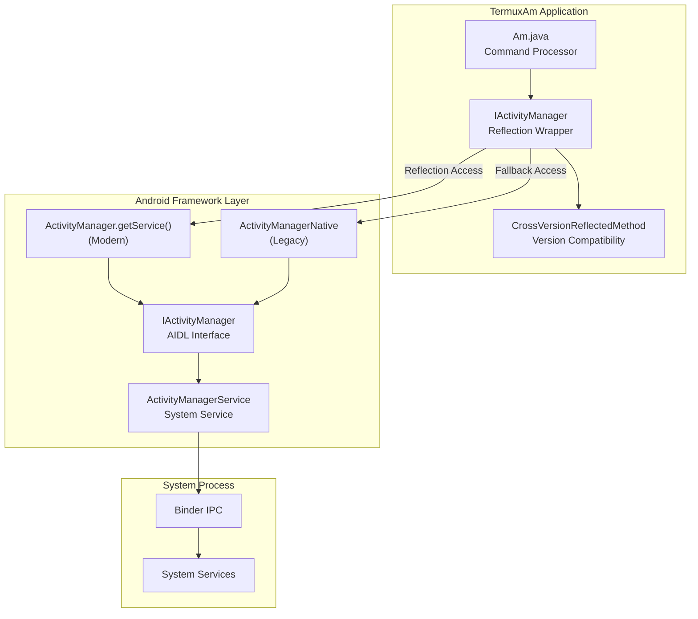
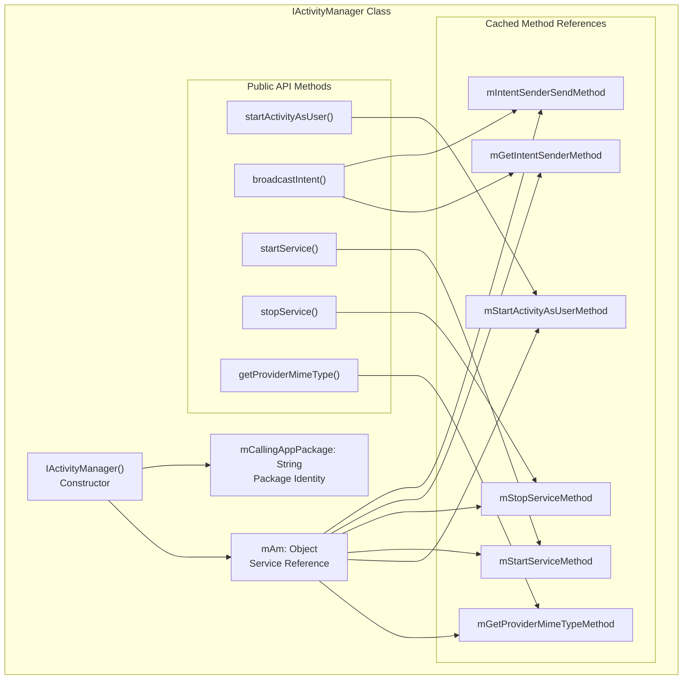
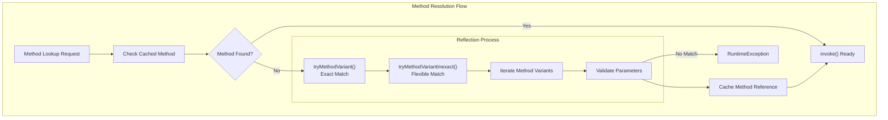
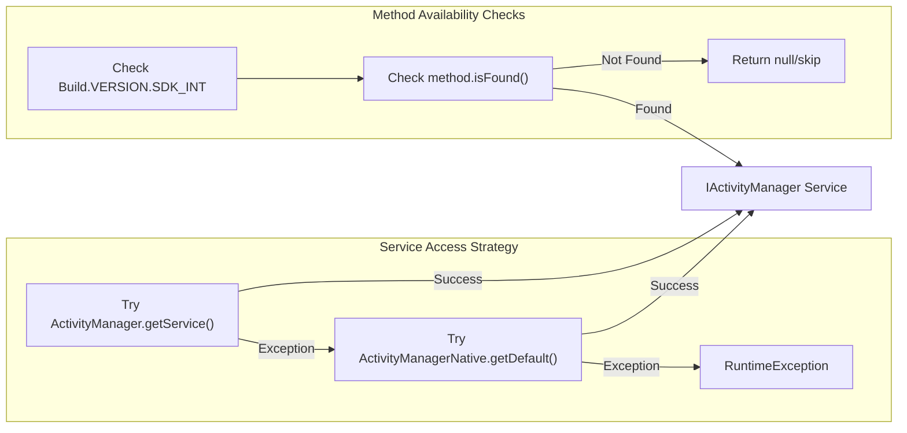
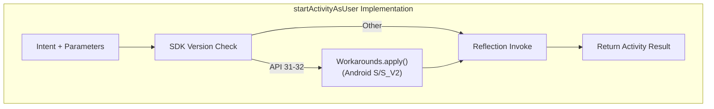
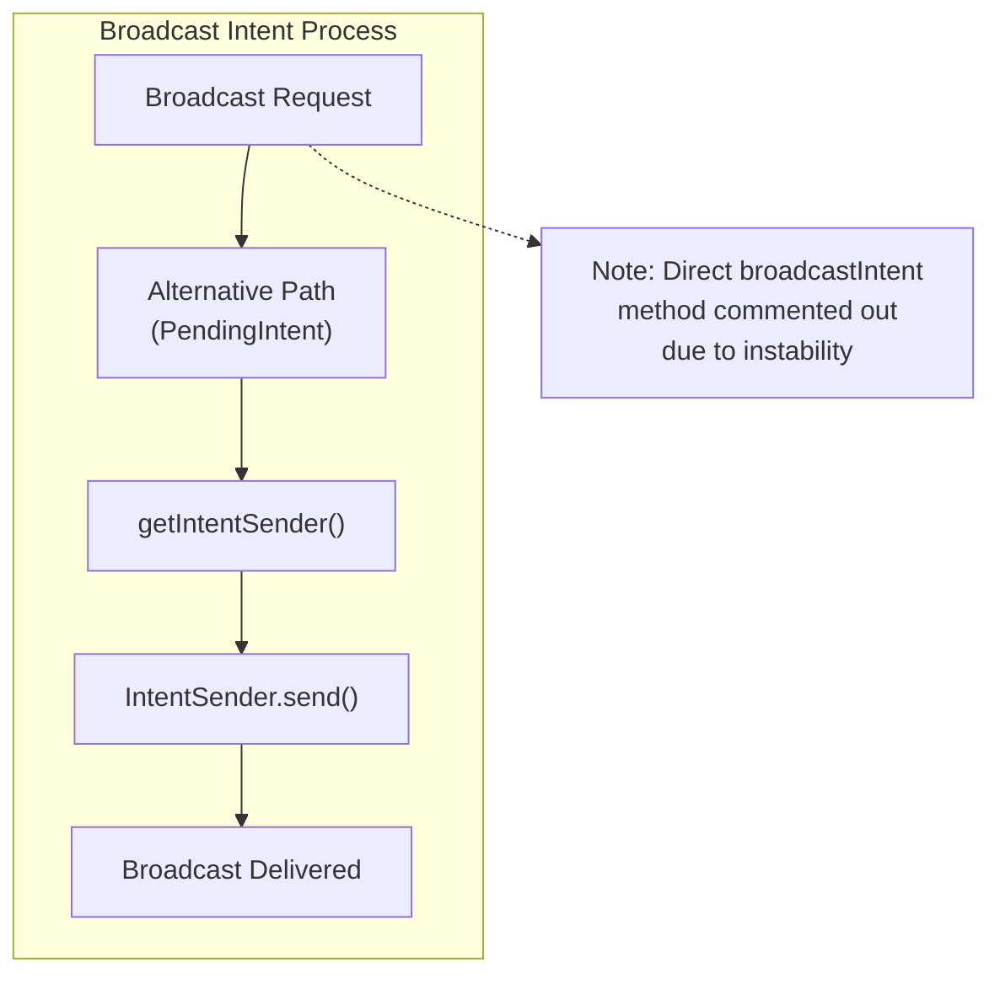

<!-- source: DeepWiki mcp.deepwiki.com · repo termux/TermuxAm · page 4.2 Android System Integration · fetched 2026-10-26 -->

# Android System Integration

Relevant source files

The following files were used as context for generating this wiki page:

- [app/src/main/java/com/termux/termuxam/CrossVersionReflectedMethod.java](app/src/main/java/com/termux/termuxam/CrossVersionReflectedMethod.java)
- [app/src/main/java/com/termux/termuxam/IActivityManager.java](app/src/main/java/com/termux/termuxam/IActivityManager.java)

This section covers how TermuxAm integrates with Android's internal system APIs to provide `am` command functionality. The system uses Java reflection to access hidden Android APIs that are normally restricted to system applications, specifically targeting the `IActivityManager` service interface.

For information about compatibility workarounds and version-specific fixes, see [Compatibility and Workarounds](#4.3). For details about the main command processing logic that uses these integration components, see [Command Processing (Am.java)](#4.1).

## System Service Integration Architecture

TermuxAm integrates with Android's Activity Manager Service through a reflection-based wrapper that mimics the behavior of the system's `am` command. The integration bypasses normal application restrictions by directly invoking system service methods.

**System Service Integration Overview**

Sources: [app/src/main/java/com/termux/termuxam/IActivityManager.java:38-50]()

The system obtains access to `IActivityManager` through two different methods depending on the Android version. Modern versions use `ActivityManager.getService()` while older versions use `ActivityManagerNative.getDefault()`.

## IActivityManager Wrapper

The `IActivityManager` class serves as the primary integration point with Android's activity management system. It wraps the internal `android.app.IActivityManager` interface using reflection to provide access to system-level functionality.

**Core IActivityManager Structure**

Sources: [app/src/main/java/com/termux/termuxam/IActivityManager.java:19-61]()

The wrapper maintains cached method references to avoid repeated reflection lookups and provides a clean API that mirrors the system's `am` command functionality.

## Cross-Version Method Resolution

The `CrossVersionReflectedMethod` class handles the complexity of method signature variations across different Android versions. It supports both exact and inexact method matching to accommodate API changes over time.

**Method Resolution Process**

Sources: [app/src/main/java/com/termux/termuxam/CrossVersionReflectedMethod.java:35-67](), [app/src/main/java/com/termux/termuxam/CrossVersionReflectedMethod.java:80-153]()

The inexact matching algorithm allows methods to have additional parameters between expected ones, accommodating Android's tendency to add new parameters to existing methods across versions.

## Android Version Compatibility Handling

The system handles significant API changes across Android versions, particularly for methods that have been removed or modified in newer versions.

| Android Version | Key Changes | Handling Strategy |
|-----------------|-------------|-------------------|
| ≤ API 28 | `ActivityManagerNative.getDefault()` | Fallback method access |
| ≥ API 29 | `ActivityManager.getService()` | Primary access method |
| ≥ API 31 (S) | Workarounds required | `Workarounds.apply()` calls |
| ≥ API 34 | `getProviderMimeType()` removed | Method availability check |

**Version-Specific Method Access**

Sources: [app/src/main/java/com/termux/termuxam/IActivityManager.java:39-50](), [app/src/main/java/com/termux/termuxam/IActivityManager.java:315-326]()

## Service Method Implementations

The wrapper implements the core `am` command functionality through reflection-based service method calls. Each method handles multiple parameter variations and provides appropriate defaults.

### Activity Management

The `startActivityAsUser` method handles activity launching with version-specific workarounds:

Sources: [app/src/main/java/com/termux/termuxam/IActivityManager.java:246-258]()

### Service Management

Service operations support multiple method signatures across Android versions:

**Service Method Variations**

| Method Signature | Android Version Support | Parameters Added |
|------------------|-------------------------|------------------|
| `startService(caller, service, resolvedType, userId)` | Legacy | Basic parameters |
| `+ callingPackage` | Mid-range versions | Package identification |
| `+ requireForeground` | Recent versions | Foreground requirement |

Sources: [app/src/main/java/com/termux/termuxam/IActivityManager.java:140-167]()

### Broadcast Handling

The broadcast functionality uses a workaround approach due to method signature instability:

Sources: [app/src/main/java/com/termux/termuxam/IActivityManager.java:260-285]()

The broadcast implementation uses `PendingIntent` creation and sending as a more stable alternative to direct `broadcastIntent()` calls, which have proven unreliable across Android versions.

## Provider Content Type Resolution

Content provider MIME type resolution demonstrates the complexity of Android version compatibility, particularly with the removal of `getProviderMimeType()` in Android 14+:

Sources: [app/src/main/java/com/termux/termuxam/IActivityManager.java:287-327]()

The method includes extensive documentation explaining the Android 14+ changes and the challenges with alternative approaches, ultimately falling back to null return when the legacy method is unavailable.

---

