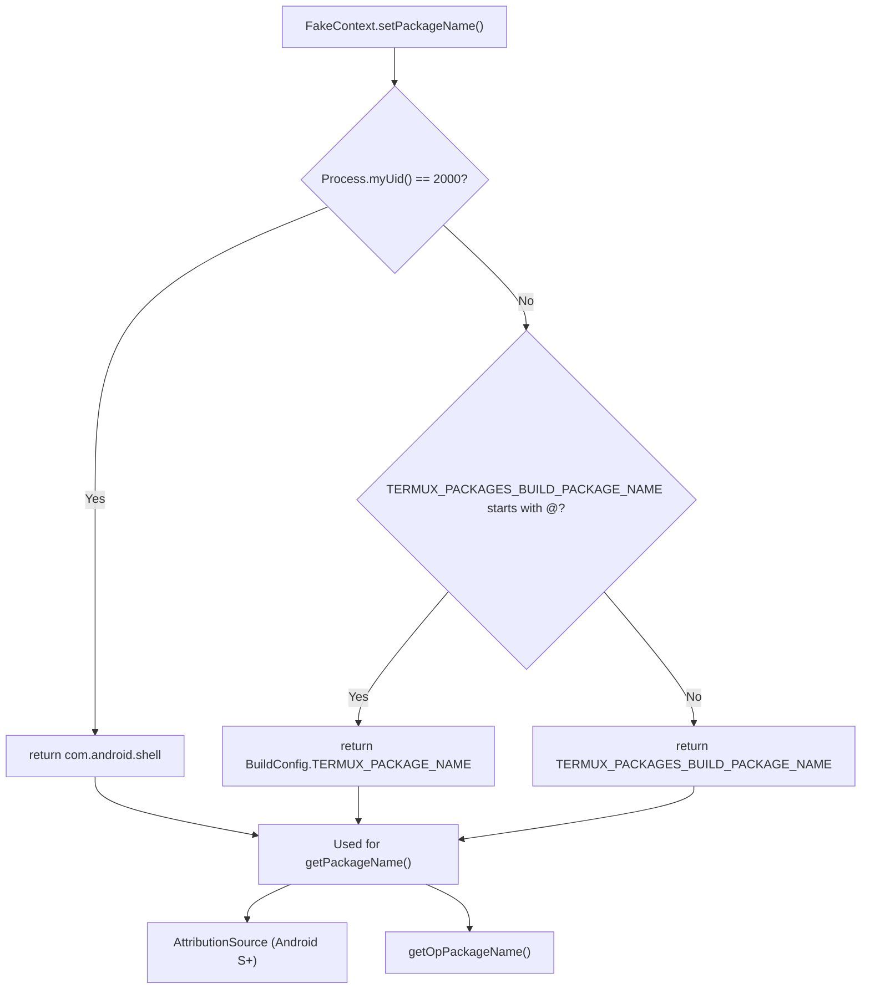
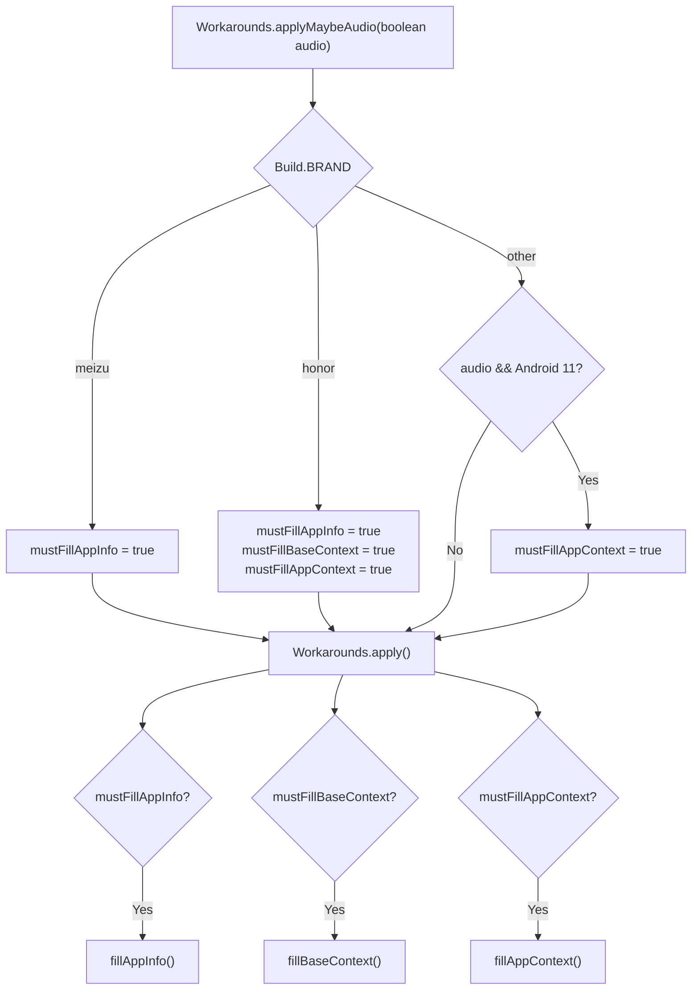
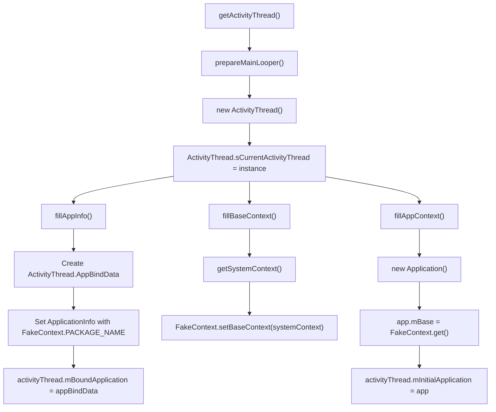
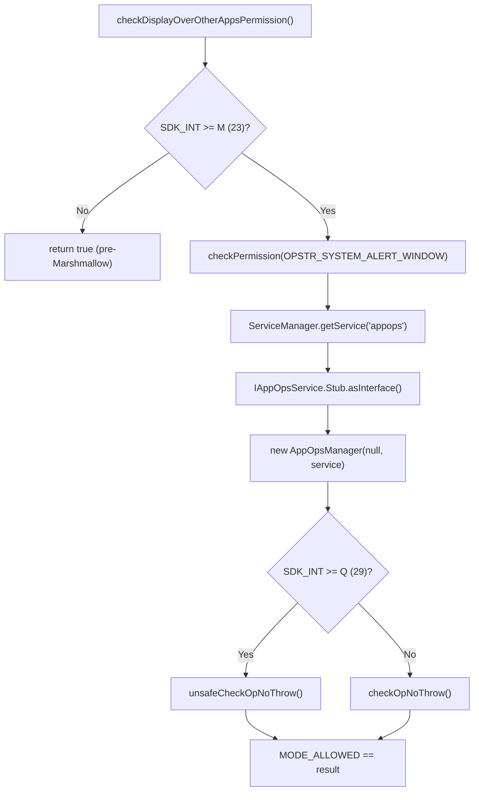

<!-- source: DeepWiki mcp.deepwiki.com · repo termux/TermuxAm · page 4.3 Compatibility and Workarounds · fetched 2026-10-26 -->

# Compatibility and Workarounds

<details>
<summary>Relevant source files</summary>

The following files were used as context for generating this wiki page:

- [app/src/main/java/android/os/ServiceManager.java](app/src/main/java/android/os/ServiceManager.java)
- [app/src/main/java/com/android/internal/app/IAppOpsService.java](app/src/main/java/com/android/internal/app/IAppOpsService.java)
- [app/src/main/java/com/termux/termuxam/FakeContext.java](app/src/main/java/com/termux/termuxam/FakeContext.java)
- [app/src/main/java/com/termux/termuxam/PermissionUtils.java](app/src/main/java/com/termux/termuxam/PermissionUtils.java)
- [app/src/main/java/com/termux/termuxam/Workarounds.java](app/src/main/java/com/termux/termuxam/Workarounds.java)

</details>


This page documents the compatibility layer that enables TermuxAm to function across different Android versions, device manufacturers, and execution environments. The compatibility system addresses restrictions introduced in Android Oreo and later versions, as well as manufacturer-specific modifications that affect system service access.

For information about the core Android system integration that these workarounds enable, see [Android System Integration](#4.2). For the build configuration that supports hidden API access, see [Application Build Configuration](#5.1).

## Overview

The TermuxAm compatibility system addresses several key challenges:

- **Android Version Differences**: Changes in Android's internal APIs and permission models across versions
- **Manufacturer Customizations**: Device-specific modifications by manufacturers like Meizu and Honor
- **Execution Context**: Different behavior when running as shell user vs. Termux app
- **Hidden API Access**: Restrictions on accessing internal Android APIs introduced in Android 9+

The system consists of three main components working together to provide a stable interface to Android's ActivityManager services.

## FakeContext System

The `FakeContext` class provides a dynamic context wrapper that adapts to the execution environment, ensuring proper package identity resolution regardless of how TermuxAm is invoked.

### Package Identity Resolution



The `FakeContext` determines the appropriate package identity based on the execution context:

| Execution Context | UID | Package Name | Use Case |
|-------------------|-----|--------------|----------|
| ADB Shell | 2000 | `com.android.shell` | Development testing |
| Termux App | Variable | Termux package name | Production usage |
| Build Environment | Variable | `BuildConfig.TERMUX_PACKAGE_NAME` | Local builds |

Sources: [app/src/main/java/com/termux/termuxam/FakeContext.java:35-42]()

### Android Version Compatibility

The `FakeContext` includes version-specific adaptations:

- **Android S (API 31)+**: Implements `getAttributionSource()` with proper `AttributionSource.Builder` configuration
- **Android 14+**: Includes placeholder `getDeviceId()` method for future compatibility

Sources: [app/src/main/java/com/termux/termuxam/FakeContext.java:49-61]()

## Manufacturer-Specific Workarounds

The `Workarounds` class implements device-specific fixes for manufacturer customizations that break standard Android behavior.

### Workaround Decision Matrix



### Manufacturer Issues Addressed

| Manufacturer | Issues | Workarounds Applied |
|--------------|--------|-------------------|
| **Meizu** | ActivityThread context issues, Surface creation failures | `fillAppInfo()` |
| **Honor** | Extended context requirements, system service access | `fillAppInfo()`, `fillBaseContext()`, `fillAppContext()` |
| **Android 11** | AudioRecord context requirements (when audio enabled) | `fillAppContext()` |

Sources: [app/src/main/java/com/termux/termuxam/Workarounds.java:36-66]()

## ActivityThread Manipulation

The workaround system manipulates Android's `ActivityThread` to provide the necessary application context for system services that expect a properly initialized Android app.

### ActivityThread Setup Process



### Key ActivityThread Operations

1. **Main Looper Preparation**: Uses `Looper.prepareMainLooper()` to avoid Handler creation exceptions
2. **Application Info Setup**: Creates `ActivityThread.AppBindData` with proper package name
3. **Context Injection**: Injects `FakeContext` into the ActivityThread's application context
4. **System Context**: Obtains and configures system context for Honor devices

Sources: [app/src/main/java/com/termux/termuxam/Workarounds.java:93-181]()

## Permission Management

The `PermissionUtils` class handles permission checking across different Android versions, particularly for the `SYSTEM_ALERT_WINDOW` permission required for background activity launching.

### Permission Check Architecture



### Android Version Support

| Android Version | API Level | Permission Check Method | Notes |
|-----------------|-----------|------------------------|-------|
| Pre-Marshmallow | < 23 | Always granted | No runtime permissions |
| Marshmallow-Pie | 23-28 | `checkOpNoThrow()` | Standard AppOps check |
| Android 10+ | 29+ | `unsafeCheckOpNoThrow()` | Enhanced security model |

### Permission Validation

The system includes special validation for Android 10+ devices where the `SYSTEM_ALERT_WINDOW` permission is required for background activity launching:

```java
validateDisplayOverOtherAppsPermissionForPostAndroid10(boolean logGranted, boolean logNotGranted)
```

Sources: [app/src/main/java/com/termux/termuxam/PermissionUtils.java:23-86]()

## AIDL Interface Stubs

The compatibility system includes stub implementations of Android internal AIDL interfaces to enable compilation and reflection-based access:

- `ServiceManager`: Provides access to system services via `getService(String name)`
- `IAppOpsService`: Interface for AppOps service interaction

These stubs throw `RuntimeException("STUB")` at runtime, as the actual implementations are accessed through reflection and hidden API bypass mechanisms.

Sources: [app/src/main/java/android/os/ServiceManager.java:11-13](), [app/src/main/java/com/android/internal/app/IAppOpsService.java:8-10]()

## Integration with Core System

The compatibility layer integrates seamlessly with TermuxAm's core functionality:

1. **Context Provision**: `FakeContext` is used throughout the system wherever Android APIs require a `Context` parameter
2. **Workaround Application**: Manufacturer workarounds are applied during system initialization based on device detection
3. **Permission Validation**: Permission checks are performed before attempting operations that require special permissions
4. **Error Handling**: All compatibility operations include graceful error handling with logging, ensuring the system continues to function even if specific workarounds fail

This compatibility system enables TermuxAm to function reliably across the wide variety of Android devices and versions in the ecosystem, providing a stable foundation for the core ActivityManager functionality.

Sources: [app/src/main/java/com/termux/termuxam/FakeContext.java](), [app/src/main/java/com/termux/termuxam/Workarounds.java](), [app/src/main/java/com/termux/termuxam/PermissionUtils.java]()

---

