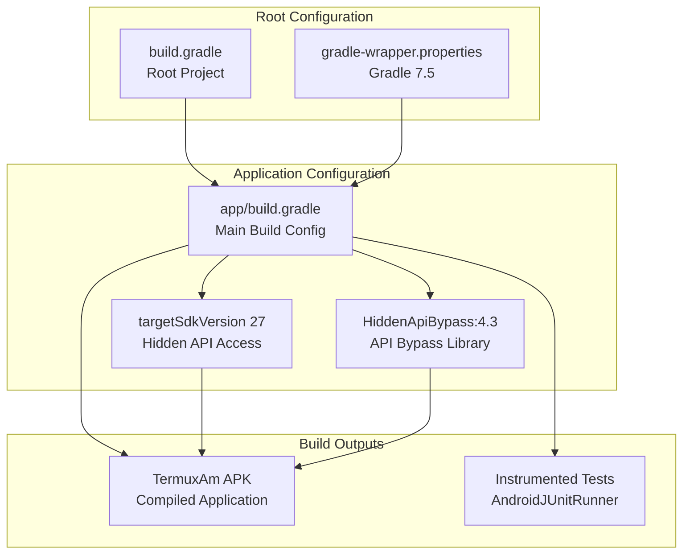
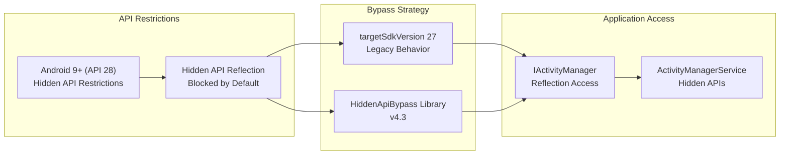
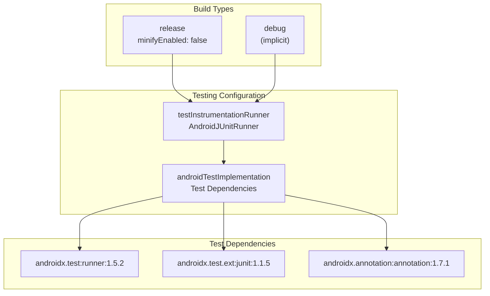
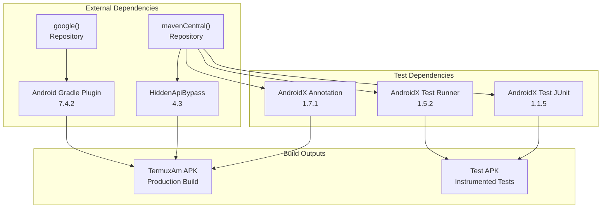

<!-- source: DeepWiki mcp.deepwiki.com · repo termux/TermuxAm · page 5 Build System and Configuration · fetched 2026-10-26 -->

# Build System and Configuration

<details>
<summary>Relevant source files</summary>

The following files were used as context for generating this wiki page:

- [app/build.gradle](app/build.gradle)
- [build.gradle](build.gradle)
- [gradle/wrapper/gradle-wrapper.properties](gradle/wrapper/gradle-wrapper.properties)

</details>


This document covers the build system configuration that enables TermuxAm to compile and access Android's hidden APIs. The build configuration is specifically designed to bypass Android's API restrictions while maintaining compatibility across Android versions.

For information about the compiled application components, see [Core Application Components](#4). For deployment and packaging details, see [Entry Points and Execution](#3).

## Overview

The TermuxAm build system uses a carefully configured Android Gradle build to enable access to restricted Android APIs. The configuration centers around maintaining a `targetSdkVersion` of 27 and integrating the HiddenApiBypass library to work around Android's hidden API restrictions introduced in Android 9 (API 28).

### Build Architecture



**Sources:** [app/build.gradle:1-41](), [build.gradle:1-21](), [gradle/wrapper/gradle-wrapper.properties:1-6]()

## Application Build Configuration

The core build configuration in `app/build.gradle` contains critical settings that enable hidden API access and ensure compatibility with Android's security restrictions.

### Android Configuration Block

The `android` configuration block defines the application's compilation and runtime parameters:

| Setting | Value | Purpose |
|---------|-------|---------|
| `namespace` | `"com.termux.termuxam"` | Application package namespace |
| `compileSdkVersion` | `33` | Latest SDK for compilation |
| `minSdkVersion` | `21` | Android 5.0+ compatibility |
| `targetSdkVersion` | `27` | **Critical for hidden API access** |
| `applicationId` | `"com.termux.termuxam"` | Unique application identifier |

The `targetSdkVersion` setting is the most critical configuration, as explained in the inline comment at [app/build.gradle:9-14]():

```
// Note: targetSdkVersion affects only tests,
//       normally, even though this is packaged as apk,
//       it's not loaded as apk so targetSdkVersion is ignored.
//       targetSdkVersion this must be < 28 because this application accesses hidden apis
```

**Sources:** [app/build.gradle:3-20]()

### Hidden API Access Configuration



The application uses two complementary strategies to access hidden APIs:

1. **Legacy targetSdkVersion**: Set to 27 to avoid Android 9's hidden API restrictions
2. **HiddenApiBypass Library**: Runtime bypass for additional protection

The HiddenApiBypass dependency is configured at [app/build.gradle:38-39]():
```gradle
// https://github.com/LSPosed/AndroidHiddenApiBypass
implementation "org.lsposed.hiddenapibypass:hiddenapibypass:4.3"
```

**Sources:** [app/build.gradle:12-14](), [app/build.gradle:38-39]()

### Build Types and Testing

The build configuration includes standard Android build types and comprehensive testing support:



The release build type disables ProGuard minification at [app/build.gradle:22-27]() to preserve reflection-based access patterns required for hidden API usage.

**Sources:** [app/build.gradle:17](), [app/build.gradle:22-27](), [app/build.gradle:33-36]()

## Root Project Configuration

The root `build.gradle` file establishes the project-wide build environment and repository configuration.

### Buildscript Configuration

The buildscript block defines the Android Gradle Plugin version and repository sources:

```gradle
buildscript {
    repositories {
        google()
        mavenCentral()
    }
    dependencies {
        classpath "com.android.tools.build:gradle:7.4.2"
    }
}
```

All projects inherit repository configuration from the `allprojects` block at [build.gradle:11-16](), ensuring consistent dependency resolution across modules.

**Sources:** [build.gradle:1-16]()

### Gradle Wrapper

The Gradle wrapper configuration ensures consistent build environments across different development machines:

| Property | Value | Purpose |
|----------|-------|---------|
| `distributionUrl` | `gradle-7.5-all.zip` | Gradle version 7.5 with full distribution |
| `distributionBase` | `GRADLE_USER_HOME` | Local Gradle cache location |

**Sources:** [gradle/wrapper/gradle-wrapper.properties:1-6]()

## Build Configuration Dependencies



The dependency configuration prioritizes:
1. **Hidden API access** through HiddenApiBypass
2. **Comprehensive testing** with AndroidX test framework
3. **Minimal runtime dependencies** to reduce attack surface

**Sources:** [app/build.gradle:30-40](), [build.gradle:2-8](), [build.gradle:12-15]()

---

