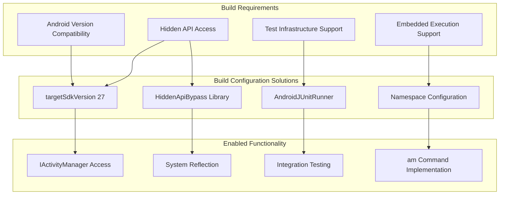
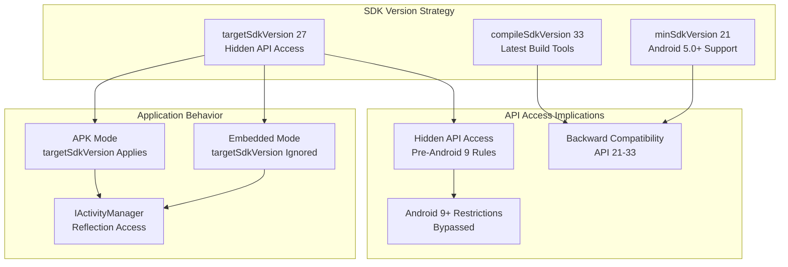
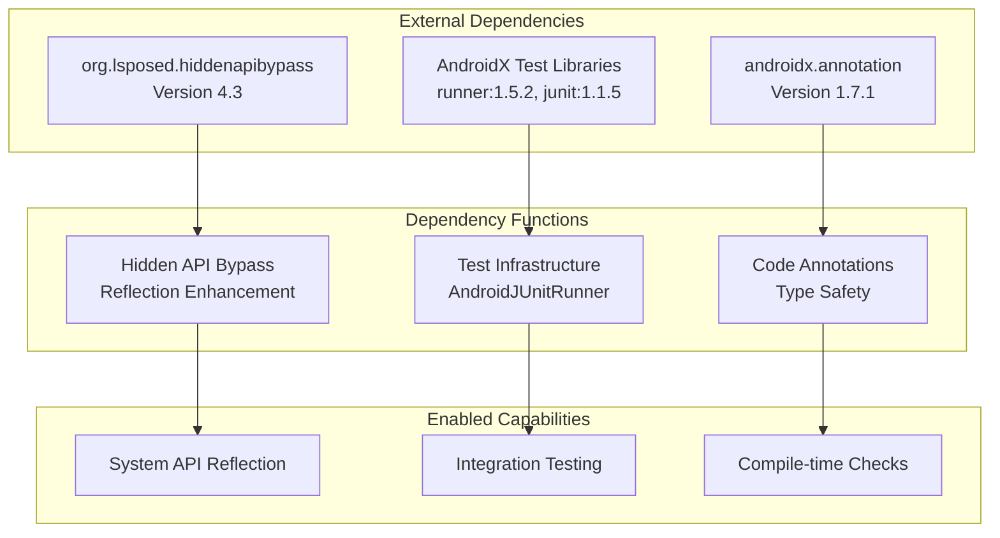
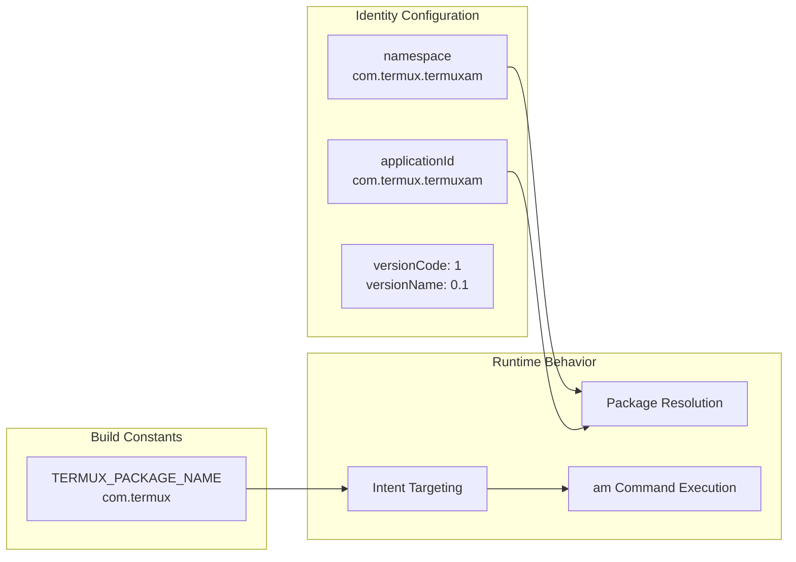
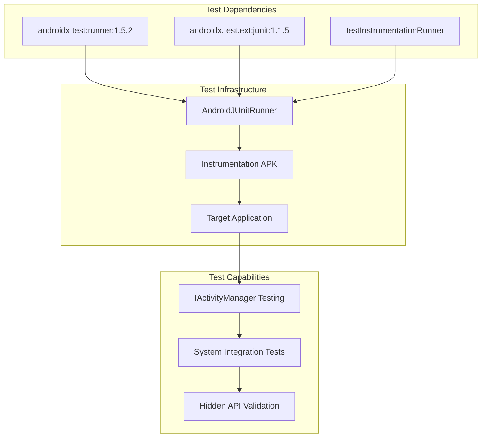
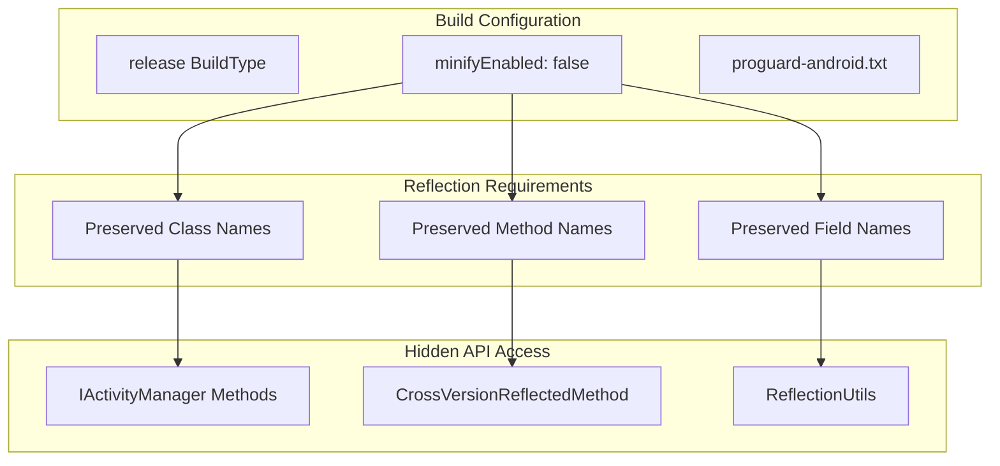

<!-- source: DeepWiki mcp.deepwiki.com · repo termux/TermuxAm · page 5.1 Application Build Configuration · fetched 2026-10-26 -->

# Application Build Configuration

Relevant source files

The following files were used as context for generating this wiki page:

- [app/build.gradle](app/build.gradle)

This document covers the application-level build configuration in `app/build.gradle` that enables TermuxAm's core functionality through hidden API access and Android system integration. This configuration is critical for allowing the application to access restricted Android framework APIs that power the `am` command functionality.

For information about root-level project configuration and Gradle wrapper setup, see [Project Build Setup](#5.2).

## Purpose and Critical Requirements

The application build configuration serves a specific purpose: enabling access to Android's hidden APIs while maintaining compatibility across Android versions. The configuration must balance several competing requirements:

- Access to restricted `IActivityManager` interfaces
- Compatibility with Android API levels 21-33
- Support for both APK deployment (testing) and embedded execution (production)
- Integration with the HiddenApiBypass library for reflection-based API access

Sources: [app/build.gradle:1-41]()

## SDK Version Configuration

The most critical aspect of the build configuration is the SDK version setup, particularly the `targetSdkVersion` setting that enables hidden API access:

| Configuration | Value | Purpose |
|---------------|-------|---------|
| `compileSdkVersion` | 33 | Latest APIs for compilation |
| `minSdkVersion` | 21 | Android 5.0+ compatibility |
| `targetSdkVersion` | 27 | Hidden API access (pre-Android 9 restrictions) |

The `targetSdkVersion 27` setting is essential because Android 9 (API 28) introduced restrictions on hidden API access. The configuration includes detailed comments explaining this requirement:

Sources: [app/build.gradle:5-16]()

## Hidden API Access Dependencies

The application relies on the HiddenApiBypass library to access Android's restricted APIs. This dependency is configured alongside AndroidX testing components:

The HiddenApiBypass library provides enhanced reflection capabilities that work around Android's hidden API restrictions, enabling access to `IActivityManager` and related system services.

Sources: [app/build.gradle:30-40]()

## Application Identity Configuration

The build configuration establishes the application's identity and provides build-time constants for runtime behavior:

| Configuration | Value | Purpose |
|---------------|-------|---------|
| `namespace` | `com.termux.termuxam` | Package namespace |
| `applicationId` | `com.termux.termuxam` | APK identifier |
| `versionCode` | 1 | APK version number |
| `versionName` | `"0.1"` | Human-readable version |
| `TERMUX_PACKAGE_NAME` | `"com.termux"` | Target package constant |

The `TERMUX_PACKAGE_NAME` build config field is particularly important as it defines the target application package that the `am` commands will interact with.

Sources: [app/build.gradle:4-20]()

## Test Configuration

The build configuration includes comprehensive test support through AndroidX test dependencies and instrumentation runner setup:

The test configuration enables comprehensive integration testing of the hidden API access functionality, which is critical for validating compatibility across Android versions.

Sources: [app/build.gradle:17-35]()

## Build Types and Optimization

The application uses a minimal build configuration focused on development and debugging rather than production optimization:

| Build Setting | Configuration | Rationale |
|---------------|---------------|-----------|
| `minifyEnabled` | `false` | Preserves reflection targets |
| `proguardFiles` | Default rules | Minimal obfuscation |
| Build variants | Release only | Simplified deployment |

The lack of code minification is intentional, as the application relies heavily on reflection to access hidden APIs, and obfuscation could break these reflection calls.

Sources: [app/build.gradle:22-28]()

---

