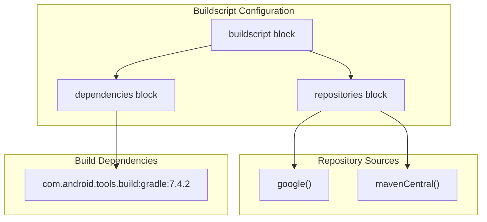
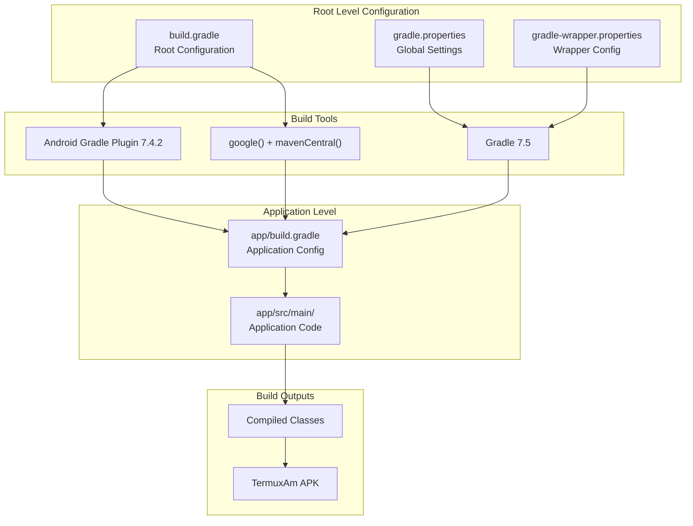
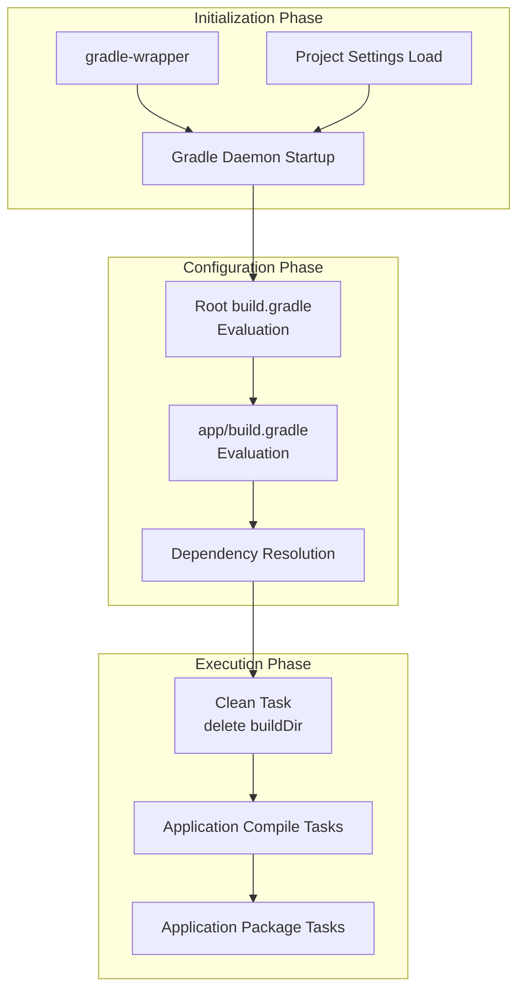

<!-- source: DeepWiki mcp.deepwiki.com · repo termux/TermuxAm · page 5.2 Project Build Setup · fetched 2026-10-26 -->

# Project Build Setup

Relevant source files

The following files were used as context for generating this wiki page:

- [build.gradle](build.gradle)
- [gradle.properties](gradle.properties)
- [gradle/wrapper/gradle-wrapper.properties](gradle/wrapper/gradle-wrapper.properties)

This document covers the root-level build configuration, Gradle wrapper setup, and project-wide settings that establish the foundation for the TermuxAm build system. This includes the root `build.gradle` configuration, Gradle wrapper properties, and global project settings.

For application-specific build configuration including hidden API access and dependency management, see [Application Build Configuration](#5.1).

## Root Build Configuration

The project uses a standard Android Gradle build setup with the root [`build.gradle`](build.gradle:1-21)() managing buildscript dependencies and global repository configuration.

### Buildscript Dependencies

The buildscript configuration establishes the Android Gradle Plugin version and repository sources:

**Root Buildscript Configuration**
- **Repository Configuration**: Uses both Google and Maven Central repositories for buildscript dependencies [build.gradle:2-5]()
- **Android Gradle Plugin**: Specifies version 7.4.2 of the Android Gradle Plugin [build.gradle:7]()
- **Global Repository Setup**: Applies the same repository configuration to all subprojects [build.gradle:11-16]()

Sources: [build.gradle:1-16]()

### Project-Wide Tasks

The root build file defines a single global task for project maintenance:

- **Clean Task**: Standard Gradle clean task that removes the build directory [build.gradle:18-20]()

Sources: [build.gradle:18-20]()

## Gradle Wrapper Configuration

The Gradle wrapper is configured to use a specific Gradle version and distribution source through [`gradle/wrapper/gradle-wrapper.properties`](gradle/wrapper/gradle-wrapper.properties:1-6)().

| Property | Value | Purpose |
|----------|--------|---------|
| `distributionBase` | `GRADLE_USER_HOME` | Base directory for Gradle distributions |
| `distributionPath` | `wrapper/dists` | Subdirectory within base for distributions |
| `distributionUrl` | `gradle-7.5-all.zip` | Specific Gradle version and distribution type |
| `zipStoreBase` | `GRADLE_USER_HOME` | Base directory for storing downloaded zips |
| `zipStorePath` | `wrapper/dists` | Subdirectory for zip storage |

The wrapper uses Gradle 7.5 with the "all" distribution, which includes sources and documentation in addition to the runtime.

Sources: [gradle/wrapper/gradle-wrapper.properties:1-6]()

## Project Properties Configuration

Global project settings are defined in [`gradle.properties`](gradle.properties:1-19)(), establishing JVM parameters and Android-specific configurations.

### JVM Configuration

The build system configures JVM memory settings for optimal build performance:
- **Heap Memory**: Maximum heap size set to 1536MB via `org.gradle.jvmargs=-Xmx1536m` [gradle.properties:12]()

### Android Configuration

Project-wide Android settings:
- **AndroidX Migration**: Enables AndroidX support with `android.useAndroidX=true` [gradle.properties:18]()
- **Parallel Builds**: Parallel execution is available but commented out [gradle.properties:17]()

Sources: [gradle.properties:12](), [gradle.properties:18]()

## Build System Architecture

**Build System Dependencies**
- Root configuration manages buildscript dependencies and global repositories
- Gradle wrapper ensures consistent Gradle version (7.5) across environments
- Project properties configure JVM settings and Android feature flags
- Application-level configuration inherits from root setup

Sources: [build.gradle:1-21](), [gradle.properties:1-19](), [gradle/wrapper/gradle-wrapper.properties:1-6]()

## Build Process Flow

**Build Execution Sequence**
1. **Wrapper Initialization**: Gradle wrapper downloads and configures Gradle 7.5
2. **Settings Application**: JVM args and AndroidX settings applied from `gradle.properties`
3. **Root Configuration**: Buildscript dependencies and repositories configured
4. **Application Configuration**: App-level build configuration inherits root settings
5. **Task Execution**: Clean task and application build tasks execute as requested

Sources: [build.gradle:1-21](), [gradle.properties:1-19](), [gradle/wrapper/gradle-wrapper.properties:1-6]()

---

