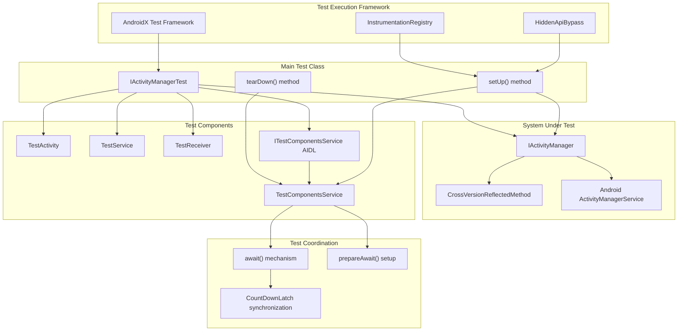
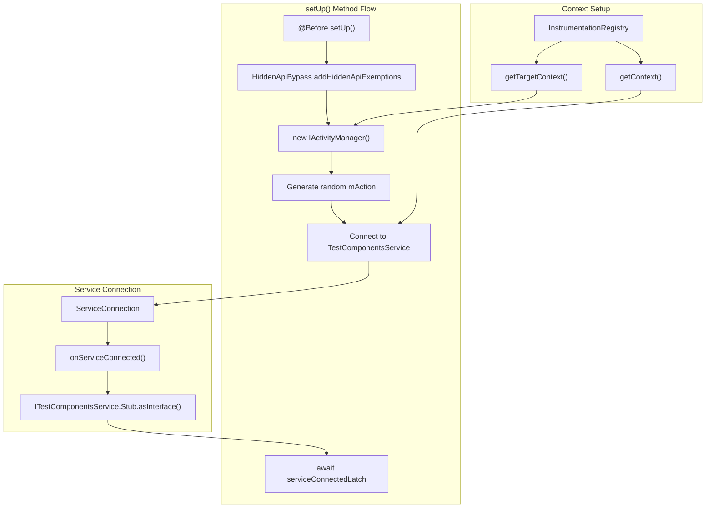
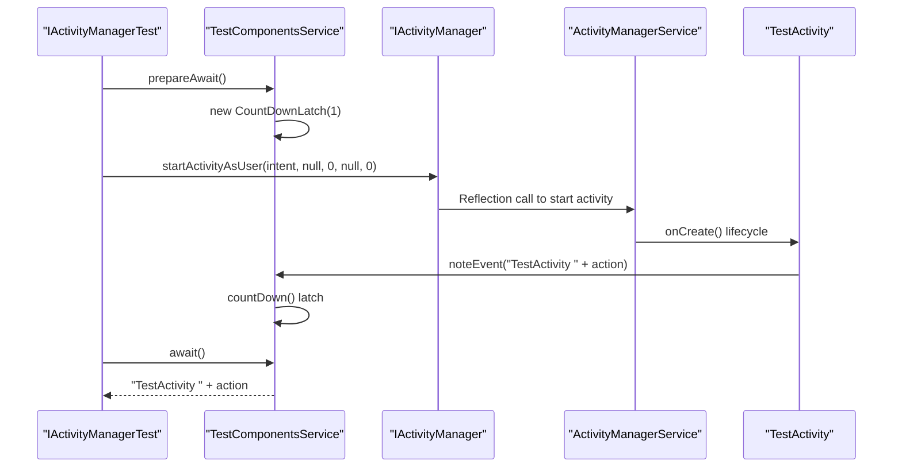
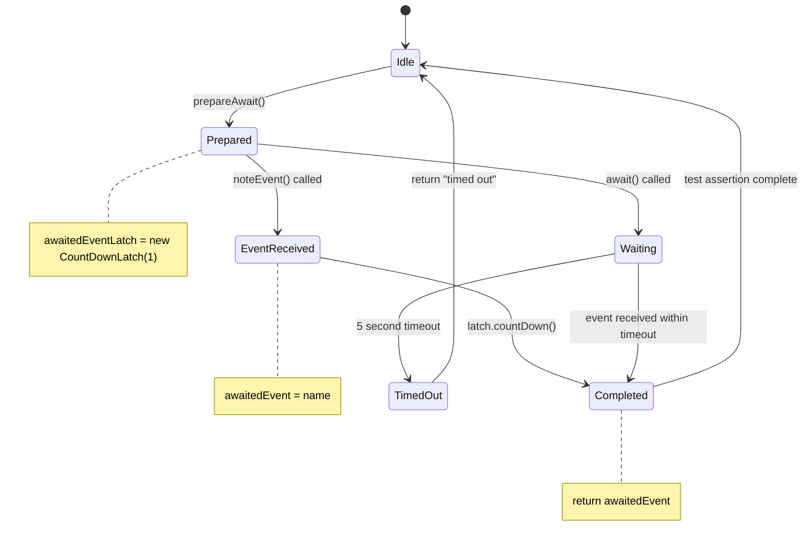

<!-- source: DeepWiki mcp.deepwiki.com · repo termux/TermuxAm · page 6 Testing Infrastructure · fetched 2026-10-26 -->

# Testing Infrastructure

Relevant source files

The following files were used as context for generating this wiki page:

- [app/src/androidTest/java/com/termux/termuxam/IActivityManagerTest.java](app/src/androidTest/java/com/termux/termuxam/IActivityManagerTest.java)
- [app/src/androidTest/java/com/termux/termuxam/test/TestComponentsService.java](app/src/androidTest/java/com/termux/termuxam/test/TestComponentsService.java)

The testing infrastructure validates the core functionality of TermuxAm through comprehensive integration tests that verify Android system interactions. This system tests the reflection-based `IActivityManager` wrapper and ensures compatibility across Android versions and device manufacturers.

For information about the build configuration that enables testing, see [Build System and Configuration](#5). For details about the specific test components used in validation, see [Test Components and Infrastructure](#6.2).

## Test Architecture Overview

The testing system uses AndroidX Test framework to perform integration testing against real Android system services. The architecture centers around the `IActivityManagerTest` class which coordinates with multiple test components through a service-based communication mechanism.

**Test Architecture and Component Relationships**

Sources: [app/src/androidTest/java/com/termux/termuxam/IActivityManagerTest.java:1-153](), [app/src/androidTest/java/com/termux/termuxam/test/TestComponentsService.java:1-57]()

## Core Integration Tests

The `IActivityManagerTest` class provides comprehensive validation of the `IActivityManager` reflection wrapper. This test class implements four critical test scenarios that validate core Android system integration functionality.

### Test Setup and Initialization

The test setup process initializes the hidden API bypass mechanism and establishes connection to test coordination services:

Sources: [app/src/androidTest/java/com/termux/termuxam/IActivityManagerTest.java:44-77]()

### Method Availability Validation

The `testMethodsAvailable()` test ensures all required reflection methods are successfully discovered across Android versions:

| Test Aspect | Implementation | Purpose |
|------------|----------------|---------|
| Reflection Method Discovery | Uses `Field.setAccessible(true)` and `Field.get()` | Validates `CrossVersionReflectedMethod` instances |
| Version Compatibility | Skips `mGetProviderMimeTypeMethod` on Android 14+ | Handles API changes in newer Android versions |
| Method Validation | Checks `method.isFound()` for each field | Ensures reflection wrapper initialization succeeded |

Sources: [app/src/androidTest/java/com/termux/termuxam/IActivityManagerTest.java:84-100]()

### Activity Lifecycle Testing

The `testStartActivity()` test validates activity launching through the `IActivityManager` wrapper:

Sources: [app/src/androidTest/java/com/termux/termuxam/IActivityManagerTest.java:102-108]()

### Service and Broadcast Testing

The integration tests include validation of service management and intent broadcasting:

- **Service Testing**: `testStartStopService()` validates both `startService()` and `stopService()` operations through the reflection wrapper
- **Broadcast Testing**: `testBroadcastIntent()` tests ordered broadcasts with result receivers, though it's disabled on Android 14+ due to system restrictions

The broadcast test implements a custom `IIntentReceiver.Stub` to capture broadcast results and uses `CountDownLatch` for synchronization.

Sources: [app/src/androidTest/java/com/termux/termuxam/IActivityManagerTest.java:110-153]()

## Test Coordination Infrastructure

The `TestComponentsService` provides centralized coordination for test execution across multiple Android components. This service implements the `ITestComponentsService` AIDL interface to enable cross-process communication during testing.

**Test Event Coordination Flow**

The service uses static fields to maintain state across component interactions:
- `awaitedEventLatch`: `CountDownLatch` for synchronization
- `awaitedEvent`: String to store the received event name
- `noteEvent()`: Static method called by test components to report events

Sources: [app/src/androidTest/java/com/termux/termuxam/test/TestComponentsService.java:19-56]()

### Test Component Integration

The test infrastructure includes multiple Android components that integrate with the coordination service:

| Component | Purpose | Integration Method |
|-----------|---------|-------------------|
| `TestActivity` | Activity lifecycle testing | Calls `TestComponentsService.noteEvent()` in lifecycle methods |
| `TestService` | Service start/stop testing | Reports start and stop events through coordination service |
| `TestReceiver` | Broadcast intent testing | Handles broadcast intents and reports through result mechanism |
| `TestComponentsService` | Test coordination hub | AIDL service providing `prepareAwait()`/`await()` synchronization |

The integration enables comprehensive testing of Android system interactions while maintaining proper test isolation and synchronization.

Sources: [app/src/androidTest/java/com/termux/termuxam/IActivityManagerTest.java:12-15]()

---

