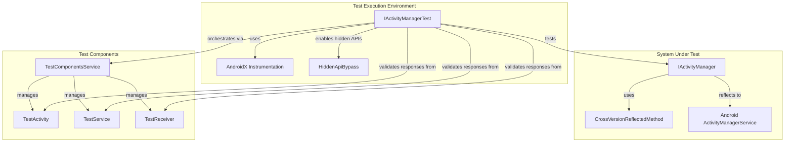
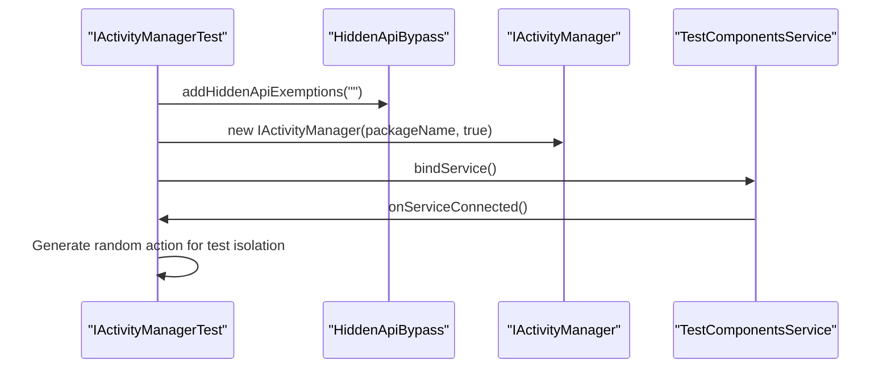
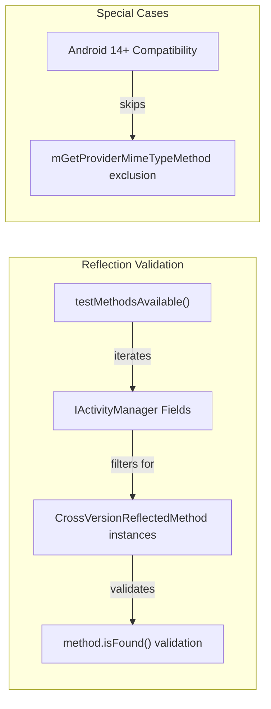
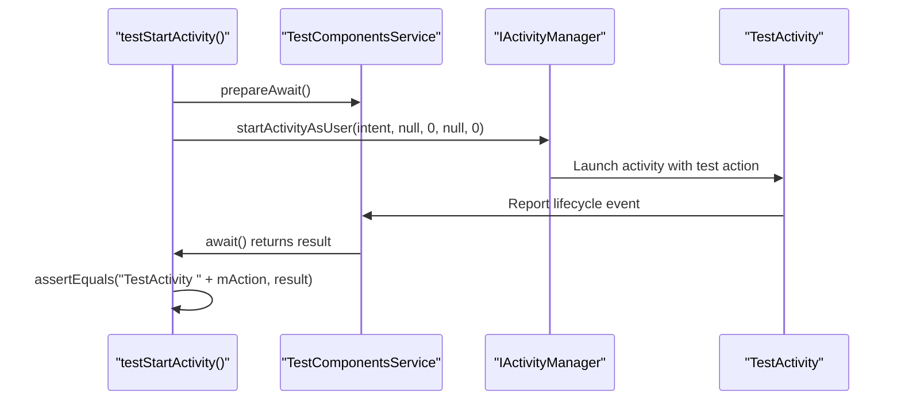
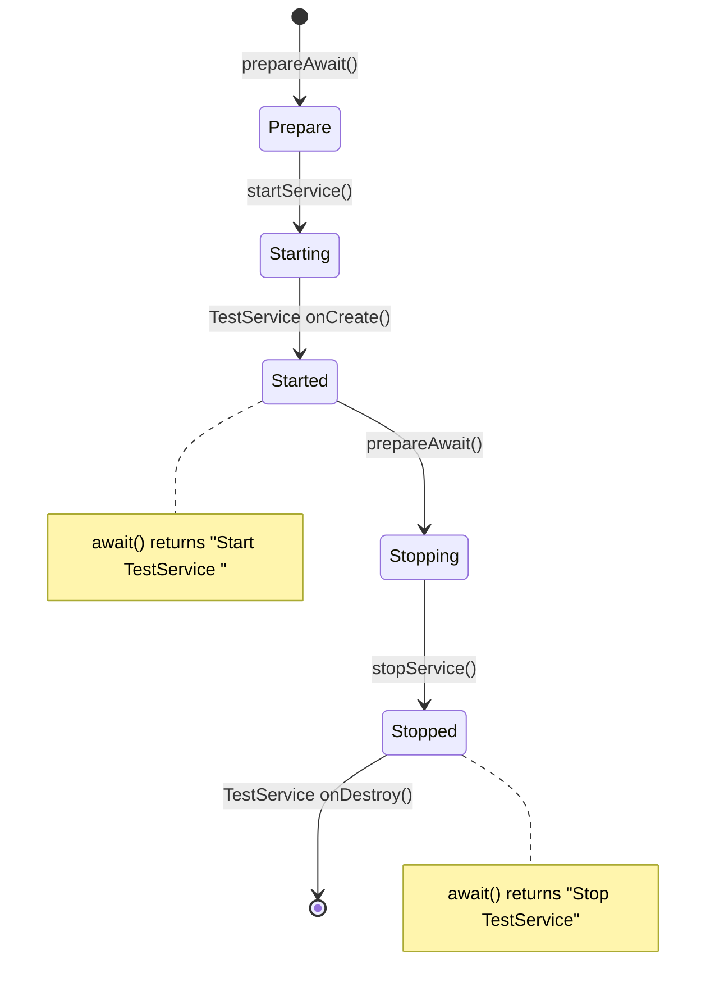
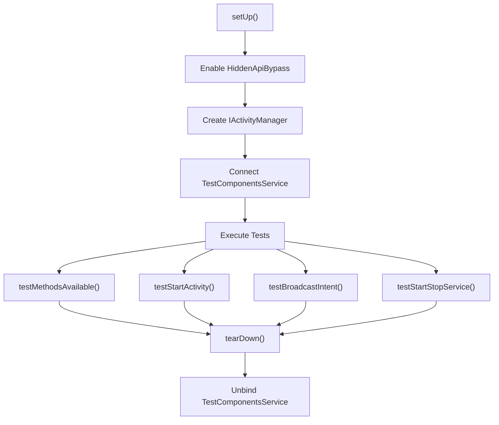

<!-- source: DeepWiki mcp.deepwiki.com · repo termux/TermuxAm · page 6.1 IActivityManager Testing · fetched 2026-10-26 -->

# IActivityManager Testing

Relevant source files

The following files were used as context for generating this wiki page:

- [app/src/androidTest/java/com/termux/termuxam/IActivityManagerTest.java](app/src/androidTest/java/com/termux/termuxam/IActivityManagerTest.java)

This document covers the comprehensive integration testing system for the IActivityManager wrapper, which validates that the reflection-based Android system integration works correctly across different Android versions. The testing system ensures that TermuxAm can successfully invoke Android's internal ActivityManager APIs through the `IActivityManager` class.

For information about the IActivityManager implementation itself, see [Android System Integration](#4.2). For details about the test components used in these tests, see [Test Components and Infrastructure](#6.2).

## Test Infrastructure Overview

The IActivityManager testing system provides comprehensive validation of the core Android system integration functionality through instrumentation tests that run on actual Android devices or emulators.

Sources: [app/src/androidTest/java/com/termux/termuxam/IActivityManagerTest.java:1-153]()

## Test Setup and Configuration

The test setup establishes the necessary environment for testing hidden API access and connects to the test orchestration service.

### Hidden API Bypass Initialization

The test setup enables access to Android's hidden APIs using the HiddenApiBypass library, which is essential for the IActivityManager reflection-based implementation to function:

The setup process includes:
- Enabling hidden API exemptions through `HiddenApiBypass.addHiddenApiExemptions("")`
- Creating an `IActivityManager` instance with the test package name and debug flag enabled
- Establishing connection to `TestComponentsService` for test orchestration
- Generating unique intent actions to prevent test interference

Sources: [app/src/androidTest/java/com/termux/termuxam/IActivityManagerTest.java:44-77]()

### Service Connection Management

The test establishes a connection to the `TestComponentsService` to coordinate test execution and capture component lifecycle events:

| Component | Purpose | Connection Method |
|-----------|---------|-------------------|
| `TestComponentsService` | Test orchestration and result collection | Service binding with `BIND_AUTO_CREATE` |
| `ITestComponentsService.Stub` | AIDL interface for service communication | Interface binding via `asInterface()` |
| `CountDownLatch` | Synchronization mechanism | Ensures service connection before tests run |

Sources: [app/src/androidTest/java/com/termux/termuxam/IActivityManagerTest.java:57-76]()

## Core Test Validations

### Method Availability Testing

The `testMethodsAvailable()` test validates that all required `CrossVersionReflectedMethod` instances are properly initialized and can locate their target methods in the Android system:

The test includes special handling for Android version compatibility:
- Excludes `mGetProviderMimeTypeMethod` on Android 14+ (`Build.VERSION.SDK_INT > Build.VERSION_CODES.TIRAMISU`)
- Validates that all other reflected methods are successfully located

Sources: [app/src/androidTest/java/com/termux/termuxam/IActivityManagerTest.java:84-100]()

### Activity Launch Testing

The `testStartActivity()` test verifies that the IActivityManager can successfully launch Android activities through the `startActivityAsUser()` method:

The test validates:
- Successful activity launch through IActivityManager
- Proper intent delivery with custom action
- Activity lifecycle event capture through TestComponentsService

Sources: [app/src/androidTest/java/com/termux/termuxam/IActivityManagerTest.java:102-108]()

### Broadcast Intent Testing

The `testBroadcastIntent()` test validates broadcast functionality with Android version-specific compatibility handling:

| Android Version | Test Behavior | Reason |
|----------------|---------------|--------|
| ≤ Android 13 | Full broadcast testing | Standard behavior works |
| ≥ Android 14 | Test skipped | `resultTo requires resultToApp` exception |

The test implementation uses `IIntentReceiver.Stub` to capture broadcast results and validate proper intent delivery and data transmission.

Sources: [app/src/androidTest/java/com/termux/termuxam/IActivityManagerTest.java:110-139]()

### Service Management Testing

The `testStartStopService()` test validates service lifecycle management through IActivityManager:

The test verifies:
- Service startup through `startService()` API
- Service shutdown through `stopService()` API  
- Proper lifecycle event reporting via TestComponentsService
- Service component recognition of custom intent actions

Sources: [app/src/androidTest/java/com/termux/termuxam/IActivityManagerTest.java:141-152]()

## Android Version Compatibility

The testing system includes specific handling for Android version differences that affect system behavior:

### Android 14+ Compatibility

Two tests include special Android 14+ handling:

1. **Method Availability**: Excludes `mGetProviderMimeTypeMethod` validation on Android 14+
2. **Broadcast Testing**: Completely skips broadcast tests on Android 14+ due to `resultTo requires resultToApp` restrictions

### Version Detection Logic

The tests use `Build.VERSION.SDK_INT > Build.VERSION_CODES.TIRAMISU` to detect Android 14+ and adjust behavior accordingly.

Sources: [app/src/androidTest/java/com/termux/termuxam/IActivityManagerTest.java:90-93](), [app/src/androidTest/java/com/termux/termuxam/IActivityManagerTest.java:112-115]()

## Test Execution Flow

The test execution follows standard JUnit lifecycle:
- `@Before setUp()`: Initialize HiddenApiBypass, create IActivityManager, connect to TestComponentsService
- Test methods: Validate specific IActivityManager functionality
- `@After tearDown()`: Clean up service connections

Sources: [app/src/androidTest/java/com/termux/termuxam/IActivityManagerTest.java:44-82]()

---

