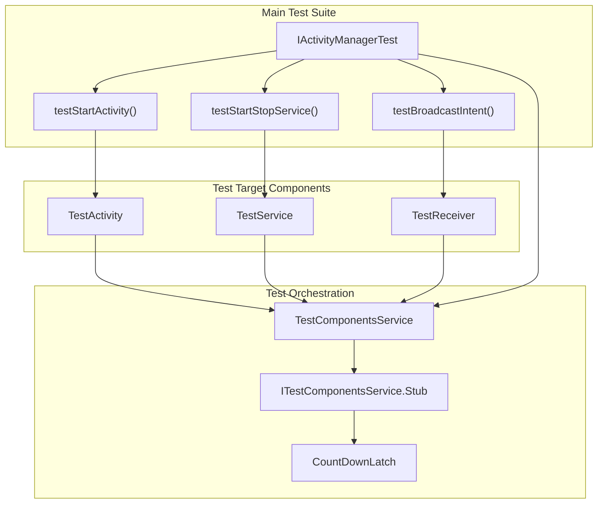
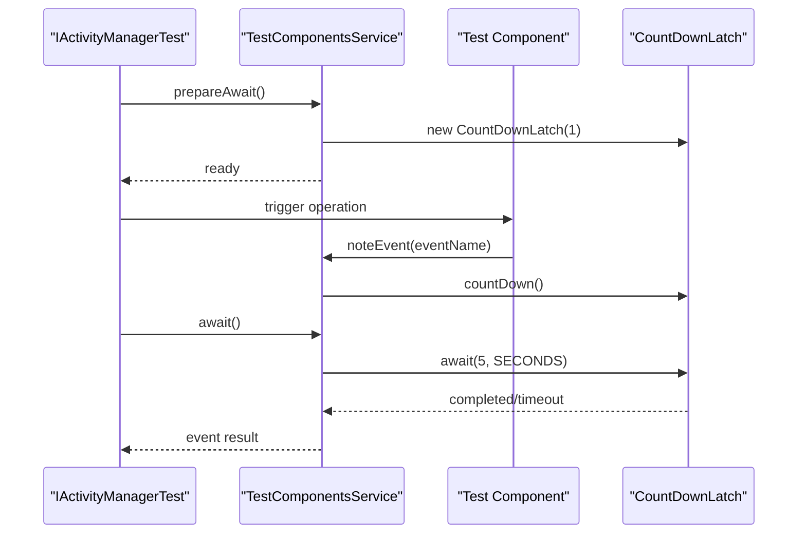
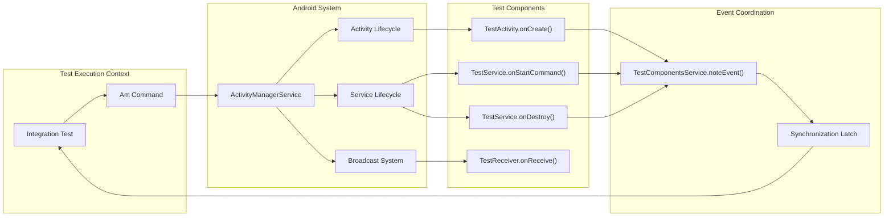
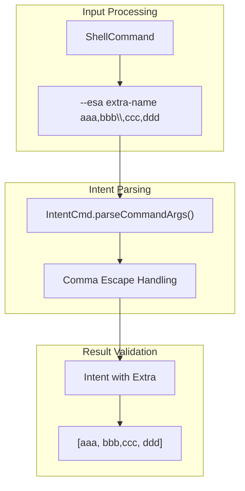

<!-- source: DeepWiki mcp.deepwiki.com · repo termux/TermuxAm · page 6.2 Test Components and Infrastructure · fetched 2026-10-26 -->

# Test Components and Infrastructure

<details>
<summary>Relevant source files</summary>

The following files were used as context for generating this wiki page:

- [app/src/androidTest/java/com/termux/termuxam/IntentCmdTest.java](app/src/androidTest/java/com/termux/termuxam/IntentCmdTest.java)
- [app/src/androidTest/java/com/termux/termuxam/test/TestActivity.java](app/src/androidTest/java/com/termux/termuxam/test/TestActivity.java)
- [app/src/androidTest/java/com/termux/termuxam/test/TestComponentsService.java](app/src/androidTest/java/com/termux/termuxam/test/TestComponentsService.java)
- [app/src/androidTest/java/com/termux/termuxam/test/TestReceiver.java](app/src/androidTest/java/com/termux/termuxam/test/TestReceiver.java)
- [app/src/androidTest/java/com/termux/termuxam/test/TestService.java](app/src/androidTest/java/com/termux/termuxam/test/TestService.java)

</details>


This document covers the supporting test components and infrastructure that enable comprehensive testing of the TermuxAm system's core Android integration functionality. These components provide the necessary test targets and orchestration services for validating activity management, service control, and intent broadcasting capabilities.

For information about the main IActivityManager integration tests, see [IActivityManager Testing](#6.1). For details about the overall testing approach and build configuration, see [Testing Infrastructure](#6).

## Test Architecture Overview

The test infrastructure consists of dedicated Android components that serve as targets for testing TermuxAm's core functionality and a central orchestration service that coordinates test execution and event synchronization.

### Test Orchestration Architecture



Sources: [app/src/androidTest/java/com/termux/termuxam/test/TestComponentsService.java:1-56](), [app/src/androidTest/java/com/termux/termuxam/test/TestActivity.java:1-21](), [app/src/androidTest/java/com/termux/termuxam/test/TestService.java:1-34](), [app/src/androidTest/java/com/termux/termuxam/test/TestReceiver.java:1-19]()

## Test Orchestration Service

The `TestComponentsService` provides centralized event coordination and synchronization for test execution through an AIDL-based interface.

### Service Architecture

| Component | Purpose | Key Methods |
|-----------|---------|-------------|
| `TestComponentsService` | Main orchestration service | `noteEvent()`, `prepareAwait()`, `await()` |
| `ITestComponentsService.Stub` | AIDL implementation | Remote procedure call interface |
| `CountDownLatch` | Synchronization primitive | Thread coordination for async operations |

### Event Synchronization Flow



Sources: [app/src/androidTest/java/com/termux/termuxam/test/TestComponentsService.java:21-49]()

### Synchronization Implementation

The service uses a static `CountDownLatch` mechanism to coordinate between test execution and component lifecycle events:

- **Preparation Phase**: [app/src/androidTest/java/com/termux/termuxam/test/TestComponentsService.java:33-36]() - Initializes synchronization state
- **Event Notification**: [app/src/androidTest/java/com/termux/termuxam/test/TestComponentsService.java:24-29]() - Components report lifecycle events
- **Await Phase**: [app/src/androidTest/java/com/termux/termuxam/test/TestComponentsService.java:39-48]() - Tests wait for expected events with 5-second timeout

## Test Target Components

### TestActivity

The `TestActivity` serves as a minimal activity target for testing activity management operations.

**Key Characteristics:**
- Extends `Activity` for standard lifecycle testing
- Reports creation event via `TestComponentsService.noteEvent()`
- Immediately calls `finish()` to complete lifecycle
- Captures intent action for verification

**Integration Pattern:**
```java
// Lifecycle flow in TestActivity.onCreate()
TestComponentsService.noteEvent("TestActivity " + getIntent().getAction());
finish();
```

Sources: [app/src/androidTest/java/com/termux/termuxam/test/TestActivity.java:14-19]()

### TestService

The `TestService` provides service lifecycle testing capabilities for start/stop operations.

**Service Operations:**
- **Start Command**: [app/src/androidTest/java/com/termux/termuxam/test/TestService.java:17-20]() - Reports service start with intent action
- **Destruction**: [app/src/androidTest/java/com/termux/termuxam/test/TestService.java:23-26]() - Reports service stop event
- **Return Policy**: Uses `START_NOT_STICKY` for deterministic lifecycle

**Event Reporting:**
| Lifecycle Phase | Event Format | Code Location |
|----------------|--------------|---------------|
| Service Start | `"Start TestService " + action` | Line 18 |
| Service Stop | `"Stop TestService"` | Line 24 |

Sources: [app/src/androidTest/java/com/termux/termuxam/test/TestService.java:17-26]()

### TestReceiver

The `TestReceiver` handles broadcast intent testing through result data modification.

**Broadcast Handling:**
- Implements `BroadcastReceiver.onReceive()`
- Sets result data with action information
- Uses predefined result format: `"TestReceiver.REPLY_DATA:" + intent.getAction()`

**Result Pattern:**
```java
public static final String REPLY_DATA = "TestReceiver.REPLY_DATA:";
// Result format: TestReceiver.REPLY_DATA:<action>
```

Sources: [app/src/androidTest/java/com/termux/termuxam/test/TestReceiver.java:13-18]()

## Component Integration Patterns

### Event Flow Architecture



Sources: [app/src/androidTest/java/com/termux/termuxam/test/TestActivity.java:17](), [app/src/androidTest/java/com/termux/termuxam/test/TestService.java:18](), [app/src/androidTest/java/com/termux/termuxam/test/TestService.java:24](), [app/src/androidTest/java/com/termux/termuxam/test/TestComponentsService.java:24-29]()

### Component Lifecycle Coordination

Each test component follows a consistent pattern for integration with the orchestration service:

1. **Event Detection**: Component lifecycle methods detect significant events
2. **Event Reporting**: Call `TestComponentsService.noteEvent()` with descriptive event string
3. **Synchronization**: Orchestration service coordinates with waiting tests
4. **Verification**: Tests validate expected events occurred

## Intent Command Testing

The system includes dedicated unit tests for intent parsing functionality, separate from the integration test infrastructure.

### IntentCmdTest Structure

**Test Coverage:**
- **String Array Parsing**: [app/src/androidTest/java/com/termux/termuxam/IntentCmdTest.java:13-20]() - Tests `--esa` option with comma escaping
- **String ArrayList Parsing**: [app/src/androidTest/java/com/termux/termuxam/IntentCmdTest.java:23-30]() - Tests `--esal` option with comma escaping

**Parsing Validation:**


Sources: [app/src/androidTest/java/com/termux/termuxam/IntentCmdTest.java:14-19](), [app/src/androidTest/java/com/termux/termuxam/IntentCmdTest.java:24-29]()

The intent parsing tests focus specifically on proper handling of comma-separated values with escape sequences, ensuring that the command-line parsing correctly translates to Android Intent extras.

---

