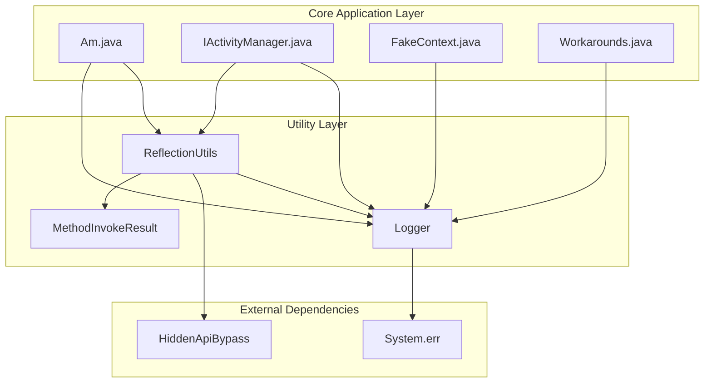
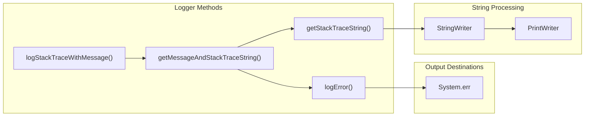
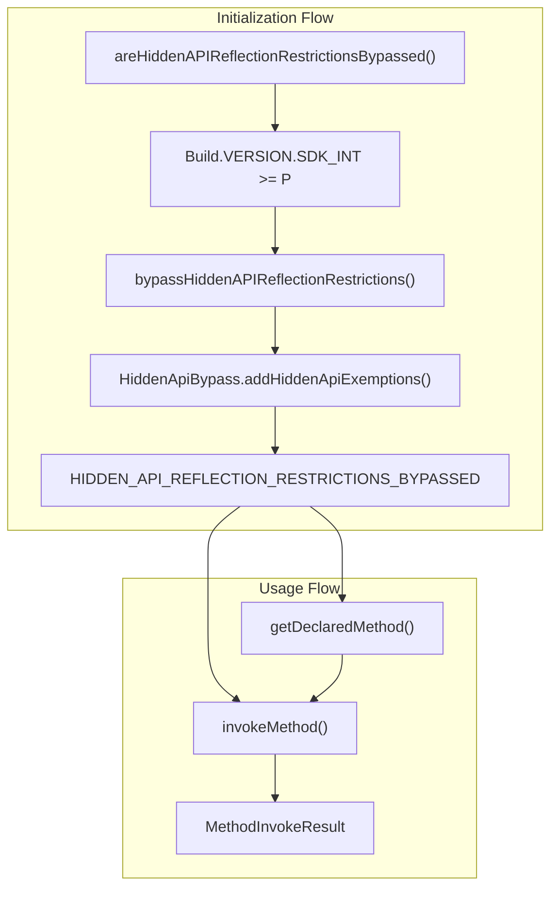
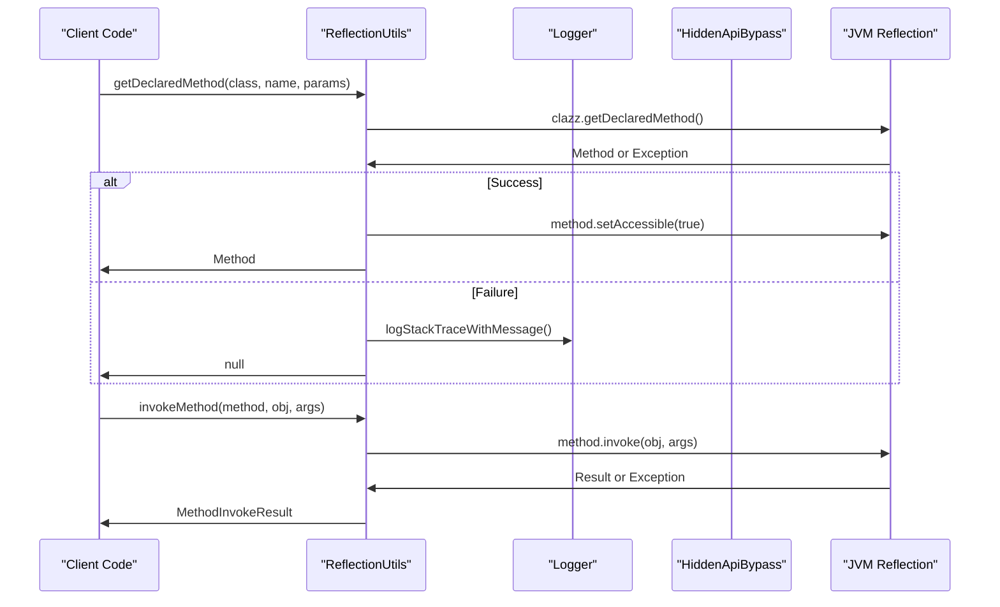
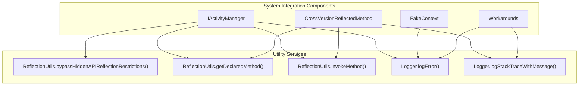

<!-- source: DeepWiki mcp.deepwiki.com · repo termux/TermuxAm · page 7 Utility Classes and Support Components · fetched 2026-10-26 -->

# Utility Classes and Support Components

Relevant source files

The following files were used as context for generating this wiki page:

- [app/src/main/java/com/termux/termuxam/logger/Logger.java](app/src/main/java/com/termux/termuxam/logger/Logger.java)
- [app/src/main/java/com/termux/termuxam/reflection/ReflectionUtils.java](app/src/main/java/com/termux/termuxam/reflection/ReflectionUtils.java)

This document covers the foundational utility classes and support components that enable the core TermuxAm functionality. These components provide essential infrastructure services including logging, reflection utilities for hidden API access, and result data structures that support the main application logic.

For information about the main application logic that uses these utilities, see [Core Application Components](#4). For details about how hidden API access is configured at the build level, see [Application Build Configuration](#5.1).

## System Context and Dependencies

The utility classes form the foundation layer that supports TermuxAm's core functionality. These components are designed to handle the low-level concerns of Android system integration, particularly the challenges of accessing hidden APIs and providing consistent logging across the application.

**Utility System Architecture**

Sources: [app/src/main/java/com/termux/termuxam/logger/Logger.java:1-57](), [app/src/main/java/com/termux/termuxam/reflection/ReflectionUtils.java:1-109]()

## Logging Infrastructure

The `Logger` class provides a centralized logging system designed for command-line applications that need to output error messages and diagnostic information to standard error.

### Core Logging Features

The logging system supports several key patterns:

| Method | Purpose | Output Format |
|--------|---------|---------------|
| `logError(String message)` | Basic error logging | `message` |
| `logError(String tag, String message)` | Tagged error logging | `tag message` |
| `logStackTraceWithMessage()` | Exception with context | `message:\nstacktrace` |
| `getStackTraceString()` | Stack trace conversion | Full exception trace |

**Logging Component Structure**

Sources: [app/src/main/java/com/termux/termuxam/logger/Logger.java:7-57]()

### Implementation Details

The `Logger` class uses a straightforward approach optimized for command-line tools:

- **Error Output**: All messages are directed to `System.err` [app/src/main/java/com/termux/termuxam/logger/Logger.java:14]()
- **Stack Trace Handling**: Converts `Throwable` objects to strings using `StringWriter` and `PrintWriter` [app/src/main/java/com/termux/termuxam/logger/Logger.java:43-49]()
- **Optional Tagging**: Supports optional tag prefixes for categorizing log messages [app/src/main/java/com/termux/termuxam/logger/Logger.java:14]()

## Reflection Utilities

The `ReflectionUtils` class handles the complex task of accessing Android's hidden APIs through Java reflection, including bypassing the hidden API restrictions introduced in Android 9 (API level 28).

### Hidden API Bypass Management

The reflection system manages hidden API access through a careful initialization process:

Sources: [app/src/main/java/com/termux/termuxam/reflection/ReflectionUtils.java:18-40]()

### Method Resolution and Invocation

The reflection utilities provide a safe wrapper around Java's reflection APIs:

| Component | Purpose | Error Handling |
|-----------|---------|----------------|
| `getDeclaredMethod()` | Locate methods by name and parameters | Returns `null` on failure |
| `invokeMethod()` | Execute methods with arguments | Returns `MethodInvokeResult` |
| `setAccessible(true)` | Bypass access restrictions | Applied automatically |

**Reflection Operation Flow**

Sources: [app/src/main/java/com/termux/termuxam/reflection/ReflectionUtils.java:49-107]()

### Integration with HiddenApiBypass

The reflection utilities integrate with the `org.lsposed.hiddenapibypass` library to overcome Android's hidden API restrictions:

- **Conditional Bypass**: Only attempts bypass on Android 9+ devices [app/src/main/java/com/termux/termuxam/reflection/ReflectionUtils.java:18-26]()
- **Global Exemptions**: Uses empty string parameter to exempt all hidden APIs [app/src/main/java/com/termux/termuxam/reflection/ReflectionUtils.java:28]()
- **Thread Safety**: Uses `synchronized` methods to ensure safe initialization [app/src/main/java/com/termux/termuxam/reflection/ReflectionUtils.java:25]()

## Supporting Data Structures

The utility system includes result wrapper classes that provide structured return values for reflection operations.

### MethodInvokeResult

The `MethodInvokeResult` class encapsulates the outcome of reflection method invocations:

- **Success Indicator**: Boolean flag indicating if the operation succeeded
- **Return Value**: The actual value returned by the reflected method
- **Error Handling**: Provides consistent error handling for failed reflections

This pattern allows calling code to distinguish between successful method calls that return `null` and failed method calls.

Sources: [app/src/main/java/com/termux/termuxam/reflection/ReflectionUtils.java:9](), [app/src/main/java/com/termux/termuxam/reflection/ReflectionUtils.java:91-105]()

## Integration with Core System

The utility classes are tightly integrated with TermuxAm's core functionality, particularly the Android system integration components that require hidden API access.

**Utility Usage Patterns**

Sources: [app/src/main/java/com/termux/termuxam/reflection/ReflectionUtils.java:1-109](), [app/src/main/java/com/termux/termuxam/logger/Logger.java:1-57]()

The utilities provide the essential foundation that enables TermuxAm to overcome Android's security restrictions while maintaining robust error handling and logging capabilities throughout the application.

---

