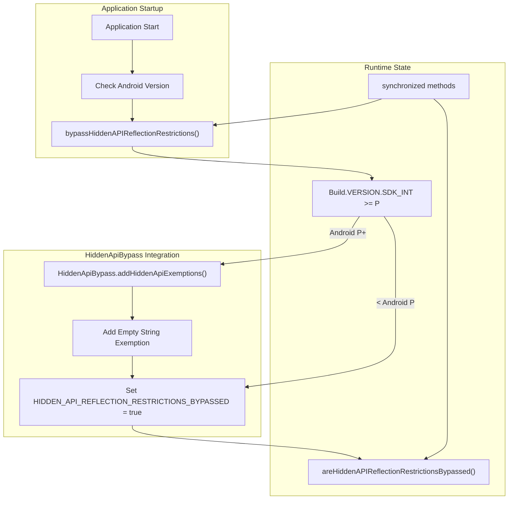
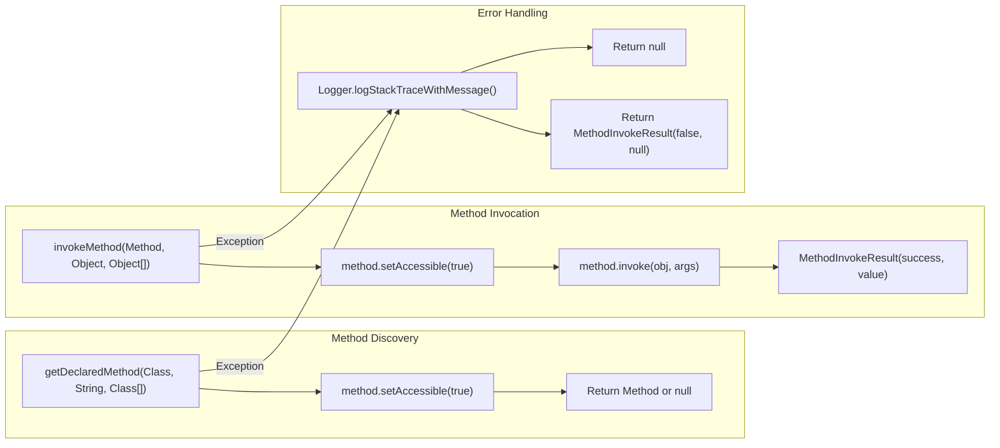
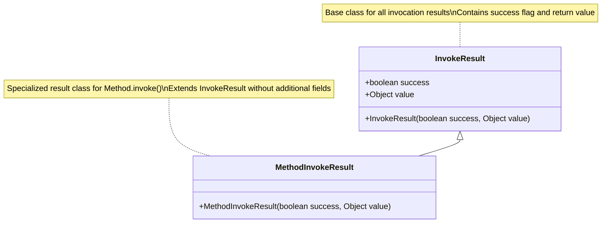

<!-- source: DeepWiki mcp.deepwiki.com · repo termux/TermuxAm · page 7.1 Reflection Utilities · fetched 2026-10-26 -->

# Reflection Utilities

Relevant source files

The following files were used as context for generating this wiki page:

- [app/src/main/java/com/termux/termuxam/reflection/ReflectionUtils.java](app/src/main/java/com/termux/termuxam/reflection/ReflectionUtils.java)
- [app/src/main/java/com/termux/termuxam/reflection/result/InvokeResult.java](app/src/main/java/com/termux/termuxam/reflection/result/InvokeResult.java)
- [app/src/main/java/com/termux/termuxam/reflection/result/MethodInvokeResult.java](app/src/main/java/com/termux/termuxam/reflection/result/MethodInvokeResult.java)

This section covers the reflection utility classes that enable TermuxAm to access Android's hidden and internal APIs through Java reflection. These utilities form the foundation layer that allows the system to interact with restricted Android framework components.

The reflection utilities provide three core capabilities: bypassing Android's hidden API restrictions introduced in Android P (API 28), safely obtaining method references from system classes, and invoking those methods with structured error handling. For information about how these utilities integrate with Android system services, see [Android System Integration](#4.2). For the broader compatibility strategy, see [Compatibility and Workarounds](#4.3).

## Hidden API Bypass System

The system implements a bypass mechanism for Android's hidden API restrictions that were introduced in Android P to prevent third-party applications from accessing non-SDK interfaces.

The bypass system uses a singleton pattern with thread safety through synchronized methods. The `bypassHiddenAPIReflectionRestrictions()` method [app/src/main/java/com/termux/termuxam/reflection/ReflectionUtils.java:25-35]() checks if the current Android version requires bypassing (API 28+) and calls `HiddenApiBypass.addHiddenApiExemptions("")` to disable restrictions for all hidden APIs.

**Sources:** [app/src/main/java/com/termux/termuxam/reflection/ReflectionUtils.java:18-40]()

## Method Reflection Capabilities

The reflection utilities provide safe method lookup and invocation with comprehensive error handling and logging.

The `getDeclaredMethod()` methods [app/src/main/java/com/termux/termuxam/reflection/ReflectionUtils.java:63-74]() handle both parameterized and non-parameterized method lookup, automatically setting accessibility and providing detailed error logging with parameter type information. The `invokeMethod()` methods [app/src/main/java/com/termux/termuxam/reflection/ReflectionUtils.java:97-107]() ensure accessibility and return structured results regardless of success or failure.

**Sources:** [app/src/main/java/com/termux/termuxam/reflection/ReflectionUtils.java:46-107]()

## Result Handling System

The reflection utilities use a hierarchical result system to provide structured feedback from reflection operations.

The result classes follow a simple inheritance pattern where `InvokeResult` [app/src/main/java/com/termux/termuxam/reflection/result/InvokeResult.java:6-18]() provides the base structure with `success` boolean and `value` object fields. `MethodInvokeResult` [app/src/main/java/com/termux/termuxam/reflection/result/MethodInvokeResult.java:10-16]() extends this specifically for method invocation results, maintaining type safety while allowing for future specialization.

**Sources:** [app/src/main/java/com/termux/termuxam/reflection/result/InvokeResult.java:1-18](), [app/src/main/java/com/termux/termuxam/reflection/result/MethodInvokeResult.java:1-16]()

## Integration with System Components

The reflection utilities serve as the foundational layer for accessing Android's internal APIs throughout the TermuxAm system.

| Component | Usage Pattern | Purpose |
|-----------|---------------|---------|
| `IActivityManager` | Uses `getDeclaredMethod()` and `invokeMethod()` | Access ActivityManagerService methods |
| `CrossVersionReflectedMethod` | Relies on bypass and method discovery | Handle API differences across Android versions |
| `FakeContext` | Uses reflection for context manipulation | Create minimal context for system operations |
| `Workarounds` | Uses reflection for device-specific fixes | Handle manufacturer-specific variations |

The utilities integrate with the logging system through the `Logger` class for comprehensive error tracking and debugging. All reflection operations that fail are logged with full stack traces and parameter information, enabling effective debugging of system integration issues.

**Sources:** [app/src/main/java/com/termux/termuxam/reflection/ReflectionUtils.java:8-9](), [app/src/main/java/com/termux/termuxam/reflection/ReflectionUtils.java:30](), [app/src/main/java/com/termux/termuxam/reflection/ReflectionUtils.java:69-71](), [app/src/main/java/com/termux/termuxam/reflection/ReflectionUtils.java:102-104]()

---

