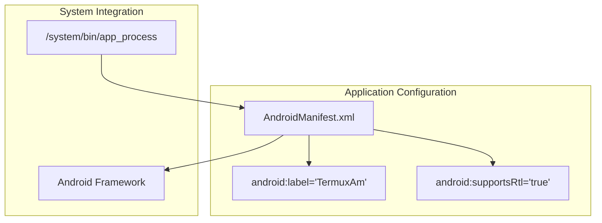
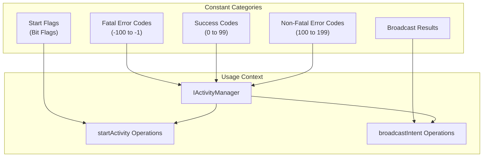
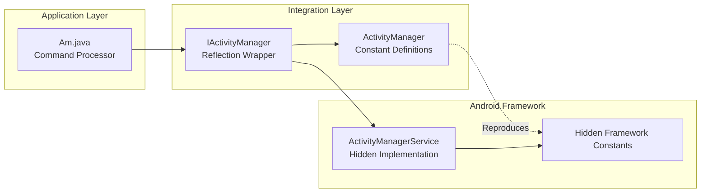

<!-- source: DeepWiki mcp.deepwiki.com · repo termux/TermuxAm · page 7.2 Constants and Configuration · fetched 2026-10-26 -->

# Constants and Configuration

Relevant source files

The following files were used as context for generating this wiki page:

- [app/.gitignore](app/.gitignore)
- [app/proguard-rules.pro](app/proguard-rules.pro)
- [app/src/main/AndroidManifest.xml](app/src/main/AndroidManifest.xml)
- [app/src/main/java/com/termux/termuxam/ActivityManager.java](app/src/main/java/com/termux/termuxam/ActivityManager.java)

This page documents the configuration files and constant definitions that support TermuxAm's core functionality. This includes the Android manifest configuration, reproduced ActivityManager constants from Android's hidden APIs, and build-related configuration files that enable the system's hidden API access capabilities.

For information about the main build system configuration that enables hidden API access, see [Application Build Configuration](#5.1). For details about the reflection utilities that use these constants, see [Reflection Utilities](#7.1).

## Purpose and Scope

The constants and configuration covered here serve two primary functions:
1. **Android Integration Configuration**: Manifest and build settings that allow the application to integrate with Android's system services
2. **Hidden API Constants**: Local definitions of Android framework constants that are normally hidden from third-party applications

## Android Manifest Configuration

The application uses a minimal Android manifest that focuses on basic application metadata while avoiding complex permission declarations that could interfere with system integration.

**Minimal Configuration Design**

The manifest at [app/src/main/AndroidManifest.xml:1-6]() deliberately maintains a minimal configuration:

| Property | Value | Purpose |
|----------|--------|---------|
| `android:label` | "TermuxAm" | Application display name |
| `android:supportsRtl` | `true` | Right-to-left language support |

This minimal approach avoids declaring activities, services, or receivers that could interfere with the application's primary role as a command-line utility executed through `app_process`.

**Sources:** [app/src/main/AndroidManifest.xml:1-6]()

## ActivityManager Constants

The `ActivityManager` class reproduces critical constants from Android's hidden framework APIs, enabling the application to interpret result codes and use flags that are normally inaccessible to third-party applications.

**Constant Range Definitions**

The constants are organized into logical ranges defined by base values:

| Range | Base Constant | Values | Purpose |
|-------|---------------|--------|---------|
| Fatal Errors | `FIRST_START_FATAL_ERROR_CODE` | -100 to -1 | Unrecoverable start failures |
| Success Codes | `FIRST_START_SUCCESS_CODE` | 0 to 99 | Successful operations with variations |
| Non-Fatal Errors | `FIRST_START_NON_FATAL_ERROR_CODE` | 100 to 199 | Recoverable failures |

**Critical Start Result Constants**

Key activity start result constants include:

- **`START_SUCCESS`** [app/src/main/java/com/termux/termuxam/ActivityManager.java:102](): Normal successful start (value 0)
- **`START_PERMISSION_DENIED`** [app/src/main/java/com/termux/termuxam/ActivityManager.java:60](): Caller lacks required permissions
- **`START_CLASS_NOT_FOUND`** [app/src/main/java/com/termux/termuxam/ActivityManager.java:75](): Requested activity class not found
- **`START_INTENT_NOT_RESOLVED`** [app/src/main/java/com/termux/termuxam/ActivityManager.java:82](): Intent cannot be resolved to activity

**Start Flags for Debugging**

Debug-related flags enable specialized activity launch modes:

- **`START_FLAG_DEBUG`** [app/src/main/java/com/termux/termuxam/ActivityManager.java:160](): Launch with debugging enabled
- **`START_FLAG_TRACK_ALLOCATION`** [app/src/main/java/com/termux/termuxam/ActivityManager.java:167](): Enable allocation tracking
- **`START_FLAG_NATIVE_DEBUGGING`** [app/src/main/java/com/termux/termuxam/ActivityManager.java:174](): Enable native debugging support

**Broadcast Result Constants**

Broadcasting operations use these result codes:

- **`BROADCAST_SUCCESS`** [app/src/main/java/com/termux/termuxam/ActivityManager.java:180](): Successful broadcast (value 0)
- **`BROADCAST_STICKY_CANT_HAVE_PERMISSION`** [app/src/main/java/com/termux/termuxam/ActivityManager.java:187](): Sticky broadcast permission error
- **`BROADCAST_FAILED_USER_STOPPED`** [app/src/main/java/com/termux/termuxam/ActivityManager.java:194](): Target user is stopped

**Sources:** [app/src/main/java/com/termux/termuxam/ActivityManager.java:1-197]()

## Constant Usage in System Integration

These constants enable proper interpretation of Android framework responses when TermuxAm interacts with system services through reflection.

The constants serve as a bridge between the application code and Android's internal representations, allowing TermuxAm to provide meaningful error messages and handle different result scenarios appropriately.

**Sources:** [app/src/main/java/com/termux/termuxam/ActivityManager.java:7-12](), [app/src/main/java/com/termux/termuxam/ActivityManager.java:102](), [app/src/main/java/com/termux/termuxam/ActivityManager.java:180]()

## Build Configuration Files

Additional configuration files support the build process and development workflow.

**ProGuard Configuration**

The ProGuard rules file [app/proguard-rules.pro:1-21]() contains default configuration with commented-out options for:
- WebView JavaScript interface preservation
- Line number information retention for debugging
- Source file name obfuscation

This minimal ProGuard configuration suggests that code obfuscation is not a primary concern, consistent with the project's focus on system integration rather than commercial distribution.

**Git Configuration**

The `.gitignore` file [app/.gitignore:1-1]() excludes the standard Android build directory, preventing build artifacts from being committed to version control.

**Sources:** [app/proguard-rules.pro:1-21](), [app/.gitignore:1-1]()

## Configuration Integration

These configuration components work together to support TermuxAm's core functionality by providing the necessary constants and build settings while maintaining compatibility with Android's security model and build system requirements.

The minimal manifest configuration combined with comprehensive constant definitions reflects the application's specialized role as a system utility that requires deep Android framework integration while avoiding the complexity of a typical Android application.

---

