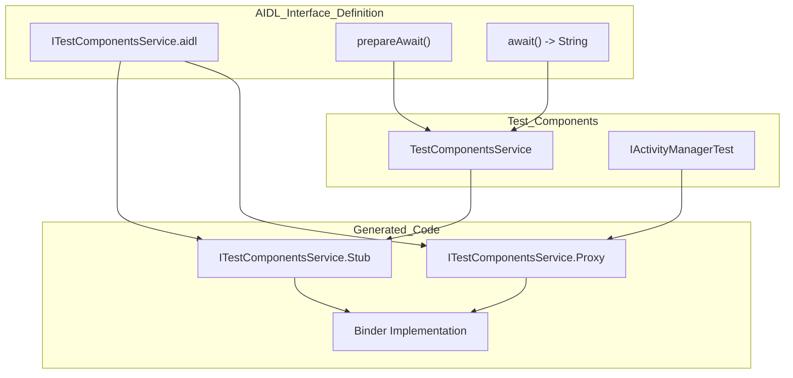
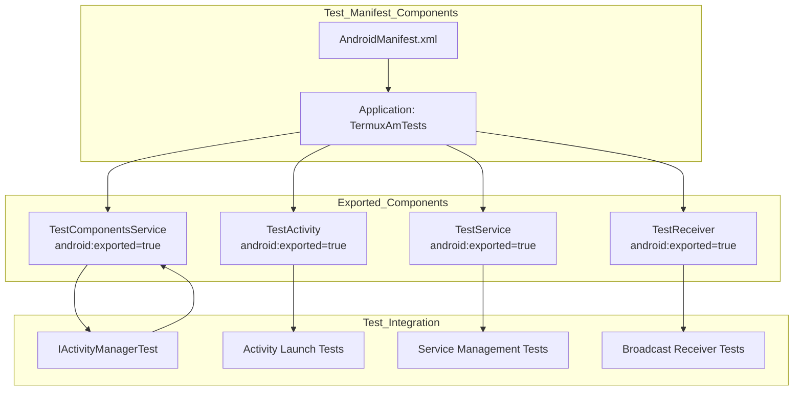
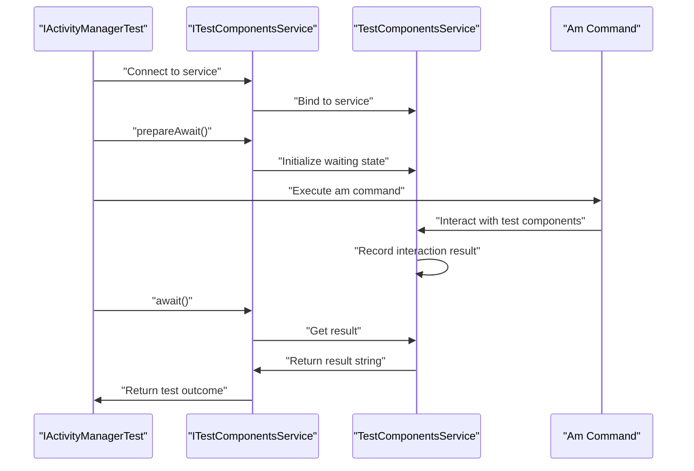

<!-- source: DeepWiki mcp.deepwiki.com · repo termux/TermuxAm · page 8 Development Reference · fetched 2026-10-26 -->

# Development Reference

Relevant source files

The following files were used as context for generating this wiki page:

- [app/src/androidTest/AndroidManifest.xml](app/src/androidTest/AndroidManifest.xml)
- [app/src/androidTest/aidl/com/termux/termuxam/ITestComponentsService.aidl](app/src/androidTest/aidl/com/termux/termuxam/ITestComponentsService.aidl)

This document covers the development-specific resources and interfaces used in the TermuxAm project, including AIDL interfaces for inter-process communication during testing and test manifest configurations. These resources are primarily used by developers working on the codebase to understand the testing infrastructure and development workflows.

For information about the main testing components and test execution, see [Testing Infrastructure](#6). For build system configuration that affects development, see [Build System and Configuration](#5).

## AIDL Interface Definitions

The project defines AIDL (Android Interface Definition Language) interfaces to enable inter-process communication during testing scenarios. These interfaces allow test components to coordinate and exchange information across process boundaries.

### ITestComponentsService Interface

The `ITestComponentsService` interface provides a simple coordination mechanism for test components to synchronize their execution and communicate results.

The interface defines two primary methods:

| Method | Return Type | Purpose |
|--------|-------------|---------|
| `prepareAwait()` | void | Initializes the service for awaiting test completion |
| `await()` | String | Blocks until test results are available and returns them |

Sources: [app/src/androidTest/aidl/com/termux/termuxam/ITestComponentsService.aidl:1-15]()

## Test Manifest Configuration

The test manifest defines the Android components required for comprehensive testing of the TermuxAm functionality. These components are exported to allow external interaction during testing scenarios.

### Test Component Architecture

### Component Definitions

The test manifest registers four key components for testing different aspects of Android system integration:

| Component | Type | Class | Export Status | Purpose |
|-----------|------|-------|---------------|---------|
| TestReceiver | BroadcastReceiver | `com.termux.termuxam.test.TestReceiver` | Exported | Tests broadcast intent handling |
| TestComponentsService | Service | `com.termux.termuxam.test.TestComponentsService` | Exported | AIDL-based test coordination |
| TestActivity | Activity | `com.termux.termuxam.test.TestActivity` | Exported | Tests activity management functionality |
| TestService | Service | `com.termux.termuxam.test.TestService` | Exported | Tests service lifecycle operations |

All components are marked as `android:exported="true"` to enable interaction from test instrumentation and external processes, which is essential for testing the `IActivityManager` integration functionality.

Sources: [app/src/androidTest/AndroidManifest.xml:1-13]()

## Development Workflow Integration

### AIDL-Test Component Interaction

The AIDL interface and test components work together to enable comprehensive testing of the TermuxAm functionality across process boundaries.

### Package Structure

The development resources are organized within the test package structure:

- **Base Package**: `com.termux.termuxam.test`
- **AIDL Package**: `com.termux.termuxam` (shared with main application)
- **Test Application Label**: `TermuxAmTests`

The AIDL interface is defined in the main application package (`com.termux.termuxam`) to enable cross-process communication between the main application and test components, while the test manifest components reside in the test-specific package namespace.

Sources: [app/src/androidTest/aidl/com/termux/termuxam/ITestComponentsService.aidl:2](), [app/src/androidTest/AndroidManifest.xml:2,5]()