# Page: Overview

# Overview

<details>
<summary>Relevant source files</summary>

The following files were used as context for generating this wiki page:

- [.gitignore](.gitignore)
- [LICENSE](LICENSE)
- [README.md](README.md)

</details>


This document provides an introduction to the TermuxAm project, explaining its purpose, core architecture, and how it solves the Android Oreo `am` command restrictions. For detailed information about specific components, see [Architecture Overview](#2), [Entry Points and Execution](#3), and [Core Application Components](#4).

## Purpose and Problem Statement

TermuxAm is an Android Oreo-compatible reimplementation of the Android Activity Manager (`am`) command that enables applications to start activities, send broadcasts, and manage services programmatically. Since Android Oreo (API 26), the system `am` command has been restricted to work only from `adb shell` environments and is no longer accessible to applications running in user space.

This restriction created a significant limitation for terminal emulators like Termux and other applications that need programmatic access to Android's activity management functionality. TermuxAm solves this problem by providing a drop-in replacement that works within application contexts while maintaining compatibility with the original `am` command interface.

Sources: [README.md:1-5]()

## System Architecture Overview

The following diagram illustrates the high-level system architecture and how the main components interact:

**TermuxAm System Architecture**

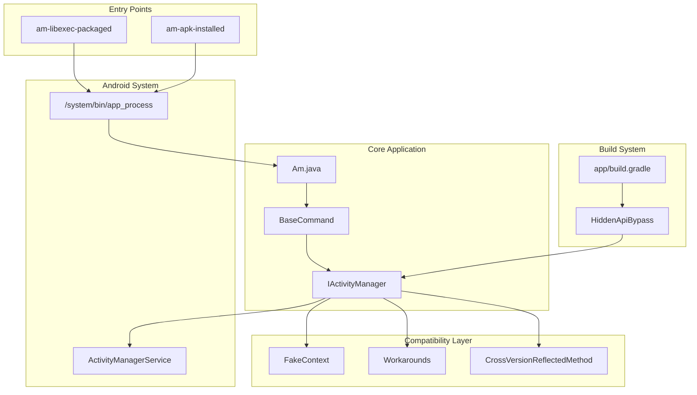

The system operates through two primary execution paths:
- **Production Path**: `am-libexec-packaged` → `app_process` → `Am.java`
- **Development Path**: `am-apk-installed` → `app_process` → `Am.java`

Both paths converge on the core Java application (`Am.java`) which processes commands and interacts with Android's system services through a carefully constructed compatibility layer.

Sources: [README.md:8-14]()

## Deployment Models

TermuxAm supports two distinct deployment models, each optimized for different use cases:

| Deployment Model | Entry Script | Target Environment | Primary Use Case |
|-----------------|--------------|-------------------|------------------|
| Production | `am-libexec-packaged` | Termux package system | End-user installations |
| Development | `am-apk-installed` | Android Studio + APK | Development and testing |

**Deployment and Execution Flow**

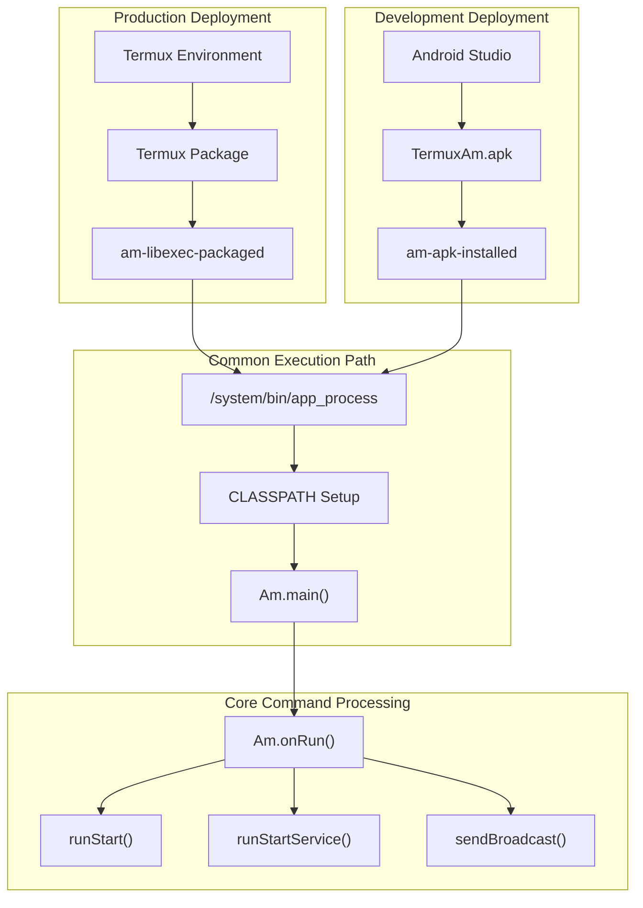

The production model (`am-libexec-packaged`) includes specific Android 14 compatibility fixes and is optimized for distribution through Termux's package manager. The development model (`am-apk-installed`) facilitates rapid development and testing by leveraging Android Studio's build and debug capabilities.

Sources: [README.md:8-14]()

## Core Technical Challenges

TermuxAm addresses several critical technical challenges that emerged with Android's security model evolution:

### Hidden API Access Restrictions

Starting with Android 9 (API 28), Google implemented restrictions on accessing hidden APIs through reflection. TermuxAm overcomes this through:

- **Target SDK Version Strategy**: Using `targetSdkVersion = 27` to maintain legacy permission model
- **HiddenApiBypass Library**: Integration of `org.lsposed.hiddenapibypass:4.3` for runtime API access
- **Reflection Utilities**: Custom `CrossVersionReflectedMethod` for version-specific compatibility

### Android 14 Writable DEX Restrictions

Android 14 introduced restrictions on writable DEX files that affected the execution model. The solution involves:

- **File Permission Management**: Setting DEX files to read-only (`chmod 0400`) in `am-libexec-packaged`
- **Execution Path Optimization**: Modified app_process invocation to handle restricted file permissions

### Manufacturer-Specific Variations

Different Android manufacturers (Meizu, Honor, etc.) implement system variations that require specific workarounds:

- **Device-Specific Fixes**: `Workarounds` class containing manufacturer-specific adaptations
- **Context Manipulation**: `FakeContext` class for handling context-related system differences

Sources: [README.md:1-19]()

## Testing and Quality Assurance

The system includes comprehensive testing infrastructure to ensure compatibility across Android versions and device manufacturers:

**Test Architecture Overview**

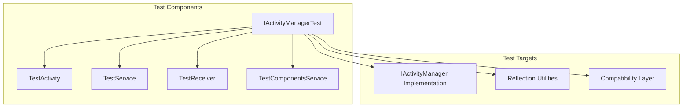

The primary test suite is located in `IActivityManagerTest.java` and provides comprehensive validation of the core `IActivityManager` wrapper functionality across different Android versions and system configurations.

Sources: [README.md:16-18]()

## Project Structure and Navigation

The TermuxAm codebase is organized into several key areas:

- **Entry Points**: Shell scripts that handle different deployment scenarios
- **Core Application**: Java implementation of the `am` command functionality  
- **Compatibility Layer**: Version-specific workarounds and system integration code
- **Build System**: Gradle configuration enabling hidden API access
- **Testing Infrastructure**: Comprehensive test suite for validation

For detailed exploration of each component:
- System architecture details: [Architecture Overview](#2)
- Entry point implementation: [Entry Points and Execution](#3)  
- Java application logic: [Core Application Components](#4)
- Build configuration: [Build System and Configuration](#5)
- Testing framework: [Testing Infrastructure](#6)

Sources: [README.md:1-19](), [LICENSE:1-203]()

---

# Page: Architecture Overview

# Architecture Overview

<details>
<summary>Relevant source files</summary>

The following files were used as context for generating this wiki page:

- [am-libexec-packaged](am-libexec-packaged)
- [app/src/main/java/com/termux/termuxam/Am.java](app/src/main/java/com/termux/termuxam/Am.java)
- [app/src/main/java/com/termux/termuxam/BaseCommand.java](app/src/main/java/com/termux/termuxam/BaseCommand.java)
- [app/src/main/java/com/termux/termuxam/IActivityManager.java](app/src/main/java/com/termux/termuxam/IActivityManager.java)

</details>


This page provides a comprehensive overview of the TermuxAm system architecture, covering the main components and their interactions to deliver Android Activity Manager functionality to terminal applications.

TermuxAm is designed as a command-line utility that replicates the functionality of Android's `/system/bin/am` command, which was restricted starting in Android Oreo. The system uses reflection and hidden API access to interact with Android's internal `IActivityManager` service, providing activities starting, service management, and broadcast capabilities to applications running in terminal environments like Termux.

For details about specific entry points and execution paths, see [Entry Points and Execution](#3). For information about the build system configuration that enables hidden API access, see [Build System and Configuration](#5).

## System Architecture Overview

The TermuxAm system follows a layered architecture with clear separation between entry points, application logic, Android integration, and compatibility handling.

**System Architecture with Code Entities**
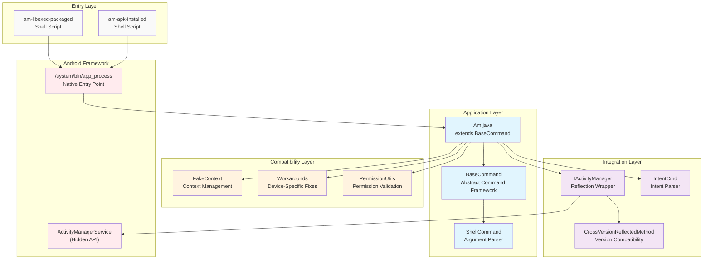

Sources: [am-libexec-packaged:1-31](), [app/src/main/java/com/termux/termuxam/Am.java:40-41](), [app/src/main/java/com/termux/termuxam/BaseCommand.java:25-27](), [app/src/main/java/com/termux/termuxam/IActivityManager.java:19-21]()

## Core Application Architecture

The application layer implements the command-line interface and business logic for processing Android Activity Manager commands.

**Application Layer Components**
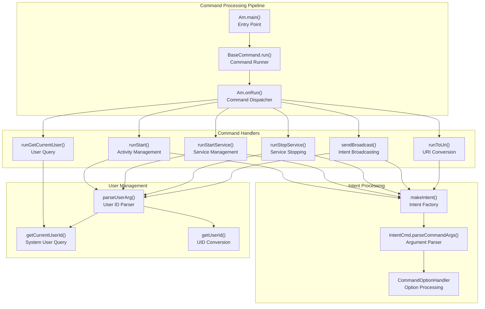

Sources: [app/src/main/java/com/termux/termuxam/Am.java:119-124](), [app/src/main/java/com/termux/termuxam/BaseCommand.java:37-56](), [app/src/main/java/com/termux/termuxam/Am.java:416-524](), [app/src/main/java/com/termux/termuxam/Am.java:606-676]()

## Android System Integration Architecture

The integration layer handles the complex task of accessing Android's hidden APIs through reflection while maintaining compatibility across Android versions.

**Android Integration and Reflection Architecture**
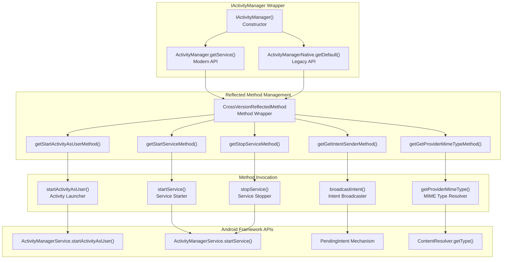

Sources: [app/src/main/java/com/termux/termuxam/IActivityManager.java:31-61](), [app/src/main/java/com/termux/termuxam/IActivityManager.java:63-242](), [app/src/main/java/com/termux/termuxam/IActivityManager.java:246-346]()

## Compatibility and Workaround System

The system includes extensive compatibility handling to work across different Android versions and manufacturer variations.

**Compatibility Architecture**
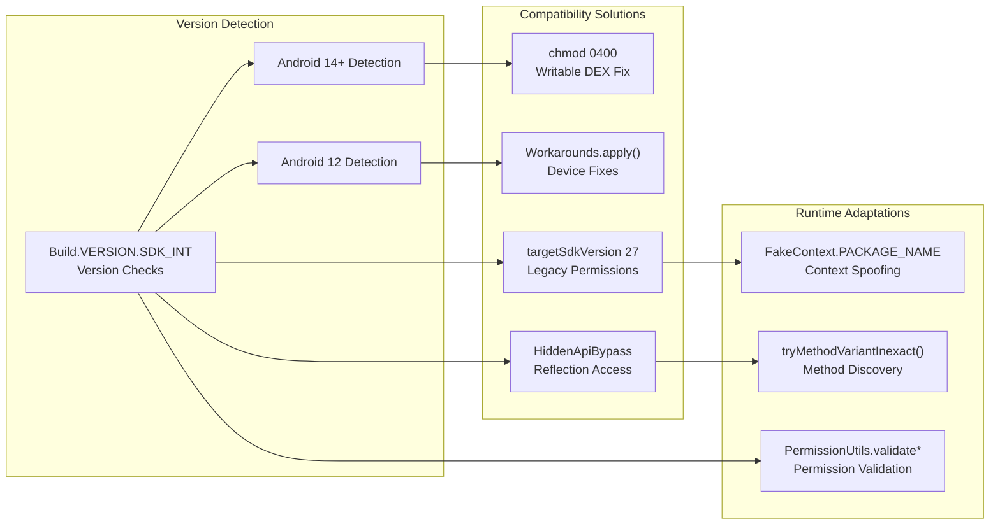

Sources: [am-libexec-packaged:10-26](), [app/src/main/java/com/termux/termuxam/IActivityManager.java:247-248](), [app/src/main/java/com/termux/termuxam/IActivityManager.java:315-326]()

## Command Execution Flow

The following diagram shows how commands flow through the system from user input to Android framework interaction.

**End-to-End Command Processing Flow**
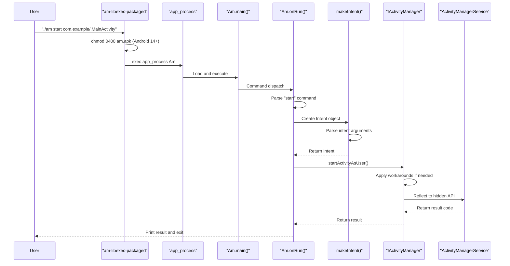

Sources: [am-libexec-packaged:28-30](), [app/src/main/java/com/termux/termuxam/Am.java:119-124](), [app/src/main/java/com/termux/termuxam/Am.java:735-933](), [app/src/main/java/com/termux/termuxam/IActivityManager.java:246-258]()

## Key Architectural Patterns

### Reflection-Based API Access
The system heavily relies on Java reflection to access Android's hidden `IActivityManager` interface. The `CrossVersionReflectedMethod` class provides version-agnostic method discovery and invocation, allowing the same code to work across different Android versions where method signatures may vary.

### Command Pattern Implementation
The `BaseCommand` class implements a command pattern where each am subcommand (`start`, `startservice`, `broadcast`, etc.) is handled by a specific method in the `Am` class. The `onRun()` method acts as a dispatcher based on the first command argument.

### Compatibility Layer Strategy
Rather than creating version-specific code branches, the system uses a layered approach with:
- Build-time configuration (`targetSdkVersion 27`)
- Runtime workarounds (`Workarounds.apply()`)
- Permission validation (`PermissionUtils`)
- Context manipulation (`FakeContext`)

### Intent Processing Pipeline
All commands that involve Android Intents follow a common pipeline through `makeIntent()`, which parses command-line arguments into `Intent` objects using the `IntentCmd.parseCommandArgs()` method with custom option handlers.

Sources: [app/src/main/java/com/termux/termuxam/BaseCommand.java:25-108](), [app/src/main/java/com/termux/termuxam/Am.java:606-676](), [app/src/main/java/com/termux/termuxam/IActivityManager.java:63-242]()

---

# Page: Entry Points and Execution

# Entry Points and Execution

<details>
<summary>Relevant source files</summary>

The following files were used as context for generating this wiki page:

- [am-apk-installed](am-apk-installed)
- [am-libexec-packaged](am-libexec-packaged)

</details>


This document explains how the TermuxAm system starts up and the two different execution paths available. It covers the shell script entry points that bootstrap the Java application and handle platform-specific compatibility requirements.

For detailed information about the main Java application logic, see [Core Application Components](#4). For build system configuration that enables this execution model, see [Build System and Configuration](#5).

## Entry Point Overview

TermuxAm provides two distinct entry points that serve different deployment scenarios:

| Entry Point | Purpose | Target Scenario | Importance Score |
|-------------|---------|-----------------|------------------|
| `am-libexec-packaged` | Production deployment | Termux package distribution | 24.97 |
| `am-apk-installed` | Development testing | Android Studio development | 3.05 |

Both entry points follow the same fundamental pattern: they configure the environment and execute the Java application via Android's `app_process` system binary.

## Execution Flow

**System Execution Flow**

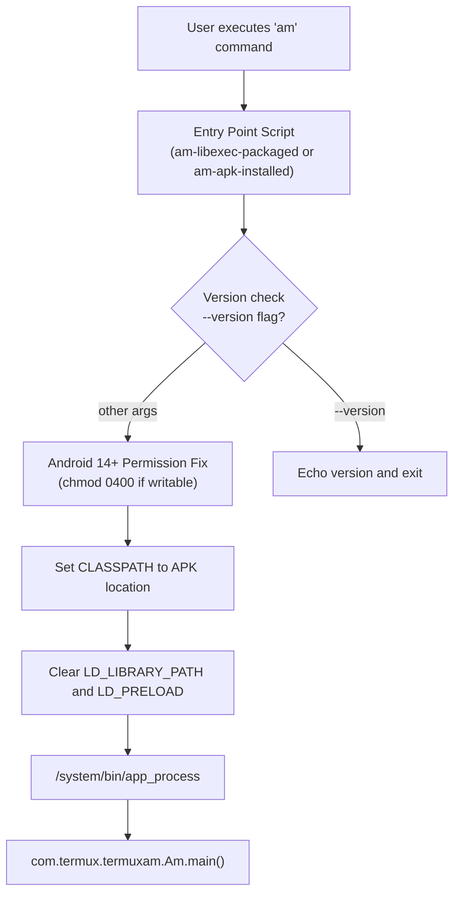

Sources: [am-libexec-packaged:1-31](), [am-apk-installed:1-5]()

## Production Entry Point Architecture

The `am-libexec-packaged` script serves as the primary entry point for production deployments and implements several critical compatibility mechanisms:

**APK Location and Permission Management**

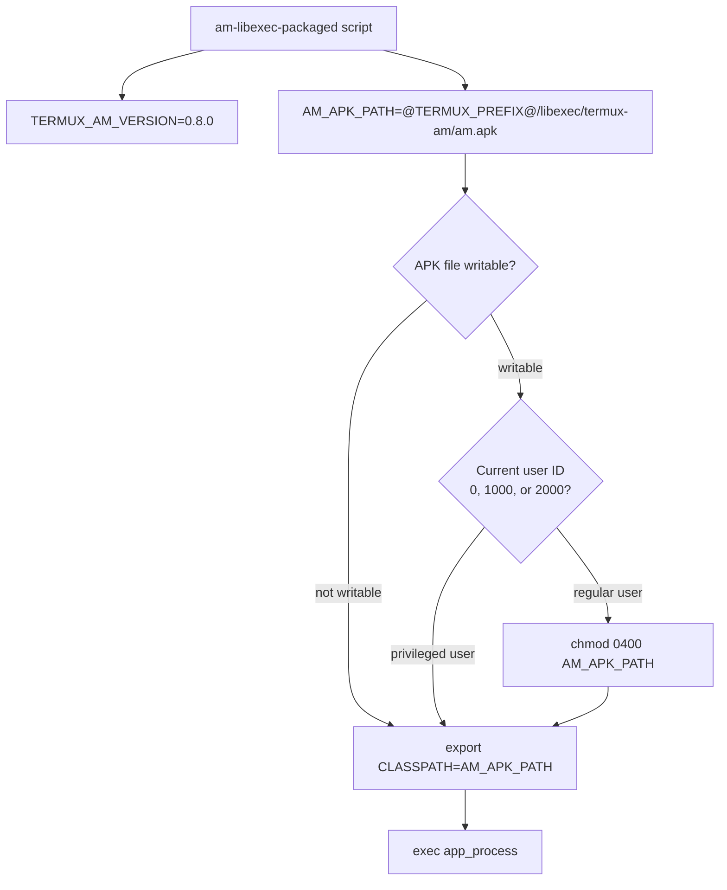

The script implements Android 14 compatibility by removing write permissions from the APK file for non-privileged users. This prevents the `SecurityException: Writable dex file` that would cause `SIGABRT` in `app_process` on Android 14+.

**Key Implementation Details:**

- **Version handling**: [am-libexec-packaged:2,5-8]() provides version information via `TERMUX_AM_VERSION` variable
- **APK path resolution**: [am-libexec-packaged:3]() uses build-time substitution with `@TERMUX_PREFIX@` placeholder
- **Android 14 fix**: [am-libexec-packaged:21-26]() removes write permissions for users other than root (0), system (1000), and shell (2000)
- **Environment cleanup**: [am-libexec-packaged:29]() clears `LD_LIBRARY_PATH` and `LD_PRELOAD` to prevent interference
- **Process execution**: [am-libexec-packaged:30]() uses `-Xnoimage-dex2oat` flag and targets main class `com.termux.termuxam.Am`

Sources: [am-libexec-packaged:1-31]()

## Development Entry Point Architecture

The `am-apk-installed` script provides a simplified entry point for development scenarios:

**Development Execution Flow**

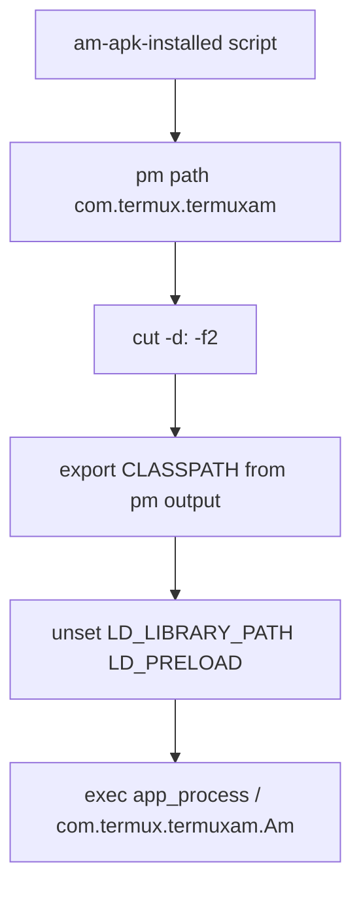

**Key Implementation Differences:**

- **Dynamic APK discovery**: [am-apk-installed:2]() uses `pm path com.termux.termuxam` to locate the installed APK dynamically
- **Simplified execution**: No version checking or permission management
- **Development focus**: Assumes APK is properly installed via Android Studio or `adb install`

Sources: [am-apk-installed:1-5]()

## Android System Integration

Both entry points ultimately delegate to Android's `app_process` system binary, which provides the runtime environment for the Java application:

**App Process Integration**

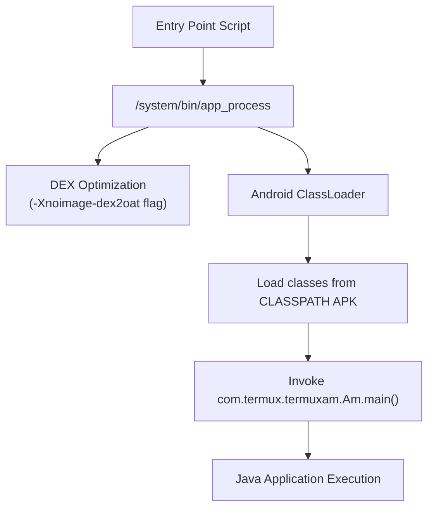

**System Integration Details:**

- **Process model**: Both scripts use `exec` to replace the shell process with `app_process`
- **DEX optimization**: The `-Xnoimage-dex2oat` flag in production script prevents image-based DEX optimization
- **Class loading**: Android's system class loader loads classes from the APK specified in `CLASSPATH`
- **Main class**: Both entry points target `com.termux.termuxam.Am` as the main application class
- **Argument passing**: All command-line arguments are forwarded to the Java application via `"$@"`

Sources: [am-libexec-packaged:30](), [am-apk-installed:4]()

---

# Page: Production Entry Point (am-libexec-packaged)

# Production Entry Point (am-libexec-packaged)

<details>
<summary>Relevant source files</summary>

The following files were used as context for generating this wiki page:

- [am-libexec-packaged](am-libexec-packaged)

</details>


## Purpose and Scope

This document covers the primary production entry point for TermuxAm, implemented as the `am-libexec-packaged` shell script. This script serves as the main executable that Termux users interact with when running `am` commands, handling system compatibility issues and launching the Java application through Android's `app_process`.

For information about the development entry point, see [Development Entry Point (am-apk-installed)](#3.2). For details about the Java application that this script launches, see [Core Application Components](#4).

## Script Overview and Architecture

The `am-libexec-packaged` script is a carefully designed wrapper that addresses several critical challenges in running Java applications within the Termux environment on modern Android systems.

### Execution Flow Diagram

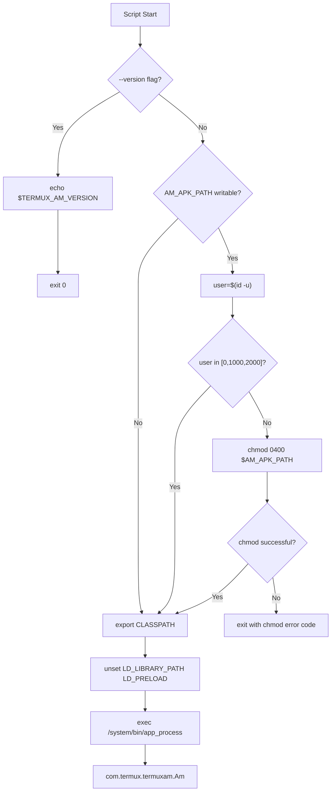

Sources: [am-libexec-packaged:1-31]()

## Version Handling

The script implements simple version reporting functionality that responds to the `--version` flag by outputting the hardcoded version string and exiting immediately.

| Component | Value | Line Reference |
|-----------|-------|----------------|
| Version Variable | `TERMUX_AM_VERSION=0.8.0` | [am-libexec-packaged:2]() |
| Version Check | `if [ "$1" = "--version" ]` | [am-libexec-packaged:5]() |
| Version Output | `echo "$TERMUX_AM_VERSION"` | [am-libexec-packaged:6]() |

Sources: [am-libexec-packaged:2](), [am-libexec-packaged:5-8]()

## Android 14 Compatibility Logic

The most complex part of the script addresses Android 14's stricter security model around writable DEX files. This compatibility layer prevents `SecurityException: Writable dex file` errors that would cause `SIGABRT` in `app_process`.

### Permission Fix Logic Diagram

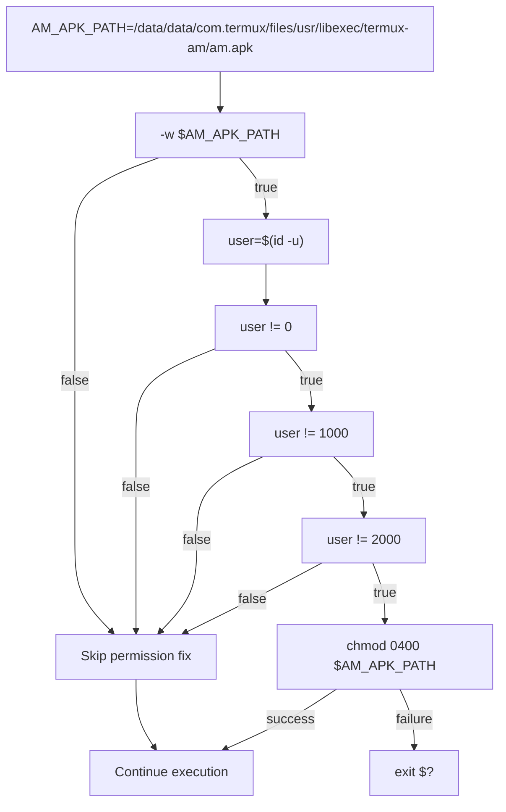

### Privileged User Exclusions

The script excludes certain system users from the permission fix:

| User ID | System Role | Reasoning |
|---------|-------------|-----------|
| `0` | root | System-level privileges bypass restrictions |
| `1000` | system | Android system user with special permissions |
| `2000` | shell | ADB shell user context |

Sources: [am-libexec-packaged:10-26]()

## Environment Setup and Process Execution

The final phase of the script configures the Java execution environment and launches the application through Android's native process spawning mechanism.

### Environment Configuration

The script performs several critical environment setup operations:

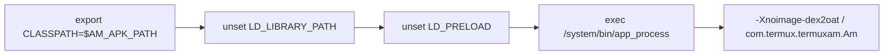

| Environment Operation | Purpose | Line Reference |
|----------------------|---------|----------------|
| `export CLASSPATH` | Set Java classpath to APK location | [am-libexec-packaged:28]() |
| `unset LD_LIBRARY_PATH` | Clean native library path | [am-libexec-packaged:29]() |
| `unset LD_PRELOAD` | Remove library preloading | [am-libexec-packaged:29]() |

### App Process Invocation

The script uses Android's `app_process` with specific flags and arguments:

- **Binary**: `/system/bin/app_process` - Android's Java application launcher
- **Flag**: `-Xnoimage-dex2oat` - Disables ahead-of-time compilation for faster startup
- **Working Directory**: `/` - Root directory as working directory
- **Main Class**: `com.termux.termuxam.Am` - Entry point for the Java application
- **Arguments**: `"$@"` - Forward all command-line arguments to the Java application

Sources: [am-libexec-packaged:28-30]()

## Integration with System Architecture

This production entry point serves as the bridge between the Termux package system and the Java application core:

### System Integration Flow

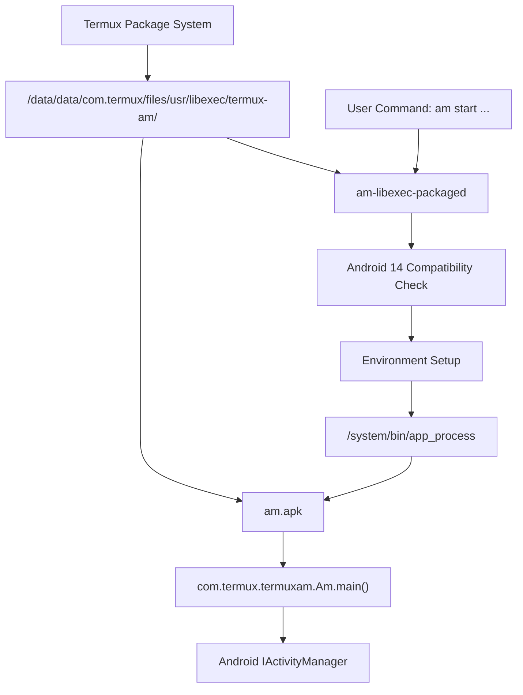

The script's design ensures that:
1. Modern Android security restrictions are respected
2. The Java application receives a clean execution environment  
3. All user arguments are properly forwarded to the application
4. System integration occurs through standard Android mechanisms

Sources: [am-libexec-packaged:1-31]()

---

# Page: Development Entry Point (am-apk-installed)

# Development Entry Point (am-apk-installed)

<details>
<summary>Relevant source files</summary>

The following files were used as context for generating this wiki page:

- [am-apk-installed](am-apk-installed)

</details>


## Purpose and Scope

This document covers the development-oriented entry point script `am-apk-installed`, which provides access to TermuxAm functionality when the application is installed as an APK during development workflows. This script is designed for developers testing the application through Android Studio or manual APK installation, as opposed to end users who would use the production Termux package entry point covered in [Production Entry Point (am-libexec-packaged)](#3.1).

## Script Overview

The `am-apk-installed` script is a minimal shell script that bootstraps the TermuxAm Java application when installed as a standard Android APK. Unlike the production entry point, this script relies on the Android Package Manager to locate the installed application.

**Sources:** [am-apk-installed:1-4]()

## Core Functionality

### APK Path Resolution

The script uses Android's Package Manager to dynamically locate the installed TermuxAm APK:

```bash
export CLASSPATH="$(pm path com.termux.termuxam 2>&1 </dev/null | cut -d: -f2)"
```

This command performs several operations:
- Executes `pm path com.termux.termuxam` to query the package location
- Redirects stderr to stdout and stdin to /dev/null for clean output
- Extracts the APK path using `cut` to parse the "package:/path/to/apk.apk" format
- Sets the extracted path as the Java CLASSPATH

**Sources:** [am-apk-installed:2]()

### Environment Cleanup

The script cleans the execution environment to prevent interference from Termux-specific library paths:

```bash
unset LD_LIBRARY_PATH LD_PRELOAD
```

This ensures that the Android system's app_process runs with clean library dependencies rather than potentially conflicting Termux libraries.

**Sources:** [am-apk-installed:3]()

### Java Execution

The final step launches the Java application through Android's app_process:

```bash
exec /system/bin/app_process / com.termux.termuxam.Am "$@"
```

This directly invokes the `com.termux.termuxam.Am` main class with all provided arguments.

**Sources:** [am-apk-installed:4]()

## Development Workflow Integration

### Execution Flow

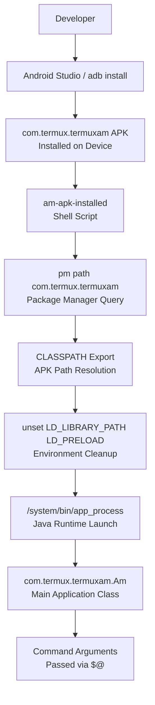

**Development Entry Point Execution Flow**

**Sources:** [am-apk-installed:1-4]()

### APK Installation Context

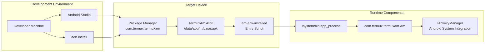

**Development Installation and Execution Context**

**Sources:** [am-apk-installed:2,4]()

## Comparison with Production Entry Point

| Aspect | Development (`am-apk-installed`) | Production (`am-libexec-packaged`) |
|--------|----------------------------------|-----------------------------------|
| **Installation Method** | APK via Android Studio/adb | Termux package manager |
| **Path Resolution** | `pm path` command | Direct file path |
| **Target Users** | Developers and testers | End users |
| **Complexity** | Simple 4-line script | Complex with Android 14 fixes |
| **Importance Score** | 3.05 | 24.97 |

**Sources:** [am-apk-installed:1-4]()

## Integration Points

### Build System Connection

This entry point connects to the build system components that produce the installable APK:

- **Application Build**: The APK is generated by [app/build.gradle](#5.1) with proper hidden API configurations
- **Main Class**: Executes the `com.termux.termuxam.Am` class documented in [Command Processing (Am.java)](#4.1)
- **System Integration**: Uses the same Android system integration layer as the production version

### Testing Workflow

The development entry point supports the testing infrastructure by providing direct access to the installed APK during development:

- Enables [IActivityManager Testing](#6.1) with installed APK
- Supports manual testing of core functionality
- Allows debugging through Android Studio with installed components

**Sources:** [am-apk-installed:2,4]()

## Technical Limitations

### APK Dependency

Unlike the production entry point, this script requires the TermuxAm APK to be installed through standard Android package management. This creates a dependency on:

- Android Package Manager service availability
- Proper APK signing and installation
- Device storage for APK installation

### Development-Only Scope

The script lacks the production-ready features of the main entry point:
- No Android 14 compatibility fixes
- No advanced error handling
- No Termux-specific environment optimizations

**Sources:** [am-apk-installed:1-4]()

---

# Page: Core Application Components

# Core Application Components

<details>
<summary>Relevant source files</summary>

The following files were used as context for generating this wiki page:

- [app/src/main/java/com/termux/termuxam/Am.java](app/src/main/java/com/termux/termuxam/Am.java)
- [app/src/main/java/com/termux/termuxam/BaseCommand.java](app/src/main/java/com/termux/termuxam/BaseCommand.java)
- [app/src/main/java/com/termux/termuxam/IActivityManager.java](app/src/main/java/com/termux/termuxam/IActivityManager.java)

</details>


This document covers the main Java application components that implement the core `am` command functionality in TermuxAm. These components handle command parsing, dispatch, and interaction with Android's system services. For detailed information about the command processing logic, see [Command Processing (Am.java)](#4.1). For Android system integration details, see [Android System Integration](#4.2). For compatibility handling, see [Compatibility and Workarounds](#4.3).

## Component Architecture

The core application is built around three primary Java classes that work together to provide `am` command functionality:

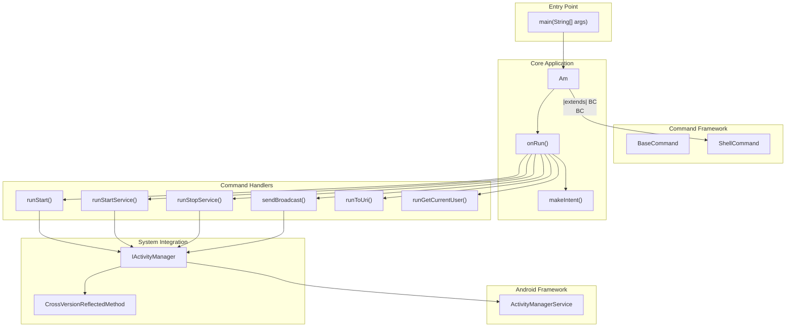

Sources: [app/src/main/java/com/termux/termuxam/Am.java:40-41](), [app/src/main/java/com/termux/termuxam/Am.java:119-124](), [app/src/main/java/com/termux/termuxam/BaseCommand.java:25-27](), [app/src/main/java/com/termux/termuxam/IActivityManager.java:19-21]()

## Component Responsibilities

| Component | Purpose | Key Methods |
|-----------|---------|-------------|
| `Am` | Main application class implementing am command functionality | `main()`, `onRun()`, `runStart()`, `runStartService()`, `sendBroadcast()` |
| `BaseCommand` | Abstract base class providing command-line framework | `run()`, `onRun()`, `onShowUsage()`, `nextArg()` |
| `IActivityManager` | Reflection wrapper for Android's internal IActivityManager interface | `startActivityAsUser()`, `broadcastIntent()`, `startService()` |
| `ShellCommand` | Command-line argument parsing utilities | `getNextOption()`, `getNextArg()`, `init()` |

Sources: [app/src/main/java/com/termux/termuxam/Am.java:40-124](), [app/src/main/java/com/termux/termuxam/BaseCommand.java:37-108](), [app/src/main/java/com/termux/termuxam/IActivityManager.java:246-345]()

## Command Processing Flow

The application follows a structured command processing pattern from entry point to Android system integration:

```mermaid
flowchart TD
    subgraph "Application Entry"
        MAIN_ENTRY["Am.main(String[] args)"]
        RUN["BaseCommand.run(args)"]
        INIT_ARGS["ShellCommand.init(args, 0)"]
    end
    
    subgraph "Command Dispatch"
        ONRUN_START["Am.onRun()"]
        NEXTARG["nextArgRequired()"]
        COMMAND_SWITCH{"Command Switch"}
    end
    
    subgraph "Command Execution"
        START_CMD["\"start\" | \"start-activity\""]
        SERVICE_CMD["\"startservice\" | \"start-service\""] 
        STOP_CMD["\"stopservice\" | \"stop-service\""]
        BROADCAST_CMD["\"broadcast\""]
        URI_CMD["\"to-uri\" | \"to-intent-uri\""]
        USER_CMD["\"get-current-user\""]
    end
    
    subgraph "Intent Creation"
        MAKE_INTENT["makeIntent()"]
        PARSE_OPTIONS["IntentCmd.parseCommandArgs()"]
        HANDLE_OPTIONS["CommandOptionHandler.handleOption()"]
    end
    
    subgraph "System Calls"
        IAM_INIT["new IActivityManager()"]
        SYSTEM_METHOD["startActivityAsUser() | startService() | broadcastIntent()"]
    end
    
    MAIN_ENTRY --> RUN
    RUN --> INIT_ARGS
    RUN --> ONRUN_START
    ONRUN_START --> NEXTARG
    NEXTARG --> COMMAND_SWITCH
    
    COMMAND_SWITCH --> START_CMD
    COMMAND_SWITCH --> SERVICE_CMD
    COMMAND_SWITCH --> STOP_CMD
    COMMAND_SWITCH --> BROADCAST_CMD
    COMMAND_SWITCH --> URI_CMD
    COMMAND_SWITCH --> USER_CMD
    
    START_CMD --> MAKE_INTENT
    SERVICE_CMD --> MAKE_INTENT
    STOP_CMD --> MAKE_INTENT
    BROADCAST_CMD --> MAKE_INTENT
    
    MAKE_INTENT --> PARSE_OPTIONS
    PARSE_OPTIONS --> HANDLE_OPTIONS
    HANDLE_OPTIONS --> IAM_INIT
    IAM_INIT --> SYSTEM_METHOD
```

Sources: [app/src/main/java/com/termux/termuxam/Am.java:119-124](), [app/src/main/java/com/termux/termuxam/Am.java:417-524](), [app/src/main/java/com/termux/termuxam/Am.java:606-676](), [app/src/main/java/com/termux/termuxam/BaseCommand.java:37-56]()

## Core Interfaces and Patterns

### Command Pattern Implementation

The application uses a command pattern where `Am` extends `BaseCommand` and implements specific command handlers:

- **Entry Point**: [app/src/main/java/com/termux/termuxam/Am.java:119-124]()
- **Command Dispatch**: [app/src/main/java/com/termux/termuxam/Am.java:417-524]()
- **Base Framework**: [app/src/main/java/com/termux/termuxam/BaseCommand.java:37-78]()

### Reflection-Based System Integration

The `IActivityManager` class uses reflection to access Android's hidden APIs across different Android versions:

- **Service Acquisition**: [app/src/main/java/com/termux/termuxam/IActivityManager.java:38-50]()
- **Method Resolution**: [app/src/main/java/com/termux/termuxam/IActivityManager.java:80-104]()
- **Cross-Version Compatibility**: [app/src/main/java/com/termux/termuxam/IActivityManager.java:246-345]()

### State Management

The `Am` class maintains command state through instance variables that are reset for each command execution:

| Variable | Purpose | Reset Location |
|----------|---------|----------------|
| `mStartFlags` | Activity start flags | [app/src/main/java/com/termux/termuxam/Am.java:607]() |
| `mWaitOption` | Wait for completion flag | [app/src/main/java/com/termux/termuxam/Am.java:608]() |
| `mUserId` | Target user ID | [app/src/main/java/com/termux/termuxam/Am.java:616]() |
| `mReceiverPermission` | Broadcast receiver permission | [app/src/main/java/com/termux/termuxam/Am.java:104]() |

Sources: [app/src/main/java/com/termux/termuxam/Am.java:98-106](), [app/src/main/java/com/termux/termuxam/Am.java:606-620]()

## Key Constants and Configuration

The application defines important Android system constants used throughout the command processing:

- **User ID Constants**: `USER_ALL (-1)`, `USER_CURRENT (-2)`, `USER_NULL (-10000)` at [app/src/main/java/com/termux/termuxam/Am.java:82-89]()
- **UID Ranges**: `PER_USER_RANGE (100000)`, `FIRST_APPLICATION_UID (10000)`, `LAST_APPLICATION_UID (19999)` at [app/src/main/java/com/termux/termuxam/Am.java:67-80]()
- **Error Codes**: Inherited from `BaseCommand` at [app/src/main/java/com/termux/termuxam/BaseCommand.java:30-32]()

Sources: [app/src/main/java/com/termux/termuxam/Am.java:67-89](), [app/src/main/java/com/termux/termuxam/BaseCommand.java:30-32]()

---

# Page: Command Processing (Am.java)

# Command Processing (Am.java)

<details>
<summary>Relevant source files</summary>

The following files were used as context for generating this wiki page:

- [app/src/main/java/com/termux/termuxam/Am.java](app/src/main/java/com/termux/termuxam/Am.java)
- [app/src/main/java/com/termux/termuxam/BaseCommand.java](app/src/main/java/com/termux/termuxam/BaseCommand.java)
- [app/src/main/java/com/termux/termuxam/IntentCmd.java](app/src/main/java/com/termux/termuxam/IntentCmd.java)

</details>


This document covers the core command processing logic implemented in the `Am` class, which serves as the main entry point and command dispatcher for the TermuxAm application. The `Am` class handles parsing command-line arguments, dispatching to appropriate command handlers, and interfacing with Android's activity management system through reflection-based API calls.

For information about the Android system integration layer, see [Android System Integration](#4.2). For details about compatibility workarounds and reflection utilities, see [Compatibility and Workarounds](#4.3).

## Command Dispatch Architecture

The `Am` class follows a command pattern where the first argument determines which operation to perform. The architecture centers around the `onRun` method which acts as the central dispatcher to specialized command handler methods.

```mermaid
flowchart TD
    main["main(String[] args)"] --> run["run(args)"]
    run --> onRun["onRun()"]
    onRun --> nextArgRequired["nextArgRequired()"]
    nextArgRequired --> dispatch{Command Type}
    
    dispatch -->|"start/start-activity"| runStart["runStart()"]
    dispatch -->|"startservice/start-service"| runStartService["runStartService()"]
    dispatch -->|"stopservice/stop-service"| runStopService["runStopService()"]
    dispatch -->|"broadcast"| sendBroadcast["sendBroadcast()"]
    dispatch -->|"to-uri"| runToUri["runToUri(0)"]
    dispatch -->|"to-intent-uri"| runToUriIntent["runToUri(Intent.URI_INTENT_SCHEME)"]
    dispatch -->|"to-app-uri"| runToUriApp["runToUri(Intent.URI_ANDROID_APP_SCHEME)"]
    dispatch -->|"get-current-user"| runGetCurrentUser["runGetCurrentUser()"]
    dispatch -->|unknown| showError["showError()"]
    
    runStart --> makeIntent["makeIntent()"]
    runStartService --> makeIntent
    runStopService --> makeIntent
    sendBroadcast --> makeIntent
```

Sources: [app/src/main/java/com/termux/termuxam/Am.java:119-124](), [app/src/main/java/com/termux/termuxam/Am.java:416-524]()

## Class Hierarchy and Dependencies

The `Am` class inherits from `BaseCommand` and integrates with several key components for argument parsing, intent creation, and system interaction.

```mermaid
classDiagram
    class BaseCommand {
        #ShellCommand mArgs
        +run(String[] args) Integer
        +onRun()* Integer
        +onShowUsage(PrintStream out)*
        +nextOption() String
        +nextArg() String
        +nextArgRequired() String
    }
    
    class Am {
        -IActivityManager mAm
        -int mStartFlags
        -boolean mWaitOption
        -boolean mStopOption
        -int mRepeat
        -Integer mUserId
        -String mReceiverPermission
        -boolean mCheckDrawOverAppsPermissions
        +main(String[] args)
        +onRun() Integer
        +onShowUsage(PrintStream out)
        -makeIntent() Intent
        -runStart() int
        -runStartService() int
        -runStopService() int
        -sendBroadcast() Integer
        -runToUri(int flags) int
        -runGetCurrentUser() int
        +parseUserArg(String arg) int
        +getCurrentUserId() int
    }
    
    class IActivityManager {
        +startActivityAsUser() int
        +startService() ComponentName
        +stopService() int
        +broadcastIntent()
        +getProviderMimeType() String
    }
    
    class IntentCmd {
        +parseCommandArgs() Intent
        +printIntentArgsHelp()
    }
    
    BaseCommand <|-- Am
    Am --> IActivityManager : uses
    Am --> IntentCmd : uses
```

Sources: [app/src/main/java/com/termux/termuxam/Am.java:40](), [app/src/main/java/com/termux/termuxam/BaseCommand.java:25-108](), [app/src/main/java/com/termux/termuxam/IntentCmd.java:16-406]()

## Command Parsing and Intent Creation

The `makeIntent` method serves as the central point for parsing command-line arguments and creating Android `Intent` objects. It handles both command-specific options and generic intent parameters through the `IntentCmd.parseCommandArgs` method.

### Intent Creation Flow

```mermaid
flowchart TD
    makeIntent["makeIntent()"] --> resetFlags["Reset instance flags"]
    resetFlags --> parseArgs["IntentCmd.parseCommandArgs()"]
    
    parseArgs --> optionHandler["CommandOptionHandler"]
    optionHandler --> handleOptions{Handle Option}
    
    handleOptions -->|"-W"| waitOption["mWaitOption = true"]
    handleOptions -->|"-R"| repeatOption["mRepeat = parseInt()"]
    handleOptions -->|"-S"| stopOption["mStopOption = true"]
    handleOptions -->|"--user"| userOption["mUserId = parseUserArg()"]
    handleOptions -->|"--receiver-permission"| permissionOption["mReceiverPermission = arg"]
    handleOptions -->|"--check-draw-over-apps-permission"| checkPermission["mCheckDrawOverAppsPermissions = true"]
    
    parseArgs --> setUserId["Set mUserId if null"]
    setUserId --> returnIntent["return Intent"]
```

### Supported Command Options

| Option | Purpose | Applicable Commands |
|--------|---------|-------------------|
| `-W` | Wait for activity launch completion | start |
| `-R COUNT` | Repeat activity launch COUNT times | start |
| `-S` | Force stop target app before starting | start |
| `--user USER_ID` | Specify target user ID | start, startservice, stopservice, broadcast |
| `--receiver-permission PERM` | Require receiver permission | broadcast |
| `--check-draw-over-apps-permission` | Validate overlay permission | start, startservice |

Sources: [app/src/main/java/com/termux/termuxam/Am.java:606-676](), [app/src/main/java/com/termux/termuxam/Am.java:623-665]()

## Individual Command Handlers

### Activity Management Commands

The `runStart` method handles launching activities through the `IActivityManager.startActivityAsUser` method. It includes comprehensive error handling for various launch result codes.

```mermaid
flowchart TD
    runStart["runStart()"] --> makeIntent["makeIntent()"]
    makeIntent --> validateUser["Validate mUserId"]
    validateUser --> checkPermissions["Check draw-over-apps permission"]
    checkPermissions --> getMimeType["Get MIME type from content provider"]
    
    getMimeType --> startLoop["Start activity loop (mRepeat times)"]
    startLoop --> addFlags["intent.addFlags(FLAG_ACTIVITY_NEW_TASK)"]
    addFlags --> startActivity["mAm.startActivityAsUser()"]
    
    startActivity --> handleResult{Result Code}
    handleResult -->|"START_SUCCESS"| success["launched = true, exitCode = 0"]
    handleResult -->|"START_SWITCHES_CANCELED"| canceled["launched = true, warn user"]
    handleResult -->|"START_DELIVERED_TO_TOP"| delivered["launched = true, warn delivered to top"]
    handleResult -->|"START_TASK_TO_FRONT"| taskToFront["launched = true, warn task to front"]
    handleResult -->|"START_INTENT_NOT_RESOLVED"| notResolved["Error: unable to resolve"]
    handleResult -->|"START_CLASS_NOT_FOUND"| classNotFound["exitCode = 2, class not found"]
    handleResult -->|"START_PERMISSION_DENIED"| permissionDenied["Error: permission denied"]
    
    handleResult --> decrementRepeat["mRepeat--"]
    decrementRepeat --> checkLoop{mRepeat > 1?}
    checkLoop -->|Yes| startLoop
    checkLoop -->|No| returnExitCode["return exitCode"]
```

Sources: [app/src/main/java/com/termux/termuxam/Am.java:735-933](), [app/src/main/java/com/termux/termuxam/Am.java:833-903]()

### Service Management Commands

Service commands (`runStartService` and `runStopService`) follow a similar pattern but use different `IActivityManager` methods and handle service-specific return codes.

```mermaid
flowchart TD
    serviceCommand["runStartService() / runStopService()"] --> makeIntent["makeIntent()"]
    makeIntent --> validateUser["Validate user != USER_ALL"]
    validateUser --> checkPermissions["Check permissions if needed"]
    
    checkPermissions --> callService{Command Type}
    callService -->|startservice| startService["mAm.startService()"]
    callService -->|stopservice| stopService["mAm.stopService()"]
    
    startService --> handleStartResult{ComponentName result}
    handleStartResult -->|null| startError["Service not found, return 2"]
    handleStartResult -->|"!"| startPermError["Permission required, return 1"]
    handleStartResult -->|"!!"| startGenError["General error, return 1"]
    handleStartResult -->|valid| startSuccess["return 0"]
    
    stopService --> handleStopResult{int result}
    handleStopResult -->|0| stopNotRunning["Service not running, return 2"]
    handleStopResult -->|1| stopSuccess["Service stopped, return 0"]
    handleStopResult -->|-1| stopError["Error stopping service, return 1"]
```

Sources: [app/src/main/java/com/termux/termuxam/Am.java:678-708](), [app/src/main/java/com/termux/termuxam/Am.java:710-733]()

### Broadcast Command

The `sendBroadcast` method handles intent broadcasting with special logic for Android 14+ where broadcast results are not waited for.

```mermaid
flowchart TD
    sendBroadcast["sendBroadcast()"] --> makeIntent["makeIntent()"]
    makeIntent --> createReceiver["new IntentReceiver()"]
    createReceiver --> setupPermissions["Setup requiredPermissions array"]
    
    setupPermissions --> checkVersion{SDK > TIRAMISU?}
    checkVersion -->|Yes| broadcastNoWait["mAm.broadcastIntent() with null receiver"]
    checkVersion -->|No| broadcastWithWait["mAm.broadcastIntent() with receiver"]
    
    broadcastNoWait --> returnImmediate["return 0"]
    broadcastWithWait --> waitForFinish["receiver.waitForFinish()"]
    waitForFinish --> returnNull["return null (don't exit in main)"]
```

Sources: [app/src/main/java/com/termux/termuxam/Am.java:971-990](), [app/src/main/java/com/termux/termuxam/Am.java:978-989]()

## User Handling and Permission Management

The `Am` class includes sophisticated user ID parsing and permission checking to handle multi-user Android environments and permission restrictions.

### User ID Resolution

```mermaid
flowchart TD
    parseUserArg["parseUserArg(String arg)"] --> checkArg{arg value}
    checkArg -->|"all"| userAll["return USER_ALL (-1)"]
    checkArg -->|"current" or "cur"| handleCurrent["Handle current user"]
    checkArg -->|numeric| parseInt["return Integer.parseInt(arg)"]
    
    handleCurrent --> getUid["Process.myUid()"]
    getUid --> checkAppUid{uid >= FIRST_APPLICATION_UID?}
    checkAppUid -->|Yes| appUser["return getUserId(uid)"]
    checkAppUid -->|No| privilegedUser{getActualUser?}
    
    privilegedUser -->|Yes| getCurrentUserId["return getCurrentUserId() via reflection"]
    privilegedUser -->|No| userCurrent["return USER_CURRENT (-2)"]
```

### Permission Validation

The system includes permission checking for scenarios where apps need special permissions to perform background operations on Android 10+.

| Permission Check | Method | Purpose |
|-----------------|--------|---------|
| Draw over apps | `PermissionUtils.validateDisplayOverOtherAppsPermissionForPostAndroid10` | Required for background activity starts on Android 10+ |
| User interaction | `parseUserArg` with reflection | Handles `INTERACT_ACROSS_USERS` permission requirements |

Sources: [app/src/main/java/com/termux/termuxam/Am.java:567-604](), [app/src/main/java/com/termux/termuxam/Am.java:547-565](), [app/src/main/java/com/termux/termuxam/Am.java:528-531]()

## Error Handling and Exit Codes

The `Am` class implements a comprehensive error handling system with specific exit codes for different failure scenarios.

### Exit Code Standards

| Exit Code | Scenario | Example |
|-----------|----------|---------|
| 0 | Success | Command completed successfully |
| 1 | General error | Permission denied, invalid arguments |
| 2 | Resource not found | Activity class not found, service not running |
| null | Async operation | Broadcast command waiting for result |

### Error Code Constants

The system defines several error code constants inherited from `BaseCommand`:

- `FATAL_ERROR_CODE`: "Error type 1"
- `NO_SYSTEM_ERROR_CODE`: "Error type 2" 
- `NO_CLASS_ERROR_CODE`: "Error type 3"

These constants are recognized by development tools like the Eclipse plugin for structured error reporting.

Sources: [app/src/main/java/com/termux/termuxam/Am.java:119-128](), [app/src/main/java/com/termux/termuxam/BaseCommand.java:29-32](), [app/src/main/java/com/termux/termuxam/Am.java:126-128]()

---

# Page: Android System Integration

# Android System Integration

<details>
<summary>Relevant source files</summary>

The following files were used as context for generating this wiki page:

- [app/src/main/java/com/termux/termuxam/CrossVersionReflectedMethod.java](app/src/main/java/com/termux/termuxam/CrossVersionReflectedMethod.java)
- [app/src/main/java/com/termux/termuxam/IActivityManager.java](app/src/main/java/com/termux/termuxam/IActivityManager.java)

</details>


This section covers how TermuxAm integrates with Android's internal system APIs to provide `am` command functionality. The system uses Java reflection to access hidden Android APIs that are normally restricted to system applications, specifically targeting the `IActivityManager` service interface.

For information about compatibility workarounds and version-specific fixes, see [Compatibility and Workarounds](#4.3). For details about the main command processing logic that uses these integration components, see [Command Processing (Am.java)](#4.1).

## System Service Integration Architecture

TermuxAm integrates with Android's Activity Manager Service through a reflection-based wrapper that mimics the behavior of the system's `am` command. The integration bypasses normal application restrictions by directly invoking system service methods.

**System Service Integration Overview**

```mermaid
graph TB
    subgraph "TermuxAm Application"
        Am["Am.java<br/>Command Processor"]
        IAM["IActivityManager<br/>Reflection Wrapper"]
        CVRM["CrossVersionReflectedMethod<br/>Version Compatibility"]
    end
    
    subgraph "Android Framework Layer"
        AMS["ActivityManagerService<br/>System Service"]
        IAMS["IActivityManager<br/>AIDL Interface"]
        AMN["ActivityManagerNative<br/>(Legacy)"]
        AMGETSVC["ActivityManager.getService()<br/>(Modern)"]
    end
    
    subgraph "System Process"
        BINDER["Binder IPC"]
        SYSTSVC["System Services"]
    end
    
    Am --> IAM
    IAM --> CVRM
    IAM -->|"Reflection Access"| AMGETSVC
    IAM -->|"Fallback Access"| AMN
    AMGETSVC --> IAMS
    AMN --> IAMS
    IAMS --> AMS
    AMS --> BINDER
    BINDER --> SYSTSVC
```

Sources: [app/src/main/java/com/termux/termuxam/IActivityManager.java:38-50]()

The system obtains access to `IActivityManager` through two different methods depending on the Android version. Modern versions use `ActivityManager.getService()` while older versions use `ActivityManagerNative.getDefault()`.

## IActivityManager Wrapper

The `IActivityManager` class serves as the primary integration point with Android's activity management system. It wraps the internal `android.app.IActivityManager` interface using reflection to provide access to system-level functionality.

**Core IActivityManager Structure**

```mermaid
graph TD
    subgraph "IActivityManager Class"
        CONSTRUCTOR["IActivityManager()<br/>Constructor"]
        MAM["mAm: Object<br/>Service Reference"]
        MCAP["mCallingAppPackage: String<br/>Package Identity"]
        
        subgraph "Cached Method References"
            MGPMT["mGetProviderMimeTypeMethod"]
            MSAUM["mStartActivityAsUserMethod"]
            MSSM["mStartServiceMethod"]
            MSTM["mStopServiceMethod"]
            MGISM["mGetIntentSenderMethod"]
            MISS["mIntentSenderSendMethod"]
        end
        
        subgraph "Public API Methods"
            SAU["startActivityAsUser()"]
            BI["broadcastIntent()"]
            SS["startService()"]
            STS["stopService()"]
            GPMT["getProviderMimeType()"]
        end
    end
    
    CONSTRUCTOR --> MAM
    CONSTRUCTOR --> MCAP
    MAM --> MGPMT
    MAM --> MSAUM
    MAM --> MSSM
    MAM --> MSTM
    MAM --> MGISM
    MAM --> MISS
    
    SAU --> MSAUM
    BI --> MGISM
    BI --> MISS
    SS --> MSSM
    STS --> MSTM
    GPMT --> MGPMT
```

Sources: [app/src/main/java/com/termux/termuxam/IActivityManager.java:19-61]()

The wrapper maintains cached method references to avoid repeated reflection lookups and provides a clean API that mirrors the system's `am` command functionality.

## Cross-Version Method Resolution

The `CrossVersionReflectedMethod` class handles the complexity of method signature variations across different Android versions. It supports both exact and inexact method matching to accommodate API changes over time.

**Method Resolution Process**

```mermaid
graph TB
    subgraph "Method Resolution Flow"
        START["Method Lookup Request"]
        CACHED["Check Cached Method"]
        FOUND{"Method Found?"}
        
        subgraph "Reflection Process"
            EXACT["tryMethodVariant()<br/>Exact Match"]
            INEXACT["tryMethodVariantInexact()<br/>Flexible Match"]
            ITERATE["Iterate Method Variants"]
            VALIDATE["Validate Parameters"]
        end
        
        CACHE["Cache Method Reference"]
        INVOKE["invoke() Ready"]
        ERROR["RuntimeException"]
    end
    
    START --> CACHED
    CACHED --> FOUND
    FOUND -->|"Yes"| INVOKE
    FOUND -->|"No"| EXACT
    EXACT --> INEXACT
    INEXACT --> ITERATE
    ITERATE --> VALIDATE
    VALIDATE --> CACHE
    CACHE --> INVOKE
    VALIDATE -->|"No Match"| ERROR
```

Sources: [app/src/main/java/com/termux/termuxam/CrossVersionReflectedMethod.java:35-67](), [app/src/main/java/com/termux/termuxam/CrossVersionReflectedMethod.java:80-153]()

The inexact matching algorithm allows methods to have additional parameters between expected ones, accommodating Android's tendency to add new parameters to existing methods across versions.

## Android Version Compatibility Handling

The system handles significant API changes across Android versions, particularly for methods that have been removed or modified in newer versions.

| Android Version | Key Changes | Handling Strategy |
|-----------------|-------------|-------------------|
| ≤ API 28 | `ActivityManagerNative.getDefault()` | Fallback method access |
| ≥ API 29 | `ActivityManager.getService()` | Primary access method |
| ≥ API 31 (S) | Workarounds required | `Workarounds.apply()` calls |
| ≥ API 34 | `getProviderMimeType()` removed | Method availability check |

**Version-Specific Method Access**

```mermaid
graph LR
    subgraph "Service Access Strategy"
        TRY1["Try ActivityManager.getService()"]
        TRY2["Try ActivityManagerNative.getDefault()"]
        FAIL["RuntimeException"]
    end
    
    subgraph "Method Availability Checks"
        CHECKVER["Check Build.VERSION.SDK_INT"]
        CHECKFOUND["Check method.isFound()"]
        FALLBACK["Return null/skip"]
    end
    
    TRY1 -->|"Success"| SERVICE["IActivityManager Service"]
    TRY1 -->|"Exception"| TRY2
    TRY2 -->|"Success"| SERVICE
    TRY2 -->|"Exception"| FAIL
    
    CHECKVER --> CHECKFOUND
    CHECKFOUND -->|"Found"| SERVICE
    CHECKFOUND -->|"Not Found"| FALLBACK
```

Sources: [app/src/main/java/com/termux/termuxam/IActivityManager.java:39-50](), [app/src/main/java/com/termux/termuxam/IActivityManager.java:315-326]()

## Service Method Implementations

The wrapper implements the core `am` command functionality through reflection-based service method calls. Each method handles multiple parameter variations and provides appropriate defaults.

### Activity Management

The `startActivityAsUser` method handles activity launching with version-specific workarounds:

```mermaid
graph TD
    subgraph "startActivityAsUser Implementation"
        INPUT["Intent + Parameters"]
        VERCHECK["SDK Version Check"]
        WORKAROUND["Workarounds.apply()<br/>(Android S/S_V2)"]
        REFLECT["Reflection Invoke"]
        RETURN["Return Activity Result"]
    end
    
    INPUT --> VERCHECK
    VERCHECK -->|"API 31-32"| WORKAROUND
    VERCHECK -->|"Other"| REFLECT
    WORKAROUND --> REFLECT
    REFLECT --> RETURN
```

Sources: [app/src/main/java/com/termux/termuxam/IActivityManager.java:246-258]()

### Service Management

Service operations support multiple method signatures across Android versions:

**Service Method Variations**

| Method Signature | Android Version Support | Parameters Added |
|------------------|-------------------------|------------------|
| `startService(caller, service, resolvedType, userId)` | Legacy | Basic parameters |
| `+ callingPackage` | Mid-range versions | Package identification |
| `+ requireForeground` | Recent versions | Foreground requirement |

Sources: [app/src/main/java/com/termux/termuxam/IActivityManager.java:140-167]()

### Broadcast Handling

The broadcast functionality uses a workaround approach due to method signature instability:

```mermaid
graph TB
    subgraph "Broadcast Intent Process"
        BCREQ["Broadcast Request"]
        ALTPATH["Alternative Path<br/>(PendingIntent)"]
        GETINTENT["getIntentSender()"]
        SEND["IntentSender.send()"]
        RESULT["Broadcast Delivered"]
    end
    
    BCREQ --> ALTPATH
    ALTPATH --> GETINTENT
    GETINTENT --> SEND
    SEND --> RESULT
    
    note1["Note: Direct broadcastIntent<br/>method commented out<br/>due to instability"]
    BCREQ -.-> note1
```

Sources: [app/src/main/java/com/termux/termuxam/IActivityManager.java:260-285]()

The broadcast implementation uses `PendingIntent` creation and sending as a more stable alternative to direct `broadcastIntent()` calls, which have proven unreliable across Android versions.

## Provider Content Type Resolution

Content provider MIME type resolution demonstrates the complexity of Android version compatibility, particularly with the removal of `getProviderMimeType()` in Android 14+:

Sources: [app/src/main/java/com/termux/termuxam/IActivityManager.java:287-327]()

The method includes extensive documentation explaining the Android 14+ changes and the challenges with alternative approaches, ultimately falling back to null return when the legacy method is unavailable.

---

# Page: Compatibility and Workarounds

# Compatibility and Workarounds

<details>
<summary>Relevant source files</summary>

The following files were used as context for generating this wiki page:

- [app/src/main/java/android/os/ServiceManager.java](app/src/main/java/android/os/ServiceManager.java)
- [app/src/main/java/com/android/internal/app/IAppOpsService.java](app/src/main/java/com/android/internal/app/IAppOpsService.java)
- [app/src/main/java/com/termux/termuxam/FakeContext.java](app/src/main/java/com/termux/termuxam/FakeContext.java)
- [app/src/main/java/com/termux/termuxam/PermissionUtils.java](app/src/main/java/com/termux/termuxam/PermissionUtils.java)
- [app/src/main/java/com/termux/termuxam/Workarounds.java](app/src/main/java/com/termux/termuxam/Workarounds.java)

</details>


This page documents the compatibility layer that enables TermuxAm to function across different Android versions, device manufacturers, and execution environments. The compatibility system addresses restrictions introduced in Android Oreo and later versions, as well as manufacturer-specific modifications that affect system service access.

For information about the core Android system integration that these workarounds enable, see [Android System Integration](#4.2). For the build configuration that supports hidden API access, see [Application Build Configuration](#5.1).

## Overview

The TermuxAm compatibility system addresses several key challenges:

- **Android Version Differences**: Changes in Android's internal APIs and permission models across versions
- **Manufacturer Customizations**: Device-specific modifications by manufacturers like Meizu and Honor
- **Execution Context**: Different behavior when running as shell user vs. Termux app
- **Hidden API Access**: Restrictions on accessing internal Android APIs introduced in Android 9+

The system consists of three main components working together to provide a stable interface to Android's ActivityManager services.

## FakeContext System

The `FakeContext` class provides a dynamic context wrapper that adapts to the execution environment, ensuring proper package identity resolution regardless of how TermuxAm is invoked.

### Package Identity Resolution

```mermaid
flowchart TD
    Start["FakeContext.setPackageName()"] --> UIDCheck{"Process.myUid() == 2000?"}
    UIDCheck -->|Yes| ShellPkg["return com.android.shell"]
    UIDCheck -->|No| BuildCheck{"TERMUX_PACKAGES_BUILD_PACKAGE_NAME starts with @?"}
    BuildCheck -->|Yes| BuildConfig["return BuildConfig.TERMUX_PACKAGE_NAME"]
    BuildCheck -->|No| TermuxPkg["return TERMUX_PACKAGES_BUILD_PACKAGE_NAME"]
    
    ShellPkg --> Usage["Used for getPackageName()"]
    BuildConfig --> Usage
    TermuxPkg --> Usage
    
    Usage --> Attribution["AttributionSource (Android S+)"]
    Usage --> OpPackage["getOpPackageName()"]
```

The `FakeContext` determines the appropriate package identity based on the execution context:

| Execution Context | UID | Package Name | Use Case |
|-------------------|-----|--------------|----------|
| ADB Shell | 2000 | `com.android.shell` | Development testing |
| Termux App | Variable | Termux package name | Production usage |
| Build Environment | Variable | `BuildConfig.TERMUX_PACKAGE_NAME` | Local builds |

Sources: [app/src/main/java/com/termux/termuxam/FakeContext.java:35-42]()

### Android Version Compatibility

The `FakeContext` includes version-specific adaptations:

- **Android S (API 31)+**: Implements `getAttributionSource()` with proper `AttributionSource.Builder` configuration
- **Android 14+**: Includes placeholder `getDeviceId()` method for future compatibility

Sources: [app/src/main/java/com/termux/termuxam/FakeContext.java:49-61]()

## Manufacturer-Specific Workarounds

The `Workarounds` class implements device-specific fixes for manufacturer customizations that break standard Android behavior.

### Workaround Decision Matrix

```mermaid
flowchart TD
    Start["Workarounds.applyMaybeAudio(boolean audio)"] --> BrandCheck{"Build.BRAND"}
    BrandCheck -->|meizu| MeizuPath["mustFillAppInfo = true"]
    BrandCheck -->|honor| HonorPath["mustFillAppInfo = true<br/>mustFillBaseContext = true<br/>mustFillAppContext = true"]
    BrandCheck -->|other| AudioCheck{"audio && Android 11?"}
    
    MeizuPath --> Apply["Workarounds.apply()"]
    HonorPath --> Apply
    AudioCheck -->|Yes| AudioPath["mustFillAppContext = true"]
    AudioCheck -->|No| Apply
    AudioPath --> Apply
    
    Apply --> FillApp{"mustFillAppInfo?"}
    Apply --> FillBase{"mustFillBaseContext?"}
    Apply --> FillContext{"mustFillAppContext?"}
    
    FillApp -->|Yes| AppInfo["fillAppInfo()"]
    FillBase -->|Yes| BaseCtx["fillBaseContext()"]
    FillContext -->|Yes| AppCtx["fillAppContext()"]
```

### Manufacturer Issues Addressed

| Manufacturer | Issues | Workarounds Applied |
|--------------|--------|-------------------|
| **Meizu** | ActivityThread context issues, Surface creation failures | `fillAppInfo()` |
| **Honor** | Extended context requirements, system service access | `fillAppInfo()`, `fillBaseContext()`, `fillAppContext()` |
| **Android 11** | AudioRecord context requirements (when audio enabled) | `fillAppContext()` |

Sources: [app/src/main/java/com/termux/termuxam/Workarounds.java:36-66]()

## ActivityThread Manipulation

The workaround system manipulates Android's `ActivityThread` to provide the necessary application context for system services that expect a properly initialized Android app.

### ActivityThread Setup Process

```mermaid
flowchart TD
    GetAT["getActivityThread()"] --> PrepLoop["prepareMainLooper()"]
    PrepLoop --> CreateAT["new ActivityThread()"]
    CreateAT --> SetCurrent["ActivityThread.sCurrentActivityThread = instance"]
    
    SetCurrent --> FillApp["fillAppInfo()"]
    SetCurrent --> FillBase["fillBaseContext()"]
    SetCurrent --> FillCtx["fillAppContext()"]
    
    FillApp --> AppBind["Create ActivityThread.AppBindData"]
    AppBind --> AppInfo["Set ApplicationInfo with FakeContext.PACKAGE_NAME"]
    AppInfo --> BindApp["activityThread.mBoundApplication = appBindData"]
    
    FillBase --> SysCtx["getSystemContext()"]
    SysCtx --> SetBase["FakeContext.setBaseContext(systemContext)"]
    
    FillCtx --> NewApp["new Application()"]
    NewApp --> SetMBase["app.mBase = FakeContext.get()"]
    SetMBase --> SetInit["activityThread.mInitialApplication = app"]
```

### Key ActivityThread Operations

1. **Main Looper Preparation**: Uses `Looper.prepareMainLooper()` to avoid Handler creation exceptions
2. **Application Info Setup**: Creates `ActivityThread.AppBindData` with proper package name
3. **Context Injection**: Injects `FakeContext` into the ActivityThread's application context
4. **System Context**: Obtains and configures system context for Honor devices

Sources: [app/src/main/java/com/termux/termuxam/Workarounds.java:93-181]()

## Permission Management

The `PermissionUtils` class handles permission checking across different Android versions, particularly for the `SYSTEM_ALERT_WINDOW` permission required for background activity launching.

### Permission Check Architecture

```mermaid
flowchart TD
    Check["checkDisplayOverOtherAppsPermission()"] --> SDKCheck{"SDK_INT >= M (23)?"}
    SDKCheck -->|No| GrantedLegacy["return true (pre-Marshmallow)"]
    SDKCheck -->|Yes| AppOps["checkPermission(OPSTR_SYSTEM_ALERT_WINDOW)"]
    
    AppOps --> ServiceBinder["ServiceManager.getService('appops')"]
    ServiceBinder --> IAppOps["IAppOpsService.Stub.asInterface()"]
    IAppOps --> AppOpsManager["new AppOpsManager(null, service)"]
    
    AppOpsManager --> VersionCheck{"SDK_INT >= Q (29)?"}
    VersionCheck -->|Yes| Unsafe["unsafeCheckOpNoThrow()"]
    VersionCheck -->|No| Safe["checkOpNoThrow()"]
    
    Unsafe --> Result["MODE_ALLOWED == result"]
    Safe --> Result
```

### Android Version Support

| Android Version | API Level | Permission Check Method | Notes |
|-----------------|-----------|------------------------|-------|
| Pre-Marshmallow | < 23 | Always granted | No runtime permissions |
| Marshmallow-Pie | 23-28 | `checkOpNoThrow()` | Standard AppOps check |
| Android 10+ | 29+ | `unsafeCheckOpNoThrow()` | Enhanced security model |

### Permission Validation

The system includes special validation for Android 10+ devices where the `SYSTEM_ALERT_WINDOW` permission is required for background activity launching:

```java
validateDisplayOverOtherAppsPermissionForPostAndroid10(boolean logGranted, boolean logNotGranted)
```

Sources: [app/src/main/java/com/termux/termuxam/PermissionUtils.java:23-86]()

## AIDL Interface Stubs

The compatibility system includes stub implementations of Android internal AIDL interfaces to enable compilation and reflection-based access:

- `ServiceManager`: Provides access to system services via `getService(String name)`
- `IAppOpsService`: Interface for AppOps service interaction

These stubs throw `RuntimeException("STUB")` at runtime, as the actual implementations are accessed through reflection and hidden API bypass mechanisms.

Sources: [app/src/main/java/android/os/ServiceManager.java:11-13](), [app/src/main/java/com/android/internal/app/IAppOpsService.java:8-10]()

## Integration with Core System

The compatibility layer integrates seamlessly with TermuxAm's core functionality:

1. **Context Provision**: `FakeContext` is used throughout the system wherever Android APIs require a `Context` parameter
2. **Workaround Application**: Manufacturer workarounds are applied during system initialization based on device detection
3. **Permission Validation**: Permission checks are performed before attempting operations that require special permissions
4. **Error Handling**: All compatibility operations include graceful error handling with logging, ensuring the system continues to function even if specific workarounds fail

This compatibility system enables TermuxAm to function reliably across the wide variety of Android devices and versions in the ecosystem, providing a stable foundation for the core ActivityManager functionality.

Sources: [app/src/main/java/com/termux/termuxam/FakeContext.java](), [app/src/main/java/com/termux/termuxam/Workarounds.java](), [app/src/main/java/com/termux/termuxam/PermissionUtils.java]()

---

# Page: Build System and Configuration

# Build System and Configuration

<details>
<summary>Relevant source files</summary>

The following files were used as context for generating this wiki page:

- [app/build.gradle](app/build.gradle)
- [build.gradle](build.gradle)
- [gradle/wrapper/gradle-wrapper.properties](gradle/wrapper/gradle-wrapper.properties)

</details>


This document covers the build system configuration that enables TermuxAm to compile and access Android's hidden APIs. The build configuration is specifically designed to bypass Android's API restrictions while maintaining compatibility across Android versions.

For information about the compiled application components, see [Core Application Components](#4). For deployment and packaging details, see [Entry Points and Execution](#3).

## Overview

The TermuxAm build system uses a carefully configured Android Gradle build to enable access to restricted Android APIs. The configuration centers around maintaining a `targetSdkVersion` of 27 and integrating the HiddenApiBypass library to work around Android's hidden API restrictions introduced in Android 9 (API 28).

### Build Architecture

```mermaid
graph TB
    subgraph "Root Configuration"
        RBG["build.gradle<br/>Root Project"]
        GWP["gradle-wrapper.properties<br/>Gradle 7.5"]
    end
    
    subgraph "Application Configuration"
        ABG["app/build.gradle<br/>Main Build Config"]
        TSD["targetSdkVersion 27<br/>Hidden API Access"]
        HAB["HiddenApiBypass:4.3<br/>API Bypass Library"]
    end
    
    subgraph "Build Outputs"
        APK["TermuxAm APK<br/>Compiled Application"]
        TESTS["Instrumented Tests<br/>AndroidJUnitRunner"]
    end
    
    RBG --> ABG
    GWP --> ABG
    ABG --> TSD
    ABG --> HAB
    ABG --> APK
    ABG --> TESTS
    
    TSD --> APK
    HAB --> APK
```

**Sources:** [app/build.gradle:1-41](), [build.gradle:1-21](), [gradle/wrapper/gradle-wrapper.properties:1-6]()

## Application Build Configuration

The core build configuration in `app/build.gradle` contains critical settings that enable hidden API access and ensure compatibility with Android's security restrictions.

### Android Configuration Block

The `android` configuration block defines the application's compilation and runtime parameters:

| Setting | Value | Purpose |
|---------|-------|---------|
| `namespace` | `"com.termux.termuxam"` | Application package namespace |
| `compileSdkVersion` | `33` | Latest SDK for compilation |
| `minSdkVersion` | `21` | Android 5.0+ compatibility |
| `targetSdkVersion` | `27` | **Critical for hidden API access** |
| `applicationId` | `"com.termux.termuxam"` | Unique application identifier |

The `targetSdkVersion` setting is the most critical configuration, as explained in the inline comment at [app/build.gradle:9-14]():

```
// Note: targetSdkVersion affects only tests,
//       normally, even though this is packaged as apk,
//       it's not loaded as apk so targetSdkVersion is ignored.
//       targetSdkVersion this must be < 28 because this application accesses hidden apis
```

**Sources:** [app/build.gradle:3-20]()

### Hidden API Access Configuration

```mermaid
graph LR
    subgraph "API Restrictions"
        API28["Android 9+ (API 28)<br/>Hidden API Restrictions"]
        HAR["Hidden API Reflection<br/>Blocked by Default"]
    end
    
    subgraph "Bypass Strategy"
        TSD["targetSdkVersion 27<br/>Legacy Behavior"]
        HAB["HiddenApiBypass Library<br/>v4.3"]
    end
    
    subgraph "Application Access"
        IAM["IActivityManager<br/>Reflection Access"]
        AMS["ActivityManagerService<br/>Hidden APIs"]
    end
    
    API28 --> HAR
    HAR --> TSD
    HAR --> HAB
    TSD --> IAM
    HAB --> IAM
    IAM --> AMS
```

The application uses two complementary strategies to access hidden APIs:

1. **Legacy targetSdkVersion**: Set to 27 to avoid Android 9's hidden API restrictions
2. **HiddenApiBypass Library**: Runtime bypass for additional protection

The HiddenApiBypass dependency is configured at [app/build.gradle:38-39]():
```gradle
// https://github.com/LSPosed/AndroidHiddenApiBypass
implementation "org.lsposed.hiddenapibypass:hiddenapibypass:4.3"
```

**Sources:** [app/build.gradle:12-14](), [app/build.gradle:38-39]()

### Build Types and Testing

The build configuration includes standard Android build types and comprehensive testing support:

```mermaid
graph TB
    subgraph "Build Types"
        REL["release<br/>minifyEnabled: false"]
        DBG["debug<br/>(implicit)"]
    end
    
    subgraph "Testing Configuration"
        TIR["testInstrumentationRunner<br/>AndroidJUnitRunner"]
        ATD["androidTestImplementation<br/>Test Dependencies"]
    end
    
    subgraph "Test Dependencies"
        TR["androidx.test:runner:1.5.2"]
        TJ["androidx.test.ext:junit:1.1.5"]
        ANN["androidx.annotation:annotation:1.7.1"]
    end
    
    REL --> TIR
    DBG --> TIR
    TIR --> ATD
    ATD --> TR
    ATD --> TJ
    ATD --> ANN
```

The release build type disables ProGuard minification at [app/build.gradle:22-27]() to preserve reflection-based access patterns required for hidden API usage.

**Sources:** [app/build.gradle:17](), [app/build.gradle:22-27](), [app/build.gradle:33-36]()

## Root Project Configuration

The root `build.gradle` file establishes the project-wide build environment and repository configuration.

### Buildscript Configuration

The buildscript block defines the Android Gradle Plugin version and repository sources:

```gradle
buildscript {
    repositories {
        google()
        mavenCentral()
    }
    dependencies {
        classpath "com.android.tools.build:gradle:7.4.2"
    }
}
```

All projects inherit repository configuration from the `allprojects` block at [build.gradle:11-16](), ensuring consistent dependency resolution across modules.

**Sources:** [build.gradle:1-16]()

### Gradle Wrapper

The Gradle wrapper configuration ensures consistent build environments across different development machines:

| Property | Value | Purpose |
|----------|-------|---------|
| `distributionUrl` | `gradle-7.5-all.zip` | Gradle version 7.5 with full distribution |
| `distributionBase` | `GRADLE_USER_HOME` | Local Gradle cache location |

**Sources:** [gradle/wrapper/gradle-wrapper.properties:1-6]()

## Build Configuration Dependencies

```mermaid
graph TB
    subgraph "External Dependencies"
        GOOG["google()<br/>Repository"]
        MC["mavenCentral()<br/>Repository"]
        AGP["Android Gradle Plugin<br/>7.4.2"]
        HAB["HiddenApiBypass<br/>4.3"]
    end
    
    subgraph "Test Dependencies"
        ATR["AndroidX Test Runner<br/>1.5.2"]
        ATJ["AndroidX Test JUnit<br/>1.1.5"]
        ANN["AndroidX Annotation<br/>1.7.1"]
    end
    
    subgraph "Build Outputs"
        APK["TermuxAm APK<br/>Production Build"]
        TESTS["Test APK<br/>Instrumented Tests"]
    end
    
    GOOG --> AGP
    MC --> HAB
    MC --> ATR
    MC --> ATJ
    MC --> ANN
    
    AGP --> APK
    HAB --> APK
    ATR --> TESTS
    ATJ --> TESTS
    ANN --> APK
```

The dependency configuration prioritizes:
1. **Hidden API access** through HiddenApiBypass
2. **Comprehensive testing** with AndroidX test framework
3. **Minimal runtime dependencies** to reduce attack surface

**Sources:** [app/build.gradle:30-40](), [build.gradle:2-8](), [build.gradle:12-15]()

---

# Page: Application Build Configuration

# Application Build Configuration

<details>
<summary>Relevant source files</summary>

The following files were used as context for generating this wiki page:

- [app/build.gradle](app/build.gradle)

</details>


This document covers the application-level build configuration in `app/build.gradle` that enables TermuxAm's core functionality through hidden API access and Android system integration. This configuration is critical for allowing the application to access restricted Android framework APIs that power the `am` command functionality.

For information about root-level project configuration and Gradle wrapper setup, see [Project Build Setup](#5.2).

## Purpose and Critical Requirements

The application build configuration serves a specific purpose: enabling access to Android's hidden APIs while maintaining compatibility across Android versions. The configuration must balance several competing requirements:

- Access to restricted `IActivityManager` interfaces
- Compatibility with Android API levels 21-33
- Support for both APK deployment (testing) and embedded execution (production)
- Integration with the HiddenApiBypass library for reflection-based API access

```mermaid
graph TB
    subgraph "Build Requirements"
        HAA["Hidden API Access"]
        COMPAT["Android Version Compatibility"]
        TEST["Test Infrastructure Support"]
        EMBED["Embedded Execution Support"]
    end
    
    subgraph "Build Configuration Solutions"
        TARGET27["targetSdkVersion 27"]
        BYPASS["HiddenApiBypass Library"]
        TESTRUNNER["AndroidJUnitRunner"]
        NAMESPACE["Namespace Configuration"]
    end
    
    subgraph "Enabled Functionality"
        IAM["IActivityManager Access"]
        REFLECTION["System Reflection"]
        TESTING["Integration Testing"]
        AMCMD["am Command Implementation"]
    end
    
    HAA --> TARGET27
    HAA --> BYPASS
    COMPAT --> TARGET27
    TEST --> TESTRUNNER
    EMBED --> NAMESPACE
    
    TARGET27 --> IAM
    BYPASS --> REFLECTION
    TESTRUNNER --> TESTING
    NAMESPACE --> AMCMD
```

Sources: [app/build.gradle:1-41]()

## SDK Version Configuration

The most critical aspect of the build configuration is the SDK version setup, particularly the `targetSdkVersion` setting that enables hidden API access:

| Configuration | Value | Purpose |
|---------------|-------|---------|
| `compileSdkVersion` | 33 | Latest APIs for compilation |
| `minSdkVersion` | 21 | Android 5.0+ compatibility |
| `targetSdkVersion` | 27 | Hidden API access (pre-Android 9 restrictions) |

The `targetSdkVersion 27` setting is essential because Android 9 (API 28) introduced restrictions on hidden API access. The configuration includes detailed comments explaining this requirement:

```mermaid
flowchart TD
    subgraph "SDK Version Strategy"
        COMPILE33["compileSdkVersion 33<br/>Latest Build Tools"]
        MIN21["minSdkVersion 21<br/>Android 5.0+ Support"]
        TARGET27["targetSdkVersion 27<br/>Hidden API Access"]
    end
    
    subgraph "API Access Implications"
        HIDDEN["Hidden API Access<br/>Pre-Android 9 Rules"]
        RESTRICT["Android 9+ Restrictions<br/>Bypassed"]
        COMPAT["Backward Compatibility<br/>API 21-33"]
    end
    
    subgraph "Application Behavior"
        APKTEST["APK Mode<br/>targetSdkVersion Applies"]
        EMBEDED["Embedded Mode<br/>targetSdkVersion Ignored"]
        IAMACCESS["IActivityManager<br/>Reflection Access"]
    end
    
    COMPILE33 --> COMPAT
    MIN21 --> COMPAT
    TARGET27 --> HIDDEN
    HIDDEN --> RESTRICT
    
    TARGET27 --> APKTEST
    TARGET27 --> EMBEDED
    APKTEST --> IAMACCESS
    EMBEDED --> IAMACCESS
```

Sources: [app/build.gradle:5-16]()

## Hidden API Access Dependencies

The application relies on the HiddenApiBypass library to access Android's restricted APIs. This dependency is configured alongside AndroidX testing components:

```mermaid
graph TB
    subgraph "External Dependencies"
        HAB["org.lsposed.hiddenapibypass<br/>Version 4.3"]
        ANDROIDX["AndroidX Test Libraries<br/>runner:1.5.2, junit:1.1.5"]
        ANNOTATION["androidx.annotation<br/>Version 1.7.1"]
    end
    
    subgraph "Dependency Functions"
        BYPASS["Hidden API Bypass<br/>Reflection Enhancement"]
        TESTING["Test Infrastructure<br/>AndroidJUnitRunner"]
        ANNO["Code Annotations<br/>Type Safety"]
    end
    
    subgraph "Enabled Capabilities"
        REFLECTION["System API Reflection"]
        INTEGRATION["Integration Testing"]
        SAFETY["Compile-time Checks"]
    end
    
    HAB --> BYPASS
    ANDROIDX --> TESTING
    ANNOTATION --> ANNO
    
    BYPASS --> REFLECTION
    TESTING --> INTEGRATION
    ANNO --> SAFETY
```

The HiddenApiBypass library provides enhanced reflection capabilities that work around Android's hidden API restrictions, enabling access to `IActivityManager` and related system services.

Sources: [app/build.gradle:30-40]()

## Application Identity Configuration

The build configuration establishes the application's identity and provides build-time constants for runtime behavior:

| Configuration | Value | Purpose |
|---------------|-------|---------|
| `namespace` | `com.termux.termuxam` | Package namespace |
| `applicationId` | `com.termux.termuxam` | APK identifier |
| `versionCode` | 1 | APK version number |
| `versionName` | `"0.1"` | Human-readable version |
| `TERMUX_PACKAGE_NAME` | `"com.termux"` | Target package constant |

The `TERMUX_PACKAGE_NAME` build config field is particularly important as it defines the target application package that the `am` commands will interact with.

```mermaid
graph LR
    subgraph "Identity Configuration"
        NAMESPACE["namespace<br/>com.termux.termuxam"]
        APPID["applicationId<br/>com.termux.termuxam"]
        VERSION["versionCode: 1<br/>versionName: 0.1"]
    end
    
    subgraph "Build Constants"
        TERMUX_PKG["TERMUX_PACKAGE_NAME<br/>com.termux"]
    end
    
    subgraph "Runtime Behavior"
        PKG_RESOLUTION["Package Resolution"]
        INTENT_TARGETING["Intent Targeting"]
        AM_COMMANDS["am Command Execution"]
    end
    
    NAMESPACE --> PKG_RESOLUTION
    APPID --> PKG_RESOLUTION
    TERMUX_PKG --> INTENT_TARGETING
    INTENT_TARGETING --> AM_COMMANDS
```

Sources: [app/build.gradle:4-20]()

## Test Configuration

The build configuration includes comprehensive test support through AndroidX test dependencies and instrumentation runner setup:

```mermaid
graph TB
    subgraph "Test Dependencies"
        RUNNER["androidx.test:runner:1.5.2"]
        JUNIT["androidx.test.ext:junit:1.1.5"]
        INSTR["testInstrumentationRunner"]
    end
    
    subgraph "Test Infrastructure"
        ANDROID_RUNNER["AndroidJUnitRunner"]
        TEST_APK["Instrumentation APK"]
        TARGET_APP["Target Application"]
    end
    
    subgraph "Test Capabilities"
        IAM_TEST["IActivityManager Testing"]
        INTEGRATION["System Integration Tests"]
        HIDDEN_API_TEST["Hidden API Validation"]
    end
    
    RUNNER --> ANDROID_RUNNER
    JUNIT --> ANDROID_RUNNER
    INSTR --> ANDROID_RUNNER
    
    ANDROID_RUNNER --> TEST_APK
    TEST_APK --> TARGET_APP
    TARGET_APP --> IAM_TEST
    IAM_TEST --> INTEGRATION
    INTEGRATION --> HIDDEN_API_TEST
```

The test configuration enables comprehensive integration testing of the hidden API access functionality, which is critical for validating compatibility across Android versions.

Sources: [app/build.gradle:17-35]()

## Build Types and Optimization

The application uses a minimal build configuration focused on development and debugging rather than production optimization:

| Build Setting | Configuration | Rationale |
|---------------|---------------|-----------|
| `minifyEnabled` | `false` | Preserves reflection targets |
| `proguardFiles` | Default rules | Minimal obfuscation |
| Build variants | Release only | Simplified deployment |

The lack of code minification is intentional, as the application relies heavily on reflection to access hidden APIs, and obfuscation could break these reflection calls.

```mermaid
graph TB
    subgraph "Build Configuration"
        RELEASE["release BuildType"]
        MINIFY_OFF["minifyEnabled: false"]
        PROGUARD["proguard-android.txt"]
    end
    
    subgraph "Reflection Requirements"
        CLASS_NAMES["Preserved Class Names"]
        METHOD_NAMES["Preserved Method Names"]
        FIELD_NAMES["Preserved Field Names"]
    end
    
    subgraph "Hidden API Access"
        IACTIVITY_MGR["IActivityManager Methods"]
        CROSS_VERSION["CrossVersionReflectedMethod"]
        REFLECTION_UTILS["ReflectionUtils"]
    end
    
    MINIFY_OFF --> CLASS_NAMES
    MINIFY_OFF --> METHOD_NAMES
    MINIFY_OFF --> FIELD_NAMES
    
    CLASS_NAMES --> IACTIVITY_MGR
    METHOD_NAMES --> CROSS_VERSION
    FIELD_NAMES --> REFLECTION_UTILS
```

Sources: [app/build.gradle:22-28]()

---

# Page: Project Build Setup

# Project Build Setup

<details>
<summary>Relevant source files</summary>

The following files were used as context for generating this wiki page:

- [build.gradle](build.gradle)
- [gradle.properties](gradle.properties)
- [gradle/wrapper/gradle-wrapper.properties](gradle/wrapper/gradle-wrapper.properties)

</details>


This document covers the root-level build configuration, Gradle wrapper setup, and project-wide settings that establish the foundation for the TermuxAm build system. This includes the root `build.gradle` configuration, Gradle wrapper properties, and global project settings.

For application-specific build configuration including hidden API access and dependency management, see [Application Build Configuration](#5.1).

## Root Build Configuration

The project uses a standard Android Gradle build setup with the root [`build.gradle`](build.gradle:1-21)() managing buildscript dependencies and global repository configuration.

### Buildscript Dependencies

The buildscript configuration establishes the Android Gradle Plugin version and repository sources:

```mermaid
graph TD
    subgraph "Buildscript Configuration"
        BS["buildscript block"]
        REPOS["repositories block"]
        DEPS["dependencies block"]
    end
    
    subgraph "Repository Sources"
        GOOGLE["google()"]
        MAVEN["mavenCentral()"]
    end
    
    subgraph "Build Dependencies"
        AGP["com.android.tools.build:gradle:7.4.2"]
    end
    
    BS --> REPOS
    BS --> DEPS
    REPOS --> GOOGLE
    REPOS --> MAVEN
    DEPS --> AGP
```

**Root Buildscript Configuration**
- **Repository Configuration**: Uses both Google and Maven Central repositories for buildscript dependencies [build.gradle:2-5]()
- **Android Gradle Plugin**: Specifies version 7.4.2 of the Android Gradle Plugin [build.gradle:7]()
- **Global Repository Setup**: Applies the same repository configuration to all subprojects [build.gradle:11-16]()

Sources: [build.gradle:1-16]()

### Project-Wide Tasks

The root build file defines a single global task for project maintenance:

- **Clean Task**: Standard Gradle clean task that removes the build directory [build.gradle:18-20]()

Sources: [build.gradle:18-20]()

## Gradle Wrapper Configuration

The Gradle wrapper is configured to use a specific Gradle version and distribution source through [`gradle/wrapper/gradle-wrapper.properties`](gradle/wrapper/gradle-wrapper.properties:1-6)().

| Property | Value | Purpose |
|----------|--------|---------|
| `distributionBase` | `GRADLE_USER_HOME` | Base directory for Gradle distributions |
| `distributionPath` | `wrapper/dists` | Subdirectory within base for distributions |
| `distributionUrl` | `gradle-7.5-all.zip` | Specific Gradle version and distribution type |
| `zipStoreBase` | `GRADLE_USER_HOME` | Base directory for storing downloaded zips |
| `zipStorePath` | `wrapper/dists` | Subdirectory for zip storage |

The wrapper uses Gradle 7.5 with the "all" distribution, which includes sources and documentation in addition to the runtime.

Sources: [gradle/wrapper/gradle-wrapper.properties:1-6]()

## Project Properties Configuration

Global project settings are defined in [`gradle.properties`](gradle.properties:1-19)(), establishing JVM parameters and Android-specific configurations.

### JVM Configuration

The build system configures JVM memory settings for optimal build performance:
- **Heap Memory**: Maximum heap size set to 1536MB via `org.gradle.jvmargs=-Xmx1536m` [gradle.properties:12]()

### Android Configuration

Project-wide Android settings:
- **AndroidX Migration**: Enables AndroidX support with `android.useAndroidX=true` [gradle.properties:18]()
- **Parallel Builds**: Parallel execution is available but commented out [gradle.properties:17]()

Sources: [gradle.properties:12](), [gradle.properties:18]()

## Build System Architecture

```mermaid
graph TB
    subgraph "Root Level Configuration"
        RGB["build.gradle<br/>Root Configuration"]
        GP["gradle.properties<br/>Global Settings"]
        GWP["gradle-wrapper.properties<br/>Wrapper Config"]
    end
    
    subgraph "Application Level"
        ABG["app/build.gradle<br/>Application Config"]
        AM["app/src/main/<br/>Application Code"]
    end
    
    subgraph "Build Tools"
        AGP["Android Gradle Plugin 7.4.2"]
        GRADLE["Gradle 7.5"]
        REPOS["google() + mavenCentral()"]
    end
    
    subgraph "Build Outputs"
        APK["TermuxAm APK"]
        CLASSES["Compiled Classes"]
    end
    
    RGB --> AGP
    GP --> GRADLE
    GWP --> GRADLE
    RGB --> REPOS
    
    AGP --> ABG
    GRADLE --> ABG
    REPOS --> ABG
    
    ABG --> AM
    AM --> CLASSES
    CLASSES --> APK
```

**Build System Dependencies**
- Root configuration manages buildscript dependencies and global repositories
- Gradle wrapper ensures consistent Gradle version (7.5) across environments
- Project properties configure JVM settings and Android feature flags
- Application-level configuration inherits from root setup

Sources: [build.gradle:1-21](), [gradle.properties:1-19](), [gradle/wrapper/gradle-wrapper.properties:1-6]()

## Build Process Flow

```mermaid
flowchart TD
    subgraph "Initialization Phase"
        GW["gradle-wrapper"]
        GD["Gradle Daemon Startup"]
        PS["Project Settings Load"]
    end
    
    subgraph "Configuration Phase"
        RBC["Root build.gradle<br/>Evaluation"]
        ABC["app/build.gradle<br/>Evaluation"]
        DR["Dependency Resolution"]
    end
    
    subgraph "Execution Phase"
        CT["Clean Task<br/>delete buildDir"]
        ACT["Application Compile Tasks"]
        APT["Application Package Tasks"]
    end
    
    GW --> GD
    PS --> GD
    GD --> RBC
    RBC --> ABC
    ABC --> DR
    DR --> CT
    CT --> ACT
    ACT --> APT
```

**Build Execution Sequence**
1. **Wrapper Initialization**: Gradle wrapper downloads and configures Gradle 7.5
2. **Settings Application**: JVM args and AndroidX settings applied from `gradle.properties`
3. **Root Configuration**: Buildscript dependencies and repositories configured
4. **Application Configuration**: App-level build configuration inherits root settings
5. **Task Execution**: Clean task and application build tasks execute as requested

Sources: [build.gradle:1-21](), [gradle.properties:1-19](), [gradle/wrapper/gradle-wrapper.properties:1-6]()

---

# Page: Testing Infrastructure

# Testing Infrastructure

<details>
<summary>Relevant source files</summary>

The following files were used as context for generating this wiki page:

- [app/src/androidTest/java/com/termux/termuxam/IActivityManagerTest.java](app/src/androidTest/java/com/termux/termuxam/IActivityManagerTest.java)
- [app/src/androidTest/java/com/termux/termuxam/test/TestComponentsService.java](app/src/androidTest/java/com/termux/termuxam/test/TestComponentsService.java)

</details>


The testing infrastructure validates the core functionality of TermuxAm through comprehensive integration tests that verify Android system interactions. This system tests the reflection-based `IActivityManager` wrapper and ensures compatibility across Android versions and device manufacturers.

For information about the build configuration that enables testing, see [Build System and Configuration](#5). For details about the specific test components used in validation, see [Test Components and Infrastructure](#6.2).

## Test Architecture Overview

The testing system uses AndroidX Test framework to perform integration testing against real Android system services. The architecture centers around the `IActivityManagerTest` class which coordinates with multiple test components through a service-based communication mechanism.

**Test Architecture and Component Relationships**

```mermaid
graph TD
    subgraph "Test Execution Framework"
        ATF["AndroidX Test Framework"]
        HAB["HiddenApiBypass"]
        IR["InstrumentationRegistry"]
    end
    
    subgraph "Main Test Class"
        IAMT["IActivityManagerTest"]
        SETUP["setUp() method"]
        TEARDOWN["tearDown() method"]
    end
    
    subgraph "System Under Test"
        IAM["IActivityManager"]
        CVRM["CrossVersionReflectedMethod"]
        AMS["Android ActivityManagerService"]
    end
    
    subgraph "Test Components"
        TCS["TestComponentsService"]
        TA["TestActivity"]
        TS["TestService"] 
        TR["TestReceiver"]
        ITCS["ITestComponentsService AIDL"]
    end
    
    subgraph "Test Coordination"
        AWAIT["await() mechanism"]
        PREPARE["prepareAwait() setup"]
        LATCH["CountDownLatch synchronization"]
    end
    
    ATF --> IAMT
    HAB --> SETUP
    IR --> SETUP
    SETUP --> IAM
    SETUP --> TCS
    
    IAMT --> IAM
    IAM --> CVRM
    IAM --> AMS
    
    IAMT --> ITCS
    ITCS --> TCS
    TCS --> AWAIT
    TCS --> PREPARE
    AWAIT --> LATCH
    
    IAMT --> TA
    IAMT --> TS
    IAMT --> TR
    
    TEARDOWN --> TCS
```

Sources: [app/src/androidTest/java/com/termux/termuxam/IActivityManagerTest.java:1-153](), [app/src/androidTest/java/com/termux/termuxam/test/TestComponentsService.java:1-57]()

## Core Integration Tests

The `IActivityManagerTest` class provides comprehensive validation of the `IActivityManager` reflection wrapper. This test class implements four critical test scenarios that validate core Android system integration functionality.

### Test Setup and Initialization

The test setup process initializes the hidden API bypass mechanism and establishes connection to test coordination services:

```mermaid
flowchart TD
    subgraph "setUp() Method Flow"
        START["@Before setUp()"]
        HAB_INIT["HiddenApiBypass.addHiddenApiExemptions"]
        IAM_INIT["new IActivityManager()"]
        ACTION_GEN["Generate random mAction"]
        SERVICE_CONNECT["Connect to TestComponentsService"]
        LATCH_WAIT["await serviceConnectedLatch"]
    end
    
    subgraph "Service Connection"
        SC["ServiceConnection"]
        OSC["onServiceConnected()"]
        AIDL_BIND["ITestComponentsService.Stub.asInterface()"]
    end
    
    subgraph "Context Setup"
        ITR["InstrumentationRegistry"]
        TC["getTargetContext()"]
        CTX["getContext()"]
    end
    
    START --> HAB_INIT
    HAB_INIT --> IAM_INIT
    IAM_INIT --> ACTION_GEN
    ACTION_GEN --> SERVICE_CONNECT
    SERVICE_CONNECT --> SC
    SC --> OSC
    OSC --> AIDL_BIND
    AIDL_BIND --> LATCH_WAIT
    
    ITR --> TC
    ITR --> CTX
    TC --> IAM_INIT
    CTX --> SERVICE_CONNECT
```

Sources: [app/src/androidTest/java/com/termux/termuxam/IActivityManagerTest.java:44-77]()

### Method Availability Validation

The `testMethodsAvailable()` test ensures all required reflection methods are successfully discovered across Android versions:

| Test Aspect | Implementation | Purpose |
|------------|----------------|---------|
| Reflection Method Discovery | Uses `Field.setAccessible(true)` and `Field.get()` | Validates `CrossVersionReflectedMethod` instances |
| Version Compatibility | Skips `mGetProviderMimeTypeMethod` on Android 14+ | Handles API changes in newer Android versions |
| Method Validation | Checks `method.isFound()` for each field | Ensures reflection wrapper initialization succeeded |

Sources: [app/src/androidTest/java/com/termux/termuxam/IActivityManagerTest.java:84-100]()

### Activity Lifecycle Testing

The `testStartActivity()` test validates activity launching through the `IActivityManager` wrapper:

```mermaid
sequenceDiagram
    participant Test as "IActivityManagerTest"
    participant TCS as "TestComponentsService"
    participant IAM as "IActivityManager"
    participant AMS as "ActivityManagerService"
    participant TA as "TestActivity"
    
    Test->>TCS: prepareAwait()
    TCS->>TCS: new CountDownLatch(1)
    Test->>IAM: startActivityAsUser(intent, null, 0, null, 0)
    IAM->>AMS: Reflection call to start activity
    AMS->>TA: onCreate() lifecycle
    TA->>TCS: noteEvent("TestActivity " + action)
    TCS->>TCS: countDown() latch
    Test->>TCS: await()
    TCS-->>Test: "TestActivity " + action
```

Sources: [app/src/androidTest/java/com/termux/termuxam/IActivityManagerTest.java:102-108]()

### Service and Broadcast Testing

The integration tests include validation of service management and intent broadcasting:

- **Service Testing**: `testStartStopService()` validates both `startService()` and `stopService()` operations through the reflection wrapper
- **Broadcast Testing**: `testBroadcastIntent()` tests ordered broadcasts with result receivers, though it's disabled on Android 14+ due to system restrictions

The broadcast test implements a custom `IIntentReceiver.Stub` to capture broadcast results and uses `CountDownLatch` for synchronization.

Sources: [app/src/androidTest/java/com/termux/termuxam/IActivityManagerTest.java:110-153]()

## Test Coordination Infrastructure

The `TestComponentsService` provides centralized coordination for test execution across multiple Android components. This service implements the `ITestComponentsService` AIDL interface to enable cross-process communication during testing.

**Test Event Coordination Flow**

```mermaid
stateDiagram-v2
    [*] --> Idle
    
    Idle --> Prepared: prepareAwait()
    Prepared --> Waiting: await() called
    Prepared --> EventReceived: noteEvent() called
    EventReceived --> Completed: latch.countDown()
    Waiting --> Completed: event received within timeout
    Waiting --> TimedOut: 5 second timeout
    Completed --> Idle: test assertion complete
    TimedOut --> Idle: return "timed out"
    
    note right of Prepared: awaitedEventLatch = new CountDownLatch(1)
    note right of EventReceived: awaitedEvent = name
    note right of Completed: return awaitedEvent
```

The service uses static fields to maintain state across component interactions:
- `awaitedEventLatch`: `CountDownLatch` for synchronization
- `awaitedEvent`: String to store the received event name
- `noteEvent()`: Static method called by test components to report events

Sources: [app/src/androidTest/java/com/termux/termuxam/test/TestComponentsService.java:19-56]()

### Test Component Integration

The test infrastructure includes multiple Android components that integrate with the coordination service:

| Component | Purpose | Integration Method |
|-----------|---------|-------------------|
| `TestActivity` | Activity lifecycle testing | Calls `TestComponentsService.noteEvent()` in lifecycle methods |
| `TestService` | Service start/stop testing | Reports start and stop events through coordination service |
| `TestReceiver` | Broadcast intent testing | Handles broadcast intents and reports through result mechanism |
| `TestComponentsService` | Test coordination hub | AIDL service providing `prepareAwait()`/`await()` synchronization |

The integration enables comprehensive testing of Android system interactions while maintaining proper test isolation and synchronization.

Sources: [app/src/androidTest/java/com/termux/termuxam/IActivityManagerTest.java:12-15]()

---

# Page: IActivityManager Testing

# IActivityManager Testing

<details>
<summary>Relevant source files</summary>

The following files were used as context for generating this wiki page:

- [app/src/androidTest/java/com/termux/termuxam/IActivityManagerTest.java](app/src/androidTest/java/com/termux/termuxam/IActivityManagerTest.java)

</details>


This document covers the comprehensive integration testing system for the IActivityManager wrapper, which validates that the reflection-based Android system integration works correctly across different Android versions. The testing system ensures that TermuxAm can successfully invoke Android's internal ActivityManager APIs through the `IActivityManager` class.

For information about the IActivityManager implementation itself, see [Android System Integration](#4.2). For details about the test components used in these tests, see [Test Components and Infrastructure](#6.2).

## Test Infrastructure Overview

The IActivityManager testing system provides comprehensive validation of the core Android system integration functionality through instrumentation tests that run on actual Android devices or emulators.

```mermaid
graph TD
    subgraph "Test Execution Environment"
        IT["IActivityManagerTest"]
        AI["AndroidX Instrumentation"]
        HAB["HiddenApiBypass"]
    end
    
    subgraph "System Under Test"
        IAM["IActivityManager"]
        CVRM["CrossVersionReflectedMethod"]
        AMS["Android ActivityManagerService"]
    end
    
    subgraph "Test Components"
        TCS["TestComponentsService"]
        TA["TestActivity"]
        TS["TestService"] 
        TR["TestReceiver"]
    end
    
    IT -->|"uses"| AI
    IT -->|"enables hidden APIs"| HAB
    IT -->|"tests"| IAM
    IT -->|"orchestrates via"| TCS
    
    IAM -->|"reflects to"| AMS
    IAM -->|"uses"| CVRM
    
    TCS -->|"manages"| TA
    TCS -->|"manages"| TS
    TCS -->|"manages"| TR
    
    IT -->|"validates responses from"| TA
    IT -->|"validates responses from"| TS
    IT -->|"validates responses from"| TR
```

Sources: [app/src/androidTest/java/com/termux/termuxam/IActivityManagerTest.java:1-153]()

## Test Setup and Configuration

The test setup establishes the necessary environment for testing hidden API access and connects to the test orchestration service.

### Hidden API Bypass Initialization

The test setup enables access to Android's hidden APIs using the HiddenApiBypass library, which is essential for the IActivityManager reflection-based implementation to function:

```mermaid
sequenceDiagram
    participant Test as "IActivityManagerTest"
    participant HAB as "HiddenApiBypass"
    participant IAM as "IActivityManager" 
    participant TCS as "TestComponentsService"
    
    Test->>HAB: addHiddenApiExemptions("")
    Test->>IAM: new IActivityManager(packageName, true)
    Test->>TCS: bindService()
    TCS->>Test: onServiceConnected()
    Test->>Test: Generate random action for test isolation
```

The setup process includes:
- Enabling hidden API exemptions through `HiddenApiBypass.addHiddenApiExemptions("")`
- Creating an `IActivityManager` instance with the test package name and debug flag enabled
- Establishing connection to `TestComponentsService` for test orchestration
- Generating unique intent actions to prevent test interference

Sources: [app/src/androidTest/java/com/termux/termuxam/IActivityManagerTest.java:44-77]()

### Service Connection Management

The test establishes a connection to the `TestComponentsService` to coordinate test execution and capture component lifecycle events:

| Component | Purpose | Connection Method |
|-----------|---------|-------------------|
| `TestComponentsService` | Test orchestration and result collection | Service binding with `BIND_AUTO_CREATE` |
| `ITestComponentsService.Stub` | AIDL interface for service communication | Interface binding via `asInterface()` |
| `CountDownLatch` | Synchronization mechanism | Ensures service connection before tests run |

Sources: [app/src/androidTest/java/com/termux/termuxam/IActivityManagerTest.java:57-76]()

## Core Test Validations

### Method Availability Testing

The `testMethodsAvailable()` test validates that all required `CrossVersionReflectedMethod` instances are properly initialized and can locate their target methods in the Android system:

```mermaid
graph LR
    subgraph "Reflection Validation"
        TVA["testMethodsAvailable()"]
        FIELDS["IActivityManager Fields"]
        CVRM["CrossVersionReflectedMethod instances"]
        CHECK["method.isFound() validation"]
    end
    
    subgraph "Special Cases"
        A14["Android 14+ Compatibility"]
        GPMT["mGetProviderMimeTypeMethod exclusion"]
    end
    
    TVA -->|"iterates"| FIELDS
    FIELDS -->|"filters for"| CVRM
    CVRM -->|"validates"| CHECK
    A14 -->|"skips"| GPMT
```

The test includes special handling for Android version compatibility:
- Excludes `mGetProviderMimeTypeMethod` on Android 14+ (`Build.VERSION.SDK_INT > Build.VERSION_CODES.TIRAMISU`)
- Validates that all other reflected methods are successfully located

Sources: [app/src/androidTest/java/com/termux/termuxam/IActivityManagerTest.java:84-100]()

### Activity Launch Testing

The `testStartActivity()` test verifies that the IActivityManager can successfully launch Android activities through the `startActivityAsUser()` method:

```mermaid
sequenceDiagram
    participant Test as "testStartActivity()"
    participant TCS as "TestComponentsService"
    participant IAM as "IActivityManager"
    participant TA as "TestActivity"
    
    Test->>TCS: prepareAwait()
    Test->>IAM: startActivityAsUser(intent, null, 0, null, 0)
    IAM->>TA: Launch activity with test action
    TA->>TCS: Report lifecycle event
    TCS->>Test: await() returns result
    Test->>Test: assertEquals("TestActivity " + mAction, result)
```

The test validates:
- Successful activity launch through IActivityManager
- Proper intent delivery with custom action
- Activity lifecycle event capture through TestComponentsService

Sources: [app/src/androidTest/java/com/termux/termuxam/IActivityManagerTest.java:102-108]()

### Broadcast Intent Testing

The `testBroadcastIntent()` test validates broadcast functionality with Android version-specific compatibility handling:

| Android Version | Test Behavior | Reason |
|----------------|---------------|--------|
| ≤ Android 13 | Full broadcast testing | Standard behavior works |
| ≥ Android 14 | Test skipped | `resultTo requires resultToApp` exception |

The test implementation uses `IIntentReceiver.Stub` to capture broadcast results and validate proper intent delivery and data transmission.

Sources: [app/src/androidTest/java/com/termux/termuxam/IActivityManagerTest.java:110-139]()

### Service Management Testing

The `testStartStopService()` test validates service lifecycle management through IActivityManager:

```mermaid
stateDiagram-v2
    [*] --> Prepare: prepareAwait()
    Prepare --> Starting: startService()
    Starting --> Started: TestService onCreate()
    Started --> Stopping: prepareAwait()
    Stopping --> Stopped: stopService()
    Stopped --> [*]: TestService onDestroy()
    
    note right of Started: await() returns "Start TestService <action>"
    note right of Stopped: await() returns "Stop TestService"
```

The test verifies:
- Service startup through `startService()` API
- Service shutdown through `stopService()` API  
- Proper lifecycle event reporting via TestComponentsService
- Service component recognition of custom intent actions

Sources: [app/src/androidTest/java/com/termux/termuxam/IActivityManagerTest.java:141-152]()

## Android Version Compatibility

The testing system includes specific handling for Android version differences that affect system behavior:

### Android 14+ Compatibility

Two tests include special Android 14+ handling:

1. **Method Availability**: Excludes `mGetProviderMimeTypeMethod` validation on Android 14+
2. **Broadcast Testing**: Completely skips broadcast tests on Android 14+ due to `resultTo requires resultToApp` restrictions

### Version Detection Logic

The tests use `Build.VERSION.SDK_INT > Build.VERSION_CODES.TIRAMISU` to detect Android 14+ and adjust behavior accordingly.

Sources: [app/src/androidTest/java/com/termux/termuxam/IActivityManagerTest.java:90-93](), [app/src/androidTest/java/com/termux/termuxam/IActivityManagerTest.java:112-115]()

## Test Execution Flow

```mermaid
flowchart TD
    Setup["setUp()"] --> HAB["Enable HiddenApiBypass"]
    HAB --> IAM["Create IActivityManager"]
    IAM --> SVC["Connect TestComponentsService"] 
    SVC --> Tests["Execute Tests"]
    
    Tests --> MA["testMethodsAvailable()"]
    Tests --> SA["testStartActivity()"]
    Tests --> BI["testBroadcastIntent()"]
    Tests --> SSS["testStartStopService()"]
    
    MA --> Teardown["tearDown()"]
    SA --> Teardown
    BI --> Teardown
    SSS --> Teardown
    
    Teardown --> Cleanup["Unbind TestComponentsService"]
```

The test execution follows standard JUnit lifecycle:
- `@Before setUp()`: Initialize HiddenApiBypass, create IActivityManager, connect to TestComponentsService
- Test methods: Validate specific IActivityManager functionality
- `@After tearDown()`: Clean up service connections

Sources: [app/src/androidTest/java/com/termux/termuxam/IActivityManagerTest.java:44-82]()

---

# Page: Test Components and Infrastructure

# Test Components and Infrastructure

<details>
<summary>Relevant source files</summary>

The following files were used as context for generating this wiki page:

- [app/src/androidTest/java/com/termux/termuxam/IntentCmdTest.java](app/src/androidTest/java/com/termux/termuxam/IntentCmdTest.java)
- [app/src/androidTest/java/com/termux/termuxam/test/TestActivity.java](app/src/androidTest/java/com/termux/termuxam/test/TestActivity.java)
- [app/src/androidTest/java/com/termux/termuxam/test/TestComponentsService.java](app/src/androidTest/java/com/termux/termuxam/test/TestComponentsService.java)
- [app/src/androidTest/java/com/termux/termuxam/test/TestReceiver.java](app/src/androidTest/java/com/termux/termuxam/test/TestReceiver.java)
- [app/src/androidTest/java/com/termux/termuxam/test/TestService.java](app/src/androidTest/java/com/termux/termuxam/test/TestService.java)

</details>


This document covers the supporting test components and infrastructure that enable comprehensive testing of the TermuxAm system's core Android integration functionality. These components provide the necessary test targets and orchestration services for validating activity management, service control, and intent broadcasting capabilities.

For information about the main IActivityManager integration tests, see [IActivityManager Testing](#6.1). For details about the overall testing approach and build configuration, see [Testing Infrastructure](#6).

## Test Architecture Overview

The test infrastructure consists of dedicated Android components that serve as targets for testing TermuxAm's core functionality and a central orchestration service that coordinates test execution and event synchronization.

### Test Orchestration Architecture

```mermaid
graph TB
    subgraph "Test Orchestration"
        TCS["TestComponentsService"]
        AIDL["ITestComponentsService.Stub"]
        CDL["CountDownLatch"]
    end
    
    subgraph "Test Target Components"
        TA["TestActivity"]
        TS["TestService"]  
        TR["TestReceiver"]
    end
    
    subgraph "Main Test Suite"
        IAMT["IActivityManagerTest"]
        TEST1["testStartActivity()"]
        TEST2["testStartStopService()"]
        TEST3["testBroadcastIntent()"]
    end
    
    IAMT --> TEST1
    IAMT --> TEST2
    IAMT --> TEST3
    
    TEST1 --> TA
    TEST2 --> TS
    TEST3 --> TR
    
    TA --> TCS
    TS --> TCS
    TR --> TCS
    
    TCS --> AIDL
    AIDL --> CDL
    
    IAMT --> TCS
```

Sources: [app/src/androidTest/java/com/termux/termuxam/test/TestComponentsService.java:1-56](), [app/src/androidTest/java/com/termux/termuxam/test/TestActivity.java:1-21](), [app/src/androidTest/java/com/termux/termuxam/test/TestService.java:1-34](), [app/src/androidTest/java/com/termux/termuxam/test/TestReceiver.java:1-19]()

## Test Orchestration Service

The `TestComponentsService` provides centralized event coordination and synchronization for test execution through an AIDL-based interface.

### Service Architecture

| Component | Purpose | Key Methods |
|-----------|---------|-------------|
| `TestComponentsService` | Main orchestration service | `noteEvent()`, `prepareAwait()`, `await()` |
| `ITestComponentsService.Stub` | AIDL implementation | Remote procedure call interface |
| `CountDownLatch` | Synchronization primitive | Thread coordination for async operations |

### Event Synchronization Flow

```mermaid
sequenceDiagram
    participant Test as "IActivityManagerTest"
    participant TCS as "TestComponentsService" 
    participant Target as "Test Component"
    participant Latch as "CountDownLatch"
    
    Test->>TCS: prepareAwait()
    TCS->>Latch: new CountDownLatch(1)
    TCS-->>Test: ready
    
    Test->>Target: trigger operation
    Target->>TCS: noteEvent(eventName)
    TCS->>Latch: countDown()
    
    Test->>TCS: await()
    TCS->>Latch: await(5, SECONDS)
    Latch-->>TCS: completed/timeout
    TCS-->>Test: event result
```

Sources: [app/src/androidTest/java/com/termux/termuxam/test/TestComponentsService.java:21-49]()

### Synchronization Implementation

The service uses a static `CountDownLatch` mechanism to coordinate between test execution and component lifecycle events:

- **Preparation Phase**: [app/src/androidTest/java/com/termux/termuxam/test/TestComponentsService.java:33-36]() - Initializes synchronization state
- **Event Notification**: [app/src/androidTest/java/com/termux/termuxam/test/TestComponentsService.java:24-29]() - Components report lifecycle events
- **Await Phase**: [app/src/androidTest/java/com/termux/termuxam/test/TestComponentsService.java:39-48]() - Tests wait for expected events with 5-second timeout

## Test Target Components

### TestActivity

The `TestActivity` serves as a minimal activity target for testing activity management operations.

**Key Characteristics:**
- Extends `Activity` for standard lifecycle testing
- Reports creation event via `TestComponentsService.noteEvent()`
- Immediately calls `finish()` to complete lifecycle
- Captures intent action for verification

**Integration Pattern:**
```java
// Lifecycle flow in TestActivity.onCreate()
TestComponentsService.noteEvent("TestActivity " + getIntent().getAction());
finish();
```

Sources: [app/src/androidTest/java/com/termux/termuxam/test/TestActivity.java:14-19]()

### TestService

The `TestService` provides service lifecycle testing capabilities for start/stop operations.

**Service Operations:**
- **Start Command**: [app/src/androidTest/java/com/termux/termuxam/test/TestService.java:17-20]() - Reports service start with intent action
- **Destruction**: [app/src/androidTest/java/com/termux/termuxam/test/TestService.java:23-26]() - Reports service stop event
- **Return Policy**: Uses `START_NOT_STICKY` for deterministic lifecycle

**Event Reporting:**
| Lifecycle Phase | Event Format | Code Location |
|----------------|--------------|---------------|
| Service Start | `"Start TestService " + action` | Line 18 |
| Service Stop | `"Stop TestService"` | Line 24 |

Sources: [app/src/androidTest/java/com/termux/termuxam/test/TestService.java:17-26]()

### TestReceiver

The `TestReceiver` handles broadcast intent testing through result data modification.

**Broadcast Handling:**
- Implements `BroadcastReceiver.onReceive()`
- Sets result data with action information
- Uses predefined result format: `"TestReceiver.REPLY_DATA:" + intent.getAction()`

**Result Pattern:**
```java
public static final String REPLY_DATA = "TestReceiver.REPLY_DATA:";
// Result format: TestReceiver.REPLY_DATA:<action>
```

Sources: [app/src/androidTest/java/com/termux/termuxam/test/TestReceiver.java:13-18]()

## Component Integration Patterns

### Event Flow Architecture

```mermaid
graph LR
    subgraph "Test Execution Context"
        IT["Integration Test"]
        AM["Am Command"]
    end
    
    subgraph "Android System"
        AMS["ActivityManagerService"]
        ACTIVITY["Activity Lifecycle"]
        SERVICE["Service Lifecycle"]
        BROADCAST["Broadcast System"]
    end
    
    subgraph "Test Components"
        TA["TestActivity.onCreate()"]
        TS_START["TestService.onStartCommand()"]
        TS_STOP["TestService.onDestroy()"]
        TR["TestReceiver.onReceive()"]
    end
    
    subgraph "Event Coordination"
        TCS["TestComponentsService.noteEvent()"]
        SYNC["Synchronization Latch"]
    end
    
    IT --> AM
    AM --> AMS
    AMS --> ACTIVITY
    AMS --> SERVICE
    AMS --> BROADCAST
    
    ACTIVITY --> TA
    SERVICE --> TS_START
    SERVICE --> TS_STOP
    BROADCAST --> TR
    
    TA --> TCS
    TS_START --> TCS
    TS_STOP --> TCS
    
    TCS --> SYNC
    SYNC --> IT
```

Sources: [app/src/androidTest/java/com/termux/termuxam/test/TestActivity.java:17](), [app/src/androidTest/java/com/termux/termuxam/test/TestService.java:18](), [app/src/androidTest/java/com/termux/termuxam/test/TestService.java:24](), [app/src/androidTest/java/com/termux/termuxam/test/TestComponentsService.java:24-29]()

### Component Lifecycle Coordination

Each test component follows a consistent pattern for integration with the orchestration service:

1. **Event Detection**: Component lifecycle methods detect significant events
2. **Event Reporting**: Call `TestComponentsService.noteEvent()` with descriptive event string
3. **Synchronization**: Orchestration service coordinates with waiting tests
4. **Verification**: Tests validate expected events occurred

## Intent Command Testing

The system includes dedicated unit tests for intent parsing functionality, separate from the integration test infrastructure.

### IntentCmdTest Structure

**Test Coverage:**
- **String Array Parsing**: [app/src/androidTest/java/com/termux/termuxam/IntentCmdTest.java:13-20]() - Tests `--esa` option with comma escaping
- **String ArrayList Parsing**: [app/src/androidTest/java/com/termux/termuxam/IntentCmdTest.java:23-30]() - Tests `--esal` option with comma escaping

**Parsing Validation:**
```mermaid
graph TB
    subgraph "Input Processing"
        CMD["ShellCommand"]
        ARGS["--esa extra-name aaa,bbb\\,ccc,ddd"]
    end
    
    subgraph "Intent Parsing"
        IC["IntentCmd.parseCommandArgs()"]
        PARSE["Comma Escape Handling"]
    end
    
    subgraph "Result Validation"
        INTENT["Intent with Extra"]
        EXPECTED["[aaa, bbb,ccc, ddd]"]
    end
    
    CMD --> ARGS
    ARGS --> IC
    IC --> PARSE
    PARSE --> INTENT
    INTENT --> EXPECTED
```

Sources: [app/src/androidTest/java/com/termux/termuxam/IntentCmdTest.java:14-19](), [app/src/androidTest/java/com/termux/termuxam/IntentCmdTest.java:24-29]()

The intent parsing tests focus specifically on proper handling of comma-separated values with escape sequences, ensuring that the command-line parsing correctly translates to Android Intent extras.

---

# Page: Utility Classes and Support Components

# Utility Classes and Support Components

<details>
<summary>Relevant source files</summary>

The following files were used as context for generating this wiki page:

- [app/src/main/java/com/termux/termuxam/logger/Logger.java](app/src/main/java/com/termux/termuxam/logger/Logger.java)
- [app/src/main/java/com/termux/termuxam/reflection/ReflectionUtils.java](app/src/main/java/com/termux/termuxam/reflection/ReflectionUtils.java)

</details>


This document covers the foundational utility classes and support components that enable the core TermuxAm functionality. These components provide essential infrastructure services including logging, reflection utilities for hidden API access, and result data structures that support the main application logic.

For information about the main application logic that uses these utilities, see [Core Application Components](#4). For details about how hidden API access is configured at the build level, see [Application Build Configuration](#5.1).

## System Context and Dependencies

The utility classes form the foundation layer that supports TermuxAm's core functionality. These components are designed to handle the low-level concerns of Android system integration, particularly the challenges of accessing hidden APIs and providing consistent logging across the application.

**Utility System Architecture**
```mermaid
graph TB
    subgraph "Core Application Layer"
        AM["Am.java"]
        IAM["IActivityManager.java"] 
        FC["FakeContext.java"]
        WA["Workarounds.java"]
    end
    
    subgraph "Utility Layer"
        LOGGER["Logger"]
        RU["ReflectionUtils"]
        MIR["MethodInvokeResult"]
    end
    
    subgraph "External Dependencies"
        HAB["HiddenApiBypass"]
        STDERR["System.err"]
    end
    
    AM --> LOGGER
    AM --> RU
    IAM --> RU
    IAM --> LOGGER
    FC --> LOGGER
    WA --> LOGGER
    
    RU --> MIR
    RU --> HAB
    RU --> LOGGER
    LOGGER --> STDERR
```

Sources: [app/src/main/java/com/termux/termuxam/logger/Logger.java:1-57](), [app/src/main/java/com/termux/termuxam/reflection/ReflectionUtils.java:1-109]()

## Logging Infrastructure

The `Logger` class provides a centralized logging system designed for command-line applications that need to output error messages and diagnostic information to standard error.

### Core Logging Features

The logging system supports several key patterns:

| Method | Purpose | Output Format |
|--------|---------|---------------|
| `logError(String message)` | Basic error logging | `message` |
| `logError(String tag, String message)` | Tagged error logging | `tag message` |
| `logStackTraceWithMessage()` | Exception with context | `message:\nstacktrace` |
| `getStackTraceString()` | Stack trace conversion | Full exception trace |

**Logging Component Structure**
```mermaid
graph LR
    subgraph "Logger Methods"
        LE["logError()"]
        LSTM["logStackTraceWithMessage()"]
        GMSTS["getMessageAndStackTraceString()"]
        GSTS["getStackTraceString()"]
    end
    
    subgraph "Output Destinations"
        STDERR["System.err"]
    end
    
    subgraph "String Processing"
        SW["StringWriter"]
        PW["PrintWriter"]
    end
    
    LE --> STDERR
    LSTM --> GMSTS
    GMSTS --> GSTS
    GSTS --> SW
    SW --> PW
    GMSTS --> LE
```

Sources: [app/src/main/java/com/termux/termuxam/logger/Logger.java:7-57]()

### Implementation Details

The `Logger` class uses a straightforward approach optimized for command-line tools:

- **Error Output**: All messages are directed to `System.err` [app/src/main/java/com/termux/termuxam/logger/Logger.java:14]()
- **Stack Trace Handling**: Converts `Throwable` objects to strings using `StringWriter` and `PrintWriter` [app/src/main/java/com/termux/termuxam/logger/Logger.java:43-49]()
- **Optional Tagging**: Supports optional tag prefixes for categorizing log messages [app/src/main/java/com/termux/termuxam/logger/Logger.java:14]()

## Reflection Utilities

The `ReflectionUtils` class handles the complex task of accessing Android's hidden APIs through Java reflection, including bypassing the hidden API restrictions introduced in Android 9 (API level 28).

### Hidden API Bypass Management

The reflection system manages hidden API access through a careful initialization process:

```mermaid
graph TB
    subgraph "Initialization Flow"
        CHECK["areHiddenAPIReflectionRestrictionsBypassed()"]
        VERSION["Build.VERSION.SDK_INT >= P"]
        BYPASS["bypassHiddenAPIReflectionRestrictions()"]
        HAB["HiddenApiBypass.addHiddenApiExemptions()"]
        FLAG["HIDDEN_API_REFLECTION_RESTRICTIONS_BYPASSED"]
    end
    
    subgraph "Usage Flow"
        GETMETHOD["getDeclaredMethod()"]
        INVOKE["invokeMethod()"]
        RESULT["MethodInvokeResult"]
    end
    
    CHECK --> VERSION
    VERSION --> BYPASS
    BYPASS --> HAB
    HAB --> FLAG
    
    FLAG --> GETMETHOD
    FLAG --> INVOKE
    GETMETHOD --> INVOKE
    INVOKE --> RESULT
```

Sources: [app/src/main/java/com/termux/termuxam/reflection/ReflectionUtils.java:18-40]()

### Method Resolution and Invocation

The reflection utilities provide a safe wrapper around Java's reflection APIs:

| Component | Purpose | Error Handling |
|-----------|---------|----------------|
| `getDeclaredMethod()` | Locate methods by name and parameters | Returns `null` on failure |
| `invokeMethod()` | Execute methods with arguments | Returns `MethodInvokeResult` |
| `setAccessible(true)` | Bypass access restrictions | Applied automatically |

**Reflection Operation Flow**
```mermaid
sequenceDiagram
    participant CLIENT as "Client Code"
    participant RU as "ReflectionUtils"
    participant LOGGER as "Logger"
    participant HAB as "HiddenApiBypass"
    participant JVM as "JVM Reflection"
    
    CLIENT->>RU: getDeclaredMethod(class, name, params)
    RU->>JVM: clazz.getDeclaredMethod()
    JVM->>RU: Method or Exception
    alt Success
        RU->>JVM: method.setAccessible(true)
        RU->>CLIENT: Method
    else Failure
        RU->>LOGGER: logStackTraceWithMessage()
        RU->>CLIENT: null
    end
    
    CLIENT->>RU: invokeMethod(method, obj, args)
    RU->>JVM: method.invoke(obj, args)
    JVM->>RU: Result or Exception
    RU->>CLIENT: MethodInvokeResult
```

Sources: [app/src/main/java/com/termux/termuxam/reflection/ReflectionUtils.java:49-107]()

### Integration with HiddenApiBypass

The reflection utilities integrate with the `org.lsposed.hiddenapibypass` library to overcome Android's hidden API restrictions:

- **Conditional Bypass**: Only attempts bypass on Android 9+ devices [app/src/main/java/com/termux/termuxam/reflection/ReflectionUtils.java:18-26]()
- **Global Exemptions**: Uses empty string parameter to exempt all hidden APIs [app/src/main/java/com/termux/termuxam/reflection/ReflectionUtils.java:28]()
- **Thread Safety**: Uses `synchronized` methods to ensure safe initialization [app/src/main/java/com/termux/termuxam/reflection/ReflectionUtils.java:25]()

## Supporting Data Structures

The utility system includes result wrapper classes that provide structured return values for reflection operations.

### MethodInvokeResult

The `MethodInvokeResult` class encapsulates the outcome of reflection method invocations:

- **Success Indicator**: Boolean flag indicating if the operation succeeded
- **Return Value**: The actual value returned by the reflected method
- **Error Handling**: Provides consistent error handling for failed reflections

This pattern allows calling code to distinguish between successful method calls that return `null` and failed method calls.

Sources: [app/src/main/java/com/termux/termuxam/reflection/ReflectionUtils.java:9](), [app/src/main/java/com/termux/termuxam/reflection/ReflectionUtils.java:91-105]()

## Integration with Core System

The utility classes are tightly integrated with TermuxAm's core functionality, particularly the Android system integration components that require hidden API access.

**Utility Usage Patterns**
```mermaid
graph TB
    subgraph "System Integration Components"
        IAM["IActivityManager"]
        CVRM["CrossVersionReflectedMethod"]
        FC["FakeContext"]
        WA["Workarounds"]
    end
    
    subgraph "Utility Services"
        RU_BYPASS["ReflectionUtils.bypassHiddenAPIReflectionRestrictions()"]
        RU_GET["ReflectionUtils.getDeclaredMethod()"]
        RU_INVOKE["ReflectionUtils.invokeMethod()"]
        LOG_ERROR["Logger.logError()"]
        LOG_STACK["Logger.logStackTraceWithMessage()"]
    end
    
    IAM --> RU_BYPASS
    IAM --> RU_GET
    IAM --> RU_INVOKE
    IAM --> LOG_ERROR
    
    CVRM --> RU_GET
    CVRM --> RU_INVOKE
    CVRM --> LOG_STACK
    
    FC --> LOG_ERROR
    WA --> LOG_ERROR
    WA --> LOG_STACK
```

Sources: [app/src/main/java/com/termux/termuxam/reflection/ReflectionUtils.java:1-109](), [app/src/main/java/com/termux/termuxam/logger/Logger.java:1-57]()

The utilities provide the essential foundation that enables TermuxAm to overcome Android's security restrictions while maintaining robust error handling and logging capabilities throughout the application.

---

# Page: Reflection Utilities

# Reflection Utilities

<details>
<summary>Relevant source files</summary>

The following files were used as context for generating this wiki page:

- [app/src/main/java/com/termux/termuxam/reflection/ReflectionUtils.java](app/src/main/java/com/termux/termuxam/reflection/ReflectionUtils.java)
- [app/src/main/java/com/termux/termuxam/reflection/result/InvokeResult.java](app/src/main/java/com/termux/termuxam/reflection/result/InvokeResult.java)
- [app/src/main/java/com/termux/termuxam/reflection/result/MethodInvokeResult.java](app/src/main/java/com/termux/termuxam/reflection/result/MethodInvokeResult.java)

</details>


This section covers the reflection utility classes that enable TermuxAm to access Android's hidden and internal APIs through Java reflection. These utilities form the foundation layer that allows the system to interact with restricted Android framework components.

The reflection utilities provide three core capabilities: bypassing Android's hidden API restrictions introduced in Android P (API 28), safely obtaining method references from system classes, and invoking those methods with structured error handling. For information about how these utilities integrate with Android system services, see [Android System Integration](#4.2). For the broader compatibility strategy, see [Compatibility and Workarounds](#4.3).

## Hidden API Bypass System

The system implements a bypass mechanism for Android's hidden API restrictions that were introduced in Android P to prevent third-party applications from accessing non-SDK interfaces.

```mermaid
flowchart TD
    subgraph "Application Startup"
        START["Application Start"]
        CHECK["Check Android Version"]
        BYPASS_CALL["bypassHiddenAPIReflectionRestrictions()"]
    end
    
    subgraph "HiddenApiBypass Integration"
        HAB_LIB["HiddenApiBypass.addHiddenApiExemptions()"]
        EXEMPTION["Add Empty String Exemption"]
        FLAG_SET["Set HIDDEN_API_REFLECTION_RESTRICTIONS_BYPASSED = true"]
    end
    
    subgraph "Runtime State"
        VERSION_CHECK["Build.VERSION.SDK_INT >= P"]
        BYPASS_STATE["areHiddenAPIReflectionRestrictionsBypassed()"]
        SYNC_GUARD["synchronized methods"]
    end
    
    START --> CHECK
    CHECK --> BYPASS_CALL
    BYPASS_CALL --> VERSION_CHECK
    VERSION_CHECK -->|"Android P+"| HAB_LIB
    VERSION_CHECK -->|"< Android P"| FLAG_SET
    HAB_LIB --> EXEMPTION
    EXEMPTION --> FLAG_SET
    FLAG_SET --> BYPASS_STATE
    SYNC_GUARD --> BYPASS_CALL
    SYNC_GUARD --> BYPASS_STATE
```

The bypass system uses a singleton pattern with thread safety through synchronized methods. The `bypassHiddenAPIReflectionRestrictions()` method [app/src/main/java/com/termux/termuxam/reflection/ReflectionUtils.java:25-35]() checks if the current Android version requires bypassing (API 28+) and calls `HiddenApiBypass.addHiddenApiExemptions("")` to disable restrictions for all hidden APIs.

**Sources:** [app/src/main/java/com/termux/termuxam/reflection/ReflectionUtils.java:18-40]()

## Method Reflection Capabilities

The reflection utilities provide safe method lookup and invocation with comprehensive error handling and logging.

```mermaid
flowchart LR
    subgraph "Method Discovery"
        GET_METHOD["getDeclaredMethod(Class, String, Class[])"]
        SET_ACCESSIBLE["method.setAccessible(true)"]
        RETURN_METHOD["Return Method or null"]
    end
    
    subgraph "Method Invocation"
        INVOKE["invokeMethod(Method, Object, Object[])"]
        SET_ACC_INV["method.setAccessible(true)"]
        METHOD_INVOKE["method.invoke(obj, args)"]
        RESULT["MethodInvokeResult(success, value)"]
    end
    
    subgraph "Error Handling"
        LOG_ERROR["Logger.logStackTraceWithMessage()"]
        RETURN_NULL["Return null"]
        RETURN_FAILED["Return MethodInvokeResult(false, null)"]
    end
    
    GET_METHOD --> SET_ACCESSIBLE
    SET_ACCESSIBLE --> RETURN_METHOD
    GET_METHOD -->|"Exception"| LOG_ERROR
    LOG_ERROR --> RETURN_NULL
    
    INVOKE --> SET_ACC_INV
    SET_ACC_INV --> METHOD_INVOKE
    METHOD_INVOKE --> RESULT
    INVOKE -->|"Exception"| LOG_ERROR
    LOG_ERROR --> RETURN_FAILED
```

The `getDeclaredMethod()` methods [app/src/main/java/com/termux/termuxam/reflection/ReflectionUtils.java:63-74]() handle both parameterized and non-parameterized method lookup, automatically setting accessibility and providing detailed error logging with parameter type information. The `invokeMethod()` methods [app/src/main/java/com/termux/termuxam/reflection/ReflectionUtils.java:97-107]() ensure accessibility and return structured results regardless of success or failure.

**Sources:** [app/src/main/java/com/termux/termuxam/reflection/ReflectionUtils.java:46-107]()

## Result Handling System

The reflection utilities use a hierarchical result system to provide structured feedback from reflection operations.

```mermaid
classDiagram
    class InvokeResult {
        +boolean success
        +Object value
        +InvokeResult(boolean success, Object value)
    }
    
    class MethodInvokeResult {
        +MethodInvokeResult(boolean success, Object value)
    }
    
    InvokeResult <|-- MethodInvokeResult
    
    note for InvokeResult "Base class for all invocation results\nContains success flag and return value"
    note for MethodInvokeResult "Specialized result class for Method.invoke()\nExtends InvokeResult without additional fields"
```

The result classes follow a simple inheritance pattern where `InvokeResult` [app/src/main/java/com/termux/termuxam/reflection/result/InvokeResult.java:6-18]() provides the base structure with `success` boolean and `value` object fields. `MethodInvokeResult` [app/src/main/java/com/termux/termuxam/reflection/result/MethodInvokeResult.java:10-16]() extends this specifically for method invocation results, maintaining type safety while allowing for future specialization.

**Sources:** [app/src/main/java/com/termux/termuxam/reflection/result/InvokeResult.java:1-18](), [app/src/main/java/com/termux/termuxam/reflection/result/MethodInvokeResult.java:1-16]()

## Integration with System Components

The reflection utilities serve as the foundational layer for accessing Android's internal APIs throughout the TermuxAm system.

| Component | Usage Pattern | Purpose |
|-----------|---------------|---------|
| `IActivityManager` | Uses `getDeclaredMethod()` and `invokeMethod()` | Access ActivityManagerService methods |
| `CrossVersionReflectedMethod` | Relies on bypass and method discovery | Handle API differences across Android versions |
| `FakeContext` | Uses reflection for context manipulation | Create minimal context for system operations |
| `Workarounds` | Uses reflection for device-specific fixes | Handle manufacturer-specific variations |

The utilities integrate with the logging system through the `Logger` class for comprehensive error tracking and debugging. All reflection operations that fail are logged with full stack traces and parameter information, enabling effective debugging of system integration issues.

**Sources:** [app/src/main/java/com/termux/termuxam/reflection/ReflectionUtils.java:8-9](), [app/src/main/java/com/termux/termuxam/reflection/ReflectionUtils.java:30](), [app/src/main/java/com/termux/termuxam/reflection/ReflectionUtils.java:69-71](), [app/src/main/java/com/termux/termuxam/reflection/ReflectionUtils.java:102-104]()

---

# Page: Constants and Configuration

# Constants and Configuration

<details>
<summary>Relevant source files</summary>

The following files were used as context for generating this wiki page:

- [app/.gitignore](app/.gitignore)
- [app/proguard-rules.pro](app/proguard-rules.pro)
- [app/src/main/AndroidManifest.xml](app/src/main/AndroidManifest.xml)
- [app/src/main/java/com/termux/termuxam/ActivityManager.java](app/src/main/java/com/termux/termuxam/ActivityManager.java)

</details>


This page documents the configuration files and constant definitions that support TermuxAm's core functionality. This includes the Android manifest configuration, reproduced ActivityManager constants from Android's hidden APIs, and build-related configuration files that enable the system's hidden API access capabilities.

For information about the main build system configuration that enables hidden API access, see [Application Build Configuration](#5.1). For details about the reflection utilities that use these constants, see [Reflection Utilities](#7.1).

## Purpose and Scope

The constants and configuration covered here serve two primary functions:
1. **Android Integration Configuration**: Manifest and build settings that allow the application to integrate with Android's system services
2. **Hidden API Constants**: Local definitions of Android framework constants that are normally hidden from third-party applications

## Android Manifest Configuration

The application uses a minimal Android manifest that focuses on basic application metadata while avoiding complex permission declarations that could interfere with system integration.

```mermaid
graph TB
    subgraph "Application Configuration"
        MANIFEST["AndroidManifest.xml"]
        LABEL["android:label='TermuxAm'"]
        RTL["android:supportsRtl='true'"]
    end
    
    subgraph "System Integration"
        APPPROCESS["/system/bin/app_process"]
        FRAMEWORK["Android Framework"]
    end
    
    MANIFEST --> LABEL
    MANIFEST --> RTL
    APPPROCESS --> MANIFEST
    MANIFEST --> FRAMEWORK
```

**Minimal Configuration Design**

The manifest at [app/src/main/AndroidManifest.xml:1-6]() deliberately maintains a minimal configuration:

| Property | Value | Purpose |
|----------|--------|---------|
| `android:label` | "TermuxAm" | Application display name |
| `android:supportsRtl` | `true` | Right-to-left language support |

This minimal approach avoids declaring activities, services, or receivers that could interfere with the application's primary role as a command-line utility executed through `app_process`.

**Sources:** [app/src/main/AndroidManifest.xml:1-6]()

## ActivityManager Constants

The `ActivityManager` class reproduces critical constants from Android's hidden framework APIs, enabling the application to interpret result codes and use flags that are normally inaccessible to third-party applications.

```mermaid
graph TB
    subgraph "Constant Categories"
        FATAL["Fatal Error Codes<br/>(-100 to -1)"]
        SUCCESS["Success Codes<br/>(0 to 99)"]
        NONFATAL["Non-Fatal Error Codes<br/>(100 to 199)"]
        FLAGS["Start Flags<br/>(Bit Flags)"]
        BROADCAST["Broadcast Results"]
    end
    
    subgraph "Usage Context"
        IAM["IActivityManager"]
        START["startActivity Operations"]
        BROADCAST_OP["broadcastIntent Operations"]
    end
    
    FATAL --> IAM
    SUCCESS --> IAM
    NONFATAL --> IAM
    FLAGS --> START
    BROADCAST --> BROADCAST_OP
    
    IAM --> START
    IAM --> BROADCAST_OP
```

**Constant Range Definitions**

The constants are organized into logical ranges defined by base values:

| Range | Base Constant | Values | Purpose |
|-------|---------------|--------|---------|
| Fatal Errors | `FIRST_START_FATAL_ERROR_CODE` | -100 to -1 | Unrecoverable start failures |
| Success Codes | `FIRST_START_SUCCESS_CODE` | 0 to 99 | Successful operations with variations |
| Non-Fatal Errors | `FIRST_START_NON_FATAL_ERROR_CODE` | 100 to 199 | Recoverable failures |

**Critical Start Result Constants**

Key activity start result constants include:

- **`START_SUCCESS`** [app/src/main/java/com/termux/termuxam/ActivityManager.java:102](): Normal successful start (value 0)
- **`START_PERMISSION_DENIED`** [app/src/main/java/com/termux/termuxam/ActivityManager.java:60](): Caller lacks required permissions
- **`START_CLASS_NOT_FOUND`** [app/src/main/java/com/termux/termuxam/ActivityManager.java:75](): Requested activity class not found
- **`START_INTENT_NOT_RESOLVED`** [app/src/main/java/com/termux/termuxam/ActivityManager.java:82](): Intent cannot be resolved to activity

**Start Flags for Debugging**

Debug-related flags enable specialized activity launch modes:

- **`START_FLAG_DEBUG`** [app/src/main/java/com/termux/termuxam/ActivityManager.java:160](): Launch with debugging enabled
- **`START_FLAG_TRACK_ALLOCATION`** [app/src/main/java/com/termux/termuxam/ActivityManager.java:167](): Enable allocation tracking
- **`START_FLAG_NATIVE_DEBUGGING`** [app/src/main/java/com/termux/termuxam/ActivityManager.java:174](): Enable native debugging support

**Broadcast Result Constants**

Broadcasting operations use these result codes:

- **`BROADCAST_SUCCESS`** [app/src/main/java/com/termux/termuxam/ActivityManager.java:180](): Successful broadcast (value 0)
- **`BROADCAST_STICKY_CANT_HAVE_PERMISSION`** [app/src/main/java/com/termux/termuxam/ActivityManager.java:187](): Sticky broadcast permission error
- **`BROADCAST_FAILED_USER_STOPPED`** [app/src/main/java/com/termux/termuxam/ActivityManager.java:194](): Target user is stopped

**Sources:** [app/src/main/java/com/termux/termuxam/ActivityManager.java:1-197]()

## Constant Usage in System Integration

These constants enable proper interpretation of Android framework responses when TermuxAm interacts with system services through reflection.

```mermaid
graph LR
    subgraph "Application Layer"
        AM["Am.java<br/>Command Processor"]
    end
    
    subgraph "Integration Layer" 
        IAM["IActivityManager<br/>Reflection Wrapper"]
        CONSTANTS["ActivityManager<br/>Constant Definitions"]
    end
    
    subgraph "Android Framework"
        AMS["ActivityManagerService<br/>Hidden Implementation"]
        HIDDEN_CONSTANTS["Hidden Framework Constants"]
    end
    
    AM --> IAM
    IAM --> CONSTANTS
    IAM --> AMS
    CONSTANTS -.->|"Reproduces"| HIDDEN_CONSTANTS
    AMS --> HIDDEN_CONSTANTS
```

The constants serve as a bridge between the application code and Android's internal representations, allowing TermuxAm to provide meaningful error messages and handle different result scenarios appropriately.

**Sources:** [app/src/main/java/com/termux/termuxam/ActivityManager.java:7-12](), [app/src/main/java/com/termux/termuxam/ActivityManager.java:102](), [app/src/main/java/com/termux/termuxam/ActivityManager.java:180]()

## Build Configuration Files

Additional configuration files support the build process and development workflow.

**ProGuard Configuration**

The ProGuard rules file [app/proguard-rules.pro:1-21]() contains default configuration with commented-out options for:
- WebView JavaScript interface preservation
- Line number information retention for debugging
- Source file name obfuscation

This minimal ProGuard configuration suggests that code obfuscation is not a primary concern, consistent with the project's focus on system integration rather than commercial distribution.

**Git Configuration**

The `.gitignore` file [app/.gitignore:1-1]() excludes the standard Android build directory, preventing build artifacts from being committed to version control.

**Sources:** [app/proguard-rules.pro:1-21](), [app/.gitignore:1-1]()

## Configuration Integration

These configuration components work together to support TermuxAm's core functionality by providing the necessary constants and build settings while maintaining compatibility with Android's security model and build system requirements.

The minimal manifest configuration combined with comprehensive constant definitions reflects the application's specialized role as a system utility that requires deep Android framework integration while avoiding the complexity of a typical Android application.

---

# Page: Development Reference

# Development Reference

<details>
<summary>Relevant source files</summary>

The following files were used as context for generating this wiki page:

- [app/src/androidTest/AndroidManifest.xml](app/src/androidTest/AndroidManifest.xml)
- [app/src/androidTest/aidl/com/termux/termuxam/ITestComponentsService.aidl](app/src/androidTest/aidl/com/termux/termuxam/ITestComponentsService.aidl)

</details>


This document covers the development-specific resources and interfaces used in the TermuxAm project, including AIDL interfaces for inter-process communication during testing and test manifest configurations. These resources are primarily used by developers working on the codebase to understand the testing infrastructure and development workflows.

For information about the main testing components and test execution, see [Testing Infrastructure](#6). For build system configuration that affects development, see [Build System and Configuration](#5).

## AIDL Interface Definitions

The project defines AIDL (Android Interface Definition Language) interfaces to enable inter-process communication during testing scenarios. These interfaces allow test components to coordinate and exchange information across process boundaries.

### ITestComponentsService Interface

The `ITestComponentsService` interface provides a simple coordination mechanism for test components to synchronize their execution and communicate results.

```mermaid
graph TB
    subgraph "AIDL_Interface_Definition"
        AIDL["ITestComponentsService.aidl"]
        PREPARE["prepareAwait()"]
        AWAIT["await() -> String"]
    end
    
    subgraph "Generated_Code"
        STUB["ITestComponentsService.Stub"]
        PROXY["ITestComponentsService.Proxy"]
        BINDER["Binder Implementation"]
    end
    
    subgraph "Test_Components"
        TCS["TestComponentsService"]
        IAM_TEST["IActivityManagerTest"]
    end
    
    AIDL --> STUB
    AIDL --> PROXY
    STUB --> BINDER
    PROXY --> BINDER
    
    TCS --> STUB
    IAM_TEST --> PROXY
    
    PREPARE --> TCS
    AWAIT --> TCS
```

The interface defines two primary methods:

| Method | Return Type | Purpose |
|--------|-------------|---------|
| `prepareAwait()` | void | Initializes the service for awaiting test completion |
| `await()` | String | Blocks until test results are available and returns them |

Sources: [app/src/androidTest/aidl/com/termux/termuxam/ITestComponentsService.aidl:1-15]()

## Test Manifest Configuration

The test manifest defines the Android components required for comprehensive testing of the TermuxAm functionality. These components are exported to allow external interaction during testing scenarios.

### Test Component Architecture

```mermaid
graph TB
    subgraph "Test_Manifest_Components"
        MANIFEST["AndroidManifest.xml"]
        APP["Application: TermuxAmTests"]
    end
    
    subgraph "Exported_Components"
        RECEIVER["TestReceiver<br/>android:exported=true"]
        SERVICE["TestService<br/>android:exported=true"]
        ACTIVITY["TestActivity<br/>android:exported=true"]
        COMP_SERVICE["TestComponentsService<br/>android:exported=true"]
    end
    
    subgraph "Test_Integration"
        IAM_TESTS["IActivityManagerTest"]
        ACTIVITY_TESTS["Activity Launch Tests"]
        SERVICE_TESTS["Service Management Tests"]
        BROADCAST_TESTS["Broadcast Receiver Tests"]
    end
    
    MANIFEST --> APP
    APP --> RECEIVER
    APP --> SERVICE
    APP --> ACTIVITY
    APP --> COMP_SERVICE
    
    RECEIVER --> BROADCAST_TESTS
    SERVICE --> SERVICE_TESTS
    ACTIVITY --> ACTIVITY_TESTS
    COMP_SERVICE --> IAM_TESTS
    
    IAM_TESTS --> COMP_SERVICE
```

### Component Definitions

The test manifest registers four key components for testing different aspects of Android system integration:

| Component | Type | Class | Export Status | Purpose |
|-----------|------|-------|---------------|---------|
| TestReceiver | BroadcastReceiver | `com.termux.termuxam.test.TestReceiver` | Exported | Tests broadcast intent handling |
| TestComponentsService | Service | `com.termux.termuxam.test.TestComponentsService` | Exported | AIDL-based test coordination |
| TestActivity | Activity | `com.termux.termuxam.test.TestActivity` | Exported | Tests activity management functionality |
| TestService | Service | `com.termux.termuxam.test.TestService` | Exported | Tests service lifecycle operations |

All components are marked as `android:exported="true"` to enable interaction from test instrumentation and external processes, which is essential for testing the `IActivityManager` integration functionality.

Sources: [app/src/androidTest/AndroidManifest.xml:1-13]()

## Development Workflow Integration

### AIDL-Test Component Interaction

The AIDL interface and test components work together to enable comprehensive testing of the TermuxAm functionality across process boundaries.

```mermaid
sequenceDiagram
    participant TEST as "IActivityManagerTest"
    participant AIDL as "ITestComponentsService"
    participant TCS as "TestComponentsService"
    participant AM as "Am Command"
    
    TEST->>AIDL: "Connect to service"
    AIDL->>TCS: "Bind to service"
    TEST->>AIDL: "prepareAwait()"
    AIDL->>TCS: "Initialize waiting state"
    
    TEST->>AM: "Execute am command"
    AM->>TCS: "Interact with test components"
    TCS->>TCS: "Record interaction result"
    
    TEST->>AIDL: "await()"
    AIDL->>TCS: "Get result"
    TCS->>AIDL: "Return result string"
    AIDL->>TEST: "Return test outcome"
```

### Package Structure

The development resources are organized within the test package structure:

- **Base Package**: `com.termux.termuxam.test`
- **AIDL Package**: `com.termux.termuxam` (shared with main application)
- **Test Application Label**: `TermuxAmTests`

The AIDL interface is defined in the main application package (`com.termux.termuxam`) to enable cross-process communication between the main application and test components, while the test manifest components reside in the test-specific package namespace.

Sources: [app/src/androidTest/aidl/com/termux/termuxam/ITestComponentsService.aidl:2](), [app/src/androidTest/AndroidManifest.xml:2,5]()