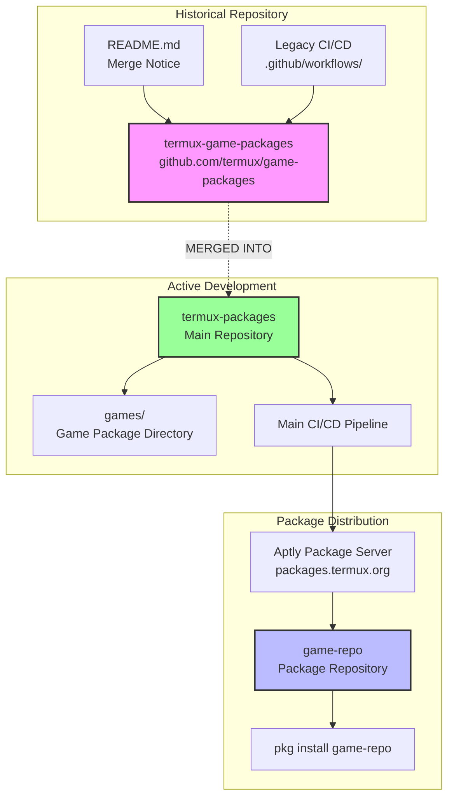
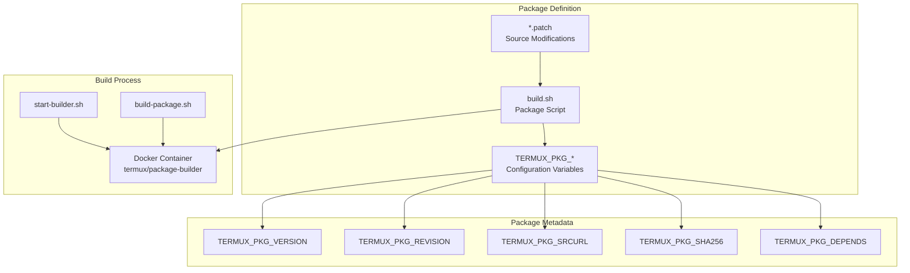
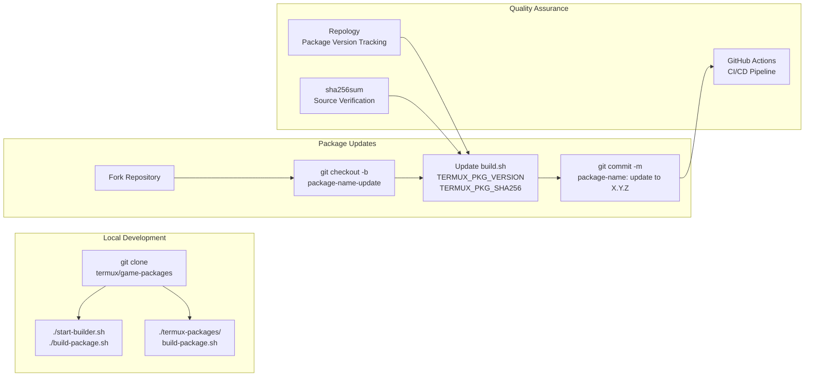
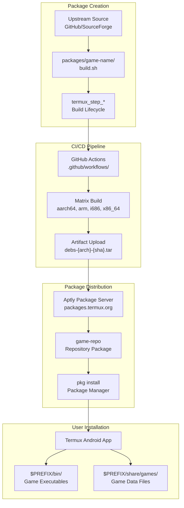

<!-- source: DeepWiki mcp.deepwiki.com · repo termux/game-packages · page 1 Overview · fetched 2026-10-26 -->

# Overview

Relevant source files

The following files were used as context for generating this wiki page:

- [.github/static/powered-by-fosshost.png](.github/static/powered-by-fosshost.png)
- [CONTRIBUTING.md](CONTRIBUTING.md)
- [README.md](README.md)

This document introduces the termux-game-packages repository, its original purpose as a collection of game packages for Termux, and its current status as a merged component of the main termux-packages repository. It covers the high-level architecture, key systems, and integration points within the broader Termux ecosystem.

For detailed information about CI/CD and build processes, see [CI/CD and Build System](#3). For package development workflows, see [Package Development Guide](#4). For specific game package examples, see [Game Package Examples](#5).

## Repository Status and Integration

The termux-game-packages repository has been **merged into the main termux-packages repository** as stated in [README.md:3](). This means that while the repository still exists for historical purposes, all active development and issue tracking now occurs in the primary termux-packages repository.

### Current Integration Architecture

**Sources:** [README.md:3](), [README.md:34-38]()

## Package Management System

The termux-game-packages ecosystem provides a standardized approach to packaging and distributing games for the Termux Android terminal environment. The system handles cross-compilation, dependency management, and platform-specific adaptations.

### Core Package Structure

**Sources:** [README.md:21-31](), [CONTRIBUTING.md:47-66]()

## Development Workflow

The repository provides a comprehensive development environment with Docker-based builds and standardized contribution processes.

### Build System Components

**Sources:** [README.md:16-31](), [CONTRIBUTING.md:8-103]()

## Package Ecosystem Integration

The game packages integrate with the broader Termux ecosystem through standardized interfaces and dependency management.

### Distribution and Installation Flow

**Sources:** [README.md:33-38](), [CONTRIBUTING.md:101-102]()

## Key System Components

The termux-game-packages system consists of several interconnected components that handle different aspects of the package lifecycle:

| Component | Purpose | Key Files |
|-----------|---------|-----------|
| **Package Definitions** | Game-specific build scripts and metadata | `packages/*/build.sh` |
| **Build System** | Docker-based cross-compilation environment | `start-builder.sh`, `build-package.sh` |
| **CI/CD Pipeline** | Automated building and publishing | `.github/workflows/` |
| **Contribution Tools** | Developer workflow support | `CONTRIBUTING.md` guidelines |
| **Package Repository** | Distribution mechanism | `game-repo` package |

### Package Variable Standards

The system uses standardized `TERMUX_PKG_*` variables for consistent package definitions:

- `TERMUX_PKG_VERSION`: Upstream version number
- `TERMUX_PKG_REVISION`: Termux-specific revision (reset on version updates)
- `TERMUX_PKG_SRCURL`: Source code download URL
- `TERMUX_PKG_SHA256`: Source archive integrity hash
- `TERMUX_PKG_DEPENDS`: Runtime dependencies

**Sources:** [CONTRIBUTING.md:47-76]()

## Current Status and Future Development

With the merger into termux-packages, the game packages are now part of the main Termux package ecosystem. Users should:

1. **Install packages** using `pkg install game-repo` as described in [README.md:34-38]()
2. **Report issues** to the main termux-packages repository
3. **Submit contributions** following the workflow in [CONTRIBUTING.md:8-103]()

The repository remains available for historical reference and to maintain existing CI/CD badges and documentation links.

**Sources:** [README.md:3](), [README.md:5]()

---

