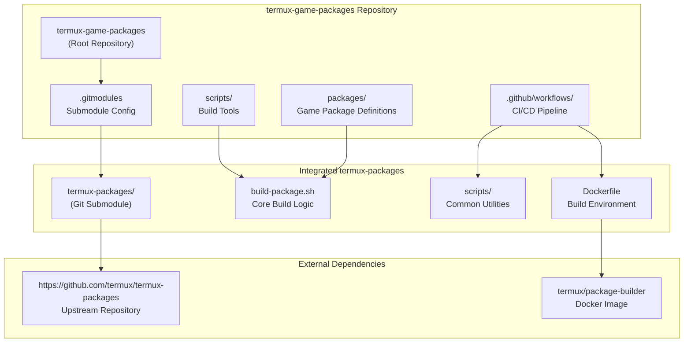
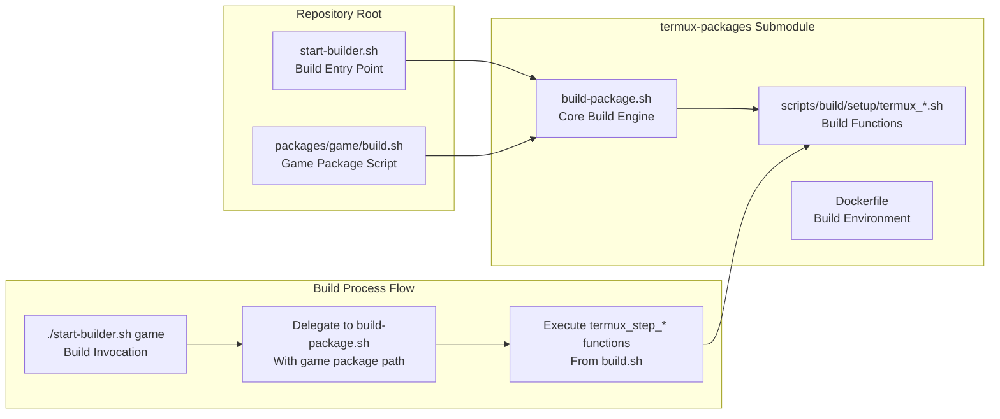
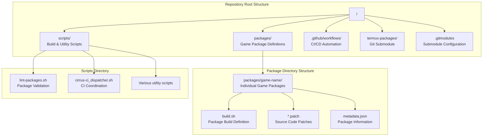
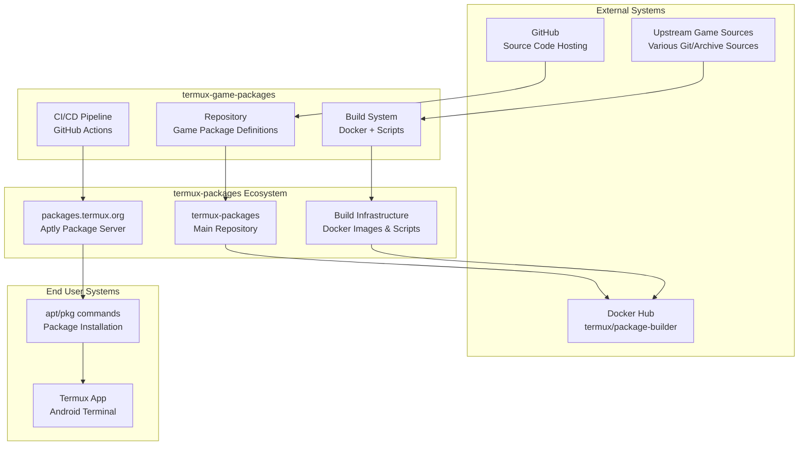
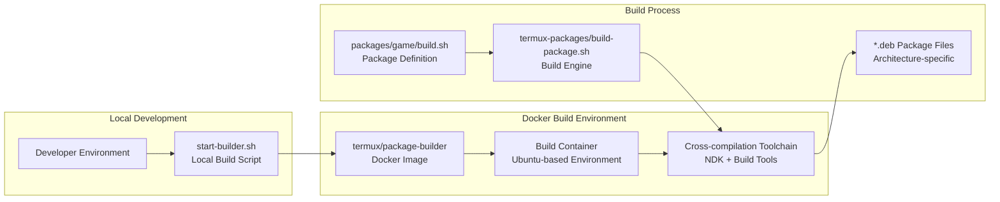
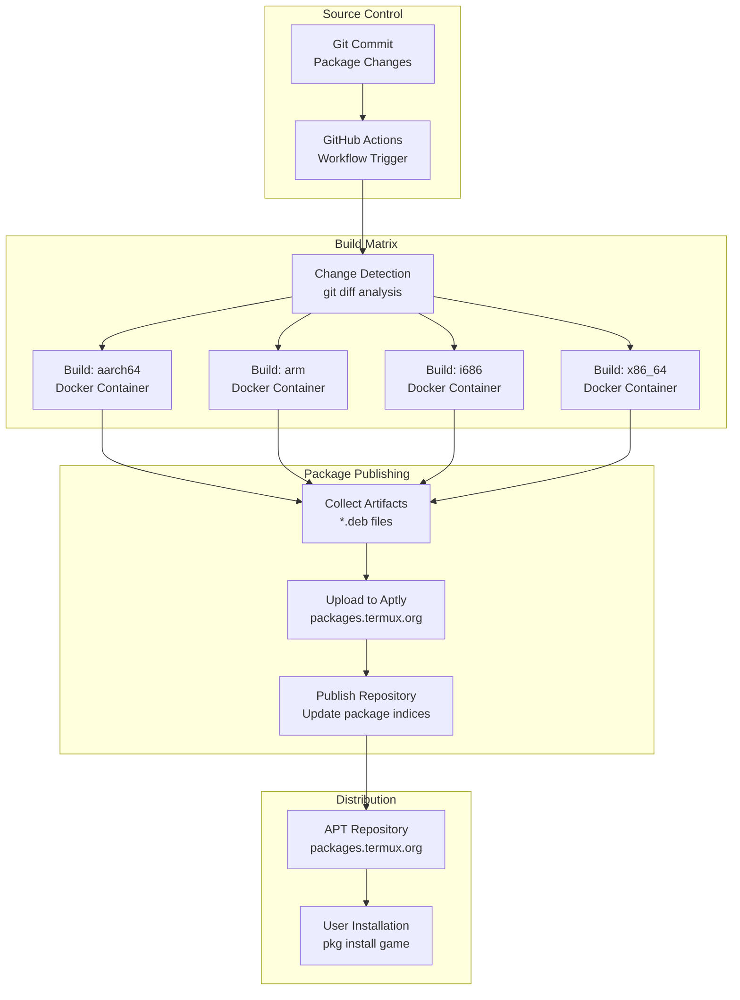

<!-- source: DeepWiki mcp.deepwiki.com · repo termux/game-packages · page 2 Repository Architecture · fetched 2026-10-26 -->

# Repository Architecture

Relevant source files

The following files were used as context for generating this wiki page:

- [.gitmodules](.gitmodules)

## Purpose and Scope

This document explains the structural organization of the termux-game-packages repository and its integration with the broader Termux ecosystem. It covers the Git submodule architecture, directory structure, and integration patterns that enable automated package building and distribution.

For information about the CI/CD pipeline and build automation, see [CI/CD and Build System](#3). For details about individual package structure and development, see [Package Development Guide](#4).

## Git Submodule Architecture

The termux-game-packages repository is architecturally built around a Git submodule pattern that integrates with the main termux-packages repository. This design allows the game packages to leverage the full build infrastructure and tooling from the main Termux package system.

### Submodule Configuration

**Git Submodule Integration**

The repository uses a single Git submodule to integrate the entire termux-packages infrastructure:

| Component | Path | Purpose |
|-----------|------|---------|
| Submodule Definition | `.gitmodules` | Defines the termux-packages submodule |
| Submodule Directory | `termux-packages/` | Contains the full termux-packages repository |
| Integration Point | `termux-packages/build-package.sh` | Core build script used by game packages |

Sources: [.gitmodules:1-4]()

### Submodule Integration Pattern

**Integration Benefits**

This submodule architecture provides several key advantages:

- **Shared Infrastructure**: Game packages use the same build system, dependency resolution, and packaging logic as main Termux packages
- **Consistent Environment**: All packages build in the same Docker environment with identical toolchains
- **Unified CI/CD**: The CI/CD pipeline leverages termux-packages workflows and publishing mechanisms
- **Automatic Updates**: The submodule can be updated to pull in improvements from the main repository

Sources: [.gitmodules:1-4]()

## Directory Structure and Organization

The repository follows a standardized directory structure that separates game packages from build infrastructure:

**Directory Structure Overview**

| Directory | Purpose | Key Files |
|-----------|---------|-----------|
| `packages/` | Game package definitions | `*/build.sh`, `*.patch` files |
| `scripts/` | Build and utility scripts | `lint-packages.sh`, `cirrus-ci_dispatcher.sh` |
| `.github/workflows/` | CI/CD pipeline definitions | `packages.yml`, workflow files |
| `termux-packages/` | Git submodule with core build system | `build-package.sh`, `Dockerfile` |

Sources: [.gitmodules:1-4]()

## Integration with Termux Ecosystem

The repository integrates with multiple components of the Termux ecosystem to provide a complete package management solution:

### Ecosystem Integration Points

**Integration Components**

The repository integrates with the Termux ecosystem through several key mechanisms:

1. **Build System Integration**: Uses `termux-packages/build-package.sh` for consistent package building
2. **Infrastructure Sharing**: Leverages Docker images and build environments from the main repository
3. **Package Distribution**: Publishes packages to the same APT repository used by main Termux packages
4. **CI/CD Integration**: Uses similar GitHub Actions workflows as the main repository

Sources: [.gitmodules:1-4]()

## Build Environment Architecture

The build environment architecture demonstrates how the repository integrates with containerized build systems:

### Build Environment Flow

**Build Environment Integration**

The build environment demonstrates several architectural patterns:

- **Containerization**: All builds occur in standardized Docker containers to ensure reproducibility
- **Cross-compilation**: The build system supports multiple target architectures (aarch64, arm, i686, x86_64)
- **Toolchain Management**: The termux-packages submodule provides consistent toolchain configuration
- **Artifact Management**: Built packages are collected and published through the CI/CD pipeline

Sources: [.gitmodules:1-4]()

## Data Flow and Integration Patterns

The repository implements several data flow patterns that demonstrate its integration with the broader Termux ecosystem:

### Package Build and Distribution Flow

**Data Flow Characteristics**

The repository's data flow demonstrates several important architectural characteristics:

- **Event-Driven**: Package builds are triggered by Git commits and pull requests
- **Parallel Processing**: Multiple architecture builds occur simultaneously
- **Artifact Management**: Built packages are collected and distributed through a centralized system
- **Integration Points**: The system integrates with external package repositories and user installations

Sources: [.gitmodules:1-4]()

This architecture enables the termux-game-packages repository to function as a specialized extension of the main Termux package system while maintaining consistency and leveraging shared infrastructure.

---

