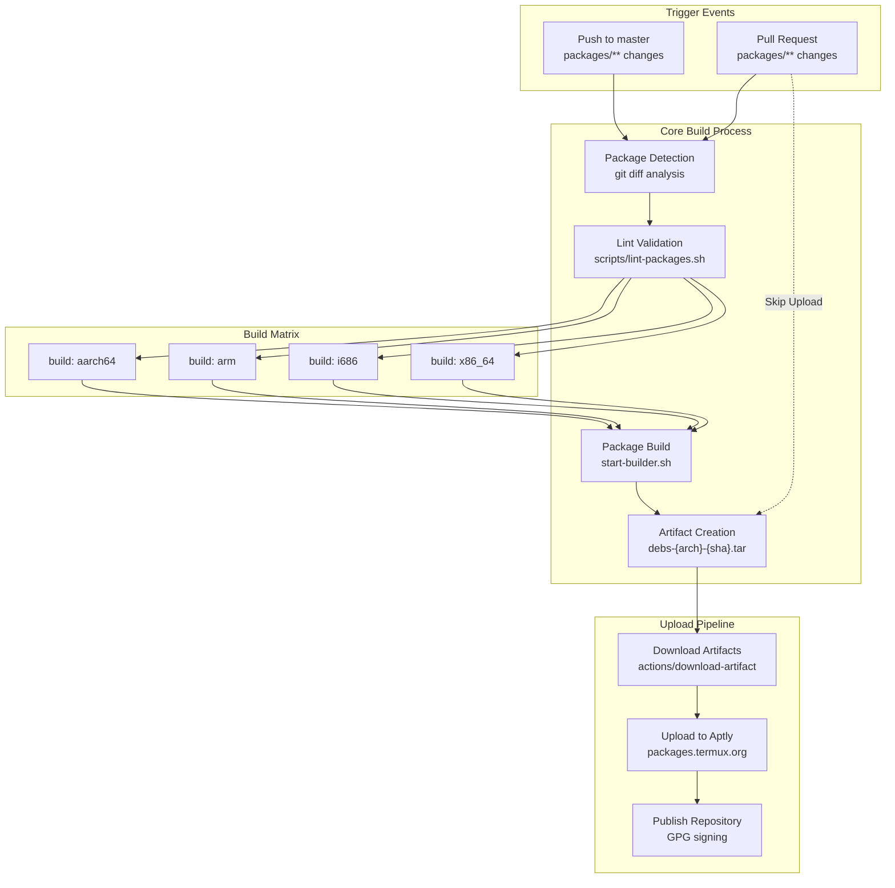
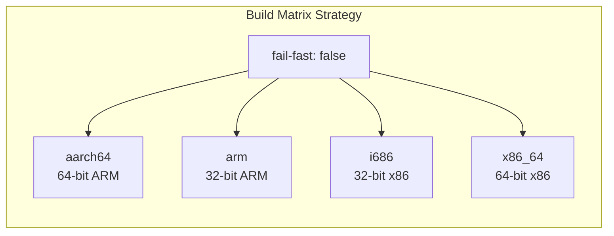
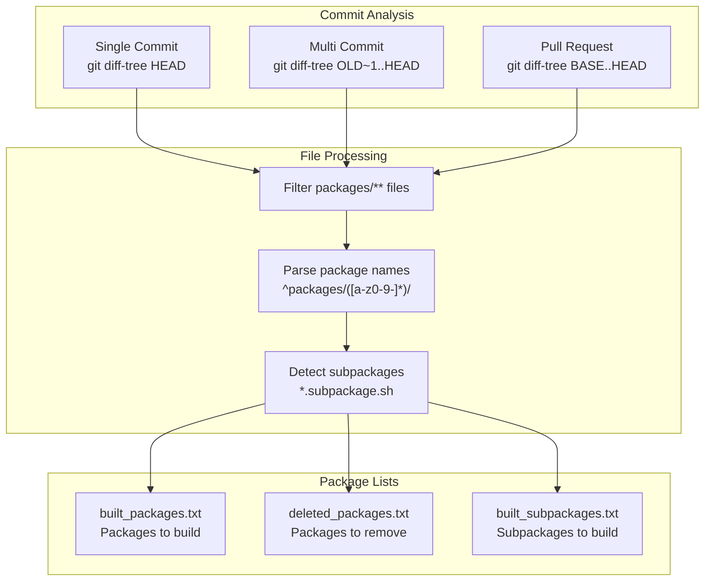
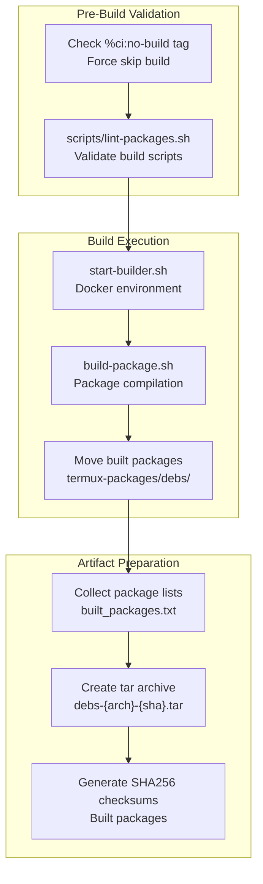
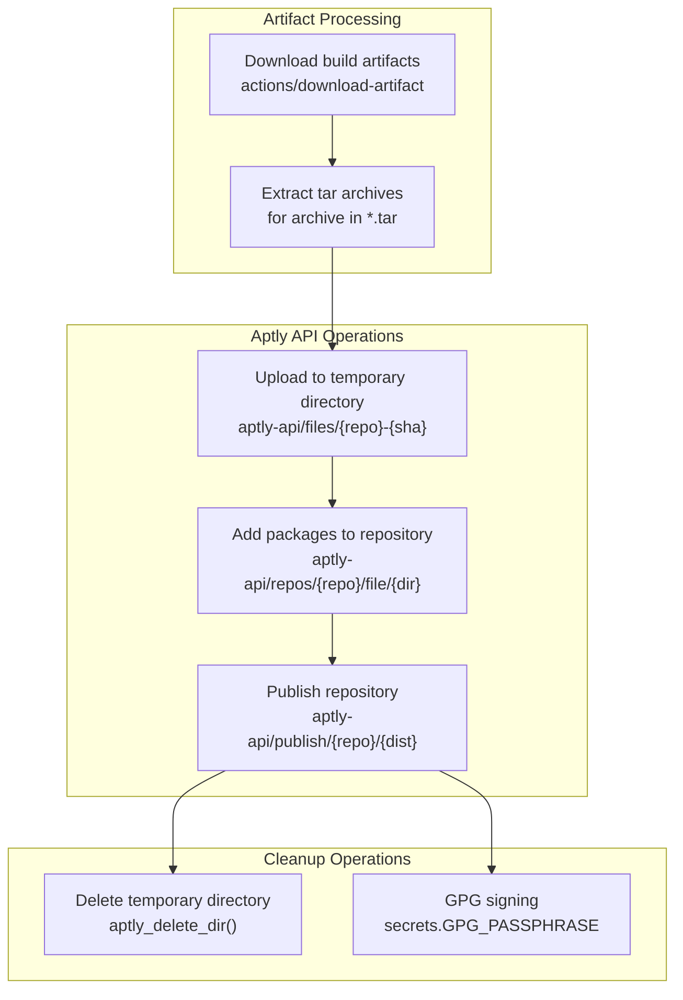
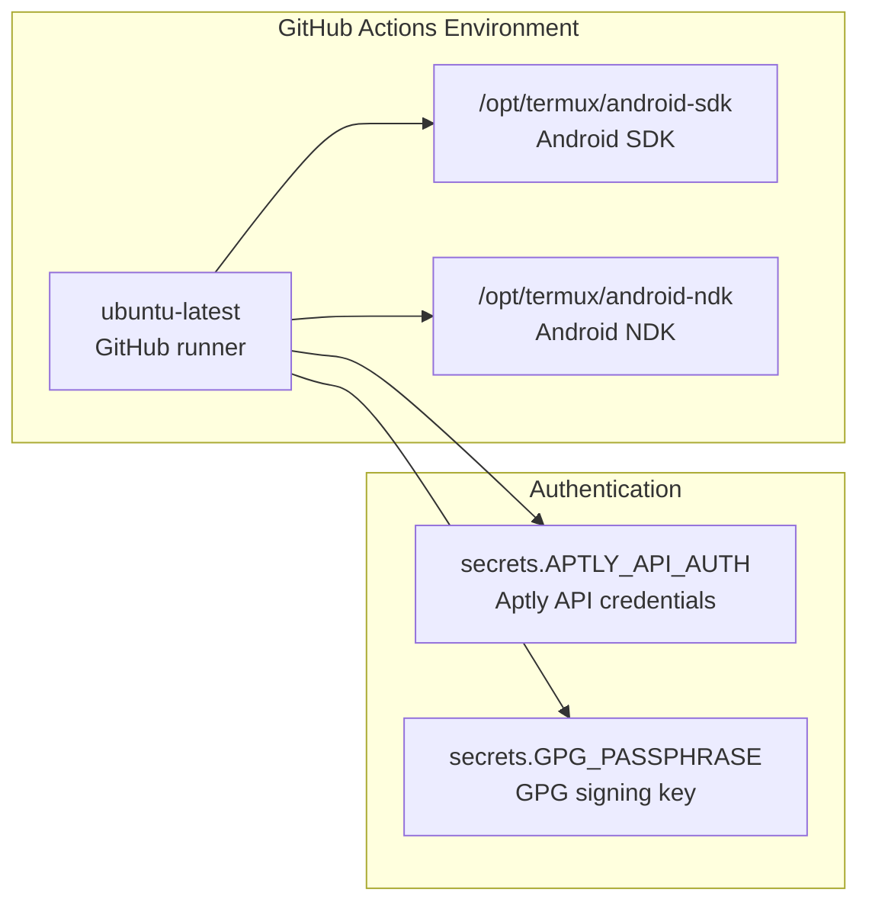
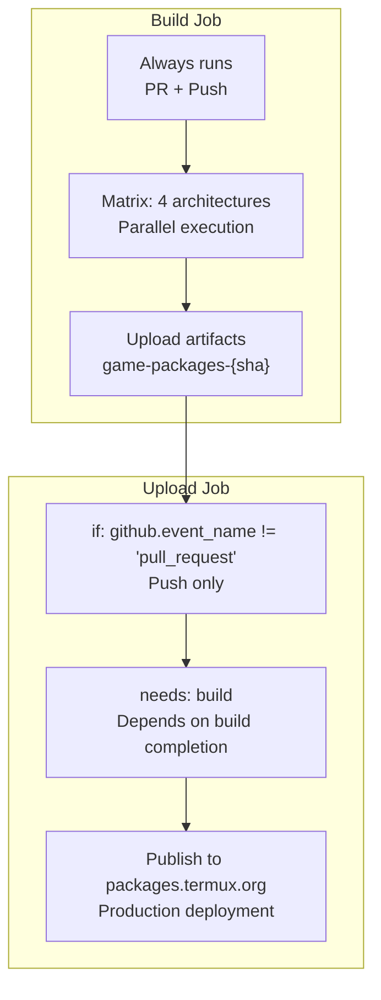

<!-- source: DeepWiki mcp.deepwiki.com · repo termux/game-packages · page 3 CI/CD and Build System · fetched 2026-10-26 -->

# CI/CD and Build System

Relevant source files

The following files were used as context for generating this wiki page:

- [.github/workflows/packages.yml](.github/workflows/packages.yml)

This document covers the automated build and deployment pipeline for the termux-game-packages repository. The CI/CD system automatically detects package changes, builds them across multiple architectures, validates the builds, and publishes them to the Termux package repository. For information about the individual package build process and development tools, see [Package Development Guide](#4) and [Development Tools](#4.3).

## System Overview

The CI/CD system is implemented as a GitHub Actions workflow that provides comprehensive automation for package management. It handles both pull request validation and production deployment through a sophisticated multi-stage pipeline.

### Workflow Architecture

**Sources:** [.github/workflows/packages.yml:1-257]()

## Build Triggers and Matrix Strategy

The workflow triggers on two primary events with specific path filtering to optimize build performance:

### Event Triggers

| Event Type | Trigger Condition | Behavior |
|------------|-------------------|----------|
| `push` | Branch: `master`, Path: `packages/**` | Full build and publish |
| `pull_request` | Path: `packages/**` | Build validation only |

### Architecture Matrix

The build system targets four Android architectures in parallel:

**Sources:** [.github/workflows/packages.yml:19-22]()

## Package Change Detection

The system implements intelligent change detection to build only modified packages, significantly improving build efficiency.

### Change Detection Algorithm

The detection logic handles three commit scenarios:
- **Single commit push**: Uses `git diff-tree` on HEAD commit
- **Multi-commit push**: Compares range from `OLD_COMMIT~1` to `HEAD_COMMIT`
- **Pull request**: Compares base branch to HEAD

**Sources:** [.github/workflows/packages.yml:30-48](), [.github/workflows/packages.yml:61-87]()

## Build Process Flow

### Package Validation and Building

### Build Control Features

The system includes several control mechanisms:

1. **Force Skip**: `%ci:no-build` tag in commit message forces successful exit
2. **Incremental Builds**: Only builds packages with detected changes
3. **Dependency Handling**: Processes subpackages automatically
4. **Artifact Management**: Creates compressed archives to handle special characters

**Sources:** [.github/workflows/packages.yml:51-57](), [.github/workflows/packages.yml:103-117]()

## Upload and Publishing Pipeline

### Aptly Integration

The publishing system integrates with the Aptly package repository management system:

### Repository Configuration

| Configuration | Value |
|---------------|--------|
| `REPOSITORY_NAME` | `termux-games` |
| `REPOSITORY_DISTRIBUTION` | `games` |
| API Endpoint | `https://packages.termux.org/aptly-api` |

### Error Handling and Cleanup

The upload process includes comprehensive error handling:

- **HTTP Status Monitoring**: Validates API responses (200 OK expected)
- **Automatic Cleanup**: Removes temporary directories on failure
- **Graceful Degradation**: Handles long-running publish operations (exit code 52)
- **Warning Processing**: Extracts and displays non-critical warnings

**Sources:** [.github/workflows/packages.yml:138-256](), [.github/workflows/packages.yml:149-166]()

## Environment and Dependencies

### Build Environment

### Key Dependencies

- **Git Operations**: Requires `fetch-depth: 1000` for proper diff analysis
- **JSON Processing**: Uses `jq` for parsing GitHub event data
- **Docker Integration**: Leverages `start-builder.sh` for containerized builds
- **Aptly API**: RESTful API for package repository management

**Sources:** [.github/workflows/packages.yml:16-18](), [.github/workflows/packages.yml:25-27]()

## Conditional Execution Logic

The workflow implements sophisticated conditional logic to optimize resource usage:

### Build vs. Upload Separation

This design ensures:
- **Pull requests**: Build validation without deployment
- **Push to master**: Full build and publish pipeline
- **Resource optimization**: Upload job only runs when needed

**Sources:** [.github/workflows/packages.yml:127-128]()

---

