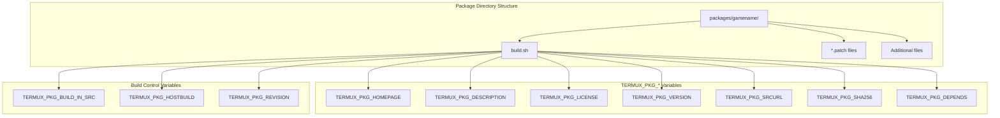
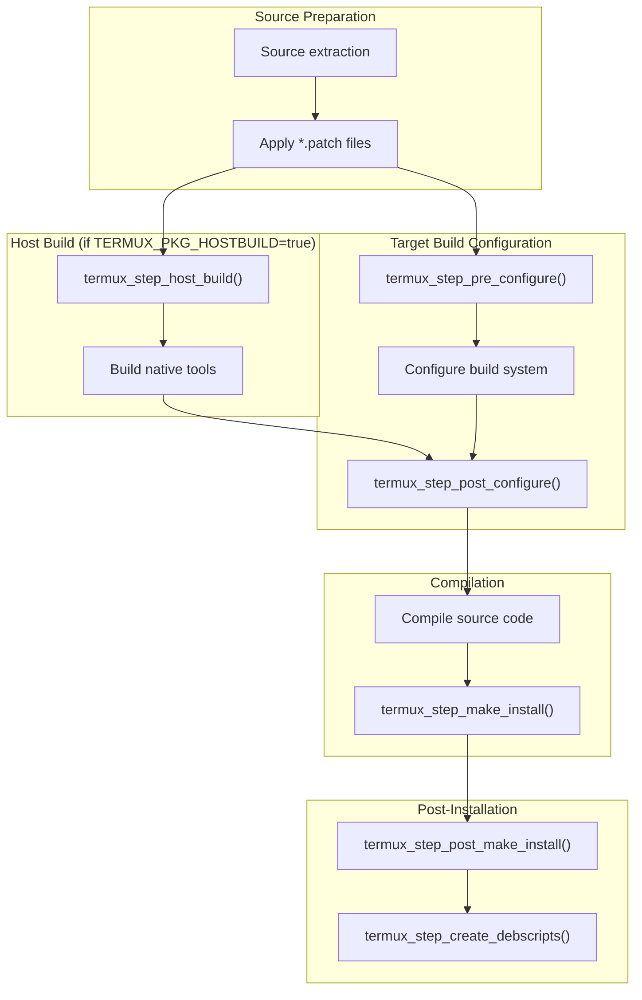
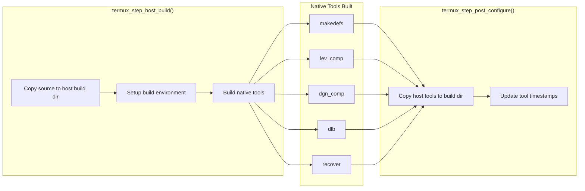
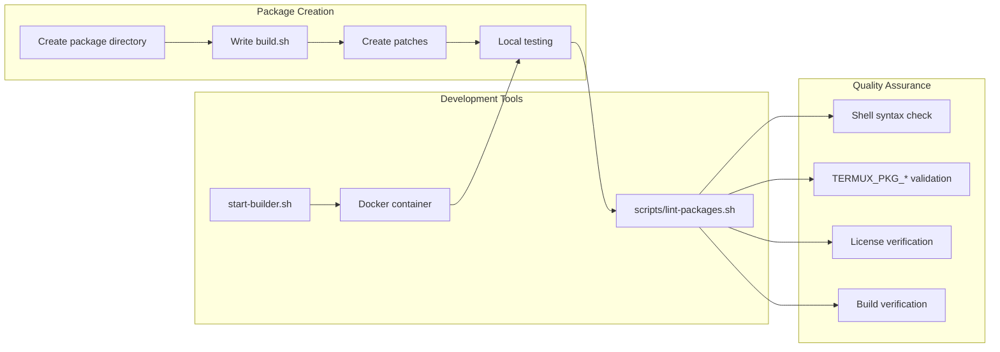
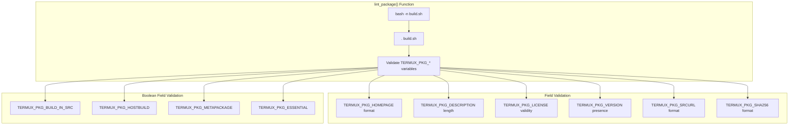

<!-- source: DeepWiki mcp.deepwiki.com · repo termux/game-packages · page 4 Package Development Guide · fetched 2026-10-26 -->

# Package Development Guide

Relevant source files

The following files were used as context for generating this wiki page:

- [packages/nethack/build.sh](packages/nethack/build.sh)
- [packages/nethack/sys-unix-Makefile.src.patch](packages/nethack/sys-unix-Makefile.src.patch)
- [packages/nethack/sys-unix-hints-linux.patch](packages/nethack/sys-unix-hints-linux.patch)
- [scripts/lint-packages.sh](scripts/lint-packages.sh)

This guide provides comprehensive instructions for developing and maintaining game packages within the termux-game-packages repository. It covers the standardized package structure, build process, patching requirements, and development workflows necessary to create packages that integrate seamlessly with the Termux ecosystem.

For information about the broader repository architecture and CI/CD systems, see [Repository Architecture](#2) and [CI/CD and Build System](#3). For detailed examples of different game categories, see [Game Package Examples](#5).

## Package Structure and Conventions

Every game package follows a standardized structure centered around the `build.sh` script, which defines all package metadata and build instructions through `TERMUX_PKG_*` variables.

### Core Package Definition

**Sources:** [packages/nethack/build.sh:1-11](), [scripts/lint-packages.sh:98-167]()

### Required Package Metadata

All packages must define these essential `TERMUX_PKG_*` variables:

| Variable | Purpose | Example |
|----------|---------|---------|
| `TERMUX_PKG_HOMEPAGE` | Official project URL | `http://www.nethack.org/` |
| `TERMUX_PKG_DESCRIPTION` | Brief package description (≤100 chars) | `"Dungeon crawl game"` |
| `TERMUX_PKG_LICENSE` | Package license identifier | `"Nethack"` |
| `TERMUX_PKG_VERSION` | Upstream version | `3.6.6` |
| `TERMUX_PKG_SRCURL` | Source download URL | `http://.../${TERMUX_PKG_VERSION}/...` |
| `TERMUX_PKG_SHA256` | Source archive checksum | `cfde0c3ab6dd7c22ae82e1e5a59ab80...` |

**Sources:** [packages/nethack/build.sh:1-8](), [scripts/lint-packages.sh:98-167]()

## Build Process and Lifecycle Hooks

The build system provides multiple lifecycle hooks that packages can implement to customize their build process. These hooks follow the `termux_step_*` naming convention.

### Build Lifecycle Flow

**Sources:** [packages/nethack/build.sh:13-54]()

### Host Build Process

Complex packages often require building native tools first, then using those tools to build the target package. This is controlled by `TERMUX_PKG_HOSTBUILD=true`.

**Sources:** [packages/nethack/build.sh:13-26](), [packages/nethack/build.sh:36-41]()

### Common Build Patterns

Most game packages follow these patterns:

1. **Simple packages**: Only require standard `TERMUX_PKG_*` variables
2. **Patched packages**: Include `*.patch` files for Android/Termux compatibility
3. **Host build packages**: Use `TERMUX_PKG_HOSTBUILD=true` and implement `termux_step_host_build()`
4. **Custom installation**: Implement `termux_step_post_make_install()` for manual file placement

**Sources:** [packages/nethack/build.sh:10-11](), [packages/nethack/build.sh:43-48]()

## Source Patching and Platform Adaptation

Games often require patches to work correctly on Android/Termux. These patches handle path corrections, compiler flags, and platform-specific adaptations.

### Common Patch Categories

```mermaid
graph TB
    subgraph "Platform Paths"
        PREFIX["@TERMUX_PREFIX@ substitution"]
        PATHS["Hardcoded path fixes"]
        BINPATHS["Binary path corrections"]
    end
    
    subgraph "Build System Fixes"
        CFLAGS["CFLAGS+= instead of CFLAGS="]
        LFLAGS["LFLAGS+= instead of LFLAGS="]
        DESTDIR["DESTDIR support"]
    end
    
    subgraph "Compilation Fixes"
        MAKEDEPS["Remove makedefs cleanup"]
        TIMESTAMPS["Preserve tool timestamps"]
        CROSSCOMP["Cross-compilation support"]
    end
    
    PREFIX --> PATHS
    PATHS --> BINPATHS
    
    CFLAGS --> LFLAGS
    LFLAGS --> DESTDIR
    
    MAKEDEPS --> TIMESTAMPS
    TIMESTAMPS --> CROSSCOMP
```

**Sources:** [packages/nethack/sys-unix-hints-linux.patch:9-27](), [packages/nethack/sys-unix-Makefile.src.patch:7-11]()

### Patch File Structure

Patches use standard unified diff format and target specific files that need modification:

- **Path substitutions**: Replace hardcoded paths with `@TERMUX_PREFIX@`
- **Compiler flags**: Use `+=` instead of `=` to preserve existing flags
- **Build system fixes**: Add `DESTDIR` support and cross-compilation compatibility

**Sources:** [packages/nethack/sys-unix-hints-linux.patch:1-40]()

## Package Development Workflow

### Development Environment Setup

**Sources:** [scripts/lint-packages.sh:394-433]()

### Package Validation

The `lint-packages.sh` script performs comprehensive validation of package definitions:

**Sources:** [scripts/lint-packages.sh:53-392]()

### Package Testing and Validation

Before submitting packages, developers should:

1. **Syntax validation**: Run `bash -n build.sh` to check for syntax errors
2. **Metadata validation**: Use `scripts/lint-packages.sh` for comprehensive checking
3. **Build testing**: Test package builds in the Docker environment
4. **Installation verification**: Ensure games run correctly after installation

**Sources:** [scripts/lint-packages.sh:64-78](), [scripts/lint-packages.sh:429-433]()

## Development Tools and Scripts

### Package Linting System

The linting system validates package definitions against established conventions:

| Check | Purpose | Error Condition |
|-------|---------|-----------------|
| Syntax | Shell script validity | `bash -n` fails |
| Homepage | URL format | Missing or invalid URL |
| Description | Length limit | >100 characters |
| License | Valid identifier | Unknown license string |
| Version | Presence | Missing version |
| SHA256 | Checksum format | Invalid 64-char hex string |

**Sources:** [scripts/lint-packages.sh:98-243]()

### Supported License Identifiers

The linting system recognizes a comprehensive set of license identifiers, including game-specific licenses like `Nethack`. Custom licenses should use `"custom"` with appropriate documentation.

**Sources:** [scripts/lint-packages.sh:18-36]()

This guide provides the foundation for developing game packages within the termux-game-packages ecosystem. The standardized approach ensures consistent packaging, reliable builds, and seamless integration with the Termux package management system.

---

