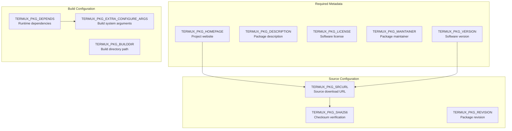
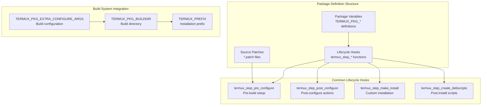
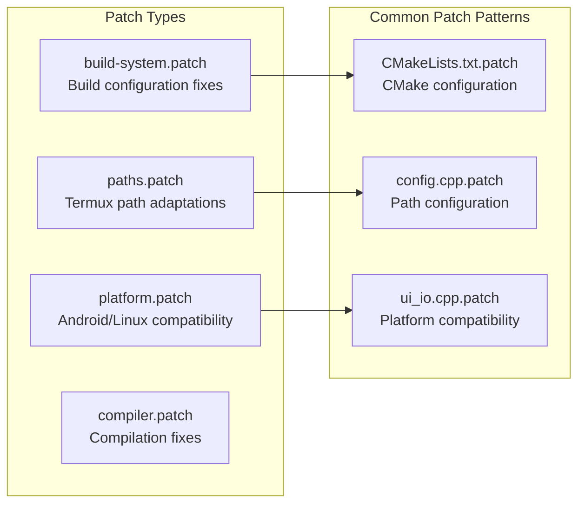
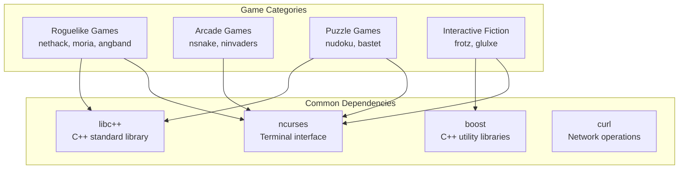

<!-- source: DeepWiki mcp.deepwiki.com · repo termux/game-packages · page 4.1 Package Structure and Conventions · fetched 2026-10-26 -->

# Package Structure and Conventions

<details>
<summary>Relevant source files</summary>

The following files were used as context for generating this wiki page:

- [packages/moria/CMakeLists.txt.patch](packages/moria/CMakeLists.txt.patch)
- [packages/moria/build.sh](packages/moria/build.sh)
- [packages/moria/config.cpp.patch](packages/moria/config.cpp.patch)
- [packages/moria/ui_io.cpp.patch](packages/moria/ui_io.cpp.patch)

</details>


This document explains the standardized structure and conventions used across all game packages in the termux-game-packages repository. These conventions ensure consistency, maintainability, and compatibility with the Termux build system.

For information about the actual build process and compilation steps, see [Build Process and Patching](#4.2). For hands-on development tools and workflows, see [Development Tools](#4.3).

## Package Directory Structure

Each game package follows a standardized directory layout within the `packages/` directory:

```
packages/
├── gamename/
│   ├── build.sh              # Main package definition
│   ├── *.patch               # Source code modifications
│   └── additional files      # Config files, assets, etc.
```

## Core Package Variables

Every package's `build.sh` file must define a set of standardized `TERMUX_PKG_*` variables that provide metadata and build configuration:

### Package Metadata Variables



Sources: [packages/moria/build.sh:1-10]()

### Variable Definitions and Usage

| Variable | Purpose | Example |
|----------|---------|---------|
| `TERMUX_PKG_HOMEPAGE` | Official project website | `https://umoria.org` |
| `TERMUX_PKG_DESCRIPTION` | Brief package description | `"Rogue-like game with an infinite dungeon"` |
| `TERMUX_PKG_LICENSE` | Software license identifier | `"GPL-3.0-or-later"` |
| `TERMUX_PKG_MAINTAINER` | Package maintainer | `"@termux"` |
| `TERMUX_PKG_VERSION` | Upstream version | `5.7.15` |
| `TERMUX_PKG_REVISION` | Package revision number | `1` |
| `TERMUX_PKG_SRCURL` | Source download URL | `https://github.com/user/repo/archive/v${TERMUX_PKG_VERSION}.tar.gz` |
| `TERMUX_PKG_SHA256` | Source archive checksum | `97f76a68b856dd5df37c20fc57c8a51017147f489e8ee8866e1764778b2e2d57` |
| `TERMUX_PKG_DEPENDS` | Runtime dependencies | `"libc++, ncurses"` |

Sources: [packages/moria/build.sh:1-10]()

## Build Script Structure

The `build.sh` file follows a predictable structure with optional lifecycle hooks:



Sources: [packages/moria/build.sh:10-17]()

## Package Lifecycle Hooks

### Post-Install Script Generation

Many packages require post-installation actions such as creating directories or initializing files. The `termux_step_create_debscripts` hook generates these scripts:

```bash
termux_step_create_debscripts() {
    # Create scores file in a debscript, so an update to the package wouldn't erase any scores
    echo "mkdir -p $TERMUX_PREFIX/lib/games/moria/" > postinst
    echo "touch $TERMUX_PREFIX/lib/games/moria/scores.dat" >> postinst
    chmod 0755 postinst
}
```

Sources: [packages/moria/build.sh:12-17]()

### Common Hook Patterns

| Hook Function | Purpose | Common Use Cases |
|---------------|---------|------------------|
| `termux_step_pre_configure` | Pre-build setup | Environment setup, file copying |
| `termux_step_post_configure` | Post-configure actions | File modifications, path updates |
| `termux_step_make_install` | Custom installation | Non-standard install procedures |
| `termux_step_create_debscripts` | Post-install scripts | Directory creation, file initialization |

## Source Code Patching Conventions

### Patch File Organization

Patches are stored alongside the `build.sh` file and follow naming conventions:



Sources: [packages/moria/CMakeLists.txt.patch:1-36](), [packages/moria/config.cpp.patch:1-30](), [packages/moria/ui_io.cpp.patch:1-37]()

### Standard Path Substitutions

Patches frequently use `@TERMUX_PREFIX@` placeholders that are automatically replaced during the build process:

```cpp
// Before patching (relative paths)
const std::string splash_screen = "data/splash.txt";
const std::string scores = "scores.dat";

// After patching (absolute Termux paths)
const std::string splash_screen = "@TERMUX_PREFIX@/lib/games/moria/data/splash.txt";
const std::string scores = "@TERMUX_PREFIX@/lib/games/moria/scores.dat";
```

Sources: [packages/moria/config.cpp.patch:7-30]()

## Standard Directory Layout

Game packages follow consistent installation patterns:

| Directory | Purpose | Example |
|-----------|---------|---------|
| `$TERMUX_PREFIX/bin` | Executable binaries | Game executables |
| `$TERMUX_PREFIX/lib/games/<name>` | Game-specific data | Save files, scores, configuration |
| `$TERMUX_PREFIX/share/games/<name>` | Shared game data | Assets, levels, documentation |
| `$TERMUX_PREFIX/share/doc/<name>` | Documentation | Manual pages, licenses |
| `$TERMUX_PREFIX/share/man` | Manual pages | Game documentation |

## Common Dependency Patterns

### Runtime Dependencies

Most game packages depend on common libraries:



### Dependency Declaration

Dependencies are declared in the `TERMUX_PKG_DEPENDS` variable as a comma-separated list:

```bash
TERMUX_PKG_DEPENDS="libc++, ncurses"
```

Sources: [packages/moria/build.sh:9]()

## Build Configuration Patterns

### CMake Projects

Many games use CMake and require specific configuration through `TERMUX_PKG_EXTRA_CONFIGURE_ARGS`:

```bash
TERMUX_PKG_EXTRA_CONFIGURE_ARGS="-Dbuild_dir=$TERMUX_PKG_BUILDDIR"
```

This pattern allows passing build directory information to the CMake configuration system.

Sources: [packages/moria/build.sh:10](), [packages/moria/CMakeLists.txt.patch:9]()

### Installation Customization

CMake patches often add installation rules for proper file placement:

```cmake
install(TARGETS moria DESTINATION ${CMAKE_INSTALL_PREFIX}/bin)
install(FILES historical/manual.md historical/faq.md LICENSE DESTINATION ${CMAKE_INSTALL_PREFIX}/share/doc/moria/)
INSTALL(DIRECTORY ${build_dir}/data DESTINATION ${CMAKE_INSTALL_PREFIX}/lib/games/moria/ FILES_MATCHING PATTERN "*.txt")
```

Sources: [packages/moria/CMakeLists.txt.patch:33-35]()

This standardized approach ensures consistent package structure and reliable builds across all game packages in the repository.

---

