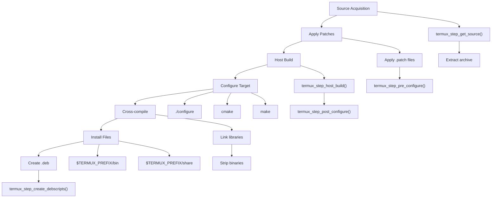
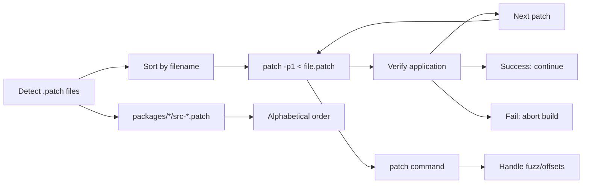
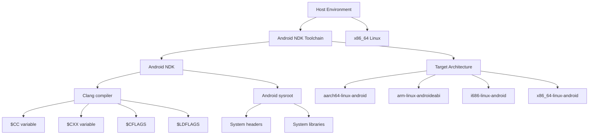
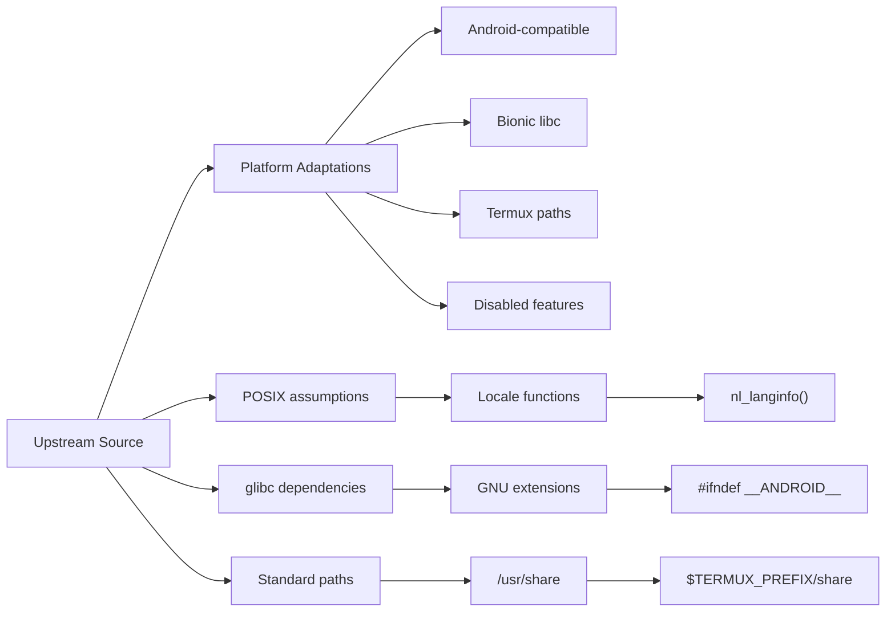
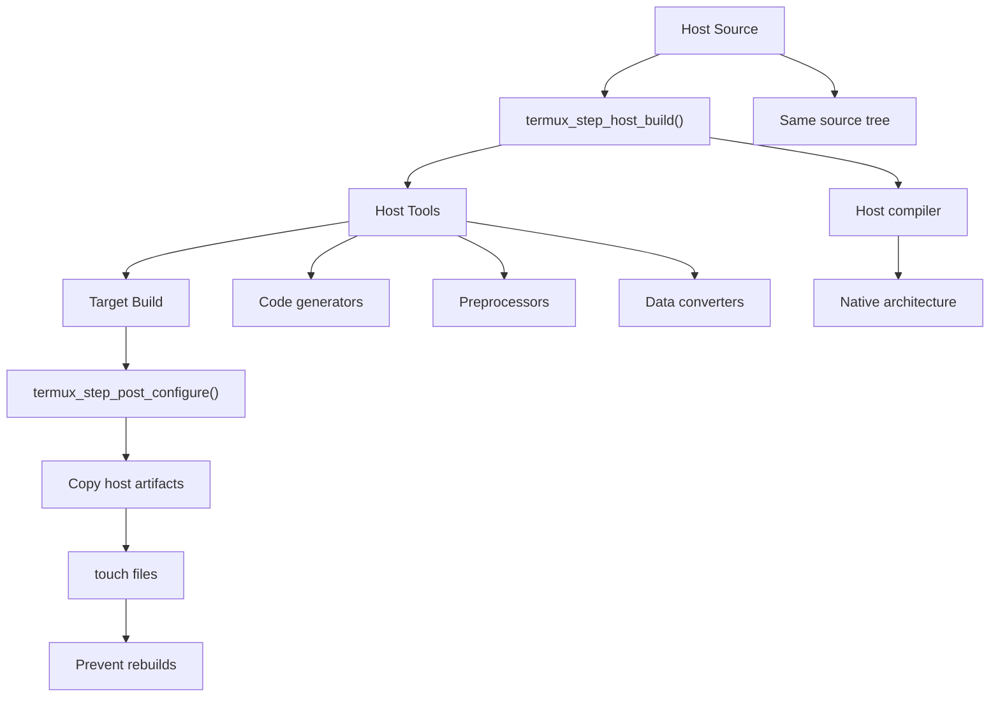
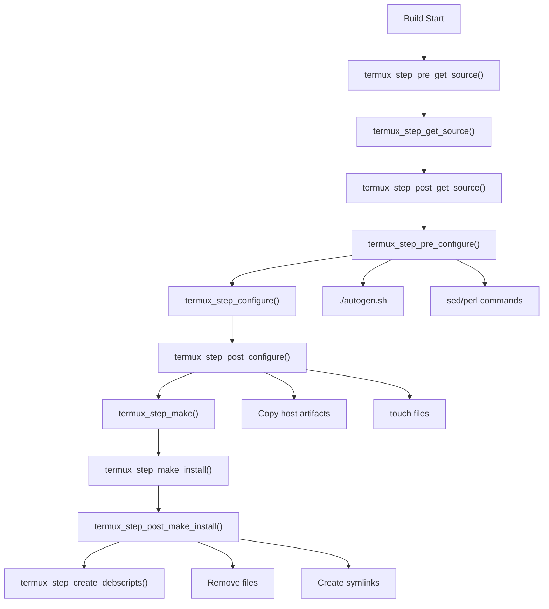
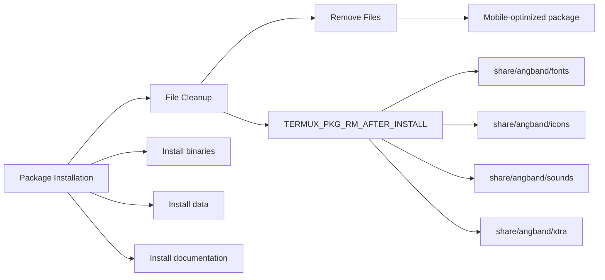

<!-- source: DeepWiki mcp.deepwiki.com · repo termux/game-packages · page 4.2 Build Process and Patching · fetched 2026-10-26 -->

# Build Process and Patching

<details>
<summary>Relevant source files</summary>

The following files were used as context for generating this wiki page:

- [packages/angband/build.sh](packages/angband/build.sh)
- [packages/angband/src-main.c.patch](packages/angband/src-main.c.patch)

</details>


This document details the compilation process for game packages in the termux-game-packages repository, covering cross-compilation for Android, source code patching, and platform-specific adaptations. It explains the build lifecycle, patching mechanisms, and customization hooks used to adapt upstream game sources for the Termux environment.

For package structure conventions and metadata variables, see [Package Structure and Conventions](#4.1). For development tools and environment setup, see [Development Tools](#4.3).

## Build Process Overview

The package build system follows a standardized lifecycle that handles source acquisition, patching, cross-compilation, and installation across multiple Android architectures.

### Build Lifecycle Flow



Sources: [packages/angband/build.sh:1-27]()

## Source Patching System

The patching system applies source code modifications to make upstream games compatible with Android and Termux. Patches are stored as `.patch` files in each package directory and applied automatically during the build process.

### Patch Application Process



### Common Patch Patterns

| Patch Type | Purpose | Example |
|------------|---------|---------|
| Platform Detection | Disable Android-incompatible features | `#ifndef __ANDROID__` |
| Library Compatibility | Adapt library calls for Android | `ncursesw6-config` vs `ncursesw5-config` |
| Locale Handling | Skip unsupported locale functions | Skip `nl_langinfo()` calls |
| File System Paths | Adjust paths for Termux prefix | Replace `/usr/share` with `$TERMUX_PREFIX/share` |

**Android Platform Adaptation Example:**
```c
// Original code
#if !defined(WINDOWS)
#include "langinfo.h"
#endif

// Patched code  
#if !defined(WINDOWS) && !defined(__ANDROID__)
#include "langinfo.h"
#endif
```

Sources: [packages/angband/src-main.c.patch:1-24]()

## Cross-compilation Process

The build system performs cross-compilation from the host architecture (typically x86_64) to Android target architectures (aarch64, arm, i686, x86_64). This process involves setting up appropriate toolchains, flags, and environment variables.

### Cross-compilation Environment



### Configure Arguments

Common cross-compilation configure arguments are set via `TERMUX_PKG_EXTRA_CONFIGURE_ARGS`:

```bash
--disable-x11                    # Disable X11 GUI
--bindir=$TERMUX_PREFIX/bin      # Set binary directory
--sysconfdir=$TERMUX_PREFIX/share # Set configuration directory
```

Sources: [packages/angband/build.sh:11-15]()

## Platform-specific Adaptations

Android and Termux require specific adaptations due to differences in available libraries, system calls, and file system layout compared to traditional Linux distributions.

### Android-specific Modifications



### Common Adaptation Strategies

1. **Conditional Compilation**: Use `#ifndef __ANDROID__` to disable incompatible code
2. **Library Replacement**: Replace unavailable libraries with Termux equivalents
3. **Path Remapping**: Change hardcoded paths to use `$TERMUX_PREFIX`
4. **Feature Disabling**: Disable features that require unavailable system services

Sources: [packages/angband/src-main.c.patch:8-20]()

## Host vs Target Builds

Some packages require building tools for the host system first, then using those tools to build the target Android binaries. This is common for packages with code generators or build-time utilities.

### Host Build Process



### Host Build Implementation

Host builds are implemented by overriding the `termux_step_host_build()` function:

```bash
termux_step_host_build() {
    # Build tools for host system
    make -C src/tools
}

termux_step_post_configure() {
    # Copy host tools to target build
    cp $TERMUX_PKG_HOSTBUILD_DIR/src/tools/generator src/
    touch src/generator  # Prevent rebuild
}
```

Sources: [packages/angband/build.sh:23-26]()

## Build Hooks and Customization

The build system provides numerous hooks for customizing the build process at different stages. These hooks allow packages to perform custom setup, patching, and installation steps.

### Build Hook Sequence



### Common Hook Usage Patterns

| Hook | Common Usage | Example |
|------|-------------|---------|
| `termux_step_pre_configure()` | Generate build files, patch scripts | `./autogen.sh`, `perl -p -i -e` |
| `termux_step_post_configure()` | Copy host build artifacts | `cp $TERMUX_PKG_HOSTBUILD_DIR/tool src/` |
| `termux_step_make_install()` | Custom installation logic | Install to non-standard locations |
| `termux_step_post_make_install()` | File cleanup, symlink creation | `rm -rf $TERMUX_PREFIX/share/unwanted` |

### Example Hook Implementation

```bash
termux_step_pre_configure() {
    # Generate build system files
    ./autogen.sh
    
    # Update configure script for newer ncurses
    perl -p -i -e 's|ncursesw5-config|ncursesw6-config|g' configure
}
```

Sources: [packages/angband/build.sh:23-26]()

## File Removal and Cleanup

The build system supports automatic removal of unwanted files after installation using `TERMUX_PKG_RM_AFTER_INSTALL`. This is commonly used to remove files that are unnecessary or incompatible with the mobile environment.

### Cleanup Configuration



### Cleanup Example

```bash
TERMUX_PKG_RM_AFTER_INSTALL="
share/angband/fonts
share/angband/icons
share/angband/sounds
share/angband/xtra
"
```

This removes GUI-related assets that are not needed in the terminal environment.

Sources: [packages/angband/build.sh:16-21]()

---

