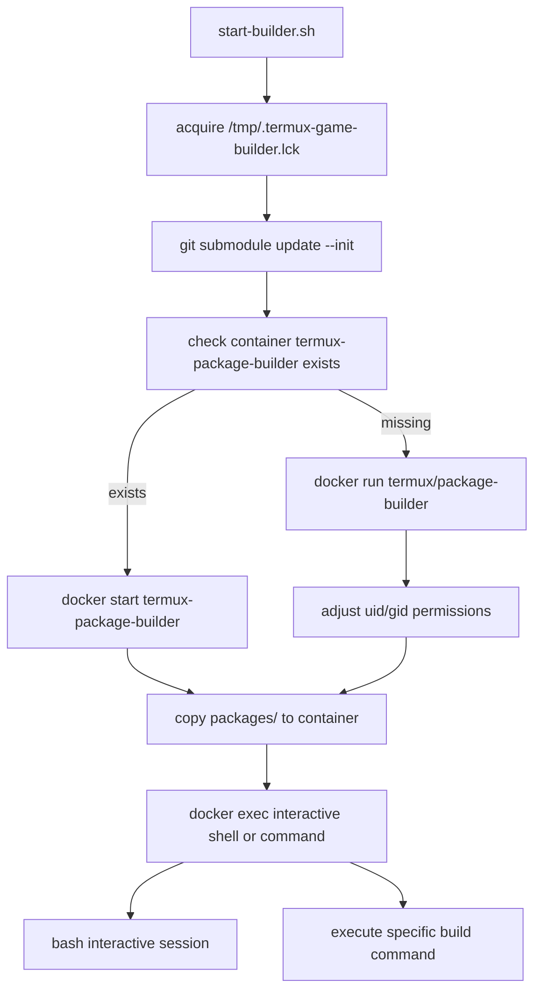
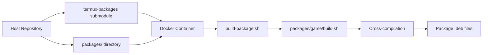
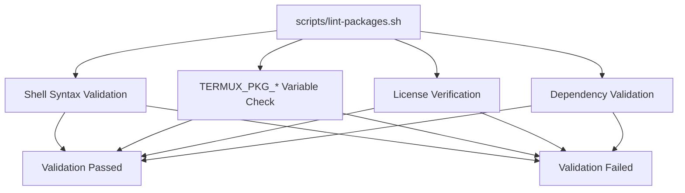
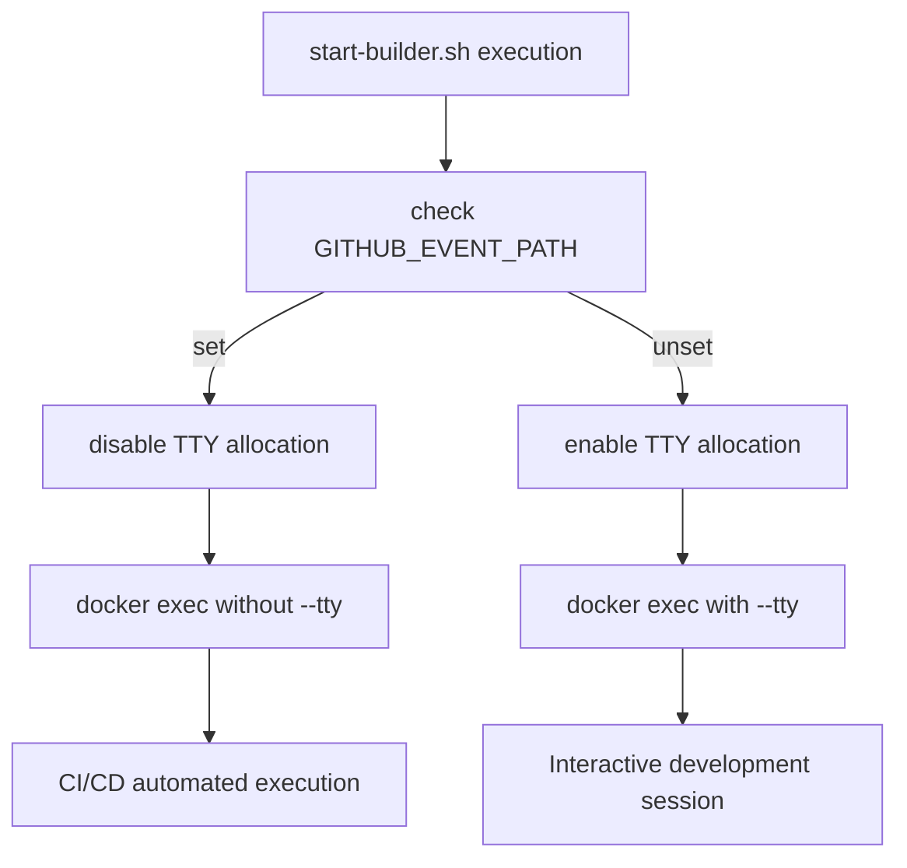
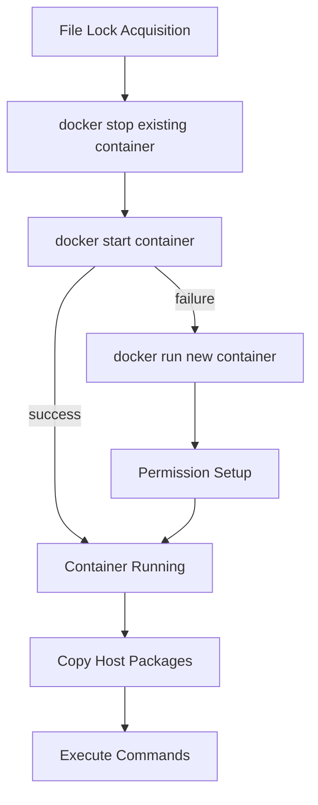

<!-- source: DeepWiki mcp.deepwiki.com · repo termux/game-packages · page 4.3 Development Tools · fetched 2026-10-26 -->

# Development Tools

<details>
<summary>Relevant source files</summary>

The following files were used as context for generating this wiki page:

- [start-builder.sh](start-builder.sh)

</details>


This document covers the development tools available for creating and maintaining game packages in the termux-game-packages repository. These tools provide a standardized Docker-based build environment, package validation utilities, and integration with the CI/CD pipeline.

For information about the overall package development process, see [Package Development Guide](#4). For details about build scripts and packaging conventions, see [Package Structure and Conventions](#4.1).

## Docker Build Environment

The primary development tool is the Docker-based build environment managed by `start-builder.sh`. This script provides a consistent, isolated environment for building and testing packages across different host systems.

### Container Setup Process

The build environment uses a standardized Docker container that mirrors the Termux build infrastructure:



Sources: [start-builder.sh:1-99]()

### Key Container Features

| Feature | Implementation | Purpose |
|---------|---------------|----------|
| **Image** | `termux/package-builder` | Standardized build environment |
| **Workspace** | `/home/builder/termux-packages` | Mounted repository root |
| **Persistence** | Named container `termux-package-builder` | Reuse environment between sessions |
| **Permissions** | UID/GID adjustment | Match host user permissions |
| **Isolation** | File locking | Prevent concurrent container conflicts |

Sources: [start-builder.sh:25-29](), [start-builder.sh:63-80]()

### Usage Patterns

The build environment supports multiple usage patterns:

#### Interactive Development
```bash
./start-builder.sh
# Enters interactive bash shell in container
```

#### Direct Command Execution
```bash
./start-builder.sh ./build-package.sh package-name
# Executes specific build command
```

#### Package Copying Strategy
The script automatically copies packages from the host `./packages` directory to the container, but skips existing packages to avoid overwriting modifications:

Sources: [start-builder.sh:82-91]()

## Package Building Tools

### Build Script Integration

The Docker environment integrates with the core Termux build system through the `termux-packages` submodule:



Sources: [start-builder.sh:49-58](), [start-builder.sh:69-70]()

### Submodule Management

The build environment handles Git submodule initialization automatically, ensuring the `termux-packages` build system is properly synchronized:

- **Owner Detection**: Respects file ownership when running under different users
- **Force Reinitialization**: Ensures clean submodule state with `git submodule deinit --all --force`
- **Automatic Updates**: Synchronizes submodule to latest committed version

Sources: [start-builder.sh:51-58]()

## Quality Assurance Tools

### Package Linting System

The development workflow includes automated package validation tools referenced in the CI/CD system:



### Testing Environment

The Docker container provides a consistent testing environment that matches the CI/CD infrastructure:

| Component | Container Path | Purpose |
|-----------|---------------|----------|
| **Build Tools** | `/data/data/com.termux/files/usr/bin/` | Cross-compilation toolchain |
| **Package Database** | `/data/data/com.termux/files/usr/var/lib/dpkg/` | Package dependency tracking |
| **Install Prefix** | `/data/data/com.termux/files/usr/` | Target installation directory |

Sources: [start-builder.sh:69-71]()

## Development Workflow Integration

### CI/CD Environment Detection

The build environment adapts to different execution contexts:



Sources: [start-builder.sh:39-44]()

### Permission Handling

The build environment handles complex permission scenarios for different development contexts:

- **Root Users**: Direct execution without permission adjustment
- **Standard Users (UID 1000)**: No permission changes needed
- **Custom UIDs**: Automatic `chown` and `usermod` operations to match host user

Sources: [start-builder.sh:73-79]()

## Advanced Features

### Container Lifecycle Management

The build environment implements sophisticated container lifecycle management:



Sources: [start-builder.sh:46-81]()

### Build Environment Persistence

The system maintains build environment state between invocations:

- **Container Reuse**: Named containers persist across script executions
- **Package Caching**: Existing packages in container are preserved
- **Build Artifacts**: Compiled objects remain available for incremental builds

Sources: [start-builder.sh:63-64](), [start-builder.sh:85-90]()

---

