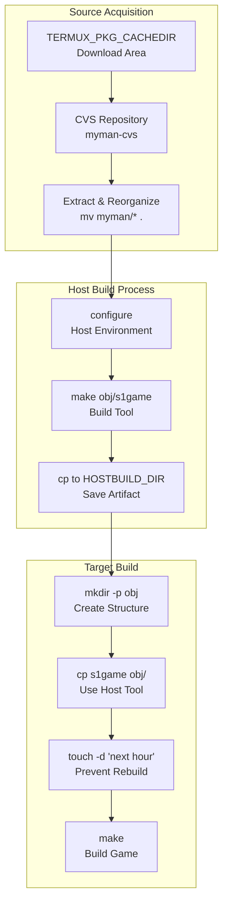
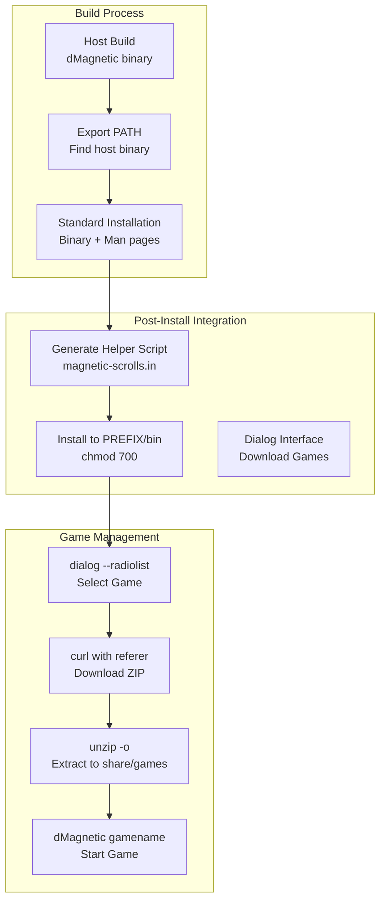
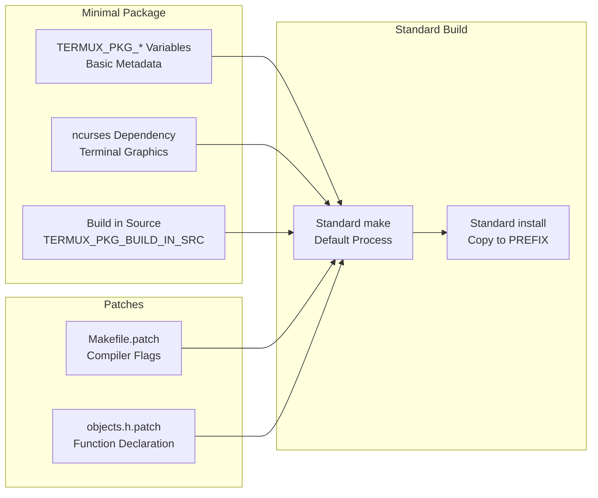
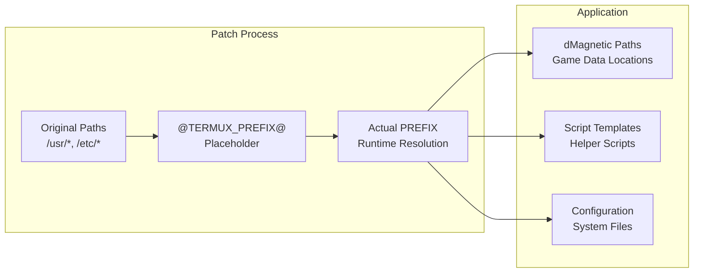
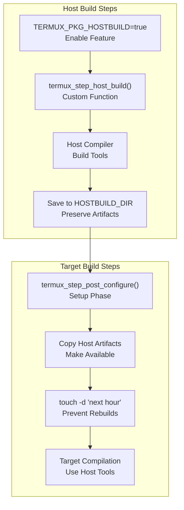

<!-- source: DeepWiki mcp.deepwiki.com · repo termux/game-packages · page 5 Game Package Examples · fetched 2026-10-26 -->

# Game Package Examples

Relevant source files

The following files were used as context for generating this wiki page:

- [packages/dmagnetic/Makefile.patch](packages/dmagnetic/Makefile.patch)
- [packages/dmagnetic/build.sh](packages/dmagnetic/build.sh)
- [packages/dmagnetic/change-prefix.patch.beforehostbuild](packages/dmagnetic/change-prefix.patch.beforehostbuild)
- [packages/dmagnetic/dMagnetic_helpscreens.c.patch.beforehostbuild](packages/dmagnetic/dMagnetic_helpscreens.c.patch.beforehostbuild)
- [packages/dmagnetic/magnetic-scrolls.in](packages/dmagnetic/magnetic-scrolls.in)
- [packages/gnuski/Makefile.patch](packages/gnuski/Makefile.patch)
- [packages/gnuski/build.sh](packages/gnuski/build.sh)
- [packages/gnuski/objects.h.patch](packages/gnuski/objects.h.patch)
- [packages/myman/Makefile.patch](packages/myman/Makefile.patch)
- [packages/myman/build.sh](packages/myman/build.sh)

This page demonstrates different categories of games in the termux-game-packages repository and their unique packaging approaches. Each game type presents distinct challenges for cross-compilation, patching, and integration with the Termux environment. The examples showcase how the standardized `build.sh` format adapts to handle everything from simple arcade games to complex interactive fiction interpreters.

For detailed information about the overall package structure and conventions, see [Package Structure and Conventions](#4.1). For specifics about the build process and patching techniques, see [Build Process and Patching](#4.2).

## Package Complexity Categories

The game packages in this repository fall into several complexity categories based on their build requirements and packaging challenges:

```mermaid
graph TB
    subgraph "Simple Games"
        GNUSKI["gnuski<br/>Simple Arcade Game"]
        NSNAKE["nsnake<br/>Snake Clone"]
        BASTET["bastet<br/>Tetris Clone"]
    end
    
    subgraph "Host Build Required"
        MYMAN["myman<br/>Pac-Man Clone"]
        DMAGNETIC["dmagnetic<br/>IF Interpreter"]
        NETHACK["nethack<br/>Roguelike"]
    end
    
    subgraph "Interactive Fiction"
        FROTZ["frotz<br/>Z-machine Interpreter"]
        GLULXE["glulxe<br/>Glulx Interpreter"]
        OPENADV["open-adventure<br/>Adventure Game"]
    end
    
    subgraph "Complex Dependencies"
        GNUCHESS["gnuchess<br/>Chess Engine"]
        BOOST_GAMES["boost-dependent<br/>C++ Games"]
        NETWORK_GAMES["multiplayer<br/>Network Games"]
    end
    
    %% Relationships
    GNUSKI --> SIMPLE_BUILD["`build.sh only<br/>TERMUX_PKG_DEPENDS`"]
    MYMAN --> HOST_BUILD["`TERMUX_PKG_HOSTBUILD=true<br/>termux_step_host_build()`"]
    DMAGNETIC --> HOST_BUILD
    DMAGNETIC --> POST_INSTALL["`termux_step_post_make_install()<br/>Helper Scripts`"]
    FROTZ --> DATA_HANDLING["`Game Data Management<br/>Custom Installation`"]
    GNUCHESS --> DEP_COMPLEX["`Complex Dependencies<br/>Library Integration`"]
```

**Sources:** [packages/myman/build.sh:1-34](), [packages/dmagnetic/build.sh:1-29](), [packages/gnuski/build.sh:1-11]()

## Build Pattern Analysis

Different game types require distinct build patterns, each with specific `TERMUX_PKG_*` variables and custom build steps:

| Game Type | Host Build | Custom Steps | Dependencies | Complexity |
|-----------|------------|--------------|--------------|------------|
| Simple Arcade | No | None | `ncurses` | Low |
| Complex Arcade | Yes | `termux_step_host_build()` | `ncurses` | Medium |
| Interactive Fiction | Yes | `termux_step_post_make_install()` | Minimal | Medium |
| Roguelikes | Yes | Multiple custom steps | `ncurses`, data files | High |
| Network Games | Varies | Network configuration | `curl`, `openssl` | High |

## Myman: Complex Arcade Game Example

The `myman` package demonstrates a complex arcade game requiring host builds and custom source acquisition:

The key implementation details include:

- **Custom Source Acquisition**: [packages/myman/build.sh:14-22]() uses `termux_step_get_source()` to handle CVS repository extraction
- **Host Build Tool**: [packages/myman/build.sh:24-27]() creates `obj/s1game` using the host compiler
- **Tool Integration**: [packages/myman/build.sh:29-33]() copies the host-built tool and uses `touch` to prevent rebuilds
- **Duplicate Prevention**: [packages/myman/build.sh:12]() removes duplicate installation with `TERMUX_PKG_RM_AFTER_INSTALL`

**Sources:** [packages/myman/build.sh:1-34](), [packages/myman/Makefile.patch:1-97]()

## Dmagnetic: Interactive Fiction Interpreter

The `dmagnetic` package showcases an interactive fiction interpreter with integrated game downloading:

Key implementation aspects:

- **Host Build Requirement**: [packages/dmagnetic/build.sh:11-16]() builds the interpreter using host tools
- **Path Integration**: [packages/dmagnetic/build.sh:18-21]() adds host build directory to PATH
- **Helper Script Generation**: [packages/dmagnetic/build.sh:23-28]() creates the `magnetic-scrolls` wrapper
- **Game Download Interface**: [packages/dmagnetic/magnetic-scrolls.in:15-25]() provides dialog-based game selection
- **Automated Installation**: [packages/dmagnetic/magnetic-scrolls.in:77-87]() handles download and extraction

**Sources:** [packages/dmagnetic/build.sh:1-29](), [packages/dmagnetic/magnetic-scrolls.in:1-88]()

## Gnuski: Simple Game Pattern

The `gnuski` package demonstrates the simplest packaging approach for basic games:

The minimal implementation includes:

- **Basic Metadata**: [packages/gnuski/build.sh:1-11]() contains only essential `TERMUX_PKG_*` variables
- **Single Dependency**: [packages/gnuski/build.sh:9]() depends only on `ncurses`
- **In-Source Build**: [packages/gnuski/build.sh:10]() uses `TERMUX_PKG_BUILD_IN_SRC=true`
- **Makefile Adaptation**: [packages/gnuski/Makefile.patch:1-20]() adjusts compiler flags and installation
- **Header Fix**: [packages/gnuski/objects.h.patch:1-11]() resolves implicit function declarations

**Sources:** [packages/gnuski/build.sh:1-11](), [packages/gnuski/Makefile.patch:1-20](), [packages/gnuski/objects.h.patch:1-11]()

## Common Packaging Patterns

Across all game types, several patterns emerge for handling platform-specific challenges:

### Path Substitution Pattern
Many games require path modifications for the Termux environment:

### Host Build Pattern
Games requiring build tools use a consistent host build pattern:

**Sources:** [packages/myman/build.sh:10-33](), [packages/dmagnetic/build.sh:9-21](), [packages/dmagnetic/change-prefix.patch.beforehostbuild:1-30]()

---

