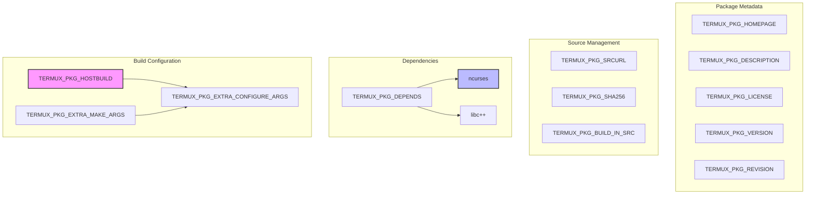
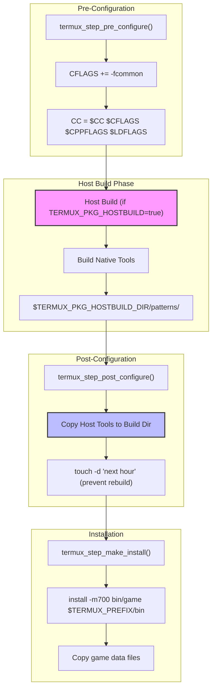
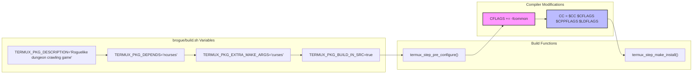
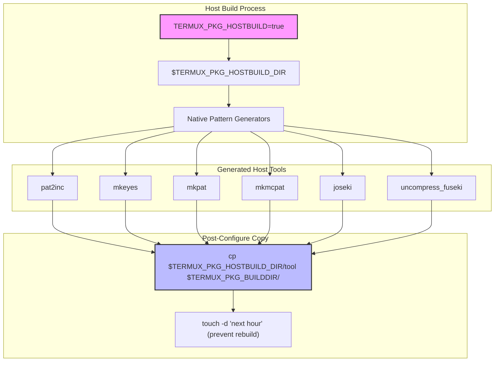
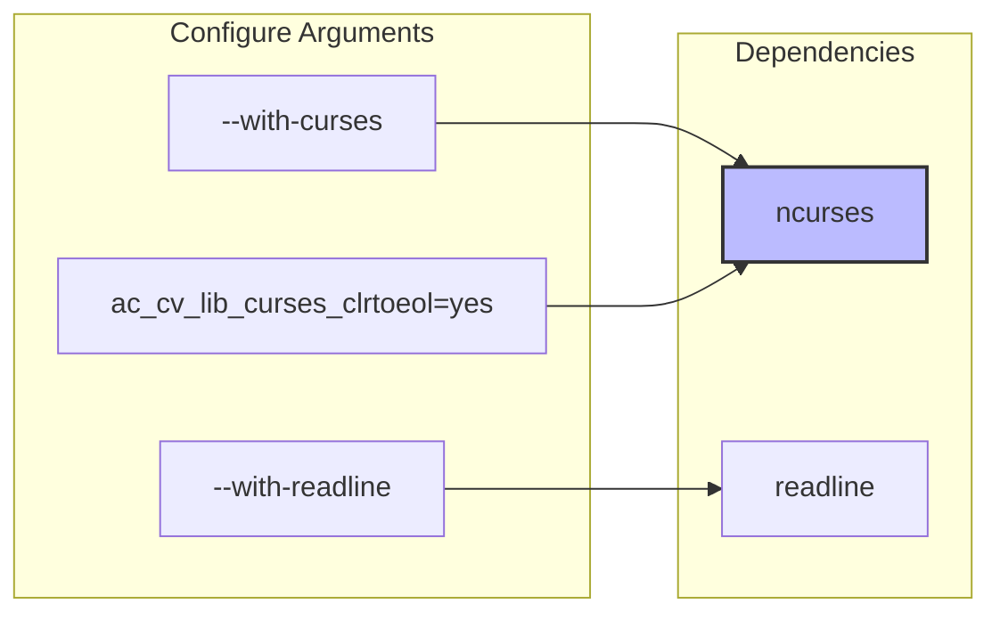

<!-- source: DeepWiki mcp.deepwiki.com · repo termux/game-packages · page 5.1 Roguelike Games · fetched 2026-10-26 -->

# Roguelike Games

<details>
<summary>Relevant source files</summary>

The following files were used as context for generating this wiki page:

- [packages/brogue/build.sh](packages/brogue/build.sh)
- [packages/curseofwar/build.sh](packages/curseofwar/build.sh)
- [packages/gnugo/build.sh](packages/gnugo/build.sh)
- [packages/gnushogi/build.sh](packages/gnushogi/build.sh)

</details>


## Purpose and Scope

This document covers the packaging and build processes for roguelike games in the termux-game-packages repository. Roguelike games are complex terminal-based dungeon crawlers that typically require extensive source modifications, host builds for cross-compilation, and custom installation procedures due to their intricate data file management and platform-specific terminal handling.

For information about simpler arcade-style and puzzle games, see [Arcade and Puzzle Games](#5.2). For board games and strategy games, see [Specialized Games](#5.4).

## Roguelike Game Characteristics

Roguelike games present unique packaging challenges due to their:

- **Complex terminal interfaces** requiring ncurses adaptations
- **Procedural content generation** needing host-built tools
- **Extensive game data files** with custom directory structures  
- **Platform-specific code paths** requiring source patches
- **Cross-compilation dependencies** for pattern generators and data builders

| Challenge | Solution Approach | Example |
|-----------|------------------|---------|
| Terminal compatibility | ncurses dependency + CFLAGS modifications | `-fcommon` compiler flag |
| Host tool building | `TERMUX_PKG_HOSTBUILD=true` | Pattern generators, data compilers |
| Data file management | Custom `termux_step_make_install()` | Binary + data separation |
| Source adaptation | Platform-specific patches | Android/Termux compatibility |

## Package Structure for Roguelikes

### Standard Build Variables

Roguelike packages follow the standard `TERMUX_PKG_*` variable pattern but with additional complexity:



**Sources:** [packages/brogue/build.sh:1-12](), [packages/gnushogi/build.sh:1-12](), [packages/gnugo/build.sh:1-11]()

### Build Process Flow

The roguelike build process involves multiple phases with host/target coordination:



**Sources:** [packages/brogue/build.sh:13-21](), [packages/gnushogi/build.sh:14-23](), [packages/gnugo/build.sh:13-24]()

## Brogue: Roguelike Packaging Example

### Package Configuration

Brogue demonstrates the typical roguelike packaging pattern with terminal-specific adaptations:



**Sources:** [packages/brogue/build.sh:1-21]()

### Build Process Implementation

The brogue package uses a simplified build process without host builds:

| Build Phase | Function | Implementation |
|-------------|----------|----------------|
| Pre-configuration | `termux_step_pre_configure()` | Set `-fcommon` flag, modify `CC` variable |
| Compilation | Default make | Uses `TERMUX_PKG_EXTRA_MAKE_ARGS="curses"` |
| Installation | `termux_step_make_install()` | Install binary with `install -m700` |

**Sources:** [packages/brogue/build.sh:13-21]()

## Host Build Requirements

### Complex Roguelikes with Host Tools

Games like GNU Shogi and GNU Go require host builds to generate platform-specific pattern files:



**Sources:** [packages/gnushogi/build.sh:12-23](), [packages/gnugo/build.sh:11-24]()

### Host Build Pattern Implementation

The host build pattern follows this sequence:

1. **Host Build Phase**: Native tools are built in `$TERMUX_PKG_HOSTBUILD_DIR`
2. **Post-Configure Copy**: Tools are copied to target build directory
3. **Timestamp Update**: Files are touched to prevent unnecessary rebuilds

```bash
# Example from gnugo/build.sh
termux_step_post_configure () {
    cp $TERMUX_PKG_HOSTBUILD_DIR/patterns/mkeyes $TERMUX_PKG_BUILDDIR/patterns/mkeyes
    cp $TERMUX_PKG_HOSTBUILD_DIR/patterns/mkpat $TERMUX_PKG_BUILDDIR/patterns/mkpat
    touch -d "next hour" $TERMUX_PKG_BUILDDIR/patterns/*
}
```

**Sources:** [packages/gnugo/build.sh:17-24]()

## Common Compilation Flags

### Platform Compatibility Flags

Roguelike games often require specific compiler flags for Android/Termux compatibility:

| Flag | Purpose | Usage Pattern |
|------|---------|---------------|
| `-fcommon` | Handle duplicate symbols | `CFLAGS+=" -fcommon"` |
| `-Wno-overflow` | Suppress overflow warnings | `CFLAGS+=" -Wno-overflow"` |
| `$CPPFLAGS` | Include preprocessor flags | `CFLAGS+=" $CPPFLAGS"` |

**Sources:** [packages/brogue/build.sh:14-15](), [packages/gnushogi/build.sh:15](), [packages/gnugo/build.sh:14]()

### Configure Arguments

Roguelike games typically require ncurses-specific configure arguments:



**Sources:** [packages/gnushogi/build.sh:9-11](), [packages/gnugo/build.sh:9-10]()

---

