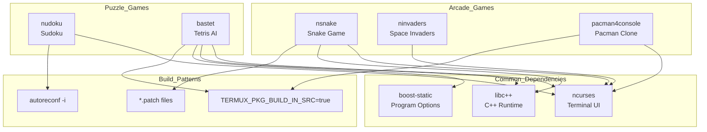
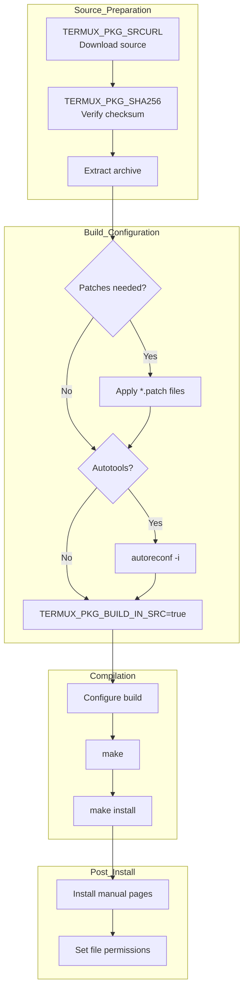
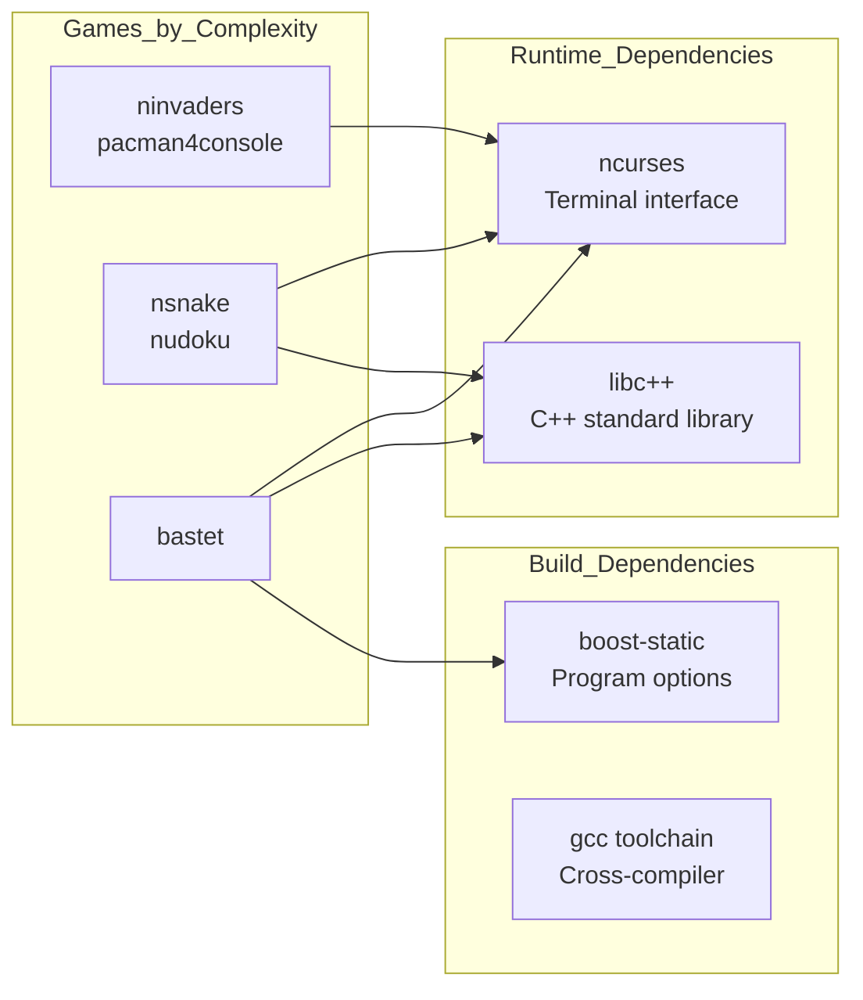

<!-- source: DeepWiki mcp.deepwiki.com · repo termux/game-packages · page 5.2 Arcade and Puzzle Games · fetched 2026-10-26 -->

# Arcade and Puzzle Games

<details>
<summary>Relevant source files</summary>

The following files were used as context for generating this wiki page:

- [packages/bastet/build.sh](packages/bastet/build.sh)
- [packages/ninvaders/build.sh](packages/ninvaders/build.sh)
- [packages/nsnake/Makefile.patch](packages/nsnake/Makefile.patch)
- [packages/nsnake/build.sh](packages/nsnake/build.sh)
- [packages/nudoku/build.sh](packages/nudoku/build.sh)
- [packages/pacman4console/build.sh](packages/pacman4console/build.sh)

</details>


This document covers the packaging and implementation of arcade-style and puzzle games in the termux-game-packages repository. These games demonstrate standard packaging patterns and common ncurses-based terminal interfaces, representing simpler build processes compared to complex roguelikes. For roguelike games with extensive patching and host builds, see [Roguelike Games](#5.1). For text-based adventure games, see [Interactive Fiction and Adventure Games](#5.3).

## Game Categories and Characteristics

Arcade and puzzle games in this repository fall into several categories, each with distinct packaging requirements and technical implementations:

### Terminal-Based Action Games
- **nsnake**: Classic Snake game implementation
- **ninvaders**: Space Invaders clone with ASCII graphics
- **pacman4console**: Pacman game with level editor

### Puzzle Games
- **nudoku**: Sudoku game with ncurses interface
- **bastet**: Tetris clone with AI opponent

### Common Technical Characteristics



**Title:** Arcade and Puzzle Games Architecture

Sources: [packages/nsnake/build.sh:1-11](), [packages/ninvaders/build.sh:1-10](), [packages/pacman4console/build.sh:1-16](), [packages/nudoku/build.sh:1-15](), [packages/bastet/build.sh:1-13]()

## Build Patterns and Packaging Strategies

### Standard Build Configuration

Most arcade and puzzle games follow a consistent packaging pattern with minimal complexity:

| Game | Build Pattern | Dependencies | Special Requirements |
|------|---------------|--------------|---------------------|
| nsnake | `BUILD_IN_SRC=true` + patches | `libc++, ncurses` | Makefile patching |
| ninvaders | Standard autotools | `ncurses` | None |
| pacman4console | `BUILD_IN_SRC=true` | `ncurses` | Manual page installation |
| nudoku | `autoreconf -i` | `ncurses` | Autotools regeneration |
| bastet | `BUILD_IN_SRC=true` | `libc++, ncurses, boost-static` | Boost linking |

### Build Process Flow



**Title:** Build Process Flow for Arcade and Puzzle Games

Sources: [packages/nsnake/build.sh:1-11](), [packages/nudoku/build.sh:12-14](), [packages/pacman4console/build.sh:12-16]()

## Implementation Examples

### Simple Games (ninvaders)

The simplest packaging approach is demonstrated by `ninvaders`:

```bash
TERMUX_PKG_DEPENDS="ncurses"
```

This game requires only ncurses and uses the standard autotools build process without any customization.

Sources: [packages/ninvaders/build.sh:1-10]()

### Games with Patches (nsnake)

Games requiring source modifications use patch files:

```bash
TERMUX_PKG_DEPENDS="libc++, ncurses"
TERMUX_PKG_BUILD_IN_SRC=true
```

The [packages/nsnake/Makefile.patch:1-34]() file demonstrates typical modifications:
- Making `PREFIX` configurable
- Adding `CPPFLAGS` support
- Ensuring proper linking order

Sources: [packages/nsnake/build.sh:1-11](), [packages/nsnake/Makefile.patch:1-34]()

### Games with Autotools (nudoku)

Games requiring autotools regeneration implement `termux_step_pre_configure`:

```bash
termux_step_pre_configure() {
    autoreconf -i
}
```

Sources: [packages/nudoku/build.sh:12-14]()

### Complex Dependencies (bastet)

Games with additional library requirements specify build and runtime dependencies:

```bash
TERMUX_PKG_DEPENDS="libc++, ncurses"
TERMUX_PKG_BUILD_DEPENDS="boost-static"
TERMUX_PKG_EXTRA_MAKE_ARGS=" BOOST_PO=$TERMUX_PREFIX/lib/libboost_program_options.a"
```

Sources: [packages/bastet/build.sh:9-11]()

### Post-Installation Customization (pacman4console)

Games requiring manual page installation use `termux_step_post_make_install`:

```bash
termux_step_post_make_install() {
    mkdir -p "$TERMUX_PREFIX"/share/man/man1 "$TERMUX_PREFIX"/share/man/man6
    install -Dm600 $TERMUX_PKG_BUILDER_DIR/pacmanedit.1 "$TERMUX_PREFIX"/share/man/man1/
    install -Dm600 $TERMUX_PKG_BUILDER_DIR/pacman.6 "$TERMUX_PREFIX"/share/man/man6/
}
```

Sources: [packages/pacman4console/build.sh:12-16]()

## Dependency Management

### Common Dependencies

All arcade and puzzle games share common dependency patterns:



**Title:** Dependency Relationships by Game Complexity

Sources: [packages/ninvaders/build.sh:9](), [packages/nsnake/build.sh:9](), [packages/bastet/build.sh:9-10]()

### Dependency Specifications

| Dependency Type | Variable | Purpose |
|----------------|----------|---------|
| Runtime | `TERMUX_PKG_DEPENDS` | Required for execution |
| Build-time | `TERMUX_PKG_BUILD_DEPENDS` | Required for compilation |
| Make arguments | `TERMUX_PKG_EXTRA_MAKE_ARGS` | Custom linker flags |

Sources: [packages/bastet/build.sh:9-11](), [packages/nsnake/build.sh:9]()

## Testing and Validation

Arcade and puzzle games typically require minimal testing compared to complex roguelikes, but still need verification of:

1. **Terminal interface functionality** - ncurses display works correctly
2. **Input handling** - Keyboard controls respond properly  
3. **Game logic** - Core gameplay mechanics function
4. **Resource loading** - Game data files load correctly

The standardized packaging patterns make these games reliable candidates for automated testing and continuous integration validation.

Sources: [packages/nsnake/build.sh:1-11](), [packages/pacman4console/build.sh:1-16](), [packages/nudoku/build.sh:1-15]()

---

