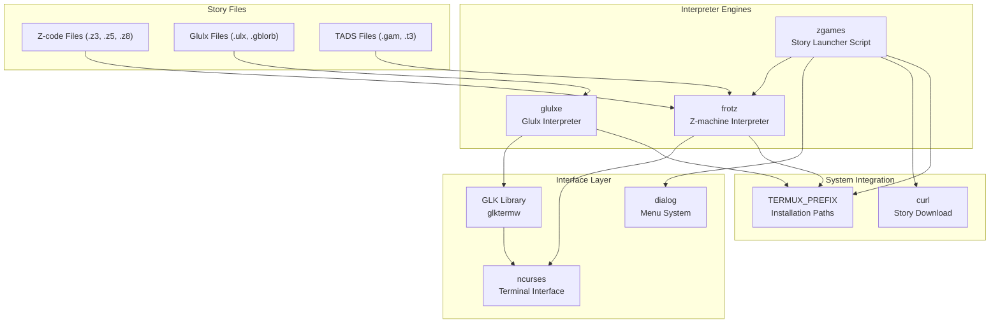
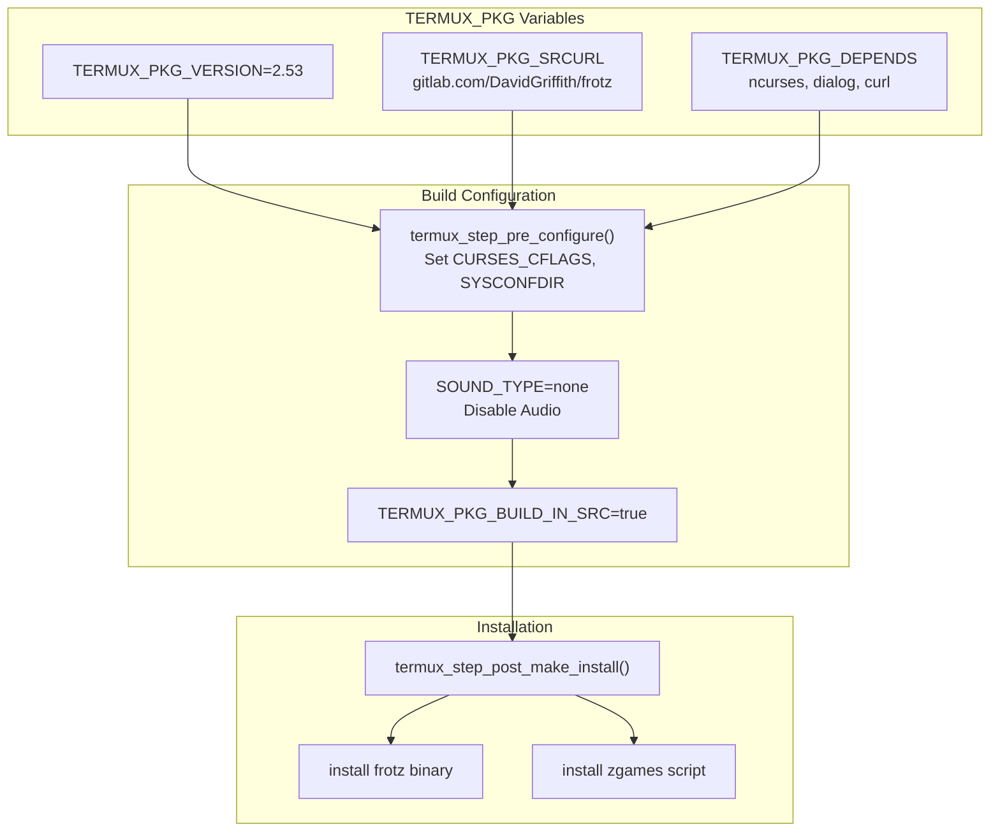
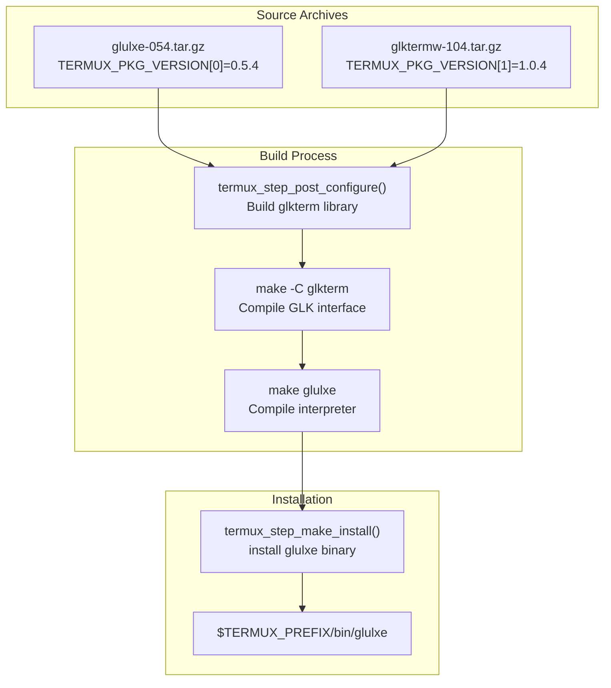
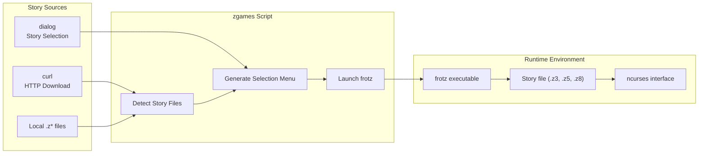

<!-- source: DeepWiki mcp.deepwiki.com · repo termux/game-packages · page 5.3 Interactive Fiction and Adventure Games · fetched 2026-10-26 -->

# Interactive Fiction and Adventure Games

<details>
<summary>Relevant source files</summary>

The following files were used as context for generating this wiki page:

- [packages/frotz/build.sh](packages/frotz/build.sh)
- [packages/glulxe/Makefile.patch](packages/glulxe/Makefile.patch)
- [packages/glulxe/build.sh](packages/glulxe/build.sh)
- [packages/glulxe/glkterm.patch](packages/glulxe/glkterm.patch)

</details>


This page documents the packaging and implementation of text-based adventure games and interactive fiction interpreters in the termux-game-packages repository. These games are characterized by their narrative-driven gameplay, text-based interfaces, and unique requirements for story data file management and interpreter engines.

Interactive fiction (IF) games use specialized virtual machines and interpreters to execute story files. The primary focus is on Z-machine and Glulx interpreters, which handle the vast majority of modern interactive fiction content. For simpler arcade-style games, see [Arcade and Puzzle Games](#5.2).

## Interactive Fiction Architecture

Interactive fiction games in Termux follow a distinct architecture pattern where interpreters execute story files rather than running as standalone executables. This creates unique packaging requirements for both the interpreter engines and the story distribution mechanisms.

### IF Interpreter Architecture



Sources: [packages/frotz/build.sh:1-21](), [packages/glulxe/build.sh:1-21]()

## Z-machine Interpreter (Frotz)

The `frotz` package provides a Z-machine interpreter for Infocom-style interactive fiction games. It represents the most widely compatible IF interpreter, supporting story formats from Z-code version 3 through 8.

### Frotz Package Structure



Sources: [packages/frotz/build.sh:1-21]()

The frotz package demonstrates key patterns for IF interpreters:

| Variable | Purpose | Value |
|----------|---------|-------|
| `TERMUX_PKG_DEPENDS` | Runtime dependencies | `ncurses, dialog, curl` |
| `TERMUX_PKG_BUILD_IN_SRC` | Build location | `true` |
| `CURSES_CFLAGS` | Include paths | `$TERMUX_PREFIX/include` |
| `SOUND_TYPE` | Audio support | `none` |

The build process configures ncurses support through `CURSES_CFLAGS` and explicitly disables sound support via `SOUND_TYPE=none` [packages/frotz/build.sh:13-16](). The package includes both the core interpreter and the `zgames` launcher script [packages/frotz/build.sh:19]().

## Glulx Interpreter (Glulxe)

The `glulxe` package provides a Glulx virtual machine interpreter for modern interactive fiction. Unlike frotz, glulxe requires building both the interpreter and the GLK interface library from separate source archives.

### Glulxe Multi-Source Build



Sources: [packages/glulxe/build.sh:1-21]()

The glulxe package uses array-based version management for multiple source archives:

```bash
TERMUX_PKG_VERSION=(0.5.4 1.0.4)
TERMUX_PKG_SRCURL=(
    https://www.eblong.com/zarf/glulx/glulxe-${TERMUX_PKG_VERSION[0]//.}.tar.gz
    https://www.eblong.com/zarf/glk/glktermw-${TERMUX_PKG_VERSION[1]//.}.tar.gz
)
```

The build process requires custom compilation of the GLK library before building the main interpreter [packages/glulxe/build.sh:15-16]().

## GLK Library Integration

The GLK (Glk) library provides a standardized interface layer for interactive fiction interpreters. The glulxe package includes extensive patches to adapt the GLK terminal library for Android/Termux compatibility.

### GLK Adaptation Patches

The GLK integration requires several platform-specific modifications:

| Patch Area | Purpose | Location |
|------------|---------|----------|
| Makefile configuration | Cross-compilation setup | [packages/glulxe/Makefile.patch:1-27]() |
| ncurses header paths | Header file locations | [packages/glulxe/glkterm.patch:76-77]() |
| timegm function | Android compatibility | [packages/glulxe/glkterm.patch:48-64]() |

The most significant adaptation is the `timegm` function implementation for Android, which lacks this POSIX function [packages/glulxe/glkterm.patch:49-63]():

```c
#ifdef __ANDROID__
time_t timegm (struct tm *tm) {
    time_t ret;
    char *tz;
    
    tz = getenv("TZ");
    setenv("TZ", "", 1);
    tzset();
    ret = mktime(tm);
    if (tz)
        setenv("TZ", tz, 1);
    else
        unsetenv("TZ");
    tzset();
    return ret;
}
#endif
```

Sources: [packages/glulxe/glkterm.patch:1-81](), [packages/glulxe/Makefile.patch:1-27]()

## Data File Management

Interactive fiction games require mechanisms for distributing and managing story files. The frotz package includes the `zgames` script for this purpose, which handles story discovery and launching.

### Story File Distribution



Sources: [packages/frotz/build.sh:5-9](), [packages/frotz/build.sh:19]()

The `zgames` script serves as a launcher that can download stories via `curl` and present them through `dialog` menus, explaining the dependencies on these packages despite frotz itself not requiring them [packages/frotz/build.sh:5]().

## Build System Patterns

Interactive fiction interpreters follow specific build patterns that differ from typical game packages due to their multi-component nature and interface library requirements.

### Common IF Build Patterns

| Pattern | Implementation | Example |
|---------|---------------|---------|
| Custom pre-configure | Set interface library paths | `CURSES_CFLAGS`, `SYSCONFDIR` |
| Multi-source builds | Array-based version management | `TERMUX_PKG_VERSION[0]`, `TERMUX_PKG_VERSION[1]` |
| Host/target separation | GLK library compilation | `make -C glkterm` |
| Custom install steps | Additional script installation | `install zgames` |

The build system accommodates the unique requirements of IF interpreters through:

1. **Interface Library Management**: Custom configuration of ncurses and GLK paths
2. **Multi-Archive Handling**: Support for building from multiple source tarballs
3. **Platform Adaptation**: Extensive patching for Android/Termux compatibility
4. **Auxiliary Tool Integration**: Installation of launcher scripts and utilities

Sources: [packages/frotz/build.sh:12-20](), [packages/glulxe/build.sh:15-21]()

This architecture enables the distribution of sophisticated text-based gaming experiences while maintaining compatibility with the broader Termux ecosystem and standard package management workflows.

---

