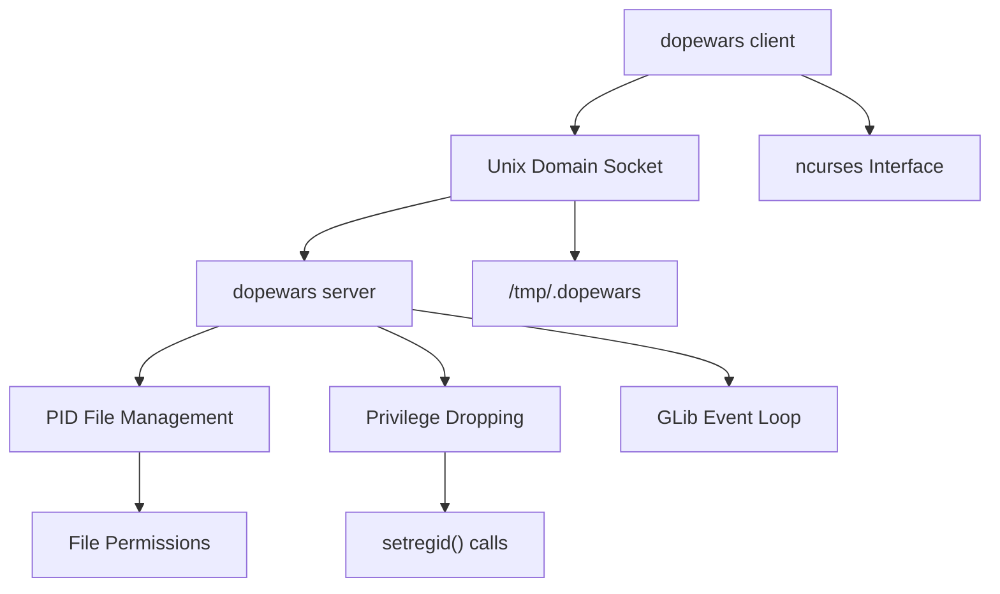
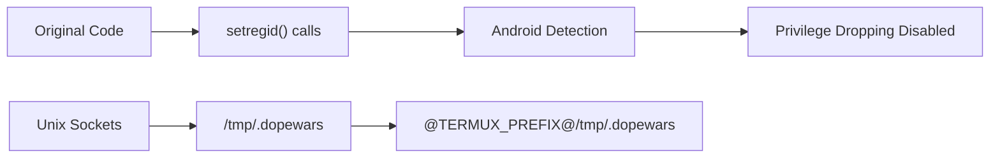
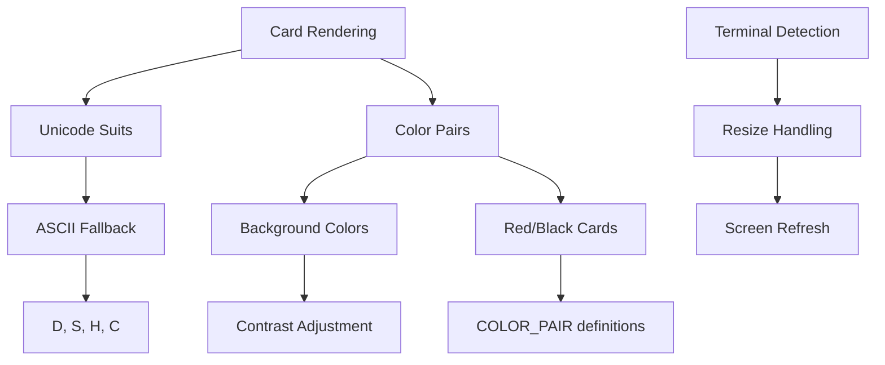
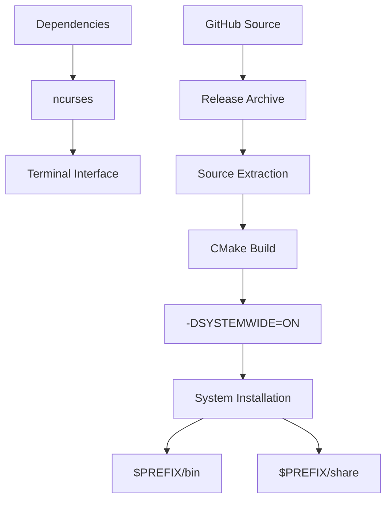
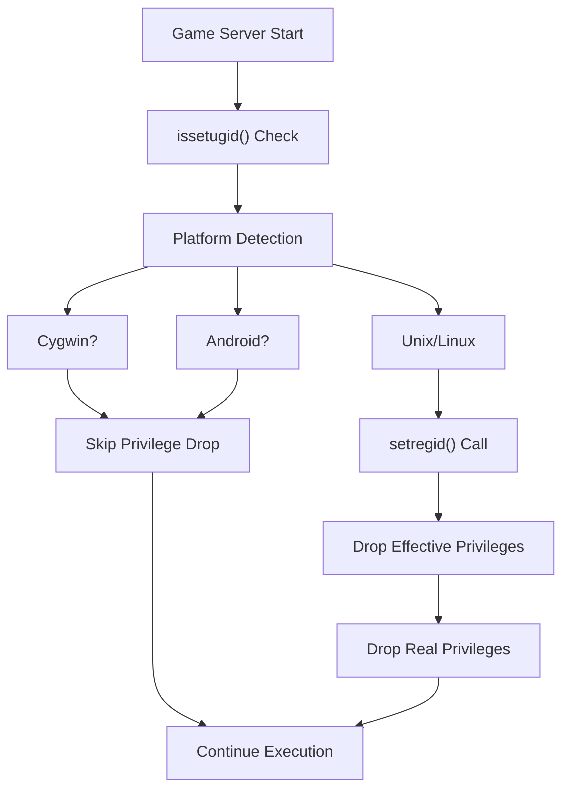
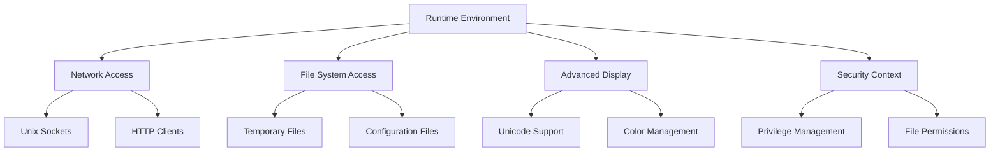

<!-- source: DeepWiki mcp.deepwiki.com · repo termux/game-packages · page 5.4 Specialized Games · fetched 2026-10-26 -->

# Specialized Games

Relevant source files

The following files were used as context for generating this wiki page:

- [packages/cavez-of-phear/build.sh](packages/cavez-of-phear/build.sh)
- [packages/dopewars/build.sh](packages/dopewars/build.sh)
- [packages/dopewars/find-configfile.h.patch](packages/dopewars/find-configfile.h.patch)
- [packages/dopewars/serverside.c.patch](packages/dopewars/serverside.c.patch)
- [packages/dopewars/setregid.patch](packages/dopewars/setregid.patch)
- [packages/tty-solitaire/Makefile.patch](packages/tty-solitaire/Makefile.patch)
- [packages/tty-solitaire/build.sh](packages/tty-solitaire/build.sh)
- [packages/tty-solitaire/tty-solitaire.patch](packages/tty-solitaire/tty-solitaire.patch)

This page covers games with unique technical requirements that distinguish them from simpler terminal games. These packages demonstrate advanced packaging techniques including network functionality, complex display handling, modern build systems, and platform-specific security adaptations.

For simpler terminal games with standard packaging patterns, see [Simple Games Reference](#5.5). For text-based adventure games, see [Interactive Fiction and Adventure Games](#5.3).

## Network-Enabled Games

Some games require network connectivity for multiplayer functionality, creating additional dependencies and security considerations.

### DopeWars: Multiplayer Drug Trading Game

DopeWars exemplifies network-enabled games with client-server architecture and Unix domain socket communication.

**Network Architecture**

DopeWars requires extensive patching for Android compatibility, particularly around privilege management and file system paths.

**Key Dependencies and Configuration**
- **Network Libraries**: `curl` for HTTP communications [packages/dopewars/build.sh:9]()
- **Build System**: Requires `autoreconf -vfi` due to build system modifications [packages/dopewars/build.sh:16]()
- **Disabled Components**: `--without-sdl` to avoid GUI dependencies [packages/dopewars/build.sh:11]()

**Android-Specific Adaptations**
The game requires patches to handle Android's restricted privilege model:

Sources: [packages/dopewars/build.sh:1-18](), [packages/dopewars/setregid.patch:1-12](), [packages/dopewars/serverside.c.patch:1-31]()

## Advanced Display and Graphics

Games with sophisticated terminal graphics require careful handling of Unicode characters, color schemes, and terminal capabilities.

### TTY Solitaire: Unicode and Color Management

TTY Solitaire demonstrates complex terminal display handling with custom color schemes and Unicode character management.

**Display System Architecture**

The game originally used Unicode suit symbols but requires fallback to ASCII characters for terminal compatibility:

**Character Set Modifications**
- **Original**: `{"\u2666", "\u2660", "\u2665", "\u2663"}` (♦♠♥♣)
- **Modified**: `{"D", "S", "H", "C"}` for universal compatibility [packages/tty-solitaire/tty-solitaire.patch:9]()

**Color Scheme Adjustments**
The patch inverts color schemes for better readability:
- `RED_ON_WHITE` → `WHITE_ON_RED`
- `BLACK_ON_WHITE` → `WHITE_ON_BLACK` [packages/tty-solitaire/tty-solitaire.patch:18-21]()

**Build System Integration**
Requires `CPPFLAGS` integration in Makefile for proper compilation [packages/tty-solitaire/Makefile.patch:9]().

Sources: [packages/tty-solitaire/build.sh:1-11](), [packages/tty-solitaire/tty-solitaire.patch:1-91](), [packages/tty-solitaire/Makefile.patch:1-13]()

## Modern Build Systems

Some games use modern build systems like CMake instead of traditional autotools, requiring different packaging approaches.

### Cavez of Phear: CMake-Based Game

Cavez of Phear demonstrates packaging of modern CMake-based games with system-wide installation.

**CMake Configuration**

**Package Configuration**
- **Build System**: CMake with system-wide installation flag [packages/cavez-of-phear/build.sh:10]()
- **Dependencies**: Minimal ncurses dependency [packages/cavez-of-phear/build.sh:9]()
- **Source**: Direct GitHub release archive [packages/cavez-of-phear/build.sh:7]()

The package demonstrates a clean, modern approach with minimal patching required due to good upstream Android compatibility.

Sources: [packages/cavez-of-phear/build.sh:1-11]()

## Security and Privilege Management

Network-enabled games often require careful handling of security privileges and file system access.

### Privilege Dropping Patterns

DopeWars illustrates the complexity of adapting Unix privilege management for Android:

**Privilege Management Flow**

**File System Security**
The game manages PID files and socket permissions:
- **PID Files**: Changed from `S_IREAD | S_IWRITE` to `S_IRUSR | S_IWUSR` [packages/dopewars/serverside.c.patch:9]()
- **Socket Paths**: Relocated from `/tmp/.dopewars` to `@TERMUX_PREFIX@/tmp/.dopewars` [packages/dopewars/serverside.c.patch:18]()

Sources: [packages/dopewars/setregid.patch:1-12](), [packages/dopewars/serverside.c.patch:1-31]()

## Common Specialized Patterns

Several patterns emerge across specialized games that distinguish them from simpler packages:

### Build System Complexity

**Pattern Comparison**
| Pattern | Simple Games | Specialized Games |
|---------|--------------|-------------------|
| Build System | Standard autotools | CMake, custom Makefiles, autoreconf |
| Dependencies | ncurses only | Multiple libraries (glib, curl, pcre) |
| Patches | Minimal | Extensive platform adaptation |
| Configuration | Basic `--prefix` | Complex flags, feature toggles |

### Runtime Requirements

**Specialized Runtime Features**

These games demonstrate the full spectrum of packaging challenges in the Termux environment, from simple dependency management to complex system integration.

Sources: [packages/dopewars/build.sh:1-18](), [packages/tty-solitaire/build.sh:1-11](), [packages/cavez-of-phear/build.sh:1-11]()

---

