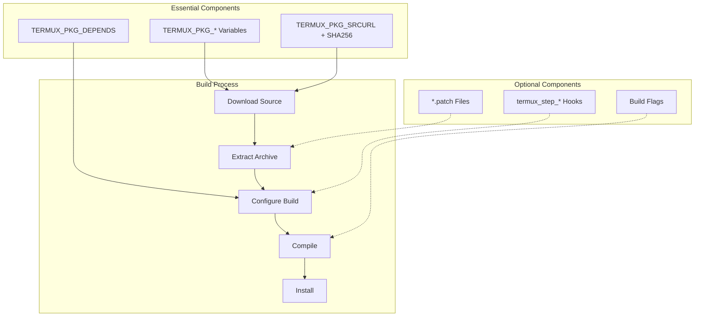
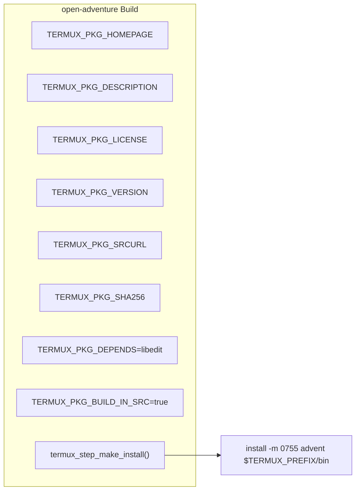
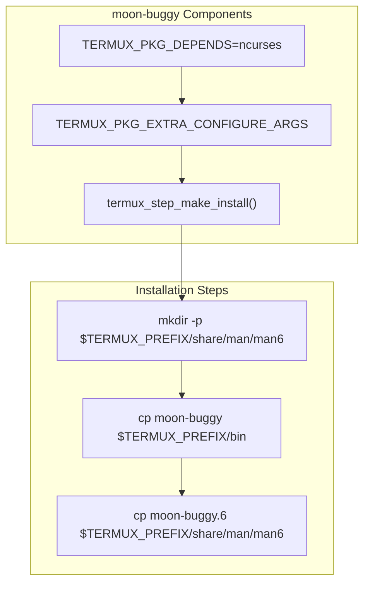
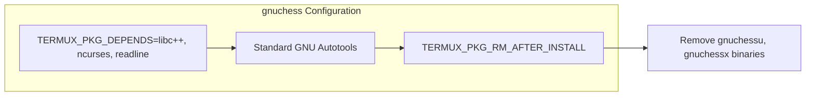

<!-- source: DeepWiki mcp.deepwiki.com · repo termux/game-packages · page 5.5 Simple Games Reference · fetched 2026-10-26 -->

# Simple Games Reference

<details>
<summary>Relevant source files</summary>

The following files were used as context for generating this wiki page:

- [packages/0verkill/build.sh](packages/0verkill/build.sh)
- [packages/cboard/build.sh](packages/cboard/build.sh)
- [packages/cboard/configure.patch](packages/cboard/configure.patch)
- [packages/cboard/libchess-pgn.c.patch](packages/cboard/libchess-pgn.c.patch)
- [packages/gnuchess/build.sh](packages/gnuchess/build.sh)
- [packages/gnuchess/components.cc.patch](packages/gnuchess/components.cc.patch)
- [packages/gnuchess/main.cc.patch](packages/gnuchess/main.cc.patch)
- [packages/moon-buggy/build.sh](packages/moon-buggy/build.sh)
- [packages/open-adventure/build.sh](packages/open-adventure/build.sh)
- [packages/vitetris/build.sh](packages/vitetris/build.sh)
- [packages/vitetris/configure.patch](packages/vitetris/configure.patch)

</details>


This page provides a quick reference for simpler games that demonstrate minimal packaging approaches and serve as good starting points for new packages. These games showcase basic packaging patterns without the complexity of advanced features like host builds, extensive patching, or complex dependency management.

For complex games requiring sophisticated build processes, see [Roguelike Games](#5.1). For games with unique requirements, see [Specialized Games](#5.4).

## Minimal Packaging Patterns

Simple games in the termux-game-packages repository follow standardized patterns that minimize complexity while maintaining consistency. The most basic packages require only essential metadata and standard build procedures.

### Basic Build Script Structure



Sources: [packages/open-adventure/build.sh:1-13](), [packages/moon-buggy/build.sh:1-18](), [packages/vitetris/build.sh:1-18]()

### Common Dependency Patterns

Simple games typically depend on one of these common patterns:

| Pattern | Dependencies | Use Case | Example |
|---------|-------------|----------|---------|
| **Minimal** | `libedit` or similar | Text-based adventures | `open-adventure` |
| **Terminal UI** | `ncurses` | Console games with UI | `moon-buggy`, `vitetris` |
| **Standard C++** | `libc++, ncurses` | C++ console games | `gnuchess` |
| **Enhanced Terminal** | `ncurses, ncurses-ui-libs` | Games with complex UI | `cboard` |

## Build Script Examples

### Minimal Example: open-adventure

The simplest possible game package demonstrates the absolute minimum required for a functional package:



Sources: [packages/open-adventure/build.sh:1-13]()

### Terminal UI Example: moon-buggy

A slightly more complex example showing ncurses dependency and manual installation:



Sources: [packages/moon-buggy/build.sh:5-18]()

### Standard Autotools Example: gnuchess

A standard GNU autotools package requiring multiple dependencies:



Sources: [packages/gnuchess/build.sh:9-10]()

## Installation Patterns

Simple games follow predictable installation patterns based on their complexity:

### Single Binary Installation

The most common pattern for simple games:

```bash
termux_step_make_install() {
    install -m 0755 [binary] $TERMUX_PREFIX/bin
}
```

Used by: [packages/open-adventure/build.sh:11-13]()

### Binary + Manual Page Installation

For games that include documentation:

```bash
termux_step_make_install() {
    mkdir -p $TERMUX_PREFIX/share/man/man6
    cp [binary] $TERMUX_PREFIX/bin
    cp [manual].6 $TERMUX_PREFIX/share/man/man6
}
```

Used by: [packages/moon-buggy/build.sh:14-18]()

### Standard Make Installation

For packages using standard autotools:

```bash
# No custom termux_step_make_install needed
# Uses default: make install
```

Used by: [packages/gnuchess/build.sh](), [packages/vitetris/build.sh]()

## Configuration Patterns

### Custom Configure Scripts

Some games use custom configure scripts instead of standard autotools:

```bash
termux_step_configure() {
    "$TERMUX_PKG_SRCDIR/configure" \
        --prefix=$TERMUX_PREFIX \
        $TERMUX_PKG_EXTRA_CONFIGURE_ARGS
}
```

Sources: [packages/vitetris/build.sh:14-18]()

### Build-in-Source Configuration

Games that require building in the source directory:

```bash
TERMUX_PKG_BUILD_IN_SRC=true
```

Sources: [packages/open-adventure/build.sh:9](), [packages/0verkill/build.sh:9](), [packages/vitetris/build.sh:11]()

## Simple Games Reference Table

| Game | Primary Dependency | Build Type | Installation | Complexity |
|------|-------------------|------------|--------------|------------|
| `open-adventure` | `libedit` | In-source | Single binary | Minimal |
| `moon-buggy` | `ncurses` | Standard | Binary + manual | Simple |
| `vitetris` | `ncurses` | Custom configure | Standard make | Simple |
| `gnuchess` | `libc++, ncurses, readline` | Autotools | Standard make | Simple |
| `0verkill` | None | Autotools + patches | Standard make | Simple |

## Common Build Flags

Simple games occasionally require basic build flag modifications:

### Common CFLAGS Additions

```bash
termux_step_pre_configure() {
    CFLAGS+=" -fcommon"  # For older C code
}
```

Sources: [packages/0verkill/build.sh:11-14]()

### Path Configuration

```bash
TERMUX_PKG_EXTRA_CONFIGURE_ARGS="--sharedstatedir=$TERMUX_PREFIX/var"
```

Sources: [packages/moon-buggy/build.sh:12]()

Sources: [packages/open-adventure/build.sh:1-13](), [packages/moon-buggy/build.sh:1-18](), [packages/vitetris/build.sh:1-18](), [packages/gnuchess/build.sh:1-10](), [packages/0verkill/build.sh:1-14]()

---

