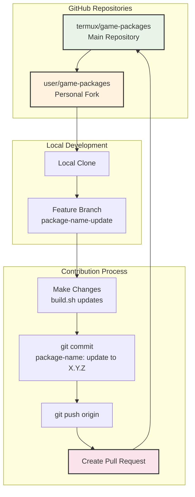
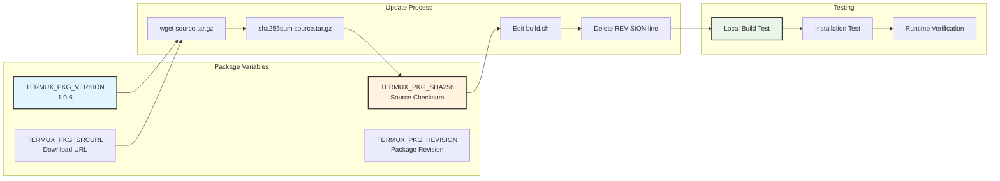
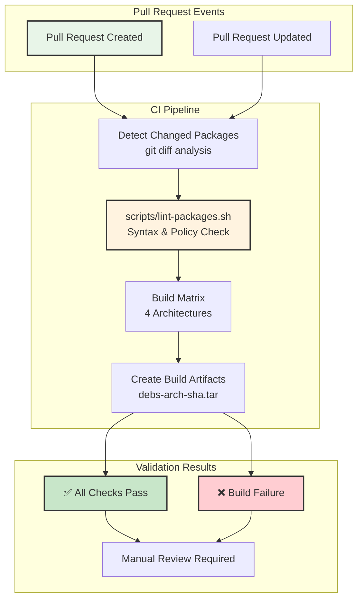
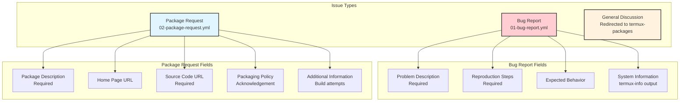
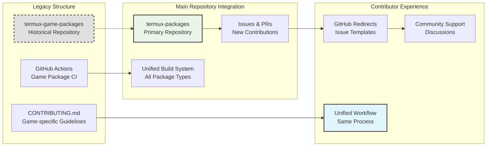

<!-- source: DeepWiki mcp.deepwiki.com · repo termux/game-packages · page 6 Contributing · fetched 2026-10-26 -->

# Contributing

<details>
<summary>Relevant source files</summary>

The following files were used as context for generating this wiki page:

- [.github/ISSUE_TEMPLATE/01-bug-report.yml](.github/ISSUE_TEMPLATE/01-bug-report.yml)
- [.github/ISSUE_TEMPLATE/02-package-request.yml](.github/ISSUE_TEMPLATE/02-package-request.yml)
- [.github/ISSUE_TEMPLATE/config.yml](.github/ISSUE_TEMPLATE/config.yml)
- [.github/static/powered-by-fosshost.png](.github/static/powered-by-fosshost.png)
- [CONTRIBUTING.md](CONTRIBUTING.md)
- [README.md](README.md)

</details>


This document covers the contribution process for the termux-game-packages repository, including development workflow, package maintenance, and issue handling. The repository has been merged into the main termux-packages repository, but the contribution guidelines and processes documented here remain relevant for game package development.

For information about package structure and development techniques, see [Package Development Guide](#4). For details about the build system and CI/CD pipeline, see [CI/CD and Build System](#3).

## Repository Status and Integration

The termux-game-packages repository has been merged into the main [termux-packages](https://github.com/termux/termux-packages) repository. All new issues and pull requests should be submitted to the main repository instead of this one.

**Current Status:**
- Repository is in maintenance mode
- CI/CD pipeline still operational for testing
- All new contributions should target termux-packages
- Issue templates redirect to termux-packages discussions

Sources: [README.md:3](), [.github/ISSUE_TEMPLATE/config.yml:4]()

## Development Workflow

### Fork and Branch Strategy

The contribution process follows a standard GitHub fork-and-pull workflow:



**Key Commands:**
```bash
# Fork repository via GitHub UI
git clone https://github.com/<username>/game-packages
git checkout master
git pull origin master  
git checkout -b <package-name>-update
```

Sources: [CONTRIBUTING.md:17-43]()

### Package Update Process

The most common contribution is updating existing packages to newer versions. This involves modifying specific variables in the package's `build.sh` file:



**Example Variable Changes:**
- `TERMUX_PKG_VERSION=1.0.6` (updated from 1.0.5)
- `TERMUX_PKG_SHA256=6116e607250...` (new checksum)
- Remove `TERMUX_PKG_REVISION=2` line (reset to 0)

Sources: [CONTRIBUTING.md:47-73]()

## Testing and Validation

### Local Build Environment

Contributors can test packages locally using the Docker-based build environment:

```bash
# Build with Docker container
./start-builder.sh ./build-package.sh package-name

# Build without Docker  
./termux-packages/build-package.sh ../packages/package-to-build
```

### CI/CD Validation Pipeline

When a pull request is created, the CI system automatically validates the changes:



**Build Status Monitoring:**
- CI status visible at https://cirrus-ci.com/github/termux/game-packages
- Build artifacts generated for each architecture
- Automatic failure notifications for patch conflicts

Sources: [CONTRIBUTING.md:101-102](), [README.md:21-31]()

## Issue Reporting and Management

### Issue Templates and Categories

The repository uses structured issue templates to categorize and handle different types of contributions:



**Template Requirements:**
- Bug reports must include problem description and reproduction steps
- Package requests must acknowledge packaging policy
- System information required for debugging (`termux-info` output)

Sources: [.github/ISSUE_TEMPLATE/01-bug-report.yml:14-36](), [.github/ISSUE_TEMPLATE/02-package-request.yml:12-40]()

### Issue Triage and Resolution

The issue management process follows these stages:

| Stage | Description | Action Required |
|-------|-------------|----------------|
| **Triage** | Categorize and validate issue | Maintainer review |
| **Investigation** | Reproduce and analyze problem | Technical analysis |
| **Resolution** | Implement fix or provide guidance | Code changes |
| **Verification** | Test fix and close issue | User confirmation |

**Unsupported Scenarios:**
- Android versions 5.x and 6.x are no longer supported
- Issues on these platforms will not be resolved
- Sensitive information (passwords, API keys) must be redacted from logs

Sources: [.github/ISSUE_TEMPLATE/01-bug-report.yml:11-13]()

## Package Maintenance Guidelines

### Update Frequency and Monitoring

Contributors can use external tools to identify outdated packages:

- **Repology**: Monitor package versions across repositories
- **Upstream tracking**: Follow project releases and changelogs
- **Security updates**: Priority for packages with known vulnerabilities

### Commit Message Standards

Consistent commit messages help maintain project history:

```bash
# Package updates
git commit -m "package-name: update to X.Y.Z"

# Bug fixes  
git commit -m "package-name: fix build issue with feature"

# New packages
git commit -m "package-name: add new game package"
```

### Review Process

Pull requests undergo several validation stages:

1. **Automated CI/CD checks** - Build verification across architectures
2. **Maintainer review** - Code quality and policy compliance
3. **Community feedback** - Input from other contributors
4. **Final approval** - Merge into main repository

Sources: [CONTRIBUTING.md:6](), [CONTRIBUTING.md:83-91]()

## Integration with Main Repository

Since the repository merger, the contribution process bridges between the game-packages legacy structure and the main termux-packages workflow:



**Key Integration Points:**
- Issue templates redirect to main repository discussions
- Build processes maintain compatibility with legacy packages
- Documentation remains relevant for game package development
- Community support consolidated in main repository

Sources: [README.md:3](), [.github/ISSUE_TEMPLATE/config.yml:3-5]()