# Page: Overview

# Overview

<details>
<summary>Relevant source files</summary>

The following files were used as context for generating this wiki page:

- [.github/static/powered-by-fosshost.png](.github/static/powered-by-fosshost.png)
- [CONTRIBUTING.md](CONTRIBUTING.md)
- [README.md](README.md)

</details>


This document introduces the termux-game-packages repository, its original purpose as a collection of game packages for Termux, and its current status as a merged component of the main termux-packages repository. It covers the high-level architecture, key systems, and integration points within the broader Termux ecosystem.

For detailed information about CI/CD and build processes, see [CI/CD and Build System](#3). For package development workflows, see [Package Development Guide](#4). For specific game package examples, see [Game Package Examples](#5).

## Repository Status and Integration

The termux-game-packages repository has been **merged into the main termux-packages repository** as stated in [README.md:3](). This means that while the repository still exists for historical purposes, all active development and issue tracking now occurs in the primary termux-packages repository.

### Current Integration Architecture

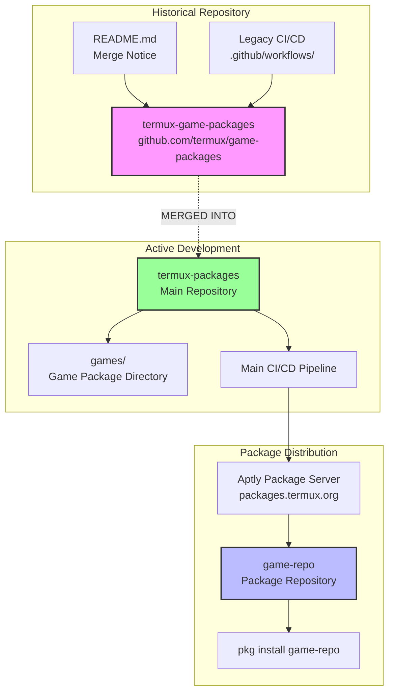

**Sources:** [README.md:3](), [README.md:34-38]()

## Package Management System

The termux-game-packages ecosystem provides a standardized approach to packaging and distributing games for the Termux Android terminal environment. The system handles cross-compilation, dependency management, and platform-specific adaptations.

### Core Package Structure

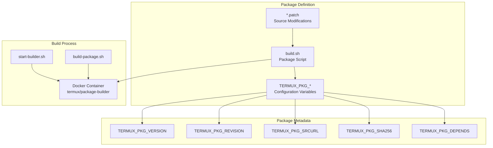

**Sources:** [README.md:21-31](), [CONTRIBUTING.md:47-66]()

## Development Workflow

The repository provides a comprehensive development environment with Docker-based builds and standardized contribution processes.

### Build System Components

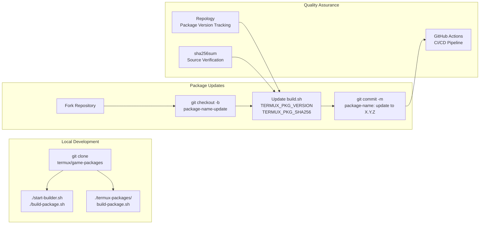

**Sources:** [README.md:16-31](), [CONTRIBUTING.md:8-103]()

## Package Ecosystem Integration

The game packages integrate with the broader Termux ecosystem through standardized interfaces and dependency management.

### Distribution and Installation Flow

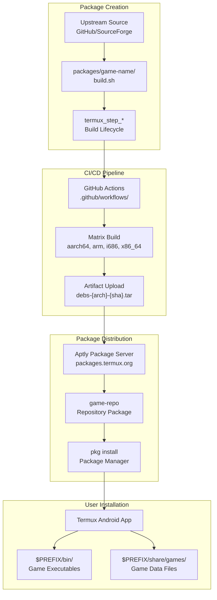

**Sources:** [README.md:33-38](), [CONTRIBUTING.md:101-102]()

## Key System Components

The termux-game-packages system consists of several interconnected components that handle different aspects of the package lifecycle:

| Component | Purpose | Key Files |
|-----------|---------|-----------|
| **Package Definitions** | Game-specific build scripts and metadata | `packages/*/build.sh` |
| **Build System** | Docker-based cross-compilation environment | `start-builder.sh`, `build-package.sh` |
| **CI/CD Pipeline** | Automated building and publishing | `.github/workflows/` |
| **Contribution Tools** | Developer workflow support | `CONTRIBUTING.md` guidelines |
| **Package Repository** | Distribution mechanism | `game-repo` package |

### Package Variable Standards

The system uses standardized `TERMUX_PKG_*` variables for consistent package definitions:

- `TERMUX_PKG_VERSION`: Upstream version number
- `TERMUX_PKG_REVISION`: Termux-specific revision (reset on version updates)
- `TERMUX_PKG_SRCURL`: Source code download URL
- `TERMUX_PKG_SHA256`: Source archive integrity hash
- `TERMUX_PKG_DEPENDS`: Runtime dependencies

**Sources:** [CONTRIBUTING.md:47-76]()

## Current Status and Future Development

With the merger into termux-packages, the game packages are now part of the main Termux package ecosystem. Users should:

1. **Install packages** using `pkg install game-repo` as described in [README.md:34-38]()
2. **Report issues** to the main termux-packages repository
3. **Submit contributions** following the workflow in [CONTRIBUTING.md:8-103]()

The repository remains available for historical reference and to maintain existing CI/CD badges and documentation links.

**Sources:** [README.md:3](), [README.md:5]()

---

# Page: Repository Architecture

# Repository Architecture

<details>
<summary>Relevant source files</summary>

The following files were used as context for generating this wiki page:

- [.gitmodules](.gitmodules)

</details>


## Purpose and Scope

This document explains the structural organization of the termux-game-packages repository and its integration with the broader Termux ecosystem. It covers the Git submodule architecture, directory structure, and integration patterns that enable automated package building and distribution.

For information about the CI/CD pipeline and build automation, see [CI/CD and Build System](#3). For details about individual package structure and development, see [Package Development Guide](#4).

## Git Submodule Architecture

The termux-game-packages repository is architecturally built around a Git submodule pattern that integrates with the main termux-packages repository. This design allows the game packages to leverage the full build infrastructure and tooling from the main Termux package system.

### Submodule Configuration

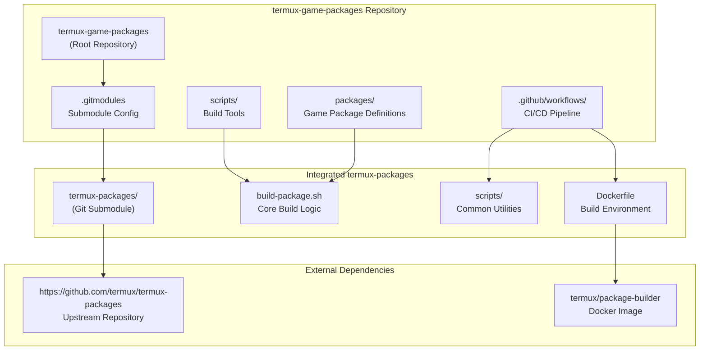

**Git Submodule Integration**

The repository uses a single Git submodule to integrate the entire termux-packages infrastructure:

| Component | Path | Purpose |
|-----------|------|---------|
| Submodule Definition | `.gitmodules` | Defines the termux-packages submodule |
| Submodule Directory | `termux-packages/` | Contains the full termux-packages repository |
| Integration Point | `termux-packages/build-package.sh` | Core build script used by game packages |

Sources: [.gitmodules:1-4]()

### Submodule Integration Pattern

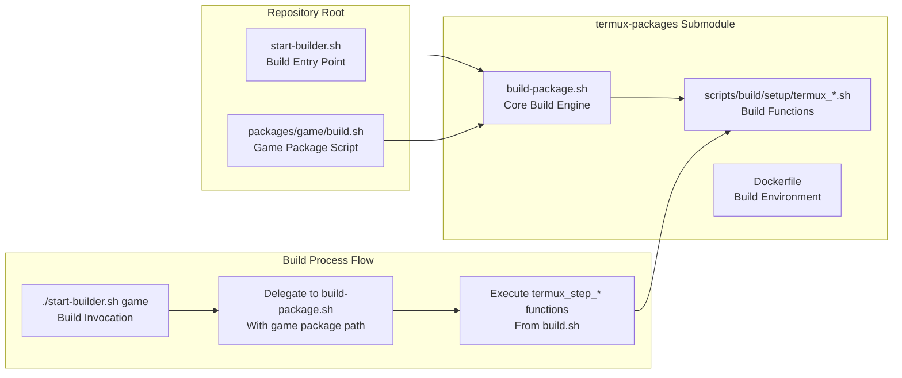

**Integration Benefits**

This submodule architecture provides several key advantages:

- **Shared Infrastructure**: Game packages use the same build system, dependency resolution, and packaging logic as main Termux packages
- **Consistent Environment**: All packages build in the same Docker environment with identical toolchains
- **Unified CI/CD**: The CI/CD pipeline leverages termux-packages workflows and publishing mechanisms
- **Automatic Updates**: The submodule can be updated to pull in improvements from the main repository

Sources: [.gitmodules:1-4]()

## Directory Structure and Organization

The repository follows a standardized directory structure that separates game packages from build infrastructure:

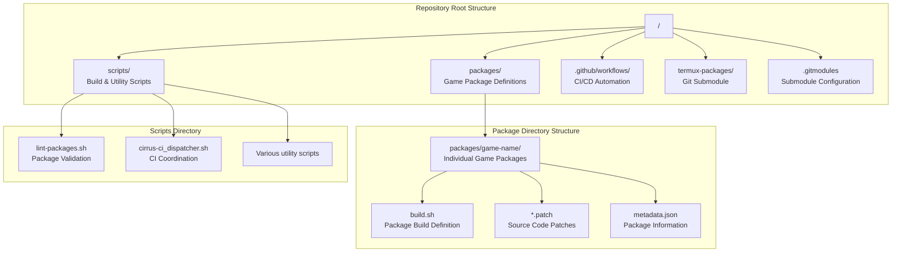

**Directory Structure Overview**

| Directory | Purpose | Key Files |
|-----------|---------|-----------|
| `packages/` | Game package definitions | `*/build.sh`, `*.patch` files |
| `scripts/` | Build and utility scripts | `lint-packages.sh`, `cirrus-ci_dispatcher.sh` |
| `.github/workflows/` | CI/CD pipeline definitions | `packages.yml`, workflow files |
| `termux-packages/` | Git submodule with core build system | `build-package.sh`, `Dockerfile` |

Sources: [.gitmodules:1-4]()

## Integration with Termux Ecosystem

The repository integrates with multiple components of the Termux ecosystem to provide a complete package management solution:

### Ecosystem Integration Points

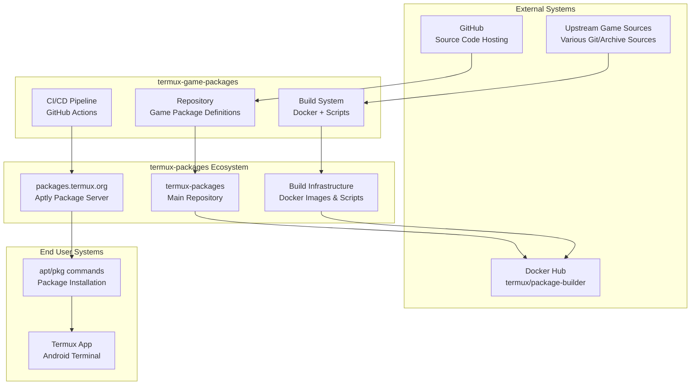

**Integration Components**

The repository integrates with the Termux ecosystem through several key mechanisms:

1. **Build System Integration**: Uses `termux-packages/build-package.sh` for consistent package building
2. **Infrastructure Sharing**: Leverages Docker images and build environments from the main repository
3. **Package Distribution**: Publishes packages to the same APT repository used by main Termux packages
4. **CI/CD Integration**: Uses similar GitHub Actions workflows as the main repository

Sources: [.gitmodules:1-4]()

## Build Environment Architecture

The build environment architecture demonstrates how the repository integrates with containerized build systems:

### Build Environment Flow

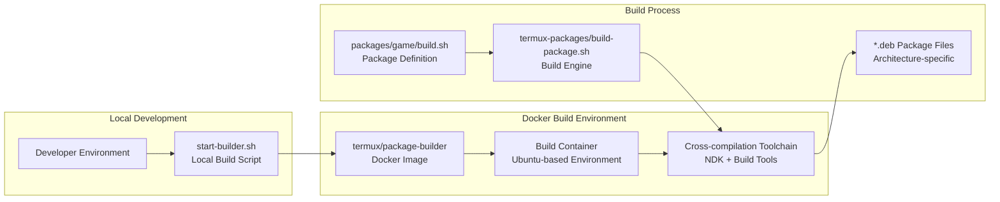

**Build Environment Integration**

The build environment demonstrates several architectural patterns:

- **Containerization**: All builds occur in standardized Docker containers to ensure reproducibility
- **Cross-compilation**: The build system supports multiple target architectures (aarch64, arm, i686, x86_64)
- **Toolchain Management**: The termux-packages submodule provides consistent toolchain configuration
- **Artifact Management**: Built packages are collected and published through the CI/CD pipeline

Sources: [.gitmodules:1-4]()

## Data Flow and Integration Patterns

The repository implements several data flow patterns that demonstrate its integration with the broader Termux ecosystem:

### Package Build and Distribution Flow

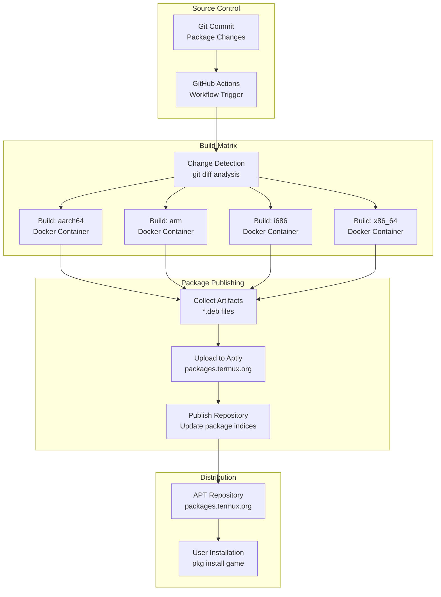

**Data Flow Characteristics**

The repository's data flow demonstrates several important architectural characteristics:

- **Event-Driven**: Package builds are triggered by Git commits and pull requests
- **Parallel Processing**: Multiple architecture builds occur simultaneously
- **Artifact Management**: Built packages are collected and distributed through a centralized system
- **Integration Points**: The system integrates with external package repositories and user installations

Sources: [.gitmodules:1-4]()

This architecture enables the termux-game-packages repository to function as a specialized extension of the main Termux package system while maintaining consistency and leveraging shared infrastructure.

---

# Page: CI/CD and Build System

# CI/CD and Build System

<details>
<summary>Relevant source files</summary>

The following files were used as context for generating this wiki page:

- [.github/workflows/packages.yml](.github/workflows/packages.yml)

</details>


This document covers the automated build and deployment pipeline for the termux-game-packages repository. The CI/CD system automatically detects package changes, builds them across multiple architectures, validates the builds, and publishes them to the Termux package repository. For information about the individual package build process and development tools, see [Package Development Guide](#4) and [Development Tools](#4.3).

## System Overview

The CI/CD system is implemented as a GitHub Actions workflow that provides comprehensive automation for package management. It handles both pull request validation and production deployment through a sophisticated multi-stage pipeline.

### Workflow Architecture

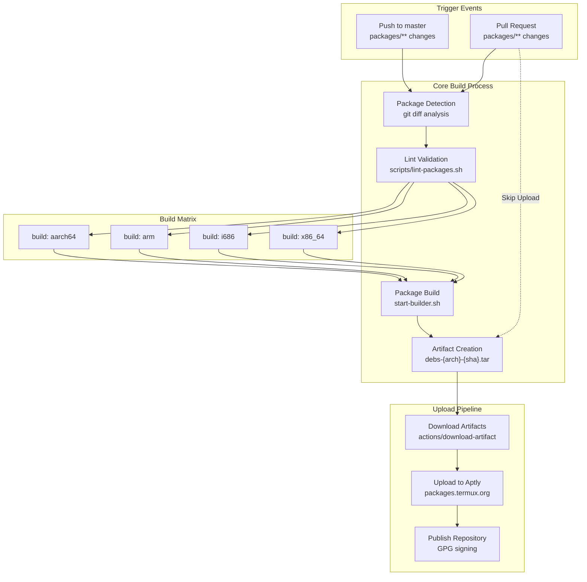

**Sources:** [.github/workflows/packages.yml:1-257]()

## Build Triggers and Matrix Strategy

The workflow triggers on two primary events with specific path filtering to optimize build performance:

### Event Triggers

| Event Type | Trigger Condition | Behavior |
|------------|-------------------|----------|
| `push` | Branch: `master`, Path: `packages/**` | Full build and publish |
| `pull_request` | Path: `packages/**` | Build validation only |

### Architecture Matrix

The build system targets four Android architectures in parallel:

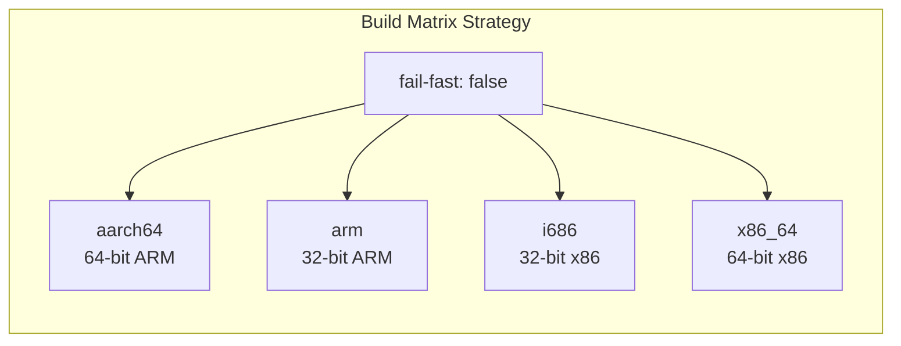

**Sources:** [.github/workflows/packages.yml:19-22]()

## Package Change Detection

The system implements intelligent change detection to build only modified packages, significantly improving build efficiency.

### Change Detection Algorithm

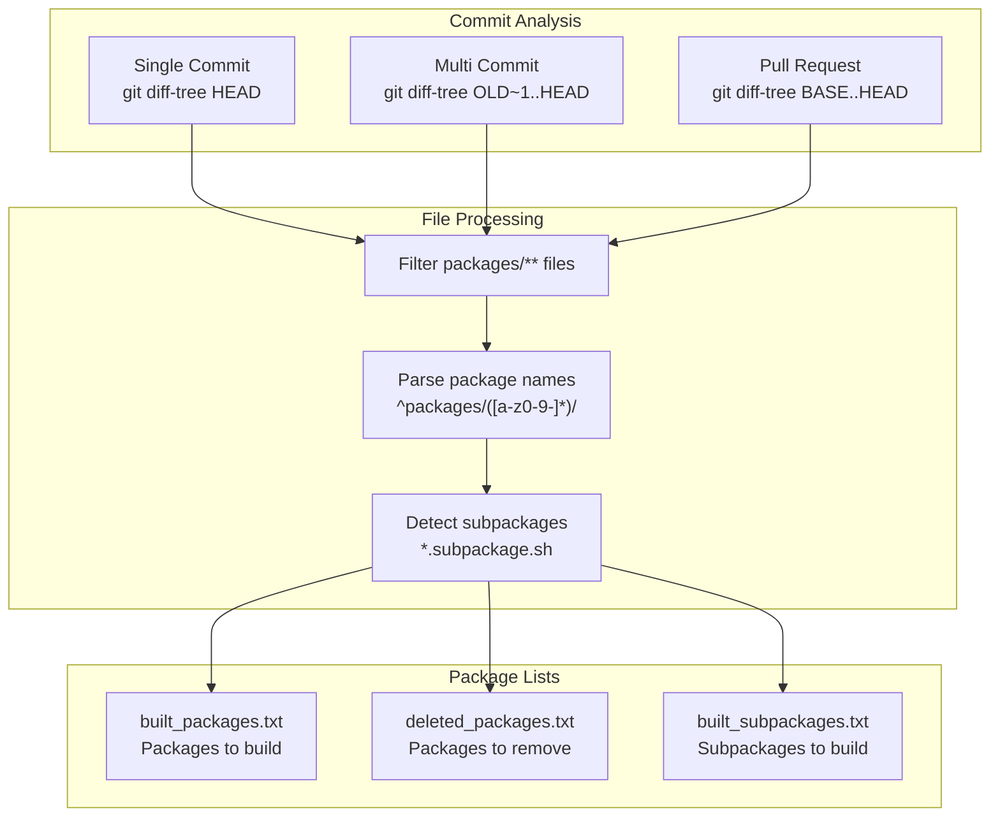

The detection logic handles three commit scenarios:
- **Single commit push**: Uses `git diff-tree` on HEAD commit
- **Multi-commit push**: Compares range from `OLD_COMMIT~1` to `HEAD_COMMIT`
- **Pull request**: Compares base branch to HEAD

**Sources:** [.github/workflows/packages.yml:30-48](), [.github/workflows/packages.yml:61-87]()

## Build Process Flow

### Package Validation and Building

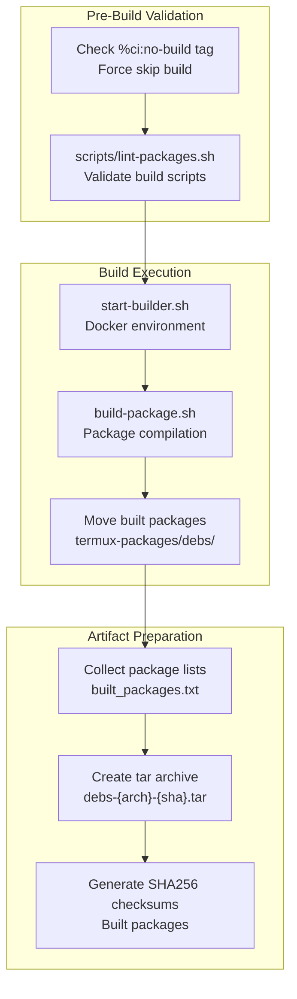

### Build Control Features

The system includes several control mechanisms:

1. **Force Skip**: `%ci:no-build` tag in commit message forces successful exit
2. **Incremental Builds**: Only builds packages with detected changes
3. **Dependency Handling**: Processes subpackages automatically
4. **Artifact Management**: Creates compressed archives to handle special characters

**Sources:** [.github/workflows/packages.yml:51-57](), [.github/workflows/packages.yml:103-117]()

## Upload and Publishing Pipeline

### Aptly Integration

The publishing system integrates with the Aptly package repository management system:

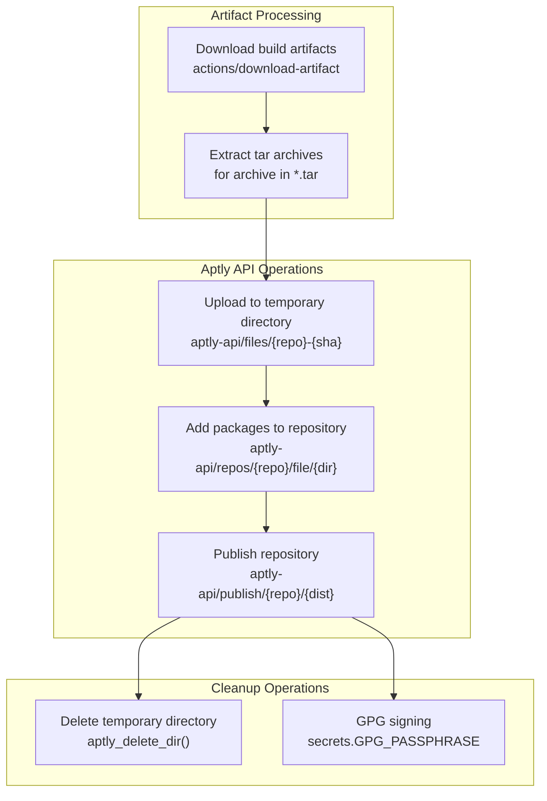

### Repository Configuration

| Configuration | Value |
|---------------|--------|
| `REPOSITORY_NAME` | `termux-games` |
| `REPOSITORY_DISTRIBUTION` | `games` |
| API Endpoint | `https://packages.termux.org/aptly-api` |

### Error Handling and Cleanup

The upload process includes comprehensive error handling:

- **HTTP Status Monitoring**: Validates API responses (200 OK expected)
- **Automatic Cleanup**: Removes temporary directories on failure
- **Graceful Degradation**: Handles long-running publish operations (exit code 52)
- **Warning Processing**: Extracts and displays non-critical warnings

**Sources:** [.github/workflows/packages.yml:138-256](), [.github/workflows/packages.yml:149-166]()

## Environment and Dependencies

### Build Environment

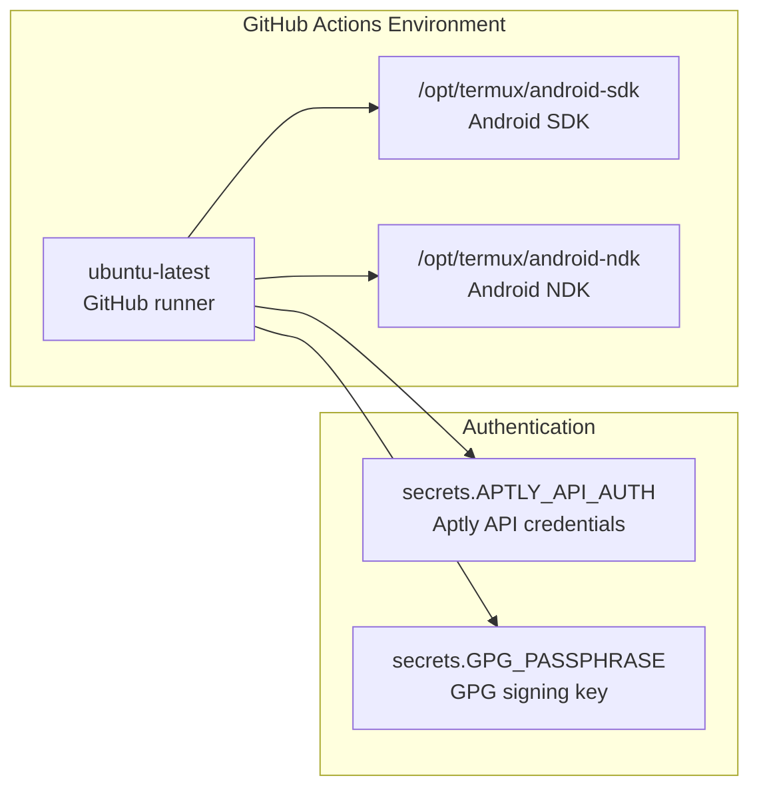

### Key Dependencies

- **Git Operations**: Requires `fetch-depth: 1000` for proper diff analysis
- **JSON Processing**: Uses `jq` for parsing GitHub event data
- **Docker Integration**: Leverages `start-builder.sh` for containerized builds
- **Aptly API**: RESTful API for package repository management

**Sources:** [.github/workflows/packages.yml:16-18](), [.github/workflows/packages.yml:25-27]()

## Conditional Execution Logic

The workflow implements sophisticated conditional logic to optimize resource usage:

### Build vs. Upload Separation

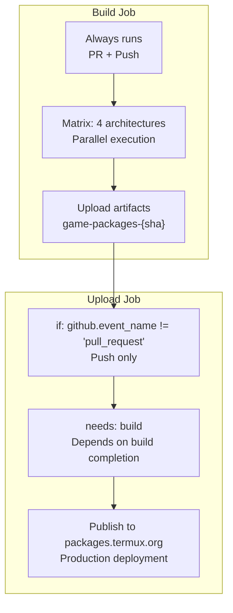

This design ensures:
- **Pull requests**: Build validation without deployment
- **Push to master**: Full build and publish pipeline
- **Resource optimization**: Upload job only runs when needed

**Sources:** [.github/workflows/packages.yml:127-128]()

---

# Page: Package Development Guide

# Package Development Guide

<details>
<summary>Relevant source files</summary>

The following files were used as context for generating this wiki page:

- [packages/nethack/build.sh](packages/nethack/build.sh)
- [packages/nethack/sys-unix-Makefile.src.patch](packages/nethack/sys-unix-Makefile.src.patch)
- [packages/nethack/sys-unix-hints-linux.patch](packages/nethack/sys-unix-hints-linux.patch)
- [scripts/lint-packages.sh](scripts/lint-packages.sh)

</details>


This guide provides comprehensive instructions for developing and maintaining game packages within the termux-game-packages repository. It covers the standardized package structure, build process, patching requirements, and development workflows necessary to create packages that integrate seamlessly with the Termux ecosystem.

For information about the broader repository architecture and CI/CD systems, see [Repository Architecture](#2) and [CI/CD and Build System](#3). For detailed examples of different game categories, see [Game Package Examples](#5).

## Package Structure and Conventions

Every game package follows a standardized structure centered around the `build.sh` script, which defines all package metadata and build instructions through `TERMUX_PKG_*` variables.

### Core Package Definition

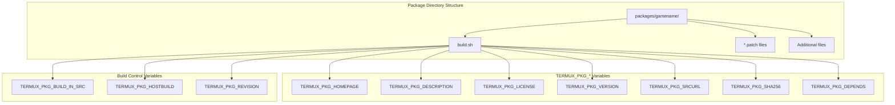

**Sources:** [packages/nethack/build.sh:1-11](), [scripts/lint-packages.sh:98-167]()

### Required Package Metadata

All packages must define these essential `TERMUX_PKG_*` variables:

| Variable | Purpose | Example |
|----------|---------|---------|
| `TERMUX_PKG_HOMEPAGE` | Official project URL | `http://www.nethack.org/` |
| `TERMUX_PKG_DESCRIPTION` | Brief package description (≤100 chars) | `"Dungeon crawl game"` |
| `TERMUX_PKG_LICENSE` | Package license identifier | `"Nethack"` |
| `TERMUX_PKG_VERSION` | Upstream version | `3.6.6` |
| `TERMUX_PKG_SRCURL` | Source download URL | `http://.../${TERMUX_PKG_VERSION}/...` |
| `TERMUX_PKG_SHA256` | Source archive checksum | `cfde0c3ab6dd7c22ae82e1e5a59ab80...` |

**Sources:** [packages/nethack/build.sh:1-8](), [scripts/lint-packages.sh:98-167]()

## Build Process and Lifecycle Hooks

The build system provides multiple lifecycle hooks that packages can implement to customize their build process. These hooks follow the `termux_step_*` naming convention.

### Build Lifecycle Flow

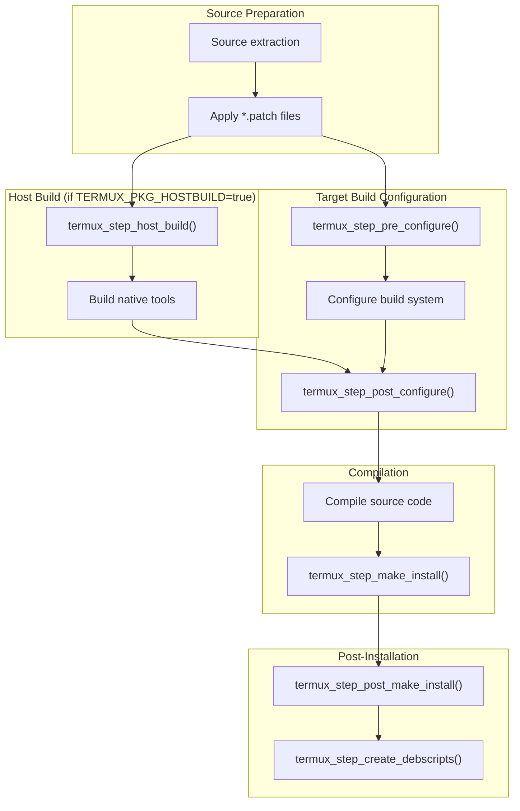

**Sources:** [packages/nethack/build.sh:13-54]()

### Host Build Process

Complex packages often require building native tools first, then using those tools to build the target package. This is controlled by `TERMUX_PKG_HOSTBUILD=true`.

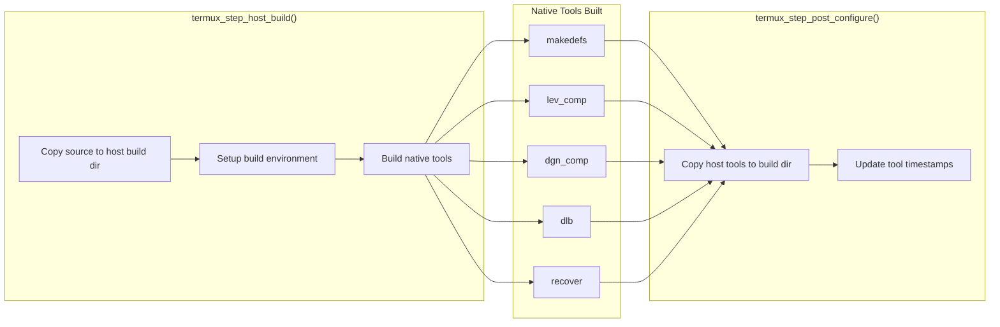

**Sources:** [packages/nethack/build.sh:13-26](), [packages/nethack/build.sh:36-41]()

### Common Build Patterns

Most game packages follow these patterns:

1. **Simple packages**: Only require standard `TERMUX_PKG_*` variables
2. **Patched packages**: Include `*.patch` files for Android/Termux compatibility
3. **Host build packages**: Use `TERMUX_PKG_HOSTBUILD=true` and implement `termux_step_host_build()`
4. **Custom installation**: Implement `termux_step_post_make_install()` for manual file placement

**Sources:** [packages/nethack/build.sh:10-11](), [packages/nethack/build.sh:43-48]()

## Source Patching and Platform Adaptation

Games often require patches to work correctly on Android/Termux. These patches handle path corrections, compiler flags, and platform-specific adaptations.

### Common Patch Categories

```mermaid
graph TB
    subgraph "Platform Paths"
        PREFIX["@TERMUX_PREFIX@ substitution"]
        PATHS["Hardcoded path fixes"]
        BINPATHS["Binary path corrections"]
    end
    
    subgraph "Build System Fixes"
        CFLAGS["CFLAGS+= instead of CFLAGS="]
        LFLAGS["LFLAGS+= instead of LFLAGS="]
        DESTDIR["DESTDIR support"]
    end
    
    subgraph "Compilation Fixes"
        MAKEDEPS["Remove makedefs cleanup"]
        TIMESTAMPS["Preserve tool timestamps"]
        CROSSCOMP["Cross-compilation support"]
    end
    
    PREFIX --> PATHS
    PATHS --> BINPATHS
    
    CFLAGS --> LFLAGS
    LFLAGS --> DESTDIR
    
    MAKEDEPS --> TIMESTAMPS
    TIMESTAMPS --> CROSSCOMP
```

**Sources:** [packages/nethack/sys-unix-hints-linux.patch:9-27](), [packages/nethack/sys-unix-Makefile.src.patch:7-11]()

### Patch File Structure

Patches use standard unified diff format and target specific files that need modification:

- **Path substitutions**: Replace hardcoded paths with `@TERMUX_PREFIX@`
- **Compiler flags**: Use `+=` instead of `=` to preserve existing flags
- **Build system fixes**: Add `DESTDIR` support and cross-compilation compatibility

**Sources:** [packages/nethack/sys-unix-hints-linux.patch:1-40]()

## Package Development Workflow

### Development Environment Setup

```mermaid
graph LR
    subgraph "Development Tools"
        BUILDER["start-builder.sh"]
        DOCKER["Docker container"]
        LINT["scripts/lint-packages.sh"]
    end
    
    subgraph "Package Creation"
        MKDIR["Create package directory"]
        BUILDSH["Write build.sh"]
        PATCHES["Create patches"]
        TEST["Local testing"]
    end
    
    subgraph "Quality Assurance"
        SYNTAX["Shell syntax check"]
        METADATA["TERMUX_PKG_* validation"]
        LICENSE_CHECK["License verification"]
        BUILD_TEST["Build verification"]
    end
    
    BUILDER --> DOCKER
    DOCKER --> TEST
    
    MKDIR --> BUILDSH
    BUILDSH --> PATCHES
    PATCHES --> TEST
    
    TEST --> LINT
    LINT --> SYNTAX
    LINT --> METADATA
    LINT --> LICENSE_CHECK
    LINT --> BUILD_TEST
```

**Sources:** [scripts/lint-packages.sh:394-433]()

### Package Validation

The `lint-packages.sh` script performs comprehensive validation of package definitions:

```mermaid
graph TB
    subgraph "lint_package() Function"
        SYNTAX_CHECK["bash -n build.sh"]
        LOAD_SCRIPT[". build.sh"]
        VALIDATE_FIELDS["Validate TERMUX_PKG_* variables"]
    end
    
    subgraph "Field Validation"
        HOMEPAGE_CHECK["TERMUX_PKG_HOMEPAGE format"]
        DESC_CHECK["TERMUX_PKG_DESCRIPTION length"]
        LICENSE_CHECK["TERMUX_PKG_LICENSE validity"]
        VERSION_CHECK["TERMUX_PKG_VERSION presence"]
        URL_CHECK["TERMUX_PKG_SRCURL format"]
        SHA_CHECK["TERMUX_PKG_SHA256 format"]
    end
    
    subgraph "Boolean Field Validation"
        BUILDSRC_CHECK["TERMUX_PKG_BUILD_IN_SRC"]
        HOSTBUILD_CHECK["TERMUX_PKG_HOSTBUILD"]
        META_CHECK["TERMUX_PKG_METAPACKAGE"]
        ESSENTIAL_CHECK["TERMUX_PKG_ESSENTIAL"]
    end
    
    SYNTAX_CHECK --> LOAD_SCRIPT
    LOAD_SCRIPT --> VALIDATE_FIELDS
    
    VALIDATE_FIELDS --> HOMEPAGE_CHECK
    VALIDATE_FIELDS --> DESC_CHECK
    VALIDATE_FIELDS --> LICENSE_CHECK
    VALIDATE_FIELDS --> VERSION_CHECK
    VALIDATE_FIELDS --> URL_CHECK
    VALIDATE_FIELDS --> SHA_CHECK
    
    VALIDATE_FIELDS --> BUILDSRC_CHECK
    VALIDATE_FIELDS --> HOSTBUILD_CHECK
    VALIDATE_FIELDS --> META_CHECK
    VALIDATE_FIELDS --> ESSENTIAL_CHECK
```

**Sources:** [scripts/lint-packages.sh:53-392]()

### Package Testing and Validation

Before submitting packages, developers should:

1. **Syntax validation**: Run `bash -n build.sh` to check for syntax errors
2. **Metadata validation**: Use `scripts/lint-packages.sh` for comprehensive checking
3. **Build testing**: Test package builds in the Docker environment
4. **Installation verification**: Ensure games run correctly after installation

**Sources:** [scripts/lint-packages.sh:64-78](), [scripts/lint-packages.sh:429-433]()

## Development Tools and Scripts

### Package Linting System

The linting system validates package definitions against established conventions:

| Check | Purpose | Error Condition |
|-------|---------|-----------------|
| Syntax | Shell script validity | `bash -n` fails |
| Homepage | URL format | Missing or invalid URL |
| Description | Length limit | >100 characters |
| License | Valid identifier | Unknown license string |
| Version | Presence | Missing version |
| SHA256 | Checksum format | Invalid 64-char hex string |

**Sources:** [scripts/lint-packages.sh:98-243]()

### Supported License Identifiers

The linting system recognizes a comprehensive set of license identifiers, including game-specific licenses like `Nethack`. Custom licenses should use `"custom"` with appropriate documentation.

**Sources:** [scripts/lint-packages.sh:18-36]()

This guide provides the foundation for developing game packages within the termux-game-packages ecosystem. The standardized approach ensures consistent packaging, reliable builds, and seamless integration with the Termux package management system.

---

# Page: Package Structure and Conventions

# Package Structure and Conventions

<details>
<summary>Relevant source files</summary>

The following files were used as context for generating this wiki page:

- [packages/moria/CMakeLists.txt.patch](packages/moria/CMakeLists.txt.patch)
- [packages/moria/build.sh](packages/moria/build.sh)
- [packages/moria/config.cpp.patch](packages/moria/config.cpp.patch)
- [packages/moria/ui_io.cpp.patch](packages/moria/ui_io.cpp.patch)

</details>


This document explains the standardized structure and conventions used across all game packages in the termux-game-packages repository. These conventions ensure consistency, maintainability, and compatibility with the Termux build system.

For information about the actual build process and compilation steps, see [Build Process and Patching](#4.2). For hands-on development tools and workflows, see [Development Tools](#4.3).

## Package Directory Structure

Each game package follows a standardized directory layout within the `packages/` directory:

```
packages/
├── gamename/
│   ├── build.sh              # Main package definition
│   ├── *.patch               # Source code modifications
│   └── additional files      # Config files, assets, etc.
```

## Core Package Variables

Every package's `build.sh` file must define a set of standardized `TERMUX_PKG_*` variables that provide metadata and build configuration:

### Package Metadata Variables

```mermaid
graph TD
    subgraph "Required Metadata"
        HOMEPAGE["TERMUX_PKG_HOMEPAGE<br/>Project website"]
        DESCRIPTION["TERMUX_PKG_DESCRIPTION<br/>Package description"]
        LICENSE["TERMUX_PKG_LICENSE<br/>Software license"]
        MAINTAINER["TERMUX_PKG_MAINTAINER<br/>Package maintainer"]
        VERSION["TERMUX_PKG_VERSION<br/>Software version"]
    end
    
    subgraph "Source Configuration"
        SRCURL["TERMUX_PKG_SRCURL<br/>Source download URL"]
        SHA256["TERMUX_PKG_SHA256<br/>Checksum verification"]
        REVISION["TERMUX_PKG_REVISION<br/>Package revision"]
    end
    
    subgraph "Build Configuration"
        DEPENDS["TERMUX_PKG_DEPENDS<br/>Runtime dependencies"]
        EXTRA_CONFIGURE_ARGS["TERMUX_PKG_EXTRA_CONFIGURE_ARGS<br/>Build system arguments"]
        BUILDDIR["TERMUX_PKG_BUILDDIR<br/>Build directory path"]
    end
    
    HOMEPAGE --> SRCURL
    VERSION --> SRCURL
    SRCURL --> SHA256
    DEPENDS --> EXTRA_CONFIGURE_ARGS
```

Sources: [packages/moria/build.sh:1-10]()

### Variable Definitions and Usage

| Variable | Purpose | Example |
|----------|---------|---------|
| `TERMUX_PKG_HOMEPAGE` | Official project website | `https://umoria.org` |
| `TERMUX_PKG_DESCRIPTION` | Brief package description | `"Rogue-like game with an infinite dungeon"` |
| `TERMUX_PKG_LICENSE` | Software license identifier | `"GPL-3.0-or-later"` |
| `TERMUX_PKG_MAINTAINER` | Package maintainer | `"@termux"` |
| `TERMUX_PKG_VERSION` | Upstream version | `5.7.15` |
| `TERMUX_PKG_REVISION` | Package revision number | `1` |
| `TERMUX_PKG_SRCURL` | Source download URL | `https://github.com/user/repo/archive/v${TERMUX_PKG_VERSION}.tar.gz` |
| `TERMUX_PKG_SHA256` | Source archive checksum | `97f76a68b856dd5df37c20fc57c8a51017147f489e8ee8866e1764778b2e2d57` |
| `TERMUX_PKG_DEPENDS` | Runtime dependencies | `"libc++, ncurses"` |

Sources: [packages/moria/build.sh:1-10]()

## Build Script Structure

The `build.sh` file follows a predictable structure with optional lifecycle hooks:

```mermaid
graph TD
    subgraph "Package Definition Structure"
        VARS["Package Variables<br/>TERMUX_PKG_* definitions"]
        HOOKS["Lifecycle Hooks<br/>termux_step_* functions"]
        PATCHES["Source Patches<br/>*.patch files"]
    end
    
    subgraph "Common Lifecycle Hooks"
        PRE_CONFIGURE["termux_step_pre_configure<br/>Pre-build setup"]
        POST_CONFIGURE["termux_step_post_configure<br/>Post-configure actions"]
        MAKE_INSTALL["termux_step_make_install<br/>Custom installation"]
        CREATE_DEBSCRIPTS["termux_step_create_debscripts<br/>Post-install scripts"]
    end
    
    subgraph "Build System Integration"
        CONFIGURE_ARGS["TERMUX_PKG_EXTRA_CONFIGURE_ARGS<br/>Build configuration"]
        BUILDDIR["TERMUX_PKG_BUILDDIR<br/>Build directory"]
        PREFIX["TERMUX_PREFIX<br/>Installation prefix"]
    end
    
    VARS --> HOOKS
    HOOKS --> PRE_CONFIGURE
    HOOKS --> POST_CONFIGURE
    HOOKS --> MAKE_INSTALL
    HOOKS --> CREATE_DEBSCRIPTS
    
    CONFIGURE_ARGS --> BUILDDIR
    BUILDDIR --> PREFIX
    
    PATCHES --> PRE_CONFIGURE
```

Sources: [packages/moria/build.sh:10-17]()

## Package Lifecycle Hooks

### Post-Install Script Generation

Many packages require post-installation actions such as creating directories or initializing files. The `termux_step_create_debscripts` hook generates these scripts:

```bash
termux_step_create_debscripts() {
    # Create scores file in a debscript, so an update to the package wouldn't erase any scores
    echo "mkdir -p $TERMUX_PREFIX/lib/games/moria/" > postinst
    echo "touch $TERMUX_PREFIX/lib/games/moria/scores.dat" >> postinst
    chmod 0755 postinst
}
```

Sources: [packages/moria/build.sh:12-17]()

### Common Hook Patterns

| Hook Function | Purpose | Common Use Cases |
|---------------|---------|------------------|
| `termux_step_pre_configure` | Pre-build setup | Environment setup, file copying |
| `termux_step_post_configure` | Post-configure actions | File modifications, path updates |
| `termux_step_make_install` | Custom installation | Non-standard install procedures |
| `termux_step_create_debscripts` | Post-install scripts | Directory creation, file initialization |

## Source Code Patching Conventions

### Patch File Organization

Patches are stored alongside the `build.sh` file and follow naming conventions:

```mermaid
graph LR
    subgraph "Patch Types"
        BUILD["build-system.patch<br/>Build configuration fixes"]
        PATHS["paths.patch<br/>Termux path adaptations"]
        PLATFORM["platform.patch<br/>Android/Linux compatibility"]
        COMPILER["compiler.patch<br/>Compilation fixes"]
    end
    
    subgraph "Common Patch Patterns"
        CMAKE["CMakeLists.txt.patch<br/>CMake configuration"]
        CONFIG["config.cpp.patch<br/>Path configuration"]
        COMPAT["ui_io.cpp.patch<br/>Platform compatibility"]
    end
    
    BUILD --> CMAKE
    PATHS --> CONFIG
    PLATFORM --> COMPAT
```

Sources: [packages/moria/CMakeLists.txt.patch:1-36](), [packages/moria/config.cpp.patch:1-30](), [packages/moria/ui_io.cpp.patch:1-37]()

### Standard Path Substitutions

Patches frequently use `@TERMUX_PREFIX@` placeholders that are automatically replaced during the build process:

```cpp
// Before patching (relative paths)
const std::string splash_screen = "data/splash.txt";
const std::string scores = "scores.dat";

// After patching (absolute Termux paths)
const std::string splash_screen = "@TERMUX_PREFIX@/lib/games/moria/data/splash.txt";
const std::string scores = "@TERMUX_PREFIX@/lib/games/moria/scores.dat";
```

Sources: [packages/moria/config.cpp.patch:7-30]()

## Standard Directory Layout

Game packages follow consistent installation patterns:

| Directory | Purpose | Example |
|-----------|---------|---------|
| `$TERMUX_PREFIX/bin` | Executable binaries | Game executables |
| `$TERMUX_PREFIX/lib/games/<name>` | Game-specific data | Save files, scores, configuration |
| `$TERMUX_PREFIX/share/games/<name>` | Shared game data | Assets, levels, documentation |
| `$TERMUX_PREFIX/share/doc/<name>` | Documentation | Manual pages, licenses |
| `$TERMUX_PREFIX/share/man` | Manual pages | Game documentation |

## Common Dependency Patterns

### Runtime Dependencies

Most game packages depend on common libraries:

```mermaid
graph TD
    subgraph "Common Dependencies"
        NCURSES["ncurses<br/>Terminal interface"]
        LIBCPP["libc++<br/>C++ standard library"]
        BOOST["boost<br/>C++ utility libraries"]
        CURL["curl<br/>Network operations"]
    end
    
    subgraph "Game Categories"
        ROGUELIKE["Roguelike Games<br/>nethack, moria, angband"]
        ARCADE["Arcade Games<br/>nsnake, ninvaders"]
        PUZZLE["Puzzle Games<br/>nudoku, bastet"]
        INTERACTIVE["Interactive Fiction<br/>frotz, glulxe"]
    end
    
    ROGUELIKE --> NCURSES
    ARCADE --> NCURSES
    PUZZLE --> NCURSES
    INTERACTIVE --> NCURSES
    
    ROGUELIKE --> LIBCPP
    PUZZLE --> LIBCPP
    
    INTERACTIVE --> BOOST
```

### Dependency Declaration

Dependencies are declared in the `TERMUX_PKG_DEPENDS` variable as a comma-separated list:

```bash
TERMUX_PKG_DEPENDS="libc++, ncurses"
```

Sources: [packages/moria/build.sh:9]()

## Build Configuration Patterns

### CMake Projects

Many games use CMake and require specific configuration through `TERMUX_PKG_EXTRA_CONFIGURE_ARGS`:

```bash
TERMUX_PKG_EXTRA_CONFIGURE_ARGS="-Dbuild_dir=$TERMUX_PKG_BUILDDIR"
```

This pattern allows passing build directory information to the CMake configuration system.

Sources: [packages/moria/build.sh:10](), [packages/moria/CMakeLists.txt.patch:9]()

### Installation Customization

CMake patches often add installation rules for proper file placement:

```cmake
install(TARGETS moria DESTINATION ${CMAKE_INSTALL_PREFIX}/bin)
install(FILES historical/manual.md historical/faq.md LICENSE DESTINATION ${CMAKE_INSTALL_PREFIX}/share/doc/moria/)
INSTALL(DIRECTORY ${build_dir}/data DESTINATION ${CMAKE_INSTALL_PREFIX}/lib/games/moria/ FILES_MATCHING PATTERN "*.txt")
```

Sources: [packages/moria/CMakeLists.txt.patch:33-35]()

This standardized approach ensures consistent package structure and reliable builds across all game packages in the repository.

---

# Page: Build Process and Patching

# Build Process and Patching

<details>
<summary>Relevant source files</summary>

The following files were used as context for generating this wiki page:

- [packages/angband/build.sh](packages/angband/build.sh)
- [packages/angband/src-main.c.patch](packages/angband/src-main.c.patch)

</details>


This document details the compilation process for game packages in the termux-game-packages repository, covering cross-compilation for Android, source code patching, and platform-specific adaptations. It explains the build lifecycle, patching mechanisms, and customization hooks used to adapt upstream game sources for the Termux environment.

For package structure conventions and metadata variables, see [Package Structure and Conventions](#4.1). For development tools and environment setup, see [Development Tools](#4.3).

## Build Process Overview

The package build system follows a standardized lifecycle that handles source acquisition, patching, cross-compilation, and installation across multiple Android architectures.

### Build Lifecycle Flow

```mermaid
graph TD
    SRC["Source Acquisition"] --> PATCH["Apply Patches"]
    PATCH --> HOST["Host Build"]
    HOST --> CONFIG["Configure Target"]
    CONFIG --> COMPILE["Cross-compile"]
    COMPILE --> INSTALL["Install Files"]
    INSTALL --> PACKAGE["Create .deb"]
    
    SRC --> SHA["termux_step_get_source()"]
    SHA --> EXTRACT["Extract archive"]
    
    PATCH --> APPLY["Apply .patch files"]
    APPLY --> HOOKS["termux_step_pre_configure()"]
    
    HOST --> HOSTBUILD["termux_step_host_build()"]
    HOSTBUILD --> COPY["termux_step_post_configure()"]
    
    CONFIG --> AUTOTOOLS["./configure"]
    CONFIG --> CMAKE["cmake"]
    CONFIG --> MAKE["make"]
    
    COMPILE --> LINK["Link libraries"]
    LINK --> STRIP["Strip binaries"]
    
    INSTALL --> BIN["$TERMUX_PREFIX/bin"]
    INSTALL --> SHARE["$TERMUX_PREFIX/share"]
    
    PACKAGE --> DEB["termux_step_create_debscripts()"]
```

Sources: [packages/angband/build.sh:1-27]()

## Source Patching System

The patching system applies source code modifications to make upstream games compatible with Android and Termux. Patches are stored as `.patch` files in each package directory and applied automatically during the build process.

### Patch Application Process

```mermaid
graph LR
    DETECT["Detect .patch files"] --> SORT["Sort by filename"]
    SORT --> APPLY["patch -p1 < file.patch"]
    APPLY --> VERIFY["Verify application"]
    VERIFY --> NEXT["Next patch"]
    NEXT --> APPLY
    
    DETECT --> GLOB["packages/*/src-*.patch"]
    GLOB --> ORDER["Alphabetical order"]
    
    APPLY --> PATCH_CMD["patch command"]
    PATCH_CMD --> FUZZ["Handle fuzz/offsets"]
    
    VERIFY --> SUCCESS["Success: continue"]
    VERIFY --> FAIL["Fail: abort build"]
```

### Common Patch Patterns

| Patch Type | Purpose | Example |
|------------|---------|---------|
| Platform Detection | Disable Android-incompatible features | `#ifndef __ANDROID__` |
| Library Compatibility | Adapt library calls for Android | `ncursesw6-config` vs `ncursesw5-config` |
| Locale Handling | Skip unsupported locale functions | Skip `nl_langinfo()` calls |
| File System Paths | Adjust paths for Termux prefix | Replace `/usr/share` with `$TERMUX_PREFIX/share` |

**Android Platform Adaptation Example:**
```c
// Original code
#if !defined(WINDOWS)
#include "langinfo.h"
#endif

// Patched code  
#if !defined(WINDOWS) && !defined(__ANDROID__)
#include "langinfo.h"
#endif
```

Sources: [packages/angband/src-main.c.patch:1-24]()

## Cross-compilation Process

The build system performs cross-compilation from the host architecture (typically x86_64) to Android target architectures (aarch64, arm, i686, x86_64). This process involves setting up appropriate toolchains, flags, and environment variables.

### Cross-compilation Environment

```mermaid
graph TB
    HOST["Host Environment"] --> TOOLCHAIN["Android NDK Toolchain"]
    TOOLCHAIN --> TARGET["Target Architecture"]
    
    HOST --> X86_64["x86_64 Linux"]
    
    TOOLCHAIN --> NDK["Android NDK"]
    NDK --> CLANG["Clang compiler"]
    NDK --> SYSROOT["Android sysroot"]
    
    TARGET --> AARCH64["aarch64-linux-android"]
    TARGET --> ARM["arm-linux-androideabi"]
    TARGET --> I686["i686-linux-android"]
    TARGET --> X86_64_AND["x86_64-linux-android"]
    
    CLANG --> CC["$CC variable"]
    CLANG --> CXX["$CXX variable"]
    CLANG --> CFLAGS["$CFLAGS"]
    CLANG --> LDFLAGS["$LDFLAGS"]
    
    SYSROOT --> HEADERS["System headers"]
    SYSROOT --> LIBS["System libraries"]
```

### Configure Arguments

Common cross-compilation configure arguments are set via `TERMUX_PKG_EXTRA_CONFIGURE_ARGS`:

```bash
--disable-x11                    # Disable X11 GUI
--bindir=$TERMUX_PREFIX/bin      # Set binary directory
--sysconfdir=$TERMUX_PREFIX/share # Set configuration directory
```

Sources: [packages/angband/build.sh:11-15]()

## Platform-specific Adaptations

Android and Termux require specific adaptations due to differences in available libraries, system calls, and file system layout compared to traditional Linux distributions.

### Android-specific Modifications

```mermaid
graph LR
    UPSTREAM["Upstream Source"] --> ADAPT["Platform Adaptations"]
    ADAPT --> ANDROID["Android-compatible"]
    
    UPSTREAM --> POSIX["POSIX assumptions"]
    UPSTREAM --> GLIBC["glibc dependencies"]
    UPSTREAM --> PATHS["Standard paths"]
    
    ADAPT --> BIONIC["Bionic libc"]
    ADAPT --> TERMUX_PATHS["Termux paths"]
    ADAPT --> DISABLED["Disabled features"]
    
    POSIX --> LOCALE["Locale functions"]
    LOCALE --> LANGINFO["nl_langinfo()"]
    
    GLIBC --> FEATURES["GNU extensions"]
    FEATURES --> CONDITIONALS["#ifndef __ANDROID__"]
    
    PATHS --> USR_SHARE["/usr/share"]
    USR_SHARE --> TERMUX_PREFIX["$TERMUX_PREFIX/share"]
```

### Common Adaptation Strategies

1. **Conditional Compilation**: Use `#ifndef __ANDROID__` to disable incompatible code
2. **Library Replacement**: Replace unavailable libraries with Termux equivalents
3. **Path Remapping**: Change hardcoded paths to use `$TERMUX_PREFIX`
4. **Feature Disabling**: Disable features that require unavailable system services

Sources: [packages/angband/src-main.c.patch:8-20]()

## Host vs Target Builds

Some packages require building tools for the host system first, then using those tools to build the target Android binaries. This is common for packages with code generators or build-time utilities.

### Host Build Process

```mermaid
graph TD
    HOST_SRC["Host Source"] --> HOST_BUILD["termux_step_host_build()"]
    HOST_BUILD --> HOST_TOOLS["Host Tools"]
    HOST_TOOLS --> TARGET_BUILD["Target Build"]
    
    HOST_SRC --> SAME_SOURCE["Same source tree"]
    HOST_BUILD --> HOST_CC["Host compiler"]
    HOST_CC --> NATIVE["Native architecture"]
    
    HOST_TOOLS --> GENERATORS["Code generators"]
    HOST_TOOLS --> PREPROCESSORS["Preprocessors"]
    HOST_TOOLS --> CONVERTERS["Data converters"]
    
    TARGET_BUILD --> COPY["termux_step_post_configure()"]
    COPY --> HOST_ARTIFACTS["Copy host artifacts"]
    HOST_ARTIFACTS --> TIMESTAMPS["touch files"]
    TIMESTAMPS --> PREVENT_REBUILD["Prevent rebuilds"]
```

### Host Build Implementation

Host builds are implemented by overriding the `termux_step_host_build()` function:

```bash
termux_step_host_build() {
    # Build tools for host system
    make -C src/tools
}

termux_step_post_configure() {
    # Copy host tools to target build
    cp $TERMUX_PKG_HOSTBUILD_DIR/src/tools/generator src/
    touch src/generator  # Prevent rebuild
}
```

Sources: [packages/angband/build.sh:23-26]()

## Build Hooks and Customization

The build system provides numerous hooks for customizing the build process at different stages. These hooks allow packages to perform custom setup, patching, and installation steps.

### Build Hook Sequence

```mermaid
graph TD
    START["Build Start"] --> PRE_GET["termux_step_pre_get_source()"]
    PRE_GET --> GET["termux_step_get_source()"]
    GET --> POST_GET["termux_step_post_get_source()"]
    POST_GET --> PRE_CONFIG["termux_step_pre_configure()"]
    PRE_CONFIG --> CONFIG["termux_step_configure()"]
    CONFIG --> POST_CONFIG["termux_step_post_configure()"]
    POST_CONFIG --> MAKE["termux_step_make()"]
    MAKE --> INSTALL["termux_step_make_install()"]
    INSTALL --> POST_INSTALL["termux_step_post_make_install()"]
    POST_INSTALL --> DEB["termux_step_create_debscripts()"]
    
    PRE_CONFIG --> AUTOGEN["./autogen.sh"]
    PRE_CONFIG --> SED["sed/perl commands"]
    
    POST_CONFIG --> COPY_HOST["Copy host artifacts"]
    POST_CONFIG --> TOUCH["touch files"]
    
    POST_INSTALL --> CLEANUP["Remove files"]
    POST_INSTALL --> SYMLINKS["Create symlinks"]
```

### Common Hook Usage Patterns

| Hook | Common Usage | Example |
|------|-------------|---------|
| `termux_step_pre_configure()` | Generate build files, patch scripts | `./autogen.sh`, `perl -p -i -e` |
| `termux_step_post_configure()` | Copy host build artifacts | `cp $TERMUX_PKG_HOSTBUILD_DIR/tool src/` |
| `termux_step_make_install()` | Custom installation logic | Install to non-standard locations |
| `termux_step_post_make_install()` | File cleanup, symlink creation | `rm -rf $TERMUX_PREFIX/share/unwanted` |

### Example Hook Implementation

```bash
termux_step_pre_configure() {
    # Generate build system files
    ./autogen.sh
    
    # Update configure script for newer ncurses
    perl -p -i -e 's|ncursesw5-config|ncursesw6-config|g' configure
}
```

Sources: [packages/angband/build.sh:23-26]()

## File Removal and Cleanup

The build system supports automatic removal of unwanted files after installation using `TERMUX_PKG_RM_AFTER_INSTALL`. This is commonly used to remove files that are unnecessary or incompatible with the mobile environment.

### Cleanup Configuration

```mermaid
graph LR
    INSTALL["Package Installation"] --> CLEANUP["File Cleanup"]
    CLEANUP --> REMOVE["Remove Files"]
    
    INSTALL --> BINARIES["Install binaries"]
    INSTALL --> DATA["Install data"]
    INSTALL --> DOCS["Install documentation"]
    
    CLEANUP --> RM_VAR["TERMUX_PKG_RM_AFTER_INSTALL"]
    RM_VAR --> FONTS["share/angband/fonts"]
    RM_VAR --> ICONS["share/angband/icons"]
    RM_VAR --> SOUNDS["share/angband/sounds"]
    RM_VAR --> XTRA["share/angband/xtra"]
    
    REMOVE --> MOBILE["Mobile-optimized package"]
```

### Cleanup Example

```bash
TERMUX_PKG_RM_AFTER_INSTALL="
share/angband/fonts
share/angband/icons
share/angband/sounds
share/angband/xtra
"
```

This removes GUI-related assets that are not needed in the terminal environment.

Sources: [packages/angband/build.sh:16-21]()

---

# Page: Development Tools

# Development Tools

<details>
<summary>Relevant source files</summary>

The following files were used as context for generating this wiki page:

- [start-builder.sh](start-builder.sh)

</details>


This document covers the development tools available for creating and maintaining game packages in the termux-game-packages repository. These tools provide a standardized Docker-based build environment, package validation utilities, and integration with the CI/CD pipeline.

For information about the overall package development process, see [Package Development Guide](#4). For details about build scripts and packaging conventions, see [Package Structure and Conventions](#4.1).

## Docker Build Environment

The primary development tool is the Docker-based build environment managed by `start-builder.sh`. This script provides a consistent, isolated environment for building and testing packages across different host systems.

### Container Setup Process

The build environment uses a standardized Docker container that mirrors the Termux build infrastructure:

```mermaid
graph TD
    START["start-builder.sh"] --> LOCK["acquire /tmp/.termux-game-builder.lck"]
    LOCK --> SUBMOD["git submodule update --init"]
    SUBMOD --> CHECK["check container termux-package-builder exists"]
    CHECK -->|"exists"| RESTART["docker start termux-package-builder"]
    CHECK -->|"missing"| CREATE["docker run termux/package-builder"]
    CREATE --> PERM["adjust uid/gid permissions"]
    RESTART --> COPY["copy packages/ to container"]
    PERM --> COPY
    COPY --> EXEC["docker exec interactive shell or command"]
    
    EXEC --> SHELL["bash interactive session"]
    EXEC --> CMD["execute specific build command"]
```

Sources: [start-builder.sh:1-99]()

### Key Container Features

| Feature | Implementation | Purpose |
|---------|---------------|----------|
| **Image** | `termux/package-builder` | Standardized build environment |
| **Workspace** | `/home/builder/termux-packages` | Mounted repository root |
| **Persistence** | Named container `termux-package-builder` | Reuse environment between sessions |
| **Permissions** | UID/GID adjustment | Match host user permissions |
| **Isolation** | File locking | Prevent concurrent container conflicts |

Sources: [start-builder.sh:25-29](), [start-builder.sh:63-80]()

### Usage Patterns

The build environment supports multiple usage patterns:

#### Interactive Development
```bash
./start-builder.sh
# Enters interactive bash shell in container
```

#### Direct Command Execution
```bash
./start-builder.sh ./build-package.sh package-name
# Executes specific build command
```

#### Package Copying Strategy
The script automatically copies packages from the host `./packages` directory to the container, but skips existing packages to avoid overwriting modifications:

Sources: [start-builder.sh:82-91]()

## Package Building Tools

### Build Script Integration

The Docker environment integrates with the core Termux build system through the `termux-packages` submodule:

```mermaid
graph LR
    HOST["Host Repository"] --> SUBMOD["termux-packages submodule"]
    SUBMOD --> BUILDER["Docker Container"]
    BUILDER --> BUILDSH["build-package.sh"]
    BUILDSH --> PKGSH["packages/game/build.sh"]
    PKGSH --> COMPILE["Cross-compilation"]
    COMPILE --> DEB["Package .deb files"]
    
    HOST --> PKGDIR["packages/ directory"]
    PKGDIR --> BUILDER
```

Sources: [start-builder.sh:49-58](), [start-builder.sh:69-70]()

### Submodule Management

The build environment handles Git submodule initialization automatically, ensuring the `termux-packages` build system is properly synchronized:

- **Owner Detection**: Respects file ownership when running under different users
- **Force Reinitialization**: Ensures clean submodule state with `git submodule deinit --all --force`
- **Automatic Updates**: Synchronizes submodule to latest committed version

Sources: [start-builder.sh:51-58]()

## Quality Assurance Tools

### Package Linting System

The development workflow includes automated package validation tools referenced in the CI/CD system:

```mermaid
graph TD
    LINT["scripts/lint-packages.sh"] --> SYNTAX["Shell Syntax Validation"]
    LINT --> VARS["TERMUX_PKG_* Variable Check"]
    LINT --> LICENSE["License Verification"]
    LINT --> DEPS["Dependency Validation"]
    
    SYNTAX --> PASS["Validation Passed"]
    VARS --> PASS
    LICENSE --> PASS
    DEPS --> PASS
    
    SYNTAX --> FAIL["Validation Failed"]
    VARS --> FAIL
    LICENSE --> FAIL
    DEPS --> FAIL
```

### Testing Environment

The Docker container provides a consistent testing environment that matches the CI/CD infrastructure:

| Component | Container Path | Purpose |
|-----------|---------------|----------|
| **Build Tools** | `/data/data/com.termux/files/usr/bin/` | Cross-compilation toolchain |
| **Package Database** | `/data/data/com.termux/files/usr/var/lib/dpkg/` | Package dependency tracking |
| **Install Prefix** | `/data/data/com.termux/files/usr/` | Target installation directory |

Sources: [start-builder.sh:69-71]()

## Development Workflow Integration

### CI/CD Environment Detection

The build environment adapts to different execution contexts:

```mermaid
graph TD
    START["start-builder.sh execution"] --> CICHECK["check GITHUB_EVENT_PATH"]
    CICHECK -->|"set"| NOTTY["disable TTY allocation"]
    CICHECK -->|"unset"| TTY["enable TTY allocation"]
    NOTTY --> DOCKER["docker exec without --tty"]
    TTY --> DOCKER_TTY["docker exec with --tty"]
    
    DOCKER --> NONINTERACTIVE["CI/CD automated execution"]
    DOCKER_TTY --> INTERACTIVE["Interactive development session"]
```

Sources: [start-builder.sh:39-44]()

### Permission Handling

The build environment handles complex permission scenarios for different development contexts:

- **Root Users**: Direct execution without permission adjustment
- **Standard Users (UID 1000)**: No permission changes needed
- **Custom UIDs**: Automatic `chown` and `usermod` operations to match host user

Sources: [start-builder.sh:73-79]()

## Advanced Features

### Container Lifecycle Management

The build environment implements sophisticated container lifecycle management:

```mermaid
graph TD
    LOCK["File Lock Acquisition"] --> STOP["docker stop existing container"]
    STOP --> START_ATTEMPT["docker start container"]
    START_ATTEMPT -->|"success"| RUNNING["Container Running"]
    START_ATTEMPT -->|"failure"| CREATE["docker run new container"]
    CREATE --> PERM_SETUP["Permission Setup"]
    PERM_SETUP --> RUNNING
    RUNNING --> COPY_PACKAGES["Copy Host Packages"]
    COPY_PACKAGES --> EXEC["Execute Commands"]
```

Sources: [start-builder.sh:46-81]()

### Build Environment Persistence

The system maintains build environment state between invocations:

- **Container Reuse**: Named containers persist across script executions
- **Package Caching**: Existing packages in container are preserved
- **Build Artifacts**: Compiled objects remain available for incremental builds

Sources: [start-builder.sh:63-64](), [start-builder.sh:85-90]()

---

# Page: Game Package Examples

# Game Package Examples

<details>
<summary>Relevant source files</summary>

The following files were used as context for generating this wiki page:

- [packages/dmagnetic/Makefile.patch](packages/dmagnetic/Makefile.patch)
- [packages/dmagnetic/build.sh](packages/dmagnetic/build.sh)
- [packages/dmagnetic/change-prefix.patch.beforehostbuild](packages/dmagnetic/change-prefix.patch.beforehostbuild)
- [packages/dmagnetic/dMagnetic_helpscreens.c.patch.beforehostbuild](packages/dmagnetic/dMagnetic_helpscreens.c.patch.beforehostbuild)
- [packages/dmagnetic/magnetic-scrolls.in](packages/dmagnetic/magnetic-scrolls.in)
- [packages/gnuski/Makefile.patch](packages/gnuski/Makefile.patch)
- [packages/gnuski/build.sh](packages/gnuski/build.sh)
- [packages/gnuski/objects.h.patch](packages/gnuski/objects.h.patch)
- [packages/myman/Makefile.patch](packages/myman/Makefile.patch)
- [packages/myman/build.sh](packages/myman/build.sh)

</details>


This page demonstrates different categories of games in the termux-game-packages repository and their unique packaging approaches. Each game type presents distinct challenges for cross-compilation, patching, and integration with the Termux environment. The examples showcase how the standardized `build.sh` format adapts to handle everything from simple arcade games to complex interactive fiction interpreters.

For detailed information about the overall package structure and conventions, see [Package Structure and Conventions](#4.1). For specifics about the build process and patching techniques, see [Build Process and Patching](#4.2).

## Package Complexity Categories

The game packages in this repository fall into several complexity categories based on their build requirements and packaging challenges:

```mermaid
graph TB
    subgraph "Simple Games"
        GNUSKI["gnuski<br/>Simple Arcade Game"]
        NSNAKE["nsnake<br/>Snake Clone"]
        BASTET["bastet<br/>Tetris Clone"]
    end
    
    subgraph "Host Build Required"
        MYMAN["myman<br/>Pac-Man Clone"]
        DMAGNETIC["dmagnetic<br/>IF Interpreter"]
        NETHACK["nethack<br/>Roguelike"]
    end
    
    subgraph "Interactive Fiction"
        FROTZ["frotz<br/>Z-machine Interpreter"]
        GLULXE["glulxe<br/>Glulx Interpreter"]
        OPENADV["open-adventure<br/>Adventure Game"]
    end
    
    subgraph "Complex Dependencies"
        GNUCHESS["gnuchess<br/>Chess Engine"]
        BOOST_GAMES["boost-dependent<br/>C++ Games"]
        NETWORK_GAMES["multiplayer<br/>Network Games"]
    end
    
    %% Relationships
    GNUSKI --> SIMPLE_BUILD["`build.sh only<br/>TERMUX_PKG_DEPENDS`"]
    MYMAN --> HOST_BUILD["`TERMUX_PKG_HOSTBUILD=true<br/>termux_step_host_build()`"]
    DMAGNETIC --> HOST_BUILD
    DMAGNETIC --> POST_INSTALL["`termux_step_post_make_install()<br/>Helper Scripts`"]
    FROTZ --> DATA_HANDLING["`Game Data Management<br/>Custom Installation`"]
    GNUCHESS --> DEP_COMPLEX["`Complex Dependencies<br/>Library Integration`"]
```

**Sources:** [packages/myman/build.sh:1-34](), [packages/dmagnetic/build.sh:1-29](), [packages/gnuski/build.sh:1-11]()

## Build Pattern Analysis

Different game types require distinct build patterns, each with specific `TERMUX_PKG_*` variables and custom build steps:

| Game Type | Host Build | Custom Steps | Dependencies | Complexity |
|-----------|------------|--------------|--------------|------------|
| Simple Arcade | No | None | `ncurses` | Low |
| Complex Arcade | Yes | `termux_step_host_build()` | `ncurses` | Medium |
| Interactive Fiction | Yes | `termux_step_post_make_install()` | Minimal | Medium |
| Roguelikes | Yes | Multiple custom steps | `ncurses`, data files | High |
| Network Games | Varies | Network configuration | `curl`, `openssl` | High |

## Myman: Complex Arcade Game Example

The `myman` package demonstrates a complex arcade game requiring host builds and custom source acquisition:

```mermaid
graph TD
    subgraph "Source Acquisition"
        CACHE["TERMUX_PKG_CACHEDIR<br/>Download Area"]
        CVS["CVS Repository<br/>myman-cvs"]
        EXTRACT["Extract & Reorganize<br/>mv myman/* ."]
    end
    
    subgraph "Host Build Process"
        HOST_CONFIG["configure<br/>Host Environment"]
        HOST_MAKE["make obj/s1game<br/>Build Tool"]
        HOST_COPY["cp to HOSTBUILD_DIR<br/>Save Artifact"]
    end
    
    subgraph "Target Build"
        TARGET_SETUP["mkdir -p obj<br/>Create Structure"]
        COPY_TOOL["cp s1game obj/<br/>Use Host Tool"]
        TOUCH_TIME["touch -d 'next hour'<br/>Prevent Rebuild"]
        MAKE_TARGET["make<br/>Build Game"]
    end
    
    %% Flow
    CACHE --> CVS
    CVS --> EXTRACT
    EXTRACT --> HOST_CONFIG
    HOST_CONFIG --> HOST_MAKE
    HOST_MAKE --> HOST_COPY
    HOST_COPY --> TARGET_SETUP
    TARGET_SETUP --> COPY_TOOL
    COPY_TOOL --> TOUCH_TIME
    TOUCH_TIME --> MAKE_TARGET
```

The key implementation details include:

- **Custom Source Acquisition**: [packages/myman/build.sh:14-22]() uses `termux_step_get_source()` to handle CVS repository extraction
- **Host Build Tool**: [packages/myman/build.sh:24-27]() creates `obj/s1game` using the host compiler
- **Tool Integration**: [packages/myman/build.sh:29-33]() copies the host-built tool and uses `touch` to prevent rebuilds
- **Duplicate Prevention**: [packages/myman/build.sh:12]() removes duplicate installation with `TERMUX_PKG_RM_AFTER_INSTALL`

**Sources:** [packages/myman/build.sh:1-34](), [packages/myman/Makefile.patch:1-97]()

## Dmagnetic: Interactive Fiction Interpreter

The `dmagnetic` package showcases an interactive fiction interpreter with integrated game downloading:

```mermaid
graph TD
    subgraph "Build Process"
        HOST_BUILD["Host Build<br/>dMagnetic binary"]
        PATH_SETUP["Export PATH<br/>Find host binary"]
        INSTALL["Standard Installation<br/>Binary + Man pages"]
    end
    
    subgraph "Post-Install Integration"
        SCRIPT_GEN["Generate Helper Script<br/>magnetic-scrolls.in"]
        SCRIPT_INSTALL["Install to PREFIX/bin<br/>chmod 700"]
        GAME_DOWNLOAD["Dialog Interface<br/>Download Games"]
    end
    
    subgraph "Game Management"
        GAME_SELECT["dialog --radiolist<br/>Select Game"]
        DOWNLOAD["curl with referer<br/>Download ZIP"]
        EXTRACT["unzip -o<br/>Extract to share/games"]
        LAUNCH["dMagnetic gamename<br/>Start Game"]
    end
    
    %% Flow
    HOST_BUILD --> PATH_SETUP
    PATH_SETUP --> INSTALL
    INSTALL --> SCRIPT_GEN
    SCRIPT_GEN --> SCRIPT_INSTALL
    SCRIPT_INSTALL --> GAME_SELECT
    GAME_SELECT --> DOWNLOAD
    DOWNLOAD --> EXTRACT
    EXTRACT --> LAUNCH
```

Key implementation aspects:

- **Host Build Requirement**: [packages/dmagnetic/build.sh:11-16]() builds the interpreter using host tools
- **Path Integration**: [packages/dmagnetic/build.sh:18-21]() adds host build directory to PATH
- **Helper Script Generation**: [packages/dmagnetic/build.sh:23-28]() creates the `magnetic-scrolls` wrapper
- **Game Download Interface**: [packages/dmagnetic/magnetic-scrolls.in:15-25]() provides dialog-based game selection
- **Automated Installation**: [packages/dmagnetic/magnetic-scrolls.in:77-87]() handles download and extraction

**Sources:** [packages/dmagnetic/build.sh:1-29](), [packages/dmagnetic/magnetic-scrolls.in:1-88]()

## Gnuski: Simple Game Pattern

The `gnuski` package demonstrates the simplest packaging approach for basic games:

```mermaid
graph LR
    subgraph "Minimal Package"
        VARS["TERMUX_PKG_* Variables<br/>Basic Metadata"]
        DEPENDS["ncurses Dependency<br/>Terminal Graphics"]
        BUILD["Build in Source<br/>TERMUX_PKG_BUILD_IN_SRC"]
    end
    
    subgraph "Standard Build"
        MAKE["Standard make<br/>Default Process"]
        INSTALL["Standard install<br/>Copy to PREFIX"]
    end
    
    subgraph "Patches"
        MAKEFILE["Makefile.patch<br/>Compiler Flags"]
        HEADERS["objects.h.patch<br/>Function Declaration"]
    end
    
    %% Flow
    VARS --> MAKE
    DEPENDS --> MAKE
    BUILD --> MAKE
    MAKE --> INSTALL
    MAKEFILE --> MAKE
    HEADERS --> MAKE
```

The minimal implementation includes:

- **Basic Metadata**: [packages/gnuski/build.sh:1-11]() contains only essential `TERMUX_PKG_*` variables
- **Single Dependency**: [packages/gnuski/build.sh:9]() depends only on `ncurses`
- **In-Source Build**: [packages/gnuski/build.sh:10]() uses `TERMUX_PKG_BUILD_IN_SRC=true`
- **Makefile Adaptation**: [packages/gnuski/Makefile.patch:1-20]() adjusts compiler flags and installation
- **Header Fix**: [packages/gnuski/objects.h.patch:1-11]() resolves implicit function declarations

**Sources:** [packages/gnuski/build.sh:1-11](), [packages/gnuski/Makefile.patch:1-20](), [packages/gnuski/objects.h.patch:1-11]()

## Common Packaging Patterns

Across all game types, several patterns emerge for handling platform-specific challenges:

### Path Substitution Pattern
Many games require path modifications for the Termux environment:

```mermaid
graph LR
    subgraph "Patch Process"
        ORIGINAL["Original Paths<br/>/usr/*, /etc/*"]
        SUBSTITUTE["@TERMUX_PREFIX@<br/>Placeholder"]
        REPLACE["Actual PREFIX<br/>Runtime Resolution"]
    end
    
    subgraph "Application"
        DMAGNETIC_PATHS["dMagnetic Paths<br/>Game Data Locations"]
        SCRIPT_PATHS["Script Templates<br/>Helper Scripts"]
        CONFIG_PATHS["Configuration<br/>System Files"]
    end
    
    %% Flow
    ORIGINAL --> SUBSTITUTE
    SUBSTITUTE --> REPLACE
    REPLACE --> DMAGNETIC_PATHS
    REPLACE --> SCRIPT_PATHS
    REPLACE --> CONFIG_PATHS
```

### Host Build Pattern
Games requiring build tools use a consistent host build pattern:

```mermaid
graph TB
    subgraph "Host Build Steps"
        HOSTBUILD_TRUE["TERMUX_PKG_HOSTBUILD=true<br/>Enable Feature"]
        HOST_FUNCTION["termux_step_host_build()<br/>Custom Function"]
        HOST_COMPILE["Host Compiler<br/>Build Tools"]
        HOST_SAVE["Save to HOSTBUILD_DIR<br/>Preserve Artifacts"]
    end
    
    subgraph "Target Build Steps"
        POST_CONFIG["termux_step_post_configure()<br/>Setup Phase"]
        COPY_TOOLS["Copy Host Artifacts<br/>Make Available"]
        TOUCH_FILES["touch -d 'next hour'<br/>Prevent Rebuilds"]
        TARGET_BUILD["Target Compilation<br/>Use Host Tools"]
    end
    
    %% Flow
    HOSTBUILD_TRUE --> HOST_FUNCTION
    HOST_FUNCTION --> HOST_COMPILE
    HOST_COMPILE --> HOST_SAVE
    HOST_SAVE --> POST_CONFIG
    POST_CONFIG --> COPY_TOOLS
    COPY_TOOLS --> TOUCH_FILES
    TOUCH_FILES --> TARGET_BUILD
```

**Sources:** [packages/myman/build.sh:10-33](), [packages/dmagnetic/build.sh:9-21](), [packages/dmagnetic/change-prefix.patch.beforehostbuild:1-30]()

---

# Page: Roguelike Games

# Roguelike Games

<details>
<summary>Relevant source files</summary>

The following files were used as context for generating this wiki page:

- [packages/brogue/build.sh](packages/brogue/build.sh)
- [packages/curseofwar/build.sh](packages/curseofwar/build.sh)
- [packages/gnugo/build.sh](packages/gnugo/build.sh)
- [packages/gnushogi/build.sh](packages/gnushogi/build.sh)

</details>


## Purpose and Scope

This document covers the packaging and build processes for roguelike games in the termux-game-packages repository. Roguelike games are complex terminal-based dungeon crawlers that typically require extensive source modifications, host builds for cross-compilation, and custom installation procedures due to their intricate data file management and platform-specific terminal handling.

For information about simpler arcade-style and puzzle games, see [Arcade and Puzzle Games](#5.2). For board games and strategy games, see [Specialized Games](#5.4).

## Roguelike Game Characteristics

Roguelike games present unique packaging challenges due to their:

- **Complex terminal interfaces** requiring ncurses adaptations
- **Procedural content generation** needing host-built tools
- **Extensive game data files** with custom directory structures  
- **Platform-specific code paths** requiring source patches
- **Cross-compilation dependencies** for pattern generators and data builders

| Challenge | Solution Approach | Example |
|-----------|------------------|---------|
| Terminal compatibility | ncurses dependency + CFLAGS modifications | `-fcommon` compiler flag |
| Host tool building | `TERMUX_PKG_HOSTBUILD=true` | Pattern generators, data compilers |
| Data file management | Custom `termux_step_make_install()` | Binary + data separation |
| Source adaptation | Platform-specific patches | Android/Termux compatibility |

## Package Structure for Roguelikes

### Standard Build Variables

Roguelike packages follow the standard `TERMUX_PKG_*` variable pattern but with additional complexity:

```mermaid
graph TD
    subgraph "Package Metadata"
        HOMEPAGE["TERMUX_PKG_HOMEPAGE"]
        DESCRIPTION["TERMUX_PKG_DESCRIPTION"]
        LICENSE["TERMUX_PKG_LICENSE"]
        VERSION["TERMUX_PKG_VERSION"]
        REVISION["TERMUX_PKG_REVISION"]
    end
    
    subgraph "Source Management"
        SRCURL["TERMUX_PKG_SRCURL"]
        SHA256["TERMUX_PKG_SHA256"]
        BUILDINSRC["TERMUX_PKG_BUILD_IN_SRC"]
    end
    
    subgraph "Dependencies"
        DEPENDS["TERMUX_PKG_DEPENDS"]
        NCURSES["ncurses"]
        LIBC["libc++"]
    end
    
    subgraph "Build Configuration"
        HOSTBUILD["TERMUX_PKG_HOSTBUILD"]
        MAKEARGS["TERMUX_PKG_EXTRA_MAKE_ARGS"]
        CONFIGARGS["TERMUX_PKG_EXTRA_CONFIGURE_ARGS"]
    end
    
    DEPENDS --> NCURSES
    DEPENDS --> LIBC
    HOSTBUILD --> CONFIGARGS
    MAKEARGS --> CONFIGARGS
    
    style HOSTBUILD fill:#f9f,stroke:#333,stroke-width:2px
    style NCURSES fill:#bbf,stroke:#333,stroke-width:2px
```

**Sources:** [packages/brogue/build.sh:1-12](), [packages/gnushogi/build.sh:1-12](), [packages/gnugo/build.sh:1-11]()

### Build Process Flow

The roguelike build process involves multiple phases with host/target coordination:

```mermaid
graph TD
    subgraph "Pre-Configuration"
        PRECONFIG["termux_step_pre_configure()"]
        CFLAGS["CFLAGS += -fcommon"]
        CCSETUP["CC = $CC $CFLAGS $CPPFLAGS $LDFLAGS"]
    end
    
    subgraph "Host Build Phase"
        HOSTBUILD["Host Build (if TERMUX_PKG_HOSTBUILD=true)"]
        HOSTTOOLS["Build Native Tools"]
        HOSTARTIFACTS["$TERMUX_PKG_HOSTBUILD_DIR/patterns/"]
    end
    
    subgraph "Post-Configuration"
        POSTCONFIG["termux_step_post_configure()"]
        COPYTOOLS["Copy Host Tools to Build Dir"]
        TIMESTAMP["touch -d 'next hour' (prevent rebuild)"]
    end
    
    subgraph "Installation"
        MAKEINSTALL["termux_step_make_install()"]
        INSTALLBIN["install -m700 bin/game $TERMUX_PREFIX/bin"]
        INSTALLDATA["Copy game data files"]
    end
    
    PRECONFIG --> CFLAGS
    CFLAGS --> CCSETUP
    CCSETUP --> HOSTBUILD
    HOSTBUILD --> HOSTTOOLS
    HOSTTOOLS --> HOSTARTIFACTS
    HOSTARTIFACTS --> POSTCONFIG
    POSTCONFIG --> COPYTOOLS
    COPYTOOLS --> TIMESTAMP
    TIMESTAMP --> MAKEINSTALL
    MAKEINSTALL --> INSTALLBIN
    INSTALLBIN --> INSTALLDATA
    
    style HOSTBUILD fill:#f9f,stroke:#333,stroke-width:2px
    style COPYTOOLS fill:#bbf,stroke:#333,stroke-width:2px
```

**Sources:** [packages/brogue/build.sh:13-21](), [packages/gnushogi/build.sh:14-23](), [packages/gnugo/build.sh:13-24]()

## Brogue: Roguelike Packaging Example

### Package Configuration

Brogue demonstrates the typical roguelike packaging pattern with terminal-specific adaptations:

```mermaid
graph LR
    subgraph "brogue/build.sh Variables"
        DESC["TERMUX_PKG_DESCRIPTION='Roguelike dungeon crawling game'"]
        DEP["TERMUX_PKG_DEPENDS='ncurses'"]
        MAKE["TERMUX_PKG_EXTRA_MAKE_ARGS='curses'"]
        BUILD["TERMUX_PKG_BUILD_IN_SRC=true"]
    end
    
    subgraph "Build Functions"
        PRECONF["termux_step_pre_configure()"]
        INSTALL["termux_step_make_install()"]
    end
    
    subgraph "Compiler Modifications"
        FCOMMON["CFLAGS += -fcommon"]
        CCVAR["CC = $CC $CFLAGS $CPPFLAGS $LDFLAGS"]
    end
    
    DESC --> DEP
    DEP --> MAKE
    MAKE --> BUILD
    BUILD --> PRECONF
    PRECONF --> FCOMMON
    FCOMMON --> CCVAR
    CCVAR --> INSTALL
    
    style FCOMMON fill:#f9f,stroke:#333,stroke-width:2px
    style CCVAR fill:#bbf,stroke:#333,stroke-width:2px
```

**Sources:** [packages/brogue/build.sh:1-21]()

### Build Process Implementation

The brogue package uses a simplified build process without host builds:

| Build Phase | Function | Implementation |
|-------------|----------|----------------|
| Pre-configuration | `termux_step_pre_configure()` | Set `-fcommon` flag, modify `CC` variable |
| Compilation | Default make | Uses `TERMUX_PKG_EXTRA_MAKE_ARGS="curses"` |
| Installation | `termux_step_make_install()` | Install binary with `install -m700` |

**Sources:** [packages/brogue/build.sh:13-21]()

## Host Build Requirements

### Complex Roguelikes with Host Tools

Games like GNU Shogi and GNU Go require host builds to generate platform-specific pattern files:

```mermaid
graph TD
    subgraph "Host Build Process"
        HOSTFLAG["TERMUX_PKG_HOSTBUILD=true"]
        HOSTDIR["$TERMUX_PKG_HOSTBUILD_DIR"]
        NATIVETOOLS["Native Pattern Generators"]
    end
    
    subgraph "Generated Host Tools"
        PAT2INC["pat2inc"]
        MKEYES["mkeyes"]  
        MKPAT["mkpat"]
        MKMCPAT["mkmcpat"]
        JOSEKI["joseki"]
        UNCOMPRESS["uncompress_fuseki"]
    end
    
    subgraph "Post-Configure Copy"
        COPYHOST["cp $TERMUX_PKG_HOSTBUILD_DIR/tool $TERMUX_PKG_BUILDDIR/"]
        TOUCHTIME["touch -d 'next hour' (prevent rebuild)"]
    end
    
    HOSTFLAG --> HOSTDIR
    HOSTDIR --> NATIVETOOLS
    NATIVETOOLS --> PAT2INC
    NATIVETOOLS --> MKEYES
    NATIVETOOLS --> MKPAT
    NATIVETOOLS --> MKMCPAT
    NATIVETOOLS --> JOSEKI
    NATIVETOOLS --> UNCOMPRESS
    
    PAT2INC --> COPYHOST
    MKEYES --> COPYHOST
    MKPAT --> COPYHOST
    MKMCPAT --> COPYHOST
    JOSEKI --> COPYHOST
    UNCOMPRESS --> COPYHOST
    
    COPYHOST --> TOUCHTIME
    
    style HOSTFLAG fill:#f9f,stroke:#333,stroke-width:2px
    style COPYHOST fill:#bbf,stroke:#333,stroke-width:2px
```

**Sources:** [packages/gnushogi/build.sh:12-23](), [packages/gnugo/build.sh:11-24]()

### Host Build Pattern Implementation

The host build pattern follows this sequence:

1. **Host Build Phase**: Native tools are built in `$TERMUX_PKG_HOSTBUILD_DIR`
2. **Post-Configure Copy**: Tools are copied to target build directory
3. **Timestamp Update**: Files are touched to prevent unnecessary rebuilds

```bash
# Example from gnugo/build.sh
termux_step_post_configure () {
    cp $TERMUX_PKG_HOSTBUILD_DIR/patterns/mkeyes $TERMUX_PKG_BUILDDIR/patterns/mkeyes
    cp $TERMUX_PKG_HOSTBUILD_DIR/patterns/mkpat $TERMUX_PKG_BUILDDIR/patterns/mkpat
    touch -d "next hour" $TERMUX_PKG_BUILDDIR/patterns/*
}
```

**Sources:** [packages/gnugo/build.sh:17-24]()

## Common Compilation Flags

### Platform Compatibility Flags

Roguelike games often require specific compiler flags for Android/Termux compatibility:

| Flag | Purpose | Usage Pattern |
|------|---------|---------------|
| `-fcommon` | Handle duplicate symbols | `CFLAGS+=" -fcommon"` |
| `-Wno-overflow` | Suppress overflow warnings | `CFLAGS+=" -Wno-overflow"` |
| `$CPPFLAGS` | Include preprocessor flags | `CFLAGS+=" $CPPFLAGS"` |

**Sources:** [packages/brogue/build.sh:14-15](), [packages/gnushogi/build.sh:15](), [packages/gnugo/build.sh:14]()

### Configure Arguments

Roguelike games typically require ncurses-specific configure arguments:

```mermaid
graph LR
    subgraph "Configure Arguments"
        CURSES["--with-curses"]
        CURSESLIB["ac_cv_lib_curses_clrtoeol=yes"]
        READLINE["--with-readline"]
    end
    
    subgraph "Dependencies"
        NCURSES["ncurses"]
        READLINELIB["readline"]
    end
    
    CURSES --> NCURSES
    CURSESLIB --> NCURSES
    READLINE --> READLINELIB
    
    style NCURSES fill:#bbf,stroke:#333,stroke-width:2px
```

**Sources:** [packages/gnushogi/build.sh:9-11](), [packages/gnugo/build.sh:9-10]()

---

# Page: Arcade and Puzzle Games

# Arcade and Puzzle Games

<details>
<summary>Relevant source files</summary>

The following files were used as context for generating this wiki page:

- [packages/bastet/build.sh](packages/bastet/build.sh)
- [packages/ninvaders/build.sh](packages/ninvaders/build.sh)
- [packages/nsnake/Makefile.patch](packages/nsnake/Makefile.patch)
- [packages/nsnake/build.sh](packages/nsnake/build.sh)
- [packages/nudoku/build.sh](packages/nudoku/build.sh)
- [packages/pacman4console/build.sh](packages/pacman4console/build.sh)

</details>


This document covers the packaging and implementation of arcade-style and puzzle games in the termux-game-packages repository. These games demonstrate standard packaging patterns and common ncurses-based terminal interfaces, representing simpler build processes compared to complex roguelikes. For roguelike games with extensive patching and host builds, see [Roguelike Games](#5.1). For text-based adventure games, see [Interactive Fiction and Adventure Games](#5.3).

## Game Categories and Characteristics

Arcade and puzzle games in this repository fall into several categories, each with distinct packaging requirements and technical implementations:

### Terminal-Based Action Games
- **nsnake**: Classic Snake game implementation
- **ninvaders**: Space Invaders clone with ASCII graphics
- **pacman4console**: Pacman game with level editor

### Puzzle Games
- **nudoku**: Sudoku game with ncurses interface
- **bastet**: Tetris clone with AI opponent

### Common Technical Characteristics

```mermaid
graph TB
    subgraph "Arcade_Games"
        nsnake["nsnake<br/>Snake Game"]
        ninvaders["ninvaders<br/>Space Invaders"]
        pacman["pacman4console<br/>Pacman Clone"]
    end
    
    subgraph "Puzzle_Games"
        nudoku["nudoku<br/>Sudoku"]
        bastet["bastet<br/>Tetris AI"]
    end
    
    subgraph "Common_Dependencies"
        ncurses["ncurses<br/>Terminal UI"]
        libcpp["libc++<br/>C++ Runtime"]
        boost["boost-static<br/>Program Options"]
    end
    
    subgraph "Build_Patterns"
        build_in_src["TERMUX_PKG_BUILD_IN_SRC=true"]
        autotools["autoreconf -i"]
        patches["*.patch files"]
    end
    
    nsnake --> ncurses
    ninvaders --> ncurses
    pacman --> ncurses
    nudoku --> ncurses
    bastet --> ncurses
    
    nsnake --> libcpp
    bastet --> libcpp
    bastet --> boost
    
    nsnake --> patches
    nudoku --> autotools
    pacman --> build_in_src
    bastet --> build_in_src
```

**Title:** Arcade and Puzzle Games Architecture

Sources: [packages/nsnake/build.sh:1-11](), [packages/ninvaders/build.sh:1-10](), [packages/pacman4console/build.sh:1-16](), [packages/nudoku/build.sh:1-15](), [packages/bastet/build.sh:1-13]()

## Build Patterns and Packaging Strategies

### Standard Build Configuration

Most arcade and puzzle games follow a consistent packaging pattern with minimal complexity:

| Game | Build Pattern | Dependencies | Special Requirements |
|------|---------------|--------------|---------------------|
| nsnake | `BUILD_IN_SRC=true` + patches | `libc++, ncurses` | Makefile patching |
| ninvaders | Standard autotools | `ncurses` | None |
| pacman4console | `BUILD_IN_SRC=true` | `ncurses` | Manual page installation |
| nudoku | `autoreconf -i` | `ncurses` | Autotools regeneration |
| bastet | `BUILD_IN_SRC=true` | `libc++, ncurses, boost-static` | Boost linking |

### Build Process Flow

```mermaid
graph TD
    subgraph "Source_Preparation"
        download["TERMUX_PKG_SRCURL<br/>Download source"]
        verify["TERMUX_PKG_SHA256<br/>Verify checksum"]
        extract["Extract archive"]
    end
    
    subgraph "Build_Configuration"
        patch_check{"Patches needed?"}
        apply_patches["Apply *.patch files"]
        autotools_check{"Autotools?"}
        autoreconf["autoreconf -i"]
        build_in_src["TERMUX_PKG_BUILD_IN_SRC=true"]
    end
    
    subgraph "Compilation"
        configure["Configure build"]
        make["make"]
        make_install["make install"]
    end
    
    subgraph "Post_Install"
        manual_pages["Install manual pages"]
        file_permissions["Set file permissions"]
    end
    
    download --> verify
    verify --> extract
    extract --> patch_check
    
    patch_check -->|"Yes"| apply_patches
    patch_check -->|"No"| autotools_check
    apply_patches --> autotools_check
    
    autotools_check -->|"Yes"| autoreconf
    autotools_check -->|"No"| build_in_src
    autoreconf --> build_in_src
    
    build_in_src --> configure
    configure --> make
    make --> make_install
    make_install --> manual_pages
    manual_pages --> file_permissions
```

**Title:** Build Process Flow for Arcade and Puzzle Games

Sources: [packages/nsnake/build.sh:1-11](), [packages/nudoku/build.sh:12-14](), [packages/pacman4console/build.sh:12-16]()

## Implementation Examples

### Simple Games (ninvaders)

The simplest packaging approach is demonstrated by `ninvaders`:

```bash
TERMUX_PKG_DEPENDS="ncurses"
```

This game requires only ncurses and uses the standard autotools build process without any customization.

Sources: [packages/ninvaders/build.sh:1-10]()

### Games with Patches (nsnake)

Games requiring source modifications use patch files:

```bash
TERMUX_PKG_DEPENDS="libc++, ncurses"
TERMUX_PKG_BUILD_IN_SRC=true
```

The [packages/nsnake/Makefile.patch:1-34]() file demonstrates typical modifications:
- Making `PREFIX` configurable
- Adding `CPPFLAGS` support
- Ensuring proper linking order

Sources: [packages/nsnake/build.sh:1-11](), [packages/nsnake/Makefile.patch:1-34]()

### Games with Autotools (nudoku)

Games requiring autotools regeneration implement `termux_step_pre_configure`:

```bash
termux_step_pre_configure() {
    autoreconf -i
}
```

Sources: [packages/nudoku/build.sh:12-14]()

### Complex Dependencies (bastet)

Games with additional library requirements specify build and runtime dependencies:

```bash
TERMUX_PKG_DEPENDS="libc++, ncurses"
TERMUX_PKG_BUILD_DEPENDS="boost-static"
TERMUX_PKG_EXTRA_MAKE_ARGS=" BOOST_PO=$TERMUX_PREFIX/lib/libboost_program_options.a"
```

Sources: [packages/bastet/build.sh:9-11]()

### Post-Installation Customization (pacman4console)

Games requiring manual page installation use `termux_step_post_make_install`:

```bash
termux_step_post_make_install() {
    mkdir -p "$TERMUX_PREFIX"/share/man/man1 "$TERMUX_PREFIX"/share/man/man6
    install -Dm600 $TERMUX_PKG_BUILDER_DIR/pacmanedit.1 "$TERMUX_PREFIX"/share/man/man1/
    install -Dm600 $TERMUX_PKG_BUILDER_DIR/pacman.6 "$TERMUX_PREFIX"/share/man/man6/
}
```

Sources: [packages/pacman4console/build.sh:12-16]()

## Dependency Management

### Common Dependencies

All arcade and puzzle games share common dependency patterns:

```mermaid
graph LR
    subgraph "Runtime_Dependencies"
        ncurses_dep["ncurses<br/>Terminal interface"]
        libcpp_dep["libc++<br/>C++ standard library"]
    end
    
    subgraph "Build_Dependencies"
        boost_static["boost-static<br/>Program options"]
        gcc["gcc toolchain<br/>Cross-compiler"]
    end
    
    subgraph "Games_by_Complexity"
        simple["ninvaders<br/>pacman4console"]
        moderate["nsnake<br/>nudoku"]
        complex["bastet"]
    end
    
    simple --> ncurses_dep
    moderate --> ncurses_dep
    moderate --> libcpp_dep
    complex --> ncurses_dep
    complex --> libcpp_dep
    complex --> boost_static
```

**Title:** Dependency Relationships by Game Complexity

Sources: [packages/ninvaders/build.sh:9](), [packages/nsnake/build.sh:9](), [packages/bastet/build.sh:9-10]()

### Dependency Specifications

| Dependency Type | Variable | Purpose |
|----------------|----------|---------|
| Runtime | `TERMUX_PKG_DEPENDS` | Required for execution |
| Build-time | `TERMUX_PKG_BUILD_DEPENDS` | Required for compilation |
| Make arguments | `TERMUX_PKG_EXTRA_MAKE_ARGS` | Custom linker flags |

Sources: [packages/bastet/build.sh:9-11](), [packages/nsnake/build.sh:9]()

## Testing and Validation

Arcade and puzzle games typically require minimal testing compared to complex roguelikes, but still need verification of:

1. **Terminal interface functionality** - ncurses display works correctly
2. **Input handling** - Keyboard controls respond properly  
3. **Game logic** - Core gameplay mechanics function
4. **Resource loading** - Game data files load correctly

The standardized packaging patterns make these games reliable candidates for automated testing and continuous integration validation.

Sources: [packages/nsnake/build.sh:1-11](), [packages/pacman4console/build.sh:1-16](), [packages/nudoku/build.sh:1-15]()

---

# Page: Interactive Fiction and Adventure Games

# Interactive Fiction and Adventure Games

<details>
<summary>Relevant source files</summary>

The following files were used as context for generating this wiki page:

- [packages/frotz/build.sh](packages/frotz/build.sh)
- [packages/glulxe/Makefile.patch](packages/glulxe/Makefile.patch)
- [packages/glulxe/build.sh](packages/glulxe/build.sh)
- [packages/glulxe/glkterm.patch](packages/glulxe/glkterm.patch)

</details>


This page documents the packaging and implementation of text-based adventure games and interactive fiction interpreters in the termux-game-packages repository. These games are characterized by their narrative-driven gameplay, text-based interfaces, and unique requirements for story data file management and interpreter engines.

Interactive fiction (IF) games use specialized virtual machines and interpreters to execute story files. The primary focus is on Z-machine and Glulx interpreters, which handle the vast majority of modern interactive fiction content. For simpler arcade-style games, see [Arcade and Puzzle Games](#5.2).

## Interactive Fiction Architecture

Interactive fiction games in Termux follow a distinct architecture pattern where interpreters execute story files rather than running as standalone executables. This creates unique packaging requirements for both the interpreter engines and the story distribution mechanisms.

### IF Interpreter Architecture

```mermaid
graph TB
    subgraph "Story Files"
        ZCODE["Z-code Files (.z3, .z5, .z8)"]
        GLULX["Glulx Files (.ulx, .gblorb)"]
        TADS["TADS Files (.gam, .t3)"]
    end
    
    subgraph "Interpreter Engines"
        FROTZ["frotz<br/>Z-machine Interpreter"]
        GLULXE["glulxe<br/>Glulx Interpreter"] 
        ZGAMES["zgames<br/>Story Launcher Script"]
    end
    
    subgraph "Interface Layer"
        GLK["GLK Library<br/>glktermw"]
        NCURSES["ncurses<br/>Terminal Interface"]
        DIALOG["dialog<br/>Menu System"]
    end
    
    subgraph "System Integration"
        CURL["curl<br/>Story Download"]
        TERMUX_PREFIX["TERMUX_PREFIX<br/>Installation Paths"]
    end
    
    ZCODE --> FROTZ
    GLULX --> GLULXE
    TADS --> FROTZ
    
    FROTZ --> NCURSES
    GLULXE --> GLK
    GLK --> NCURSES
    
    ZGAMES --> FROTZ
    ZGAMES --> DIALOG
    ZGAMES --> CURL
    
    FROTZ --> TERMUX_PREFIX
    GLULXE --> TERMUX_PREFIX
    ZGAMES --> TERMUX_PREFIX
```

Sources: [packages/frotz/build.sh:1-21](), [packages/glulxe/build.sh:1-21]()

## Z-machine Interpreter (Frotz)

The `frotz` package provides a Z-machine interpreter for Infocom-style interactive fiction games. It represents the most widely compatible IF interpreter, supporting story formats from Z-code version 3 through 8.

### Frotz Package Structure

```mermaid
graph TB
    subgraph "TERMUX_PKG Variables"
        VERSION["TERMUX_PKG_VERSION=2.53"]
        SRCURL["TERMUX_PKG_SRCURL<br/>gitlab.com/DavidGriffith/frotz"]
        DEPENDS["TERMUX_PKG_DEPENDS<br/>ncurses, dialog, curl"]
    end
    
    subgraph "Build Configuration"
        PRE_CONFIGURE["termux_step_pre_configure()<br/>Set CURSES_CFLAGS, SYSCONFDIR"]
        SOUND_TYPE["SOUND_TYPE=none<br/>Disable Audio"]
        BUILD_IN_SRC["TERMUX_PKG_BUILD_IN_SRC=true"]
    end
    
    subgraph "Installation"
        POST_INSTALL["termux_step_post_make_install()"]
        INSTALL_FROTZ["install frotz binary"]
        INSTALL_ZGAMES["install zgames script"]
    end
    
    VERSION --> PRE_CONFIGURE
    SRCURL --> PRE_CONFIGURE
    DEPENDS --> PRE_CONFIGURE
    
    PRE_CONFIGURE --> SOUND_TYPE
    SOUND_TYPE --> BUILD_IN_SRC
    BUILD_IN_SRC --> POST_INSTALL
    
    POST_INSTALL --> INSTALL_FROTZ
    POST_INSTALL --> INSTALL_ZGAMES
```

Sources: [packages/frotz/build.sh:1-21]()

The frotz package demonstrates key patterns for IF interpreters:

| Variable | Purpose | Value |
|----------|---------|-------|
| `TERMUX_PKG_DEPENDS` | Runtime dependencies | `ncurses, dialog, curl` |
| `TERMUX_PKG_BUILD_IN_SRC` | Build location | `true` |
| `CURSES_CFLAGS` | Include paths | `$TERMUX_PREFIX/include` |
| `SOUND_TYPE` | Audio support | `none` |

The build process configures ncurses support through `CURSES_CFLAGS` and explicitly disables sound support via `SOUND_TYPE=none` [packages/frotz/build.sh:13-16](). The package includes both the core interpreter and the `zgames` launcher script [packages/frotz/build.sh:19]().

## Glulx Interpreter (Glulxe)

The `glulxe` package provides a Glulx virtual machine interpreter for modern interactive fiction. Unlike frotz, glulxe requires building both the interpreter and the GLK interface library from separate source archives.

### Glulxe Multi-Source Build

```mermaid
graph TB
    subgraph "Source Archives"
        GLULXE_SRC["glulxe-054.tar.gz<br/>TERMUX_PKG_VERSION[0]=0.5.4"]
        GLKTERM_SRC["glktermw-104.tar.gz<br/>TERMUX_PKG_VERSION[1]=1.0.4"]
    end
    
    subgraph "Build Process"
        POST_CONFIGURE["termux_step_post_configure()<br/>Build glkterm library"]
        MAKE_GLKTERM["make -C glkterm<br/>Compile GLK interface"]
        MAKE_GLULXE["make glulxe<br/>Compile interpreter"]
    end
    
    subgraph "Installation"
        MAKE_INSTALL["termux_step_make_install()<br/>install glulxe binary"]
        TERMUX_BIN["$TERMUX_PREFIX/bin/glulxe"]
    end
    
    GLULXE_SRC --> POST_CONFIGURE
    GLKTERM_SRC --> POST_CONFIGURE
    
    POST_CONFIGURE --> MAKE_GLKTERM
    MAKE_GLKTERM --> MAKE_GLULXE
    MAKE_GLULXE --> MAKE_INSTALL
    
    MAKE_INSTALL --> TERMUX_BIN
```

Sources: [packages/glulxe/build.sh:1-21]()

The glulxe package uses array-based version management for multiple source archives:

```bash
TERMUX_PKG_VERSION=(0.5.4 1.0.4)
TERMUX_PKG_SRCURL=(
    https://www.eblong.com/zarf/glulx/glulxe-${TERMUX_PKG_VERSION[0]//.}.tar.gz
    https://www.eblong.com/zarf/glk/glktermw-${TERMUX_PKG_VERSION[1]//.}.tar.gz
)
```

The build process requires custom compilation of the GLK library before building the main interpreter [packages/glulxe/build.sh:15-16]().

## GLK Library Integration

The GLK (Glk) library provides a standardized interface layer for interactive fiction interpreters. The glulxe package includes extensive patches to adapt the GLK terminal library for Android/Termux compatibility.

### GLK Adaptation Patches

The GLK integration requires several platform-specific modifications:

| Patch Area | Purpose | Location |
|------------|---------|----------|
| Makefile configuration | Cross-compilation setup | [packages/glulxe/Makefile.patch:1-27]() |
| ncurses header paths | Header file locations | [packages/glulxe/glkterm.patch:76-77]() |
| timegm function | Android compatibility | [packages/glulxe/glkterm.patch:48-64]() |

The most significant adaptation is the `timegm` function implementation for Android, which lacks this POSIX function [packages/glulxe/glkterm.patch:49-63]():

```c
#ifdef __ANDROID__
time_t timegm (struct tm *tm) {
    time_t ret;
    char *tz;
    
    tz = getenv("TZ");
    setenv("TZ", "", 1);
    tzset();
    ret = mktime(tm);
    if (tz)
        setenv("TZ", tz, 1);
    else
        unsetenv("TZ");
    tzset();
    return ret;
}
#endif
```

Sources: [packages/glulxe/glkterm.patch:1-81](), [packages/glulxe/Makefile.patch:1-27]()

## Data File Management

Interactive fiction games require mechanisms for distributing and managing story files. The frotz package includes the `zgames` script for this purpose, which handles story discovery and launching.

### Story File Distribution

```mermaid
graph LR
    subgraph "Story Sources"
        CURL_DOWNLOAD["curl<br/>HTTP Download"]
        LOCAL_FILES["Local .z* files"]
        DIALOG_MENU["dialog<br/>Story Selection"]
    end
    
    subgraph "zgames Script"
        STORY_DETECTION["Detect Story Files"]
        MENU_GENERATION["Generate Selection Menu"]
        INTERPRETER_LAUNCH["Launch frotz"]
    end
    
    subgraph "Runtime Environment"
        FROTZ_EXEC["frotz executable"]
        STORY_FILE["Story file (.z3, .z5, .z8)"]
        NCURSES_UI["ncurses interface"]
    end
    
    CURL_DOWNLOAD --> STORY_DETECTION
    LOCAL_FILES --> STORY_DETECTION
    DIALOG_MENU --> MENU_GENERATION
    
    STORY_DETECTION --> MENU_GENERATION
    MENU_GENERATION --> INTERPRETER_LAUNCH
    
    INTERPRETER_LAUNCH --> FROTZ_EXEC
    FROTZ_EXEC --> STORY_FILE
    STORY_FILE --> NCURSES_UI
```

Sources: [packages/frotz/build.sh:5-9](), [packages/frotz/build.sh:19]()

The `zgames` script serves as a launcher that can download stories via `curl` and present them through `dialog` menus, explaining the dependencies on these packages despite frotz itself not requiring them [packages/frotz/build.sh:5]().

## Build System Patterns

Interactive fiction interpreters follow specific build patterns that differ from typical game packages due to their multi-component nature and interface library requirements.

### Common IF Build Patterns

| Pattern | Implementation | Example |
|---------|---------------|---------|
| Custom pre-configure | Set interface library paths | `CURSES_CFLAGS`, `SYSCONFDIR` |
| Multi-source builds | Array-based version management | `TERMUX_PKG_VERSION[0]`, `TERMUX_PKG_VERSION[1]` |
| Host/target separation | GLK library compilation | `make -C glkterm` |
| Custom install steps | Additional script installation | `install zgames` |

The build system accommodates the unique requirements of IF interpreters through:

1. **Interface Library Management**: Custom configuration of ncurses and GLK paths
2. **Multi-Archive Handling**: Support for building from multiple source tarballs
3. **Platform Adaptation**: Extensive patching for Android/Termux compatibility
4. **Auxiliary Tool Integration**: Installation of launcher scripts and utilities

Sources: [packages/frotz/build.sh:12-20](), [packages/glulxe/build.sh:15-21]()

This architecture enables the distribution of sophisticated text-based gaming experiences while maintaining compatibility with the broader Termux ecosystem and standard package management workflows.

---

# Page: Specialized Games

# Specialized Games

<details>
<summary>Relevant source files</summary>

The following files were used as context for generating this wiki page:

- [packages/cavez-of-phear/build.sh](packages/cavez-of-phear/build.sh)
- [packages/dopewars/build.sh](packages/dopewars/build.sh)
- [packages/dopewars/find-configfile.h.patch](packages/dopewars/find-configfile.h.patch)
- [packages/dopewars/serverside.c.patch](packages/dopewars/serverside.c.patch)
- [packages/dopewars/setregid.patch](packages/dopewars/setregid.patch)
- [packages/tty-solitaire/Makefile.patch](packages/tty-solitaire/Makefile.patch)
- [packages/tty-solitaire/build.sh](packages/tty-solitaire/build.sh)
- [packages/tty-solitaire/tty-solitaire.patch](packages/tty-solitaire/tty-solitaire.patch)

</details>


This page covers games with unique technical requirements that distinguish them from simpler terminal games. These packages demonstrate advanced packaging techniques including network functionality, complex display handling, modern build systems, and platform-specific security adaptations.

For simpler terminal games with standard packaging patterns, see [Simple Games Reference](#5.5). For text-based adventure games, see [Interactive Fiction and Adventure Games](#5.3).

## Network-Enabled Games

Some games require network connectivity for multiplayer functionality, creating additional dependencies and security considerations.

### DopeWars: Multiplayer Drug Trading Game

DopeWars exemplifies network-enabled games with client-server architecture and Unix domain socket communication.

**Network Architecture**
```mermaid
graph TD
    CLIENT["dopewars client"] --> SOCKET["Unix Domain Socket"]
    SOCKET --> SERVER["dopewars server"]
    SERVER --> PIDFILE["PID File Management"]
    SERVER --> PRIVILEGES["Privilege Dropping"]
    CLIENT --> NCURSES["ncurses Interface"]
    SERVER --> GLIB["GLib Event Loop"]
    
    SOCKET --> SOCKPATH["/tmp/.dopewars"]
    PIDFILE --> CHMOD["File Permissions"]
    PRIVILEGES --> SETREGID["setregid() calls"]
```

DopeWars requires extensive patching for Android compatibility, particularly around privilege management and file system paths.

**Key Dependencies and Configuration**
- **Network Libraries**: `curl` for HTTP communications [packages/dopewars/build.sh:9]()
- **Build System**: Requires `autoreconf -vfi` due to build system modifications [packages/dopewars/build.sh:16]()
- **Disabled Components**: `--without-sdl` to avoid GUI dependencies [packages/dopewars/build.sh:11]()

**Android-Specific Adaptations**
The game requires patches to handle Android's restricted privilege model:

```mermaid
graph LR
    ORIGINAL["Original Code"] --> SETREGID["setregid() calls"]
    SETREGID --> ANDROID_CHECK["Android Detection"]
    ANDROID_CHECK --> DISABLED["Privilege Dropping Disabled"]
    
    UNIXSOCK["Unix Sockets"] --> TMPPATH["/tmp/.dopewars"]
    TMPPATH --> TERMUX_PATH["@TERMUX_PREFIX@/tmp/.dopewars"]
```

Sources: [packages/dopewars/build.sh:1-18](), [packages/dopewars/setregid.patch:1-12](), [packages/dopewars/serverside.c.patch:1-31]()

## Advanced Display and Graphics

Games with sophisticated terminal graphics require careful handling of Unicode characters, color schemes, and terminal capabilities.

### TTY Solitaire: Unicode and Color Management

TTY Solitaire demonstrates complex terminal display handling with custom color schemes and Unicode character management.

**Display System Architecture**
```mermaid
graph TD
    CARDS["Card Rendering"] --> UNICODE["Unicode Suits"]
    UNICODE --> FALLBACK["ASCII Fallback"]
    FALLBACK --> LETTERS["D, S, H, C"]
    
    CARDS --> COLORS["Color Pairs"]
    COLORS --> BACKGROUND["Background Colors"]
    BACKGROUND --> CONTRAST["Contrast Adjustment"]
    
    COLORS --> REDBLACK["Red/Black Cards"]
    REDBLACK --> COLORPAIRS["COLOR_PAIR definitions"]
    
    TERMINAL["Terminal Detection"] --> RESIZE["Resize Handling"]
    RESIZE --> REFRESH["Screen Refresh"]
```

The game originally used Unicode suit symbols but requires fallback to ASCII characters for terminal compatibility:

**Character Set Modifications**
- **Original**: `{"\u2666", "\u2660", "\u2665", "\u2663"}` (♦♠♥♣)
- **Modified**: `{"D", "S", "H", "C"}` for universal compatibility [packages/tty-solitaire/tty-solitaire.patch:9]()

**Color Scheme Adjustments**
The patch inverts color schemes for better readability:
- `RED_ON_WHITE` → `WHITE_ON_RED`
- `BLACK_ON_WHITE` → `WHITE_ON_BLACK` [packages/tty-solitaire/tty-solitaire.patch:18-21]()

**Build System Integration**
Requires `CPPFLAGS` integration in Makefile for proper compilation [packages/tty-solitaire/Makefile.patch:9]().

Sources: [packages/tty-solitaire/build.sh:1-11](), [packages/tty-solitaire/tty-solitaire.patch:1-91](), [packages/tty-solitaire/Makefile.patch:1-13]()

## Modern Build Systems

Some games use modern build systems like CMake instead of traditional autotools, requiring different packaging approaches.

### Cavez of Phear: CMake-Based Game

Cavez of Phear demonstrates packaging of modern CMake-based games with system-wide installation.

**CMake Configuration**
```mermaid
graph TD
    CMAKE["CMake Build"] --> SYSTEMWIDE["-DSYSTEMWIDE=ON"]
    SYSTEMWIDE --> INSTALL["System Installation"]
    INSTALL --> BINDIR["$PREFIX/bin"]
    INSTALL --> DATADIR["$PREFIX/share"]
    
    DEPS["Dependencies"] --> NCURSES["ncurses"]
    NCURSES --> TERMINAL["Terminal Interface"]
    
    SOURCE["GitHub Source"] --> ARCHIVE["Release Archive"]
    ARCHIVE --> EXTRACT["Source Extraction"]
    EXTRACT --> CMAKE
```

**Package Configuration**
- **Build System**: CMake with system-wide installation flag [packages/cavez-of-phear/build.sh:10]()
- **Dependencies**: Minimal ncurses dependency [packages/cavez-of-phear/build.sh:9]()
- **Source**: Direct GitHub release archive [packages/cavez-of-phear/build.sh:7]()

The package demonstrates a clean, modern approach with minimal patching required due to good upstream Android compatibility.

Sources: [packages/cavez-of-phear/build.sh:1-11]()

## Security and Privilege Management

Network-enabled games often require careful handling of security privileges and file system access.

### Privilege Dropping Patterns

DopeWars illustrates the complexity of adapting Unix privilege management for Android:

**Privilege Management Flow**
```mermaid
graph TD
    START["Game Server Start"] --> CHECKUGID["issetugid() Check"]
    CHECKUGID --> PLATFORM["Platform Detection"]
    PLATFORM --> CYGWIN["Cygwin?"]
    PLATFORM --> ANDROID["Android?"]
    
    CYGWIN --> SKIP["Skip Privilege Drop"]
    ANDROID --> SKIP
    PLATFORM --> UNIX["Unix/Linux"]
    
    UNIX --> SETREGID["setregid() Call"]
    SETREGID --> EFFECTIVE["Drop Effective Privileges"]
    EFFECTIVE --> REAL["Drop Real Privileges"]
    
    SKIP --> CONTINUE["Continue Execution"]
    REAL --> CONTINUE
```

**File System Security**
The game manages PID files and socket permissions:
- **PID Files**: Changed from `S_IREAD | S_IWRITE` to `S_IRUSR | S_IWUSR` [packages/dopewars/serverside.c.patch:9]()
- **Socket Paths**: Relocated from `/tmp/.dopewars` to `@TERMUX_PREFIX@/tmp/.dopewars` [packages/dopewars/serverside.c.patch:18]()

Sources: [packages/dopewars/setregid.patch:1-12](), [packages/dopewars/serverside.c.patch:1-31]()

## Common Specialized Patterns

Several patterns emerge across specialized games that distinguish them from simpler packages:

### Build System Complexity

**Pattern Comparison**
| Pattern | Simple Games | Specialized Games |
|---------|--------------|-------------------|
| Build System | Standard autotools | CMake, custom Makefiles, autoreconf |
| Dependencies | ncurses only | Multiple libraries (glib, curl, pcre) |
| Patches | Minimal | Extensive platform adaptation |
| Configuration | Basic `--prefix` | Complex flags, feature toggles |

### Runtime Requirements

**Specialized Runtime Features**
```mermaid
graph TD
    RUNTIME["Runtime Environment"] --> NETWORK["Network Access"]
    RUNTIME --> FILESYSTEM["File System Access"]
    RUNTIME --> DISPLAY["Advanced Display"]
    RUNTIME --> SECURITY["Security Context"]
    
    NETWORK --> SOCKETS["Unix Sockets"]
    NETWORK --> HTTP["HTTP Clients"]
    
    FILESYSTEM --> TEMP["Temporary Files"]
    FILESYSTEM --> CONFIG["Configuration Files"]
    
    DISPLAY --> UNICODE["Unicode Support"]
    DISPLAY --> COLORS["Color Management"]
    
    SECURITY --> PRIVILEGES["Privilege Management"]
    SECURITY --> PERMISSIONS["File Permissions"]
```

These games demonstrate the full spectrum of packaging challenges in the Termux environment, from simple dependency management to complex system integration.

Sources: [packages/dopewars/build.sh:1-18](), [packages/tty-solitaire/build.sh:1-11](), [packages/cavez-of-phear/build.sh:1-11]()

---

# Page: Simple Games Reference

# Simple Games Reference

<details>
<summary>Relevant source files</summary>

The following files were used as context for generating this wiki page:

- [packages/0verkill/build.sh](packages/0verkill/build.sh)
- [packages/cboard/build.sh](packages/cboard/build.sh)
- [packages/cboard/configure.patch](packages/cboard/configure.patch)
- [packages/cboard/libchess-pgn.c.patch](packages/cboard/libchess-pgn.c.patch)
- [packages/gnuchess/build.sh](packages/gnuchess/build.sh)
- [packages/gnuchess/components.cc.patch](packages/gnuchess/components.cc.patch)
- [packages/gnuchess/main.cc.patch](packages/gnuchess/main.cc.patch)
- [packages/moon-buggy/build.sh](packages/moon-buggy/build.sh)
- [packages/open-adventure/build.sh](packages/open-adventure/build.sh)
- [packages/vitetris/build.sh](packages/vitetris/build.sh)
- [packages/vitetris/configure.patch](packages/vitetris/configure.patch)

</details>


This page provides a quick reference for simpler games that demonstrate minimal packaging approaches and serve as good starting points for new packages. These games showcase basic packaging patterns without the complexity of advanced features like host builds, extensive patching, or complex dependency management.

For complex games requiring sophisticated build processes, see [Roguelike Games](#5.1). For games with unique requirements, see [Specialized Games](#5.4).

## Minimal Packaging Patterns

Simple games in the termux-game-packages repository follow standardized patterns that minimize complexity while maintaining consistency. The most basic packages require only essential metadata and standard build procedures.

### Basic Build Script Structure

```mermaid
graph TD
    subgraph "Essential Components"
        META["TERMUX_PKG_* Variables"]
        DEPS["TERMUX_PKG_DEPENDS"]
        SRC["TERMUX_PKG_SRCURL + SHA256"]
    end
    
    subgraph "Optional Components"
        HOOKS["termux_step_* Hooks"]
        PATCHES["*.patch Files"]
        FLAGS["Build Flags"]
    end
    
    subgraph "Build Process"
        DOWNLOAD["Download Source"]
        EXTRACT["Extract Archive"]
        CONFIGURE["Configure Build"]
        COMPILE["Compile"]
        INSTALL["Install"]
    end
    
    META --> DOWNLOAD
    DEPS --> CONFIGURE
    SRC --> DOWNLOAD
    DOWNLOAD --> EXTRACT
    EXTRACT --> CONFIGURE
    CONFIGURE --> COMPILE
    COMPILE --> INSTALL
    
    HOOKS -.-> CONFIGURE
    PATCHES -.-> EXTRACT
    FLAGS -.-> COMPILE
```

Sources: [packages/open-adventure/build.sh:1-13](), [packages/moon-buggy/build.sh:1-18](), [packages/vitetris/build.sh:1-18]()

### Common Dependency Patterns

Simple games typically depend on one of these common patterns:

| Pattern | Dependencies | Use Case | Example |
|---------|-------------|----------|---------|
| **Minimal** | `libedit` or similar | Text-based adventures | `open-adventure` |
| **Terminal UI** | `ncurses` | Console games with UI | `moon-buggy`, `vitetris` |
| **Standard C++** | `libc++, ncurses` | C++ console games | `gnuchess` |
| **Enhanced Terminal** | `ncurses, ncurses-ui-libs` | Games with complex UI | `cboard` |

## Build Script Examples

### Minimal Example: open-adventure

The simplest possible game package demonstrates the absolute minimum required for a functional package:

```mermaid
graph LR
    subgraph "open-adventure Build"
        HOMEPAGE["TERMUX_PKG_HOMEPAGE"]
        DESC["TERMUX_PKG_DESCRIPTION"]
        LICENSE["TERMUX_PKG_LICENSE"]
        VERSION["TERMUX_PKG_VERSION"]
        SRCURL["TERMUX_PKG_SRCURL"]
        SHA256["TERMUX_PKG_SHA256"]
        DEPS["TERMUX_PKG_DEPENDS=libedit"]
        BUILDSRC["TERMUX_PKG_BUILD_IN_SRC=true"]
        INSTALL["termux_step_make_install()"]
    end
    
    INSTALL --> BINARY["install -m 0755 advent $TERMUX_PREFIX/bin"]
```

Sources: [packages/open-adventure/build.sh:1-13]()

### Terminal UI Example: moon-buggy

A slightly more complex example showing ncurses dependency and manual installation:

```mermaid
graph TD
    subgraph "moon-buggy Components"
        NCURSES["TERMUX_PKG_DEPENDS=ncurses"]
        CONFIGURE["TERMUX_PKG_EXTRA_CONFIGURE_ARGS"]
        INSTALL["termux_step_make_install()"]
    end
    
    subgraph "Installation Steps"
        MANDIR["mkdir -p $TERMUX_PREFIX/share/man/man6"]
        BINARY["cp moon-buggy $TERMUX_PREFIX/bin"]
        MANPAGE["cp moon-buggy.6 $TERMUX_PREFIX/share/man/man6"]
    end
    
    NCURSES --> CONFIGURE
    CONFIGURE --> INSTALL
    INSTALL --> MANDIR
    MANDIR --> BINARY
    BINARY --> MANPAGE
```

Sources: [packages/moon-buggy/build.sh:5-18]()

### Standard Autotools Example: gnuchess

A standard GNU autotools package requiring multiple dependencies:

```mermaid
graph LR
    subgraph "gnuchess Configuration"
        DEPS["TERMUX_PKG_DEPENDS=libc++, ncurses, readline"]
        REMOVE["TERMUX_PKG_RM_AFTER_INSTALL"]
        AUTOTOOLS["Standard GNU Autotools"]
    end
    
    DEPS --> AUTOTOOLS
    AUTOTOOLS --> REMOVE
    REMOVE --> CLEANUP["Remove gnuchessu, gnuchessx binaries"]
```

Sources: [packages/gnuchess/build.sh:9-10]()

## Installation Patterns

Simple games follow predictable installation patterns based on their complexity:

### Single Binary Installation

The most common pattern for simple games:

```bash
termux_step_make_install() {
    install -m 0755 [binary] $TERMUX_PREFIX/bin
}
```

Used by: [packages/open-adventure/build.sh:11-13]()

### Binary + Manual Page Installation

For games that include documentation:

```bash
termux_step_make_install() {
    mkdir -p $TERMUX_PREFIX/share/man/man6
    cp [binary] $TERMUX_PREFIX/bin
    cp [manual].6 $TERMUX_PREFIX/share/man/man6
}
```

Used by: [packages/moon-buggy/build.sh:14-18]()

### Standard Make Installation

For packages using standard autotools:

```bash
# No custom termux_step_make_install needed
# Uses default: make install
```

Used by: [packages/gnuchess/build.sh](), [packages/vitetris/build.sh]()

## Configuration Patterns

### Custom Configure Scripts

Some games use custom configure scripts instead of standard autotools:

```bash
termux_step_configure() {
    "$TERMUX_PKG_SRCDIR/configure" \
        --prefix=$TERMUX_PREFIX \
        $TERMUX_PKG_EXTRA_CONFIGURE_ARGS
}
```

Sources: [packages/vitetris/build.sh:14-18]()

### Build-in-Source Configuration

Games that require building in the source directory:

```bash
TERMUX_PKG_BUILD_IN_SRC=true
```

Sources: [packages/open-adventure/build.sh:9](), [packages/0verkill/build.sh:9](), [packages/vitetris/build.sh:11]()

## Simple Games Reference Table

| Game | Primary Dependency | Build Type | Installation | Complexity |
|------|-------------------|------------|--------------|------------|
| `open-adventure` | `libedit` | In-source | Single binary | Minimal |
| `moon-buggy` | `ncurses` | Standard | Binary + manual | Simple |
| `vitetris` | `ncurses` | Custom configure | Standard make | Simple |
| `gnuchess` | `libc++, ncurses, readline` | Autotools | Standard make | Simple |
| `0verkill` | None | Autotools + patches | Standard make | Simple |

## Common Build Flags

Simple games occasionally require basic build flag modifications:

### Common CFLAGS Additions

```bash
termux_step_pre_configure() {
    CFLAGS+=" -fcommon"  # For older C code
}
```

Sources: [packages/0verkill/build.sh:11-14]()

### Path Configuration

```bash
TERMUX_PKG_EXTRA_CONFIGURE_ARGS="--sharedstatedir=$TERMUX_PREFIX/var"
```

Sources: [packages/moon-buggy/build.sh:12]()

Sources: [packages/open-adventure/build.sh:1-13](), [packages/moon-buggy/build.sh:1-18](), [packages/vitetris/build.sh:1-18](), [packages/gnuchess/build.sh:1-10](), [packages/0verkill/build.sh:1-14]()

---

# Page: Contributing

# Contributing

<details>
<summary>Relevant source files</summary>

The following files were used as context for generating this wiki page:

- [.github/ISSUE_TEMPLATE/01-bug-report.yml](.github/ISSUE_TEMPLATE/01-bug-report.yml)
- [.github/ISSUE_TEMPLATE/02-package-request.yml](.github/ISSUE_TEMPLATE/02-package-request.yml)
- [.github/ISSUE_TEMPLATE/config.yml](.github/ISSUE_TEMPLATE/config.yml)
- [.github/static/powered-by-fosshost.png](.github/static/powered-by-fosshost.png)
- [CONTRIBUTING.md](CONTRIBUTING.md)
- [README.md](README.md)

</details>


This document covers the contribution process for the termux-game-packages repository, including development workflow, package maintenance, and issue handling. The repository has been merged into the main termux-packages repository, but the contribution guidelines and processes documented here remain relevant for game package development.

For information about package structure and development techniques, see [Package Development Guide](#4). For details about the build system and CI/CD pipeline, see [CI/CD and Build System](#3).

## Repository Status and Integration

The termux-game-packages repository has been merged into the main [termux-packages](https://github.com/termux/termux-packages) repository. All new issues and pull requests should be submitted to the main repository instead of this one.

**Current Status:**
- Repository is in maintenance mode
- CI/CD pipeline still operational for testing
- All new contributions should target termux-packages
- Issue templates redirect to termux-packages discussions

Sources: [README.md:3](), [.github/ISSUE_TEMPLATE/config.yml:4]()

## Development Workflow

### Fork and Branch Strategy

The contribution process follows a standard GitHub fork-and-pull workflow:

```mermaid
graph TB
    subgraph "GitHub Repositories"
        MAIN["termux/game-packages<br/>Main Repository"]
        FORK["user/game-packages<br/>Personal Fork"]
    end
    
    subgraph "Local Development"
        LOCAL["Local Clone"]
        BRANCH["Feature Branch<br/>package-name-update"]
    end
    
    subgraph "Contribution Process"
        CHANGES["Make Changes<br/>build.sh updates"]
        COMMIT["git commit<br/>package-name: update to X.Y.Z"]
        PUSH["git push origin"]
        PR["Create Pull Request"]
    end
    
    %% Workflow
    MAIN --> FORK
    FORK --> LOCAL
    LOCAL --> BRANCH
    BRANCH --> CHANGES
    CHANGES --> COMMIT
    COMMIT --> PUSH
    PUSH --> PR
    PR --> MAIN
    
    %% Styling
    style MAIN fill:#e8f5e8,stroke:#333,stroke-width:2px
    style FORK fill:#fff3e0,stroke:#333,stroke-width:2px
    style PR fill:#fce4ec,stroke:#333,stroke-width:2px
```

**Key Commands:**
```bash
# Fork repository via GitHub UI
git clone https://github.com/<username>/game-packages
git checkout master
git pull origin master  
git checkout -b <package-name>-update
```

Sources: [CONTRIBUTING.md:17-43]()

### Package Update Process

The most common contribution is updating existing packages to newer versions. This involves modifying specific variables in the package's `build.sh` file:

```mermaid
graph LR
    subgraph "Package Variables"
        VER["TERMUX_PKG_VERSION<br/>1.0.6"]
        URL["TERMUX_PKG_SRCURL<br/>Download URL"]
        SHA["TERMUX_PKG_SHA256<br/>Source Checksum"]
        REV["TERMUX_PKG_REVISION<br/>Package Revision"]
    end
    
    subgraph "Update Process"
        DOWNLOAD["wget source.tar.gz"]
        CHECKSUM["sha256sum source.tar.gz"]
        EDIT["Edit build.sh"]
        RESET["Delete REVISION line"]
    end
    
    subgraph "Testing"
        BUILD["Local Build Test"]
        INSTALL["Installation Test"]
        RUNTIME["Runtime Verification"]
    end
    
    %% Process flow
    VER --> DOWNLOAD
    URL --> DOWNLOAD
    DOWNLOAD --> CHECKSUM
    CHECKSUM --> SHA
    SHA --> EDIT
    EDIT --> RESET
    RESET --> BUILD
    BUILD --> INSTALL
    INSTALL --> RUNTIME
    
    %% Styling
    style VER fill:#e1f5fe,stroke:#333,stroke-width:2px
    style SHA fill:#fff3e0,stroke:#333,stroke-width:2px
    style BUILD fill:#e8f5e8,stroke:#333,stroke-width:2px
```

**Example Variable Changes:**
- `TERMUX_PKG_VERSION=1.0.6` (updated from 1.0.5)
- `TERMUX_PKG_SHA256=6116e607250...` (new checksum)
- Remove `TERMUX_PKG_REVISION=2` line (reset to 0)

Sources: [CONTRIBUTING.md:47-73]()

## Testing and Validation

### Local Build Environment

Contributors can test packages locally using the Docker-based build environment:

```bash
# Build with Docker container
./start-builder.sh ./build-package.sh package-name

# Build without Docker  
./termux-packages/build-package.sh ../packages/package-to-build
```

### CI/CD Validation Pipeline

When a pull request is created, the CI system automatically validates the changes:

```mermaid
graph TD
    subgraph "Pull Request Events"
        PR_CREATE["Pull Request Created"]
        PR_UPDATE["Pull Request Updated"]
    end
    
    subgraph "CI Pipeline"
        DETECT["Detect Changed Packages<br/>git diff analysis"]
        LINT["scripts/lint-packages.sh<br/>Syntax & Policy Check"]
        BUILD_MATRIX["Build Matrix<br/>4 Architectures"]
        ARTIFACTS["Create Build Artifacts<br/>debs-arch-sha.tar"]
    end
    
    subgraph "Validation Results"
        SUCCESS["✅ All Checks Pass"]
        FAILURE["❌ Build Failure"]
        REVIEW["Manual Review Required"]
    end
    
    %% Flow
    PR_CREATE --> DETECT
    PR_UPDATE --> DETECT
    DETECT --> LINT
    LINT --> BUILD_MATRIX
    BUILD_MATRIX --> ARTIFACTS
    ARTIFACTS --> SUCCESS
    ARTIFACTS --> FAILURE
    SUCCESS --> REVIEW
    FAILURE --> REVIEW
    
    %% Styling
    style PR_CREATE fill:#e8f5e8,stroke:#333,stroke-width:2px
    style LINT fill:#fff3e0,stroke:#333,stroke-width:2px
    style SUCCESS fill:#c8e6c9,stroke:#333,stroke-width:2px
    style FAILURE fill:#ffcdd2,stroke:#333,stroke-width:2px
```

**Build Status Monitoring:**
- CI status visible at https://cirrus-ci.com/github/termux/game-packages
- Build artifacts generated for each architecture
- Automatic failure notifications for patch conflicts

Sources: [CONTRIBUTING.md:101-102](), [README.md:21-31]()

## Issue Reporting and Management

### Issue Templates and Categories

The repository uses structured issue templates to categorize and handle different types of contributions:

```mermaid
graph TB
    subgraph "Issue Types"
        BUG["Bug Report<br/>01-bug-report.yml"]
        PACKAGE["Package Request<br/>02-package-request.yml"]
        DISCUSSION["General Discussion<br/>Redirected to termux-packages"]
    end
    
    subgraph "Bug Report Fields"
        PROBLEM["Problem Description<br/>Required"]
        STEPS["Reproduction Steps<br/>Required"]
        EXPECTED["Expected Behavior"]
        SYSTEM["System Information<br/>termux-info output"]
    end
    
    subgraph "Package Request Fields"
        DESC["Package Description<br/>Required"]
        HOMEPAGE["Home Page URL"]
        SOURCE["Source Code URL<br/>Required"]
        POLICY["Packaging Policy<br/>Acknowledgement"]
        ADDITIONAL["Additional Information<br/>Build attempts"]
    end
    
    %% Relationships
    BUG --> PROBLEM
    BUG --> STEPS
    BUG --> EXPECTED
    BUG --> SYSTEM
    
    PACKAGE --> DESC
    PACKAGE --> HOMEPAGE
    PACKAGE --> SOURCE
    PACKAGE --> POLICY
    PACKAGE --> ADDITIONAL
    
    %% Styling
    style BUG fill:#ffcdd2,stroke:#333,stroke-width:2px
    style PACKAGE fill:#e1f5fe,stroke:#333,stroke-width:2px
    style DISCUSSION fill:#fff3e0,stroke:#333,stroke-width:2px
```

**Template Requirements:**
- Bug reports must include problem description and reproduction steps
- Package requests must acknowledge packaging policy
- System information required for debugging (`termux-info` output)

Sources: [.github/ISSUE_TEMPLATE/01-bug-report.yml:14-36](), [.github/ISSUE_TEMPLATE/02-package-request.yml:12-40]()

### Issue Triage and Resolution

The issue management process follows these stages:

| Stage | Description | Action Required |
|-------|-------------|----------------|
| **Triage** | Categorize and validate issue | Maintainer review |
| **Investigation** | Reproduce and analyze problem | Technical analysis |
| **Resolution** | Implement fix or provide guidance | Code changes |
| **Verification** | Test fix and close issue | User confirmation |

**Unsupported Scenarios:**
- Android versions 5.x and 6.x are no longer supported
- Issues on these platforms will not be resolved
- Sensitive information (passwords, API keys) must be redacted from logs

Sources: [.github/ISSUE_TEMPLATE/01-bug-report.yml:11-13]()

## Package Maintenance Guidelines

### Update Frequency and Monitoring

Contributors can use external tools to identify outdated packages:

- **Repology**: Monitor package versions across repositories
- **Upstream tracking**: Follow project releases and changelogs
- **Security updates**: Priority for packages with known vulnerabilities

### Commit Message Standards

Consistent commit messages help maintain project history:

```bash
# Package updates
git commit -m "package-name: update to X.Y.Z"

# Bug fixes  
git commit -m "package-name: fix build issue with feature"

# New packages
git commit -m "package-name: add new game package"
```

### Review Process

Pull requests undergo several validation stages:

1. **Automated CI/CD checks** - Build verification across architectures
2. **Maintainer review** - Code quality and policy compliance
3. **Community feedback** - Input from other contributors
4. **Final approval** - Merge into main repository

Sources: [CONTRIBUTING.md:6](), [CONTRIBUTING.md:83-91]()

## Integration with Main Repository

Since the repository merger, the contribution process bridges between the game-packages legacy structure and the main termux-packages workflow:

```mermaid
graph LR
    subgraph "Legacy Structure"
        GAME_REPO["termux-game-packages<br/>Historical Repository"]
        GAME_DOCS["CONTRIBUTING.md<br/>Game-specific Guidelines"]
        GAME_CI["GitHub Actions<br/>Game Package CI"]
    end
    
    subgraph "Main Repository Integration"
        MAIN_REPO["termux-packages<br/>Primary Repository"]
        MAIN_ISSUES["Issues & PRs<br/>New Contributions"]
        MAIN_BUILDS["Unified Build System<br/>All Package Types"]
    end
    
    subgraph "Contributor Experience"
        REDIRECT["GitHub Redirects<br/>Issue Templates"]
        UNIFIED["Unified Workflow<br/>Same Process"]
        SUPPORT["Community Support<br/>Discussions"]
    end
    
    %% Integration flow
    GAME_REPO -.-> MAIN_REPO
    GAME_DOCS --> UNIFIED
    GAME_CI --> MAIN_BUILDS
    MAIN_REPO --> MAIN_ISSUES
    MAIN_ISSUES --> REDIRECT
    REDIRECT --> SUPPORT
    
    %% Styling
    style GAME_REPO fill:#e0e0e0,stroke:#333,stroke-width:2px,stroke-dasharray: 5 5
    style MAIN_REPO fill:#e8f5e8,stroke:#333,stroke-width:2px
    style UNIFIED fill:#e1f5fe,stroke:#333,stroke-width:2px
```

**Key Integration Points:**
- Issue templates redirect to main repository discussions
- Build processes maintain compatibility with legacy packages
- Documentation remains relevant for game package development
- Community support consolidated in main repository

Sources: [README.md:3](), [.github/ISSUE_TEMPLATE/config.yml:3-5]()