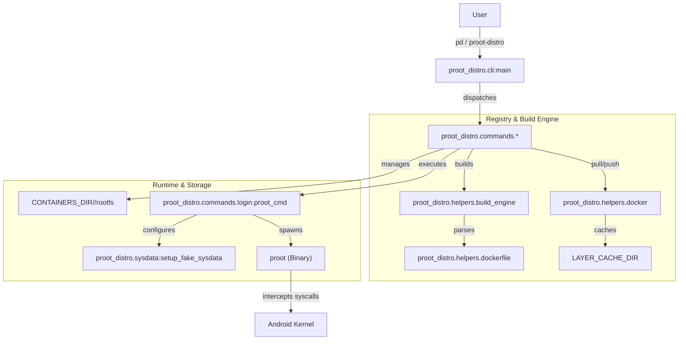
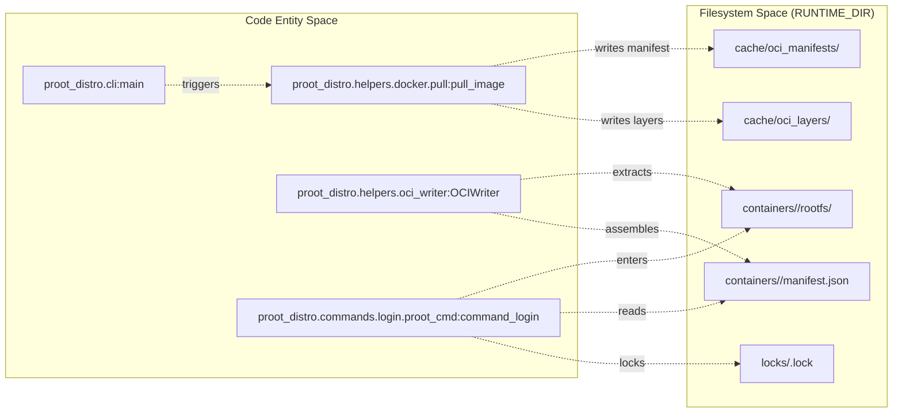

<!-- source: DeepWiki mcp.deepwiki.com · repo termux/proot-distro · page 1 PRoot-Distro Overview · fetched 2026-10-26 -->

# PRoot-Distro Overview

Relevant source files

The following files were used as context for generating this wiki page:

- [CLAUDE.md](CLAUDE.md)
- [README.md](README.md)
- [pyproject.toml](pyproject.toml)
- [screenshot.png](screenshot.png)

## Purpose and Scope

PRoot-Distro v5.1 is a lightweight, rootless Linux container management utility built for [Termux](https://termux.dev) and regular Linux hosts [README.md:3-6](). It provides a modern, pure-Python OCI (Open Container Initiative) container engine that replaces the legacy shell-based architecture. It solves the problem of running full Linux userlands—such as Ubuntu, Debian, or Alpine—on Android without requiring root access, kernel modules, or a Docker daemon [README.md:48-54]().

By leveraging `proot`, it simulates a chroot-like environment, translates system calls, and handles Android-specific filesystem constraints [README.md:3-6](). The v5.1 release extends these capabilities to include building and pushing OCI images directly from a Dockerfile without a Docker daemon [README.md:13-15]().

For specific installation instructions, see [Installation & Quick Start](#1.1). For information about limitations of using PRoot compared to actual chroot or Docker environments, see [Limitations & Constraints](#1.2).

Sources: [README.md:1-15](), [README.md:48-54](), [pyproject.toml:5-12](), [CLAUDE.md:5-13]()

## System Architecture

PRoot-Distro v5.1 is architected as a modular Python package with zero third-party dependencies [CLAUDE.md:13-14](). The system logic is strictly separated into CLI dispatching, OCI registry interaction, a custom build engine, and the container runtime management layer.

### High-Level Component Architecture

Sources: [CLAUDE.md:28-63](), [README.md:8-15](), [pyproject.toml:19-21]()

### Key Code Entities and Storage Layout

The following diagram maps logical code subsystems to their specific filesystem locations and storage constants.

Sources: [CLAUDE.md:65-76](), [CLAUDE.md:88-93](), [CLAUDE.md:152-155]()

## Core Features and Comparison

### v5.x (Python) vs. Legacy 4.x (Shell)

The transition to Python enabled a significantly more robust feature set, particularly regarding image management and multi-stage builds.

| Feature | Legacy 4.x (Shell) | Modern 5.1 (Python) |
| :--- | :--- | :--- |
| **Backend** | Bash Script | Pure Python 3.9+ [pyproject.toml:10]() |
| **Image Source** | Static tarball URLs in plugins | OCI/Docker Registries [README.md:8-11]() |
| **Image Building** | Not supported | Native Dockerfile Build Engine [README.md:13]() |
| **Storage Layout** | `installed-rootfs/<name>` | `containers/<name>/rootfs` [CLAUDE.md:88-93]() |
| **Metadata** | None (Filesystem only) | `manifest.json` per container [CLAUDE.md:91]() |
| **Dependencies** | `bash`, `curl`, `tar` | `python`, `proot` (zero extra libs) [CLAUDE.md:20-26]() |
| **Migration** | N/A | Automatic legacy rootfs migration [CLAUDE.md:97-98]() |

Sources: [README.md:48-64](), [CLAUDE.md:13-17](), [CLAUDE.md:105-120]()

### Multi-Architecture & Emulation
PRoot-Distro supports running guest distributions with different architectures than the host (e.g., running `x86_64` images on an `aarch64` device) via QEMU user-mode emulation [README.md:59](). 

- **Architecture Detection**: Handled via ELF magic byte inspection [CLAUDE.md:39-40]().
- **Emulation**: Triggered when host and guest architectures mismatch, utilizing `proot -q` to invoke the appropriate `qemu-user-*` binary [README.md:76-77]().

## Container Types: `normal` vs `termux`

PRoot-Distro distinguishes between standard Linux distributions and "Termux-style" containers to handle environment variables and path bindings correctly.

- **`normal`**: Standard distributions (Ubuntu, Alpine, etc.) using `link2symlink` to handle Android filesystem restrictions [CLAUDE.md:100-101]().
- **`termux`**: Containers replicating the Termux environment. These bypass `link2symlink`, use specific path bindings for the Termux prefix, and **prohibit cross-architecture emulation** to prevent host binaries from shadowing container ones [CLAUDE.md:103-107]().

Sources: [CLAUDE.md:100-108]()

## Command Reference Summary

The utility is accessible via the `proot-distro` command or the `pd` shorthand alias [README.md:68]().

| Category | Commands |
| :--- | :--- |
| **Installation** | `install`, `remove`, `reset`, `rename` |
| **Access** | `login`, `run` |
| **Management** | `backup`, `restore`, `copy`, `sync`, `list` |
| **Build & Push** | `build`, `push` |
| **Utility** | `help`, `clear-cache` |

Sources: [README.md:24-38](), [pyproject.toml:19-21](), [CLAUDE.md:110-125]()

## Next Steps

- **Installation**: Learn how to set up v5.1 via `pkg`, `pip`, or source. See [Installation & Quick Start](#1.1).
- **Usage**: Explore the [Command Reference](#2) for detailed flag and OCI reference documentation.
- **Constraints**: Understand what can and cannot be done within a rootless PRoot environment. See [Limitations & Constraints](#1.2).

---

