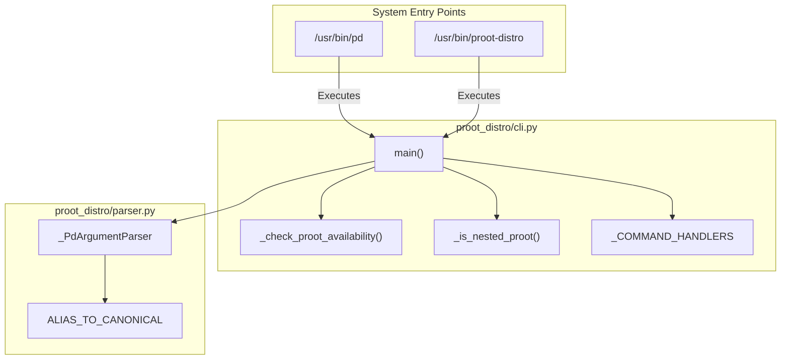
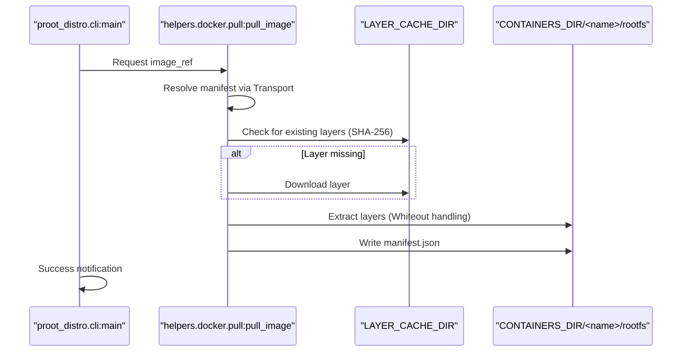

<!-- source: DeepWiki mcp.deepwiki.com · repo termux/proot-distro · page 1.1 Installation & Quick Start · fetched 2026-10-26 -->

# Installation & Quick Start

<details>
<summary>Relevant source files</summary>

The following files were used as context for generating this wiki page:

- [CLAUDE.md](CLAUDE.md)
- [README.md](README.md)
- [pyproject.toml](pyproject.toml)
- [screenshot.png](screenshot.png)

</details>


This document covers the installation of **PRoot-Distro v5.1**, a major Python-based container management utility. v5.1 maintains the zero-third-party-dependency architecture [pyproject.toml:12]() and expands on native OCI/Docker image support, including on-device image building [README.md:13-15]().

## Prerequisites

PRoot-Distro is designed for [Termux](https://termux.dev) on Android but also supports regular Linux hosts [README.md:4-6]().

**Runtime Requirements:**
*   **Python 3.9+**: The core engine requires a modern Python interpreter [pyproject.toml:10]().
*   **PRoot**: The primary execution engine that provides rootless chroot-like functionality [README.md:5]().
*   **QEMU User (Optional)**: Required for cross-architecture containers (e.g., running `x86_64` on `aarch64`) [README.md:76-77]().

Sources: [pyproject.toml:10-12](), [README.md:4-6](), [README.md:75-77]()

## Installation Methods

### Method 1: Termux Package Manager (Recommended)
The official package automatically handles the `proot` dependency.
```sh
pkg install proot-distro
```
Sources: [README.md:87]()

### Method 2: Python Package Index (PyPI)
Install the latest stable release via `pip`. Ensure `proot` is installed separately.
```sh
pkg install python proot
pip install proot-distro
```
Sources: [README.md:95-96]()

### Method 3: From Source (Development Mode)
For developers or users testing the latest repository changes, use an editable install.
```sh
git clone https://github.com/termux/proot-distro
cd proot-distro
pip install -e .
```
Sources: [README.md:107-110](), [CLAUDE.md:110]()

## The `pd` Alias and Entry Points

The installation registers two console scripts [pyproject.toml:20-21](). Both are entry points to the `proot_distro.cli:main` function [CLAUDE.md:17]().

*   `proot-distro`: The standard command.
*   `pd`: A convenient shorthand alias.

### CLI Entry Point Architecture


Sources: [pyproject.toml:19-21](), [CLAUDE.md:46-52](), [README.md:68-69]()

## Quick Start Guide

PRoot-Distro v5.1 allows pulling images from Docker Hub, GitHub Container Registry (`ghcr.io`), and others [README.md:193-194]().

### 1. Install a Container
You can install using an image reference. The system defaults to the host architecture unless overridden.
```sh
# Install Ubuntu 24.04 from Docker Hub
pd install ubuntu:24.04

# Install Alpine with a custom name and architecture
pd install alpine --name my-alpine --architecture x86_64
```
Sources: [README.md:129](), [README.md:180-181]()

### 2. List Installed Containers
View all containers and their current status.
```sh
pd list
```
Sources: [README.md:141]()

### 3. Log In to a Container
Access the container shell. The `login` command sets up the `proot` environment, including fake `sysdata` [CLAUDE.md:50]().
```sh
# Standard login
pd login ubuntu

# Login as a specific user (UID or name)
pd login ubuntu --user 1000
```
Sources: [README.md:132](), [CLAUDE.md:129]()

### 4. Run One-off Commands
The `--` separator passes arguments directly to the container's shell or entrypoint.
```sh
pd login ubuntu -- /bin/uname -a
```
Sources: [README.md:138]()

## Installation and Build Data Flow

When installing or building, the system interacts with the OCI registry and local cache.


Sources: [CLAUDE.md:88-93](), [README.md:8-11](), [CLAUDE.md:62-63]()

## Key Files and Locations

| Constant | Path (Termux) | Description |
|------|-------------|-------------|
| `RUNTIME_DIR` | `$PREFIX/var/lib/proot-distro` | Root directory for all data [CLAUDE.md:69](). |
| `CONTAINERS_DIR` | `RUNTIME_DIR/containers/` | Container rootfs and `manifest.json` [CLAUDE.md:71](). |
| `LAYER_CACHE_DIR` | `BASE_CACHE_DIR/oci_layers/` | Cached OCI image layers [CLAUDE.md:73](). |
| `MANIFEST_CACHE_DIR` | `BASE_CACHE_DIR/oci_manifests/` | Cached OCI manifests for builds [CLAUDE.md:74](). |

Sources: [CLAUDE.md:67-75]()

---

