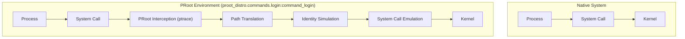
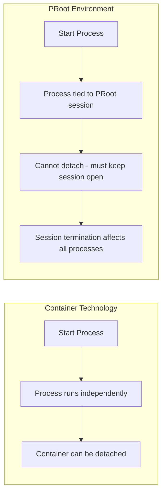
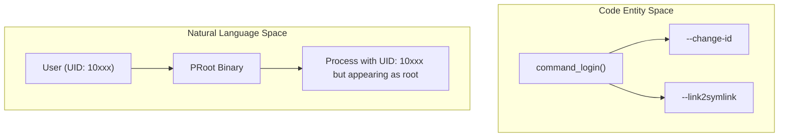
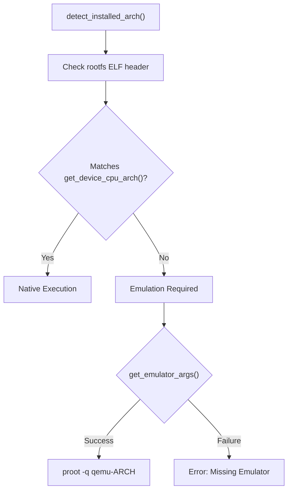
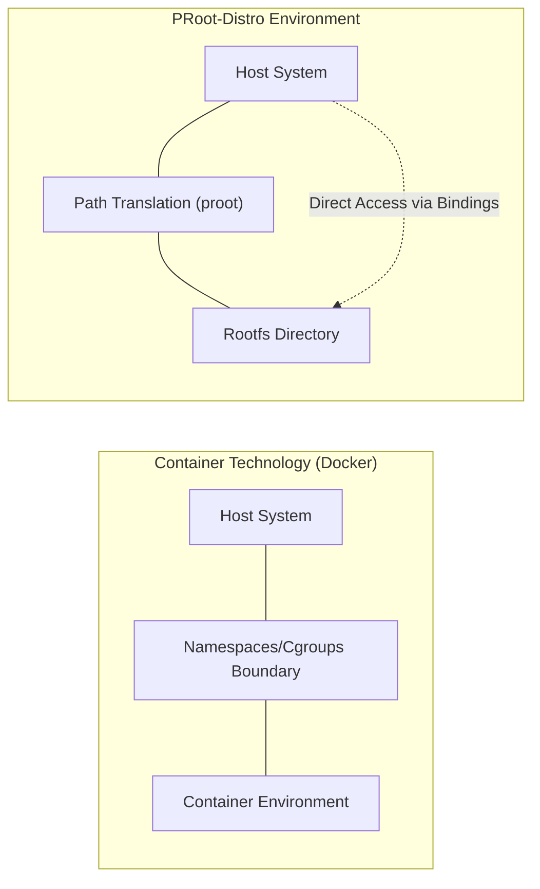

<!-- source: DeepWiki mcp.deepwiki.com · repo termux/proot-distro · page 1.2 Limitations & Constraints · fetched 2026-10-26 -->

# Limitations & Constraints

<details>
<summary>Relevant source files</summary>

The following files were used as context for generating this wiki page:

- [CLAUDE.md](CLAUDE.md)
- [README.md](README.md)
- [proot_distro/constants.py](proot_distro/constants.py)
- [proot_distro/helpers/build_cache.py](proot_distro/helpers/build_cache.py)

</details>


This document provides a comprehensive overview of the inherent limitations and operational constraints of `proot-distro` v5.1. Understanding these limitations is essential for users to set appropriate expectations, troubleshoot issues effectively, and implement suitable workarounds where needed.

## Inherent PRoot Limitations

`proot-distro` relies on the PRoot utility, which uses `ptrace()` to provide a chroot-like environment without requiring root privileges. However, this approach comes with significant limitations compared to true chroot or containerization technologies like Docker.

### Performance Degradation

PRoot intercepts and handles system calls through `ptrace()`, which introduces overhead for every process executed within the environment. This leads to noticeable performance degradation compared to native execution, especially for system-call-heavy workloads.

**Native vs PRoot Execution Flow**


Sources: [README.md:3-6](), [proot_distro/commands/login/proot_cmd.py:121-180]()

### Process Management Limitations

Unlike true containers, PRoot cannot fully detach from processes it starts. When the PRoot session ends, child processes are typically terminated or left in an orphaned state that may not function correctly. This creates constraints for running long-lived daemon processes.



Sources: [proot_distro/commands/login/proot_cmd.py:121-180]()

### Privilege Emulation Not Actual Elevation

PRoot provides the appearance of root privileges (UID 0) without actually elevating permissions. The underlying process still runs with the Android application's UID.

**Identity Simulation Mapping**


Sources: [proot_distro/commands/login/proot_cmd.py:121-125](), [proot_distro/commands/login/proot_cmd.py:165-170](), [CLAUDE.md:22-26]()

## Technical Implementation Constraints

### Architecture Support and Emulation

`proot-distro` supports multiple CPU architectures via QEMU user-mode emulation. However, cross-architecture execution introduces significant overhead.

**Architecture Resolution Logic**


Sources: [proot_distro/arch.py:45-64](), [proot_distro/arch.py:101-118](), [proot_distro/commands/login/proot_cmd.py:113-119]()

### Anti-Nested PRoot Protections

`proot-distro` explicitly prevents execution inside another PRoot environment to avoid `ptrace` conflicts and extreme performance degradation. It detects this by checking for the `PROOT_TMPDIR` environment variable or inspecting the process tracer via `/proc`.

```python
# From proot_distro/cli.py:main()
if "PROOT_TMPDIR" in os.environ:
    msg(f"{C['RED']}error:{C['RST']} you are trying to run {PROGRAM_NAME} inside proot.")
    sys.exit(1)
```

Sources: [proot_distro/cli.py:168-171](), [CLAUDE.md:51-52]()

### `termux` Type Container Restrictions

Containers of type `termux` (which contain a full Termux environment inside) have specific architectural constraints. Because they share the same hardcoded `PREFIX` path (`/data/data/com.termux/files/usr`) as the host, cross-architecture emulation is impossible.

```python
# From proot_distro/commands/login/proot_cmd.py:command_login()
if is_termux_dist and guest_arch != host_arch:
    msg(f"{C['RED']}error:{C['RST']} cross-architecture is not supported for 'termux' containers.")
    sys.exit(1)
```

Sources: [CLAUDE.md:100-108](), [proot_distro/commands/login/proot_cmd.py:34-38]()

## System Data & SELinux Constraints

### Synthetic System Data (`sysdata.py`)

Android restricts access to `/proc` and `/sys`. `proot-distro` works around this by generating synthetic files and binding them into the container.

| Simulated Path | Code Source | Purpose |
|---|---|---|
| `/proc/loadavg` | `fake_proc_bindings()` | Static load average to satisfy uptime/top |
| `/proc/stat` | `fake_proc_bindings()` | Static CPU stats |
| `/proc/version` | `DEFAULT_FAKE_KERNEL_VERSION` | Fake kernel string |
| `/sys/fs/selinux` | `setup_fake_sysdata()` | Fake SELinux directory to bypass checks |

Sources: [proot_distro/sysdata.py:27-39](), [proot_distro/sysdata.py:68-100](), [proot_distro/constants.py:117-120]()

### SELinux and Link2Symlink

Android's SELinux policy often prevents the creation of hard links in the app's data directory. `proot-distro` uses the PRoot `link2symlink` extension to emulate hard links using specially formatted symlinks.

*   **Mechanism**: Enabled via `--link2symlink` flag in `command_login`.
*   **Storage**: Metadata is stored in a directory defined by `PROOT_L2S_DIR`.
*   **Constraint**: If `link2symlink` is disabled (e.g., in `termux` type containers), many Linux package managers (like `apt` or `pacman`) will fail due to their reliance on hard links.

Sources: [proot_distro/commands/login/proot_cmd.py:121-125](), [CLAUDE.md:43](), [CLAUDE.md:104-106]()

## Security & Isolation

### Limited Isolation Boundary

PRoot is a path-translation engine, not a security sandbox. It provides significantly less isolation than Docker.



Sources: [proot_distro/commands/login/bindings.py:16-30](), [proot_distro/commands/login/proot_cmd.py:130-150]()

### Image Environment Blocks

To prevent guest images from breaking the host-to-guest transition or terminal state, certain environment variables are blocked from being imported from OCI image configurations.

```python
# From proot_distro/commands/login/env.py
_IMAGE_ENV_BLOCKED = frozenset({
    "ANDROID_ART_ROOT", "ANDROID_DATA", "ANDROID_I18N_ROOT",
    "ANDROID_ROOT", "ANDROID_RUNTIME_ROOT", "ANDROID_TZDATA_ROOT",
    "BOOTCLASSPATH", "DEX2OATBOOTCLASSPATH", "EXTERNAL_STORAGE",
    "TERM", "COLORTERM",
})
```

Sources: [proot_distro/commands/login/env.py:27-33]()

## Network Constraints

### Low-Port Redirection

Android does not allow non-root users to bind to ports below 1024. `proot-distro` uses the `--redirect-ports` flag to handle this by shifting port requests.

*   **Logic**: Maps guest ports `0-1023` to host ports `2000-3023`.
*   **Implementation**: Passed to PRoot via `-p 0:1024:2000`.

Sources: [proot_distro/commands/login/proot_cmd.py:127-129]()

---

