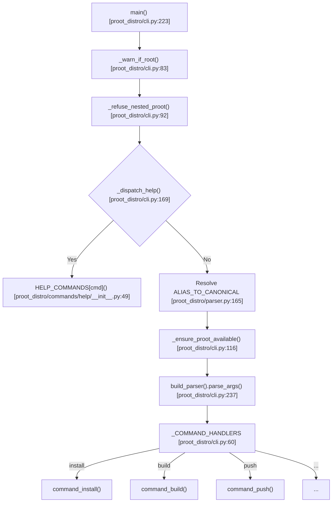
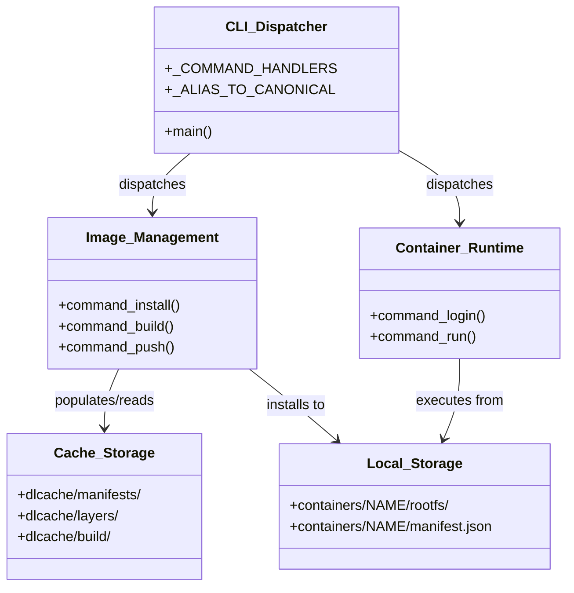

<!-- source: DeepWiki mcp.deepwiki.com · repo termux/proot-distro · page 2 Command Reference · fetched 2026-10-26 -->

# Command Reference

Relevant source files

The following files were used as context for generating this wiki page:

- [proot_distro/cli.py](proot_distro/cli.py)
- [proot_distro/commands/help/__init__.py](proot_distro/commands/help/__init__.py)
- [proot_distro/commands/help/pages.py](proot_distro/commands/help/pages.py)

## Purpose and Scope

This document provides a comprehensive reference for all commands available in `proot-distro` v5.1. It details the CLI dispatcher logic, available aliases, and command syntax. Version 5.1 introduces significant new capabilities for building and pushing OCI images directly from Termux. For detailed documentation on specific subsystems, see the relevant child pages: [Installation Commands](#2.1), [Access Commands](#2.2), [Management Commands](#2.3), [Utility Commands](#2.4), and [Build & Push Commands](#2.5).

## Command Overview

PRoot-Distro v5.1 uses a Python-based CLI dispatcher defined in `proot_distro/cli.py`. It utilizes `argparse` with `add_help=False` to manually handle help output via the `HELP_COMMANDS` registry [proot_distro/cli.py:43](). This prevents "missing required argument" errors when a user requests help for a subcommand [proot_distro/cli.py:170-182]().

The following table summarizes the available commands and their aliases:

| Command | Aliases | Description |
|---------|---------|-------------|
| `install` | `add`, `i`, `in`, `ins` | Pull OCI images or install local archives |
| `login` | `sh` | Enter a container's interactive shell |
| `run` | - | Execute a specific command inside a container |
| `remove` | `rm` | Delete a container and its rootfs |
| `rename` | - | Change a container's alias |
| `reset` | - | Reinstall a container using its existing manifest |
| `list` | `li`, `ls` | Show installed and available distributions |
| `backup` | `bak`, `bkp` | Archive a container's rootfs and metadata |
| `restore` | - | Restore a container from a tar archive |
| `copy` | `cp` | Copy files between host and container |
| `sync` | - | Synchronize files using CRC32 checksums |
| `build` | `b` | Build OCI images from a Dockerfile |
| `push` | `p` | Push locally built images to a registry |
| `clear-cache` | `clear`, `cl` | Remove downloaded OCI layers and manifests |
| `help` | `hel`, `he`, `h` | Show usage information |

Sources: [proot_distro/cli.py:60-76](), [proot_distro/parser.py:165-195]()

## CLI Dispatcher Architecture

The dispatcher resolves aliases to canonical command names before execution using `ALIAS_TO_CANONICAL` [proot_distro/parser.py:165-195](). Before dispatching, the CLI performs several environment checks, including a warning if running as root [proot_distro/cli.py:83-90](), a refusal to run inside a nested PRoot session [proot_distro/cli.py:92-114](), and a probe for the `proot` utility (except for `build` and `push` commands) [proot_distro/cli.py:116-168]().

### Command Dispatch Flow

The following diagram illustrates how the CLI entry point processes a user command and routes it to the appropriate internal handler.

**CLI Dispatch Logic**

Sources: [proot_distro/cli.py:60-250](), [proot_distro/parser.py:165-195]()

### System Entity Mapping

This diagram bridges the CLI command names to their specific implementation modules and the underlying storage and cache entities.

**Entity Mapping**

Sources: [proot_distro/cli.py:60-76](), [proot_distro/constants.py:44-55](), [proot_distro/commands/install.py:1-50]()

## Command Groups

### Installation Commands
These commands manage the lifecycle of container instances. `install` supports pulling from OCI registries or installing from local tarballs and OCI layouts. `reset` allows for a clean state without re-specifying the image source by reading the existing `manifest.json`.

For details, see [Installation Commands](#2.1).

### Access Commands
`login` and `run` are the primary interfaces for executing code inside containers. `login` provides an interactive shell, while `run` executes specific commands, resolving `Entrypoint` and `Cmd` from the container's manifest. Both support advanced proot features like port redirection and isolated mounts.

For details, see [Access Commands](#2.2).

### Management Commands
These commands handle data movement and maintenance. `backup` and `restore` create and extract compressed tar archives. `copy` and `sync` allow for granular file transfers between the host and container rootfs using `dist:path` syntax.

For details, see [Management Commands](#2.3).

### Utility Commands
Utility functions include the per-command help system and cache management. `clear-cache` targets the `dlcache/` directory, removing downloaded OCI layers, manifests, and the build cache to free up space.

For details, see [Utility Commands](#2.4).

### Build & Push Commands
New in v5.1, `build` allows creating OCI-compatible images from Dockerfiles using a pure-Python parser and a PRoot-based `RUN` execution engine. `push` enables uploading these locally built images to remote registries like Docker Hub or GHCR.

For details, see [Build & Push Commands](#2.5).

## Environment Variables

PRoot-Distro behavior can be influenced by several environment variables:

| Variable | Description |
|----------|-------------|
| `PD_DOCKER_AUTH` | Credentials for OCI registries in `user:password` format [proot_distro/commands/help/__init__.py:153](). |
| `PD_FORCE_NO_COLORS` | If set, disables ANSI color codes in output [proot_distro/commands/help/__init__.py:142](). |
| `PROOT_L2S_DIR` | Directory used for PRoot's `link2symlink` storage. |

Sources: [proot_distro/commands/help/__init__.py:136-157](), [proot_distro/cli.py:38-39]()

---

