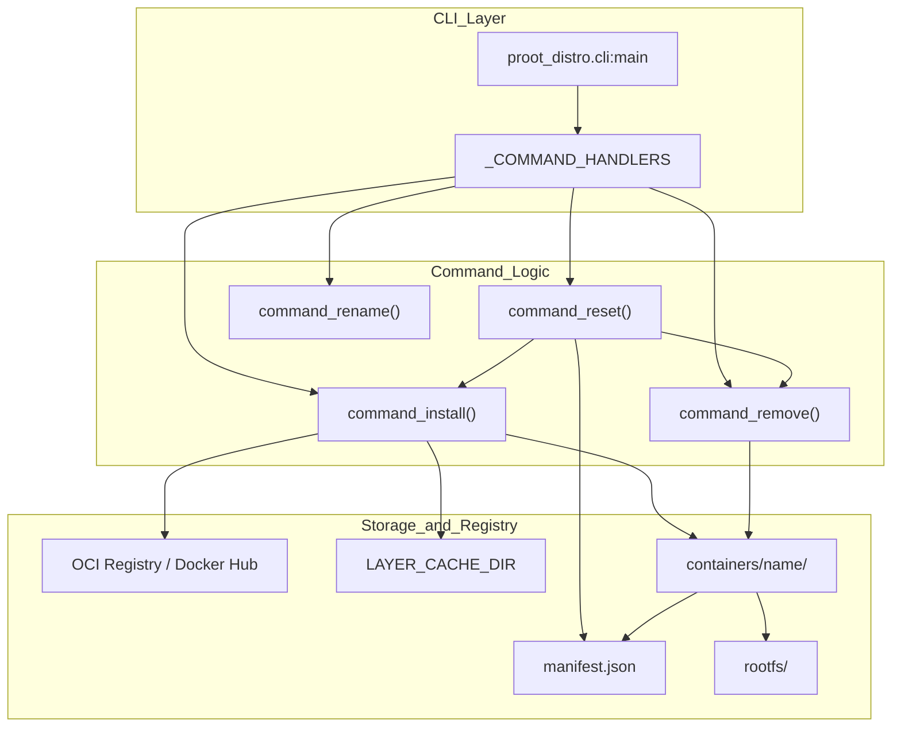
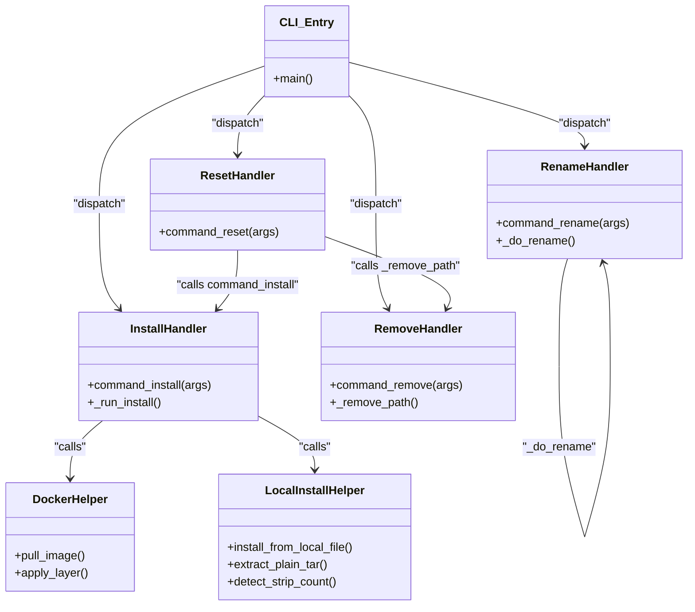

<!-- source: DeepWiki mcp.deepwiki.com · repo termux/proot-distro · page 2.1 Installation Commands · fetched 2026-10-26 -->

# Installation Commands

Relevant source files

The following files were used as context for generating this wiki page:

- [proot_distro/commands/install.py](proot_distro/commands/install.py)
- [proot_distro/commands/install_local.py](proot_distro/commands/install_local.py)
- [proot_distro/commands/remove.py](proot_distro/commands/remove.py)
- [proot_distro/commands/rename.py](proot_distro/commands/rename.py)
- [proot_distro/commands/reset.py](proot_distro/commands/reset.py)
- [proot_distro/helpers/docker/__init__.py](proot_distro/helpers/docker/__init__.py)
- [proot_distro/helpers/docker/cache.py](proot_distro/helpers/docker/cache.py)

This page documents the commands for installing, removing, resetting, and renaming containers in PRoot-Distro v5.1. These commands manage the container lifecycle, handling OCI image pulls, local archive extractions, and filesystem management.

## Overview

PRoot-Distro v5.1 is a Python-based OCI-compliant manager. The core installation commands are:

1.  `install`: Pulls Docker/OCI images, fetches URLs, or extracts local tarballs into a new container.
2.  `remove`: Deletes a container's rootfs and metadata.
3.  `reset`: Rebuilds a container using its original image reference stored in a manifest.
4.  `rename`: Safely renames a container and updates internal path references.

## Command Dispatch and Data Flow

The following diagram illustrates how installation commands interact with the storage layer and external resources.

**Installation System Data Flow**

Sources: [proot_distro/commands/install.py:21-28](), [proot_distro/commands/remove.py:21-23](), [proot_distro/commands/reset.py:21-25](), [proot_distro/commands/rename.py:21-24]()

## The `install` Command

The `install` command is the primary entry point for creating new environments. It supports Docker/OCI image references, remote URLs, and local rootfs archives.

### Syntax and Options
`proot-distro install [OPTIONS] IMAGE_REF`

| Option | Description |
| :--- | :--- |
| `--name NAME` | Set a custom name for the container. |
| `--architecture ARCH` | Override the target architecture (e.g., `aarch64`, `arm`, `i686`, `riscv64`, `x86_64`). |

**Aliases:** `add`, `i`, `in`, `ins`
Sources: [proot_distro/commands/install.py:105-139](), [proot_distro/commands/install.py:382-390]()

### Installation Logic
The `command_install` function [proot_distro/commands/install.py:105-140]() dispatches based on the `image_ref` type:

1.  **OCI Pull**: If the reference is not a local path or URL, it calls `pull_image()` [proot_distro/helpers/docker/pull.py:115](). It resolves the image, downloads layers to `LAYER_CACHE_DIR`, and extracts them sequentially using `apply_layer()` [proot_distro/helpers/docker/layers.py:73]().
2.  **Local OCI Layout**: If the path is a tarball containing an `oci-layout` marker, `install_from_local_file()` [proot_distro/commands/install_local.py:227-243]() extracts layers to the cache and applies them.
3.  **Plain Tarball**: For standard rootfs archives, it uses `extract_plain_tar()` [proot_distro/commands/install_local.py:85-93](). This includes an automatic `detect_strip_count()` [proot_distro/commands/install_local.py:64-82]() to find the rootfs root by scoring path depths against known directories like `etc` or `usr`.
4.  **URL Download**: Remote archives are downloaded via `download_file()` [proot_distro/helpers/download.py:28]() to a temporary location before being treated as local archives [proot_distro/commands/install.py:204-210]().

### Container Naming and Validation
Container names must be valid according to `is_valid_name()` [proot_distro/names.py:26]().
*   **Derived Names**: For Docker images, names are derived via `derive_alias()` [proot_distro/helpers/docker/refs.py:110]().
*   **Local Paths**: Names are derived by stripping extensions like `.tar.gz` or `.oci.tar.xz` and sanitizing characters [proot_distro/commands/install.py:84-98]().

Sources: [proot_distro/commands/install.py:61-65](), [proot_distro/commands/install.py:142-175](), [proot_distro/commands/install_local.py:21-31]()

## The `remove` Command

The `remove` command deletes the entire container directory, including the `rootfs/` and `manifest.json`.

### Recursive Deletion with Permission Fixes
Because PRoot can create files with restrictive permissions (e.g., `chmod 000`) that the host user cannot normally delete, `_remove_path()` [proot_distro/commands/remove.py:35-88]() implements a recursive deletion algorithm that:
1.  Attempts to `os.lstat()` the path.
2.  If a file lacks read/write permissions for the owner, it applies `os.chmod(path, st.st_mode | stat.S_IRUSR | stat.S_IWUSR)` [proot_distro/commands/remove.py:49-54]().
3.  If a directory lacks read/write/execute permissions, it applies `os.chmod(path, st.st_mode | stat.S_IRWXU)` [proot_distro/commands/remove.py:63-68]().
4.  Deletes files via `os.unlink()` and directories via `os.rmdir()`.

**Aliases:** `rm`
Sources: [proot_distro/commands/remove.py:21-23](), [proot_distro/commands/remove.py:91-118]()

## The `reset` Command

The `reset` command restores a container to its original state using metadata stored in its manifest.

### Reset Workflow
1.  **Manifest Retrieval**: Reads `containers/<name>/manifest.json` to extract the `image_ref` and `arch` [proot_distro/commands/reset.py:57-62]().
2.  **Rootfs Wipe**: Deletes the `rootfs/` subdirectory while preserving the container directory and manifest [proot_distro/commands/reset.py:71-81]().
3.  **Re-installation**: Re-runs `command_install()` using the original metadata [proot_distro/commands/reset.py:83-89]().

Reset is only supported for containers installed via OCI images [proot_distro/commands/reset.py:66-69]().

Sources: [proot_distro/commands/reset.py:21-25](), [proot_distro/commands/reset.py:41-90]()

## The `rename` Command

The `rename` command moves a container directory and corrects internal references.

### Link2Symlink Path Correction
When a container is renamed, absolute paths in PRoot's `link2symlink` (l2s) extension must be updated. `command_rename()` [proot_distro/commands/rename.py:37-66]() performs:
1.  **Directory Move**: `os.rename()` of the container directory [proot_distro/commands/rename.py:72]().
2.  **L2S Rewrite**: Calls `rewrite_l2s_targets()` [proot_distro/l2s.py:75]() to update symlinks in the new rootfs path that point to the old rootfs path [proot_distro/commands/rename.py:77]().

**Aliases:** `mv`
Sources: [proot_distro/commands/rename.py:21-25](), [proot_distro/commands/rename.py:69-79]()

## Summary of Command Entities

The following diagram maps CLI commands to their implementation functions and primary helper utilities.

**Command Implementation Map**

Sources: [proot_distro/commands/install.py:105](), [proot_distro/commands/remove.py:91](), [proot_distro/commands/reset.py:41](), [proot_distro/commands/rename.py:37](), [proot_distro/commands/install_local.py:227](), [proot_distro/helpers/docker/pull.py:115]()

---

