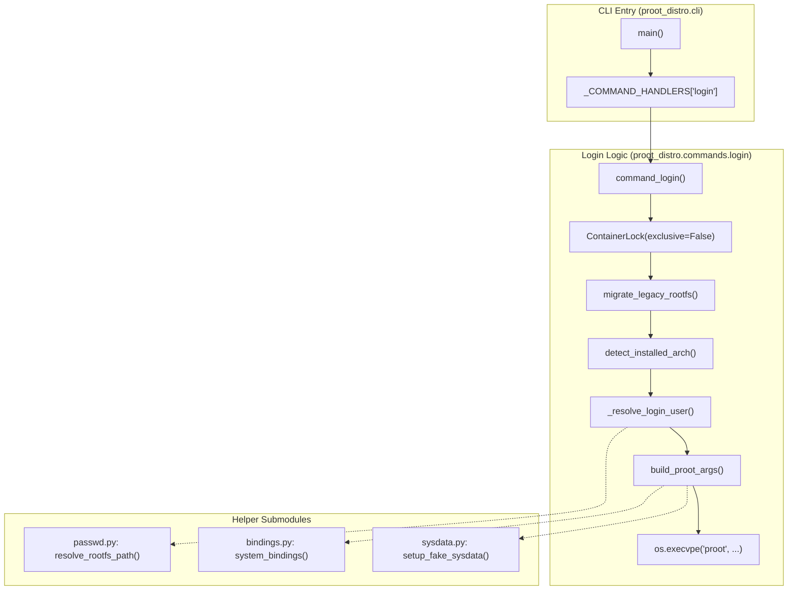
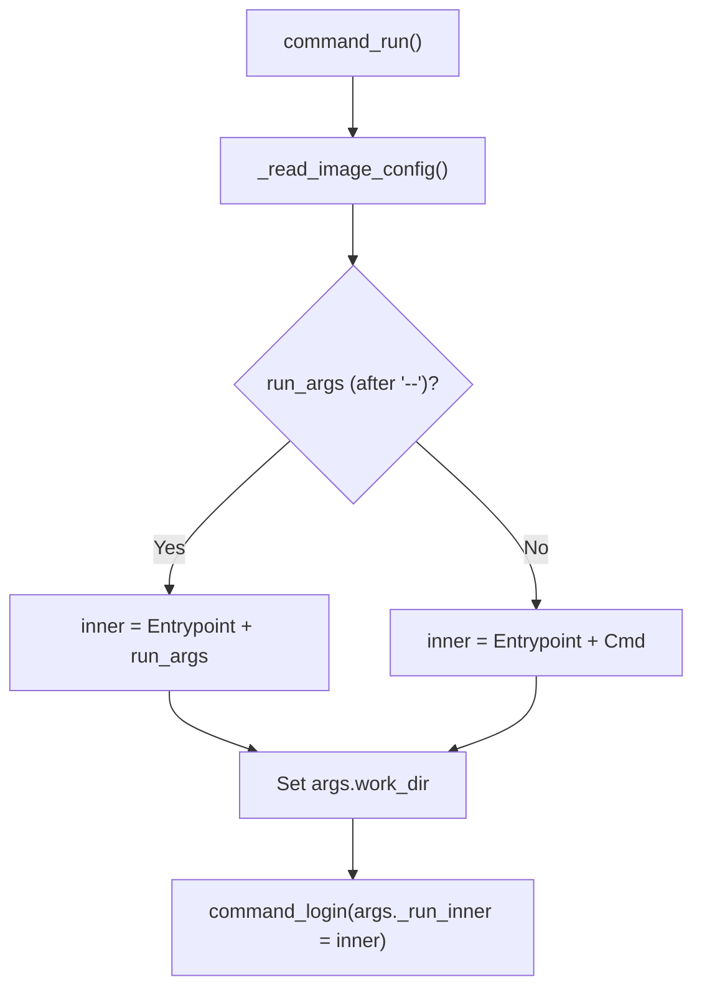
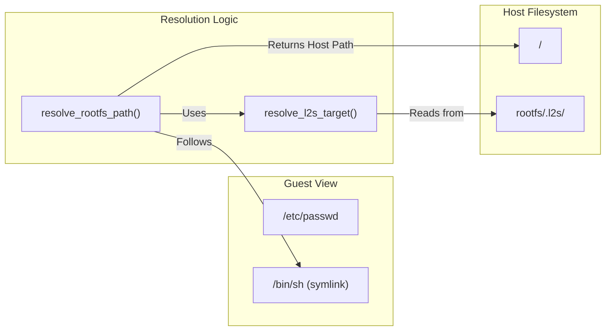

<!-- source: DeepWiki mcp.deepwiki.com · repo termux/proot-distro · page 2.2 Access Commands · fetched 2026-10-26 -->

# Access Commands

Relevant source files

The following files were used as context for generating this wiki page:

- [proot_distro/commands/login/__init__.py](proot_distro/commands/login/__init__.py)
- [proot_distro/commands/login/bindings.py](proot_distro/commands/login/bindings.py)
- [proot_distro/commands/login/env.py](proot_distro/commands/login/env.py)
- [proot_distro/commands/login/passwd.py](proot_distro/commands/login/passwd.py)
- [proot_distro/commands/run.py](proot_distro/commands/run.py)

This document details the PRoot-Distro access commands, primarily the `login` and `run` commands. These commands allow you to interact with installed distributions by starting shells or executing commands within them. In the Python-based v5.1 architecture, these commands handle complex environment setup, OCI manifest resolution, and PRoot execution logic.

## Login Command Overview

The `login` command (aliased as `sh`) is the primary method for accessing distributions. It spawns an interactive shell or a custom command inside the container by building a full `proot` command line. The command utilizes a shared lock via `ContainerLock` to ensure session integrity while allowing multiple concurrent logins to the same rootfs.

Sources: [proot_distro/commands/login/__init__.py:71-85](), [proot_distro/commands/login/__init__.py:82-84](), [proot_distro/commands/login/passwd.py:34-70](), [proot_distro/commands/login/bindings.py:58-84]()

## The Run Command

The `run` command executes the `Entrypoint` and/or `Cmd` defined in a container's OCI image manifest (`manifest.json`). It acts as a wrapper around `command_login`, injecting the resolved command into the login flow via the `args._run_inner` attribute.

### Entrypoint/Cmd Resolution Logic
The command resolution follows OCI/Docker semantics:
1.  If arguments are provided after the `--` separator, they **replace** `Cmd` but are **appended** to `Entrypoint`.
2.  If no arguments are provided, it concatenates `Entrypoint` + `Cmd`.
3.  The `WorkingDir` from the manifest is used unless overridden by `--work-dir`.

Sources: [proot_distro/commands/run.py:21-26](), [proot_distro/commands/run.py:71-85](), [proot_distro/commands/run.py:89-93]()

## Login and Run Options

The following table details the technical implementation of access options:

| Option | Implementation Detail |
| :--- | :--- |
| `--user <user>` | Resolved via `_resolve_login_user`. It parses `/etc/passwd` and `/etc/group` using `resolve_rootfs_path` to handle guest-side symlinks. [proot_distro/commands/login/__init__.py:102-191]() |
| `--isolated` | When set, `system_bindings()` and `storage_bindings()` are not called, preventing host path exposure. [proot_distro/commands/login/proot_cmd.py:105-115]() |
| `--minimal` | Disables `inject_termux_profile` and sets a restricted `DEFAULT_PATH_ENV`. [proot_distro/commands/login/__init__.py:194-205]() |
| `--bind <h:g>` | Appends to the `proot` command line as `--bind=host_path:guest_path`. [proot_distro/commands/login/proot_cmd.py:125-128]() |
| `--shared-x11` | Binds `/tmp/.X11-unix` and propagates `DISPLAY` and `XAUTHORITY` variables. [proot_distro/commands/login/proot_cmd.py:133-144]() |
| `--shared-tmp` | Binds the host `$TMPDIR` to the guest `/tmp`. [proot_distro/commands/login/proot_cmd.py:130-132]() |
| `--termux-home` | Binds the host `TERMUX_HOME` to the resolved guest user's home directory. [proot_distro/commands/login/proot_cmd.py:146-153]() |
| `--redirect-ports` | Passes `-p` to `proot` for port redirection (e.g., mapping privileged ports). [proot_distro/commands/login/proot_cmd.py:228-230]() |
| `--env VAR=val` | Merged into the environment dict before being written to the `termux-profile.sh` snippet. [proot_distro/commands/login/env.py:80-135]() |
| `--emulator <bin>` | Forces a specific binary for guest execution via `proot -q`. [proot_distro/commands/login/proot_cmd.py:219-221]() |

Sources: [proot_distro/commands/login/__init__.py:102-191](), [proot_distro/commands/login/proot_cmd.py:105-153](), [proot_distro/commands/login/env.py:80-135]()

## Filesystem Access and Fake Sysdata

To provide a functional Linux environment on Android's restricted kernel, PRoot-Distro utilizes a "Fake Sysdata" subsystem and specialized path resolution.

### Synthetic Mounts
The `setup_fake_sysdata()` function generates temporary files and binds them to `/proc` and `/sys` entries to satisfy software that expects standard Linux kernel interfaces. This includes `/proc/loadavg`, `/proc/stat`, and `/sys/block` entries.
Sources: [proot_distro/sysdata.py:108-123]()

### Rootfs Path Resolution
The `resolve_rootfs_path()` function in `passwd.py` is critical for user management. It manually traverses symlinks within the guest rootfs (up to 40 levels) to find real host paths. It specifically handles `link2symlink` (`.l2s`) targets to prevent re-rooting loops and ensures absolute symlinks inside the guest (common in NixOS) resolve correctly within the container namespace.

Sources: [proot_distro/commands/login/passwd.py:34-70](), [proot_distro/commands/login/passwd.py:60-63]()

## Environment Precedence and Persistence

The environment within the container is constructed and persisted to handle `su -` sessions correctly.

1.  **Blocked Variables**: Variables like `ANDROID_ROOT` and `LD_PRELOAD` are explicitly blocked via `IMAGE_ENV_BLOCKED` to prevent guest crashes. [proot_distro/commands/login/env.py:46-52]()
2.  **Profile Injection**: The `inject_termux_profile()` function writes a snippet to `/etc/profile.d/termux-profile.sh`. This ensures that even when a login shell re-sources `/etc/profile` (e.g., during `su -`), the PRoot-Distro defined variables and user `--env` flags are re-exported. [proot_distro/commands/login/env.py:80-94]()
3.  **Skip Logic**: Per-session variables like `HOME`, `USER`, and `TERM` are excluded from injection via `_PROFILE_INJECT_SKIP` so they don't override the values set by the guest's own login mechanisms. [proot_distro/commands/login/env.py:60-65]()

Sources: [proot_distro/commands/login/env.py:46-65](), [proot_distro/commands/login/env.py:80-135]()

---

