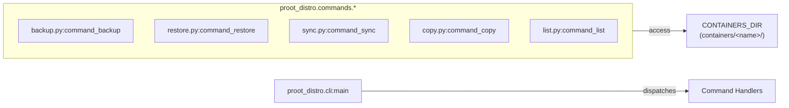
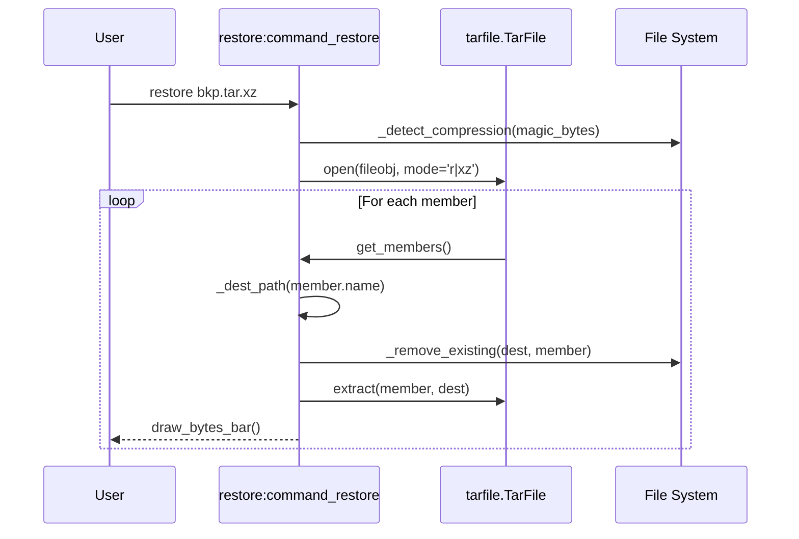

<!-- source: DeepWiki mcp.deepwiki.com · repo termux/proot-distro · page 2.3 Management Commands · fetched 2026-10-26 -->

# Management Commands

<details>
<summary>Relevant source files</summary>

The following files were used as context for generating this wiki page:

- [proot_distro/commands/backup.py](proot_distro/commands/backup.py)
- [proot_distro/commands/clear_cache.py](proot_distro/commands/clear_cache.py)
- [proot_distro/commands/copy.py](proot_distro/commands/copy.py)
- [proot_distro/commands/list.py](proot_distro/commands/list.py)
- [proot_distro/commands/restore.py](proot_distro/commands/restore.py)
- [proot_distro/commands/sync.py](proot_distro/commands/sync.py)

</details>


This page provides detailed technical documentation for the management commands in PRoot-Distro v5.1. These commands handle the lifecycle and data movement of installed containers, including backup, restoration, synchronization, and listing.

## Overview of Management Commands

Management commands are implemented as specialized modules within the `proot_distro.commands` package. They interact with the container storage located in `CONTAINERS_DIR`, which follows a structured layout: `containers/<name>/manifest.json` and `containers/<name>/rootfs/`.

The CLI dispatcher maps user input to these specific command handlers.


Sources: [proot_distro/commands/backup.py:21-25](), [proot_distro/commands/restore.py:21-28](), [proot_distro/commands/list.py:21-23]()

## Backup and Restore

The backup and restore system facilitates portable container archives. v5.1 uses a standard directory structure inside the archive to ensure metadata (manifests) and data (rootfs) are preserved together.

### Backup Command Implementation

The `command_backup` function creates a TAR archive of a container. It preserves file permissions and symlinks while stripping host-specific ownership information (UID/GID) to ensure portability.

**Key Features:**
- **Compression Detection**: Inferred from the `--output` file extension via `_compression_mode` [proot_distro/commands/backup.py:67-80]() or forced via the `--compress` flag.
- **Progress Tracking**: Uses a `_ReadCounter` wrapper [proot_distro/commands/backup.py:122-141]() to provide real-time byte-level progress updates during the compression stream.
- **Link2Symlink Handling**: Symlinks that are actually PRoot `link2symlink` emulated hard links are resolved to their backing files and packed as regular files [proot_distro/commands/backup.py:173-193]().
- **Deterministic Order**: Entries are sorted during iteration in `_iter_entries` to ensure reproducible archive generation [proot_distro/commands/backup.py:83-119]().

| Compression Type | Extension Suffixes | Internal Mode |
| :--- | :--- | :--- |
| Gzip | `.tar.gz`, `.tgz` | `gz` |
| Bzip2 | `.tar.bz2`, `.tbz2` | `bz2` |
| XZ / LZMA | `.tar.xz`, `.txz`, `.tar.lzma` | `xz` |
| None | `.tar` | `''` |

Sources: [proot_distro/commands/backup.py:43-64](), [proot_distro/commands/backup.py:143-163](), [proot_distro/commands/backup.py:221-250]()

### Restore Command Implementation

The `command_restore` function handles extraction. It is designed to be backward compatible with legacy 4.x archives while supporting the new v5.1 layout.

**Archive Layout Resolution (`_dest_path`):**
1. **New Format**: `<name>/manifest.json` and `<name>/rootfs/...` are extracted to their respective locations in `CONTAINERS_DIR` [proot_distro/commands/restore.py:173-179]().
2. **Legacy Format**: Entries starting with `installed-rootfs/` are re-rooted to `containers/<name>/rootfs/` [proot_distro/commands/restore.py:151-160]().
3. **Safety**: Members containing `..` or absolute paths are rejected to prevent path traversal [proot_distro/commands/restore.py:142-144]().

**Compression Auto-detection**: For stdin streams, `_detect_compression` inspects magic bytes (e.g., `\x1f\x8b` for Gzip) to determine the decompression algorithm [proot_distro/commands/restore.py:65-70]().


Sources: [proot_distro/commands/restore.py:54-59](), [proot_distro/commands/restore.py:122-183](), [proot_distro/commands/restore.py:207-250]()

## Synchronization and Copying

PRoot-Distro provides file movement between the host and containers using a `dist:path` notation.

### Path Resolution
Both `copy` and `sync` use `resolve_container_path` from `proot_distro.paths`. This helper splits the input string at the first colon; if a container name is found, it prepends the absolute path to that container's rootfs.

```python
# Conceptual Path Flow
"ubuntu:/etc/passwd" -> resolve_container_path() -> "/.../containers/ubuntu/rootfs/etc/passwd"
```
Sources: [proot_distro/commands/copy.py:54-55](), [proot_distro/commands/sync.py:40-41]()

### Sync Command (`sync`)
The `sync` command performs a recursive synchronization.

- **Comparison Logic**: `_needs_update` [proot_distro/commands/sync.py:55-81]() compares file size and integer modification time (`mtime`).
- **Checksum Mode**: With `--checksum`, it calculates a `CRC32` hash of file contents using `zlib.crc32` [proot_distro/commands/sync.py:45-52]().
- **Atomic Writes**: `_sync_file` writes to a temporary `.~pd_sync` file before performing an atomic rename to prevent corruption during partial writes [proot_distro/commands/sync.py:178-212]().
- **Deletion**: The `--delete` flag triggers `_do_delete_pass` [proot_distro/commands/sync.py:288-309]() which removes destination entries that have no counterpart in the source.

Sources: [proot_distro/commands/sync.py:21-30](), [proot_distro/commands/sync.py:313-345]()

### Copy Command (`copy`)
The `copy` command is a wrapper around Python's `shutil` module.
- **Normal Copy**: Uses `shutil.copy2` to preserve metadata [proot_distro/commands/copy.py:110-117]().
- **Move Mode**: Uses `shutil.move` [proot_distro/commands/copy.py:107]().
- **Validation**: Explicitly rejects `.` or `..` as destination names [proot_distro/commands/copy.py:58-61]().

Sources: [proot_distro/commands/copy.py:21-24](), [proot_distro/commands/copy.py:93-117]()

## List and Clear Cache

### List Command
The `list` command scans `CONTAINERS_DIR` for subdirectories containing a `rootfs/` entry.
- **Quiet Mode**: Prints only the container names [proot_distro/commands/list.py:44-47]().
- **Interactive Mode**: Provides a formatted list and usage suggestions if no containers are found [proot_distro/commands/list.py:50-63]().

Sources: [proot_distro/commands/list.py:21-23](), [proot_distro/commands/list.py:32-40]()

### Clear Cache Command
The `clear_cache` command empties the `BASE_CACHE_DIR`, which houses Docker layers, manifests, and build cache index.
- **Space Reporting**: Calculates the total size of files before removal and reports the reclaimed space [proot_distro/commands/clear_cache.py:54-61]().
- **Permission Fixup**: Uses `_ensure_readable` to attempt to fix permissions on cached files that might be unwritable before deletion [proot_distro/commands/clear_cache.py:34-43]().

Sources: [proot_distro/commands/clear_cache.py:21-23](), [proot_distro/commands/clear_cache.py:46-88]()

## Summary of Options

| Command | Implementation | Primary Options |
| :--- | :--- | :--- |
| `backup` | `backup.py` | `--output`, `--compress`, `--verbose` |
| `restore` | `restore.py` | `archive`, `--verbose` |
| `sync` | `sync.py` | `--checksum`, `--delete`, `--verbose` |
| `copy` | `copy.py` | `--move`, `--recursive`, `--verbose` |
| `list` | `list.py` | `--quiet` |
| `clear-cache` | `clear_cache.py` | `--verbose` |

Sources: [proot_distro/commands/backup.py:218-220](), [proot_distro/commands/restore.py:186-189](), [proot_distro/commands/sync.py:313-318](), [proot_distro/commands/copy.py:39-45](), [proot_distro/commands/list.py:32-34]()

---

