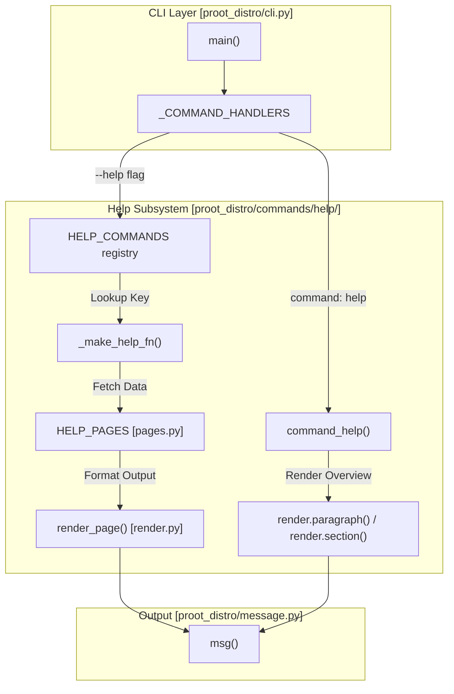
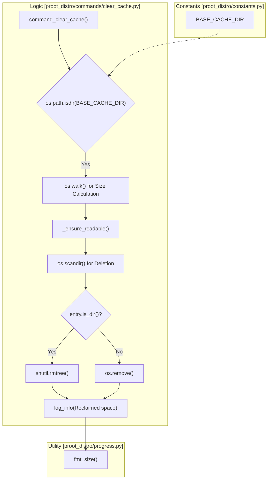

<!-- source: DeepWiki mcp.deepwiki.com · repo termux/proot-distro · page 2.4 Utility Commands · fetched 2026-10-26 -->

# Utility Commands

Relevant source files

The following files were used as context for generating this wiki page:

- [proot_distro/commands/clear_cache.py](proot_distro/commands/clear_cache.py)
- [proot_distro/commands/help/__init__.py](proot_distro/commands/help/__init__.py)
- [proot_distro/commands/help/pages.py](proot_distro/commands/help/pages.py)
- [proot_distro/commands/list.py](proot_distro/commands/list.py)

Utility commands in PRoot-Distro v5.1 provide supporting functionality for managing the environment, including a per-command help system and cache management. Unlike management or access commands, these do not directly manipulate container lifecycles but manage the global state of the tool, including the OCI manifest cache and build cache index.

## The Help System

PRoot-Distro implements a centralized help system where all user-facing documentation is decoupled from command logic. This allows for consistent formatting and ensures that help pages stay in sync with what `argparse` actually accepts on the current host.

### Implementation Architecture

The help system is split into data and rendering logic. The `proot_distro.commands.help.pages` module contains the help content as plain Python data [proot_distro/commands/help/pages.py:21-24](). This data is then consumed by the `proot_distro.commands.help.render` module to produce formatted terminal output.

The CLI dispatcher in `proot_distro/cli.py` uses `HELP_COMMANDS` to map command names to zero-arg renderer functions [proot_distro/commands/help/__init__.py:49]().

### Help Command Data Flow

Sources: [proot_distro/commands/help/__init__.py:21-49](), [proot_distro/commands/help/pages.py:31-33]()

### Help Registry (`HELP_COMMANDS`)
The `HELP_COMMANDS` dictionary is dynamically generated by wrapping entries from `HELP_PAGES` in a closure [proot_distro/commands/help/__init__.py:41-49]().

| Command | Data Source | Features Documented |
| :--- | :--- | :--- |
| **Global Help** | `command_help` | Usage overview, quick start examples, and troubleshooting [proot_distro/commands/help/__init__.py:52-164](). |
| **Build** | `HELP_PAGES["build"]` | Dockerfile parsing, build-args, multi-stage targets, and OCI output [proot_distro/commands/help/pages.py:32-139](). |
| **Push** | `HELP_PAGES["push"]` | Registry authentication and manifest cache interaction [proot_distro/commands/help/pages.py:142-178](). |
| **Clear Cache** | `HELP_PAGES["clear-cache"]` | Removal of layers, manifests, and build cache [proot_distro/commands/help/pages.py:304-323](). |

Sources: [proot_distro/commands/help/__init__.py:41-49](), [proot_distro/commands/help/pages.py:31-330]()

## The Clear-Cache Command

The `clear-cache` command reclaims disk space by deleting downloaded OCI image layers, manifests, and the build cache index stored in the local cache.

### Behavior and Data Flow
The command targets `BASE_CACHE_DIR` [proot_distro/commands/clear_cache.py:47](). It performs a two-pass operation: first calculating the total size of files to be deleted, then removing them.

1.  **Permission Correction**: Before deletion, it calls `_ensure_readable()` to attempt to add `S_IRWXU` permissions to directories and `S_IRUSR|S_IWUSR` to files, ensuring `shutil.rmtree` or `os.remove` do not fail due to restrictive permissions often found in OCI layer archives [proot_distro/commands/clear_cache.py:34-43]().
2.  **Size Calculation**: It walks the cache directory to sum file sizes for the final report [proot_distro/commands/clear_cache.py:54-63]().
3.  **Removal**: It iterates through the directory entries. If `--verbose` is passed, it logs every individual file being removed [proot_distro/commands/clear_cache.py:71-84]().
4.  **Reporting**: Reclaimed space is reported in a human-readable format using `fmt_size()` [proot_distro/commands/clear_cache.py:88]().

### Clear-Cache Logic Diagram

Sources: [proot_distro/commands/clear_cache.py:34-89](), [proot_distro/constants.py:29]()

### Implementation Details

| Component | Code Entity | Description |
| :--- | :--- | :--- |
| **Cache Root** | `BASE_CACHE_DIR` | The base directory for all cached data [proot_distro/constants.py:29](). |
| **Permission Fix** | `_ensure_readable` | Uses `os.chmod` to fix access issues before deletion [proot_distro/commands/clear_cache.py:34-43](). |
| **Size Reporting** | `fmt_size` | Formats the calculated `total` bytes into a human-readable string [proot_distro/commands/clear_cache.py:88](). |
| **Error Handling** | `OSError` | Failures on individual entries are caught and logged but do not abort the overall process [proot_distro/commands/clear_cache.py:85-86](). |

Sources: [proot_distro/commands/clear_cache.py:21-89](), [proot_distro/progress.py:31]()

---

