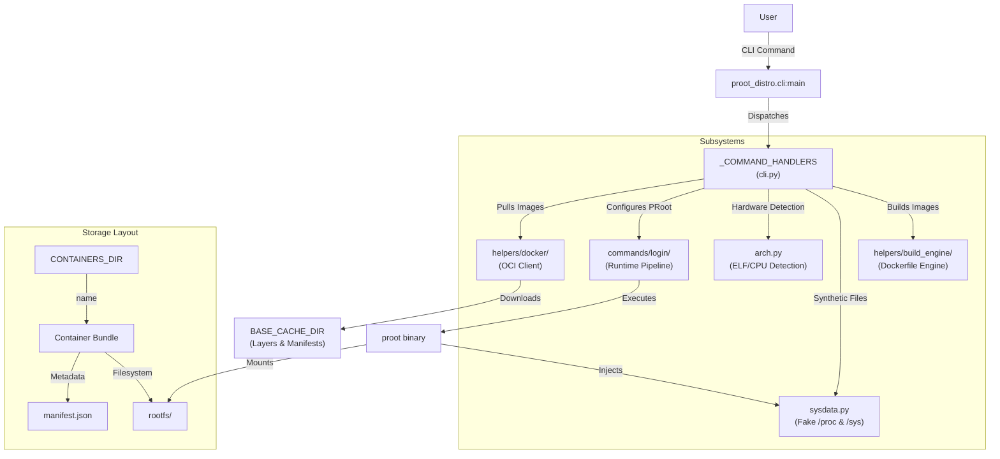
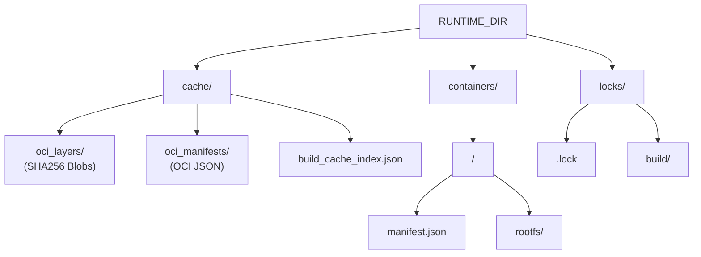

<!-- source: DeepWiki mcp.deepwiki.com · repo termux/proot-distro · page 3 Architecture & Design · fetched 2026-10-26 -->

# Architecture & Design

Relevant source files

The following files were used as context for generating this wiki page:

- [CLAUDE.md](CLAUDE.md)
- [README.md](README.md)
- [proot_distro/cli.py](proot_distro/cli.py)

This document provides a technical overview of the `proot-distro` v5.1 internal architecture and design principles. The v5.x series represents a significant shift from a Bash-based utility to a modular Python 3.9+ architecture. It is designed to be a lightweight, zero-dependency OCI container manager specifically for the Termux environment.

## Core Design Principles

The architecture of `proot-distro` v5.1 is guided by several key principles:

*   **Pure Python / Zero Dependencies**: The codebase relies exclusively on the Python standard library. No third-party packages from PyPI are required at runtime. [CLAUDE.md:12-13](), [CLAUDE.md:20-27]().
*   **OCI-Native Workflow**: Distribution management is centered around OCI (Docker) registries, supporting manifest resolution, layer caching, and content-addressable storage. [README.md:8-11]().
*   **Build Engine**: Includes a pure-Python Dockerfile parser and build engine that allows authoring OCI images on-device without a Docker daemon. [README.md:13-15]().
*   **Rootless by Design**: All operations are performed without Android root privileges, leveraging `proot` for filesystem namespacing and link emulation. [CLAUDE.md:7-11]().
*   **Static Identity**: Container identity is derived solely from the directory name within the storage path; there is no central database or complex configuration registry. [CLAUDE.md:90-95]().

## System Components Diagram

The following diagram illustrates the interaction between the user, the Python subsystems, and the underlying Termux environment.

Sources: [proot_distro/cli.py:60-76](), [proot_distro/constants.py:51-62](), [CLAUDE.md:28-64]()

## Module Layout

The codebase is organized into a core package with specialized sub-packages for commands and helper utilities.

| Module / Package | Role |
|---|---|
| `proot_distro.cli` | Entry point, signal routing, and command dispatching. [proot_distro/cli.py:21-30]() |
| `proot_distro.parser` | `argparse` construction and `ALIAS_TO_CANONICAL` mapping. [proot_distro/parser.py:32-48]() |
| `proot_distro.constants` | Global paths and default environment values. [proot_distro/constants.py:21-35]() |
| `proot_distro.arch` | Logic for detecting host/guest CPU architectures via ELF magic. [proot_distro/arch.py:21-30]() |
| `proot_distro.sysdata` | Generation of synthetic `/proc` and `/sys` entries. [proot_distro/sysdata.py:21-30]() |
| `proot_distro.commands.*` | Subcommand implementations (install, login, build, etc.). [CLAUDE.md:54-57]() |
| `proot_distro.helpers.*` | OCI transport, Dockerfile parsing, and build engine logic. [CLAUDE.md:59-63]() |

Sources: [CLAUDE.md:28-64](), [proot_distro/cli.py:21-30]()

## File System Structure

`proot-distro` v5.1 uses a structured storage layout rooted in `RUNTIME_DIR`.

Sources: [proot_distro/constants.py:45-62](), [CLAUDE.md:65-76](), [CLAUDE.md:152-155]()

## Major Subsystems

The following sections provide a high-level overview of the primary subsystems. Detailed technical documentation for each is available in the child pages.

### CLI & Dispatch Layer
The CLI layer handles the translation of user strings into executable logic. It uses a manual dispatch map (`_COMMAND_HANDLERS`) and alias resolution (`ALIAS_TO_CANONICAL`) to route commands. It also enforces environment constraints, such as preventing nested `proot` sessions via `_refuse_nested_proot`.
For details, see [CLI & Dispatch Layer](#3.1).

### OCI Image & Container Management
The system uses a pure-Python OCI client (`helpers/docker/`) to communicate with registries. It handles multi-layer image pulls, manifest resolution, and layer caching with SHA-256 integrity verification. Containers are stored as bundles containing a `manifest.json` and a `rootfs/` directory.
For details, see [OCI Image & Container Management](#3.2).

### Multi-architecture Support
`proot-distro` detects the host architecture and determines if the guest rootfs requires emulation. It manages the `personality()` syscall for 32-bit compatibility and configures QEMU user-mode emulation (`proot -q`) when architecture mismatches occur.
For details, see [Multi-architecture Support](#3.3).

### Container Runtime & Fake Sysdata
The runtime pipeline in `command_login()` constructs the `proot` execution string. This includes building bind mounts, resolving symlinks, and managing the "Fake Sysdata" subsystem (`sysdata.py`)—a collection of synthetic files that mimic kernel interfaces to satisfy guest software requirements.
For details, see [Container Runtime & Fake Sysdata](#3.4).

### Legacy Migration
To support users upgrading from version 4.x, the system includes a migration path in `commands/login/migrate.py` that moves legacy rootfs directories into the new `containers/` layout and rewrites internal `link2symlink` paths.
For details, see [Legacy Migration](#3.5).

### Build Engine & Image Authoring
A major feature of v5.1 is the `BuildEngine`, which implements a pure-Python Dockerfile parser and execution environment. It supports multi-stage builds, caching, and exporting results as OCI tarballs or local container installs.
For details, see [Build Engine & Image Authoring](#3.6).

Sources: [CLAUDE.md:105-119](), [proot_distro/cli.py:92-114](), [proot_distro/cli.py:60-76]()

---

