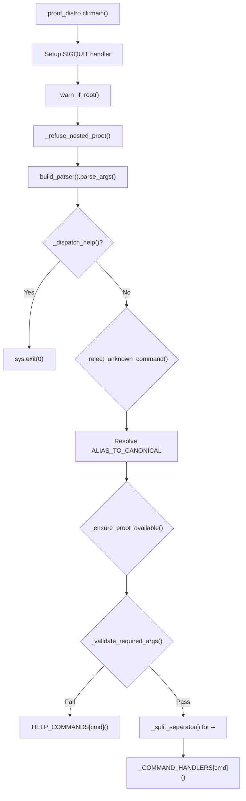
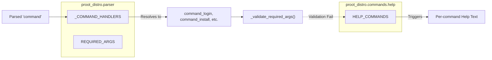

<!-- source: DeepWiki mcp.deepwiki.com · repo termux/proot-distro · page 3.1 CLI & Dispatch Layer · fetched 2026-10-26 -->

# CLI & Dispatch Layer

Relevant source files

The following files were used as context for generating this wiki page:

- [proot_distro/cli.py](proot_distro/cli.py)
- [proot_distro/message.py](proot_distro/message.py)
- [proot_distro/parser.py](proot_distro/parser.py)

The CLI & Dispatch Layer serves as the entry point for `proot-distro` v5.1. It is responsible for parsing user input, resolving command aliases, validating environment sanity (such as checking for `proot` availability), and dispatching execution to the appropriate command handlers.

## Entry Point and Argument Parsing

The primary entry point for the application is `main()` in `proot_distro/cli.py` [[proot_distro/cli.py:240]](). The CLI utilizes a custom `argparse.ArgumentParser` subclass called `_PdArgumentParser` [[proot_distro/parser.py:39-55]]() with a specific configuration: `add_help=False` [[proot_distro/parser.py:141]]().

This design choice is critical for manual help handling. By disabling automatic help, the dispatcher avoids "required argument" errors when a user invokes `-h` or `--help` on a subcommand without providing the positional arguments that would otherwise be mandatory [[proot_distro/cli.py:169-182]]() [[proot_distro/parser.py:21-25]]().

### Dispatch Logic Flow

The `main()` function coordinates the startup sequence, from signal handling to final command execution.

Sources: [proot_distro/cli.py:240-316](), [proot_distro/cli.py:169-182](), [proot_distro/cli.py:116-168](), [proot_distro/parser.py:136-163]()

## Command Alias Resolution

To provide a user-friendly experience, `proot-distro` supports multiple aliases for most commands. These are resolved to a "canonical" command name before being dispatched to the internal handlers.

| Canonical Command | Supported Aliases |
|-------------------|-------------------|
| `help`            | `hel`, `he`, `h` |
| `install`         | `add`, `i`, `in`, `ins` |
| `remove`          | `rm` |
| `login`           | `sh` |
| `list`            | `li`, `ls` |
| `backup`          | `bak`, `bkp` |
| `clear-cache`     | `clear`, `cl` |
| `copy`            | `cp` |

The mapping is defined in the `ALIAS_TO_CANONICAL` dictionary [[proot_distro/parser.py:80-89]]().

Sources: [proot_distro/parser.py:80-89](), [proot_distro/cli.py:60-76]()

## Dispatch Map and Validation

The CLI uses a dispatch table, `_COMMAND_HANDLERS`, to map canonical command strings to their respective implementation functions imported from the `commands` subpackage [[proot_distro/cli.py:60-76]]().

### Manual Argument Validation
Because `argparse` is configured with `add_help=False`, the CLI must manually ensure that required positional arguments are present before the command handler is invoked. This is handled via the `REQUIRED_ARGS` dictionary [[proot_distro/parser.py:59-75]](). The `_validate_required_args` function checks the parsed `Namespace` for these keys; if any are `None`, it triggers the per-command help page and exits [[proot_distro/cli.py:221-238]]().

Sources: [proot_distro/cli.py:60-76](), [proot_distro/parser.py:59-75](), [proot_distro/cli.py:221-238]()

## Environment Sanity Checks

Before executing any command, the CLI performs several critical environment checks:

1.  **Root User Warning**: `_warn_if_root()` issues a prominent warning if the script is run as UID 0, as `proot` is designed for unprivileged use [[proot_distro/cli.py:83-90]]().
2.  **Nested Session Detection**: `_refuse_nested_proot()` inspects `/proc/[pid]/status` to find the `TracerPid`. It then checks if the tracer process name contains "proot". If detected, it refuses to run to prevent filesystem corruption [[proot_distro/cli.py:92-114]]().
3.  **PRoot Availability**: `_ensure_proot_available()` verifies that the `proot` binary is on the `PATH`. In Termux, it offers an interactive prompt to install the package via `pkg install proot` if missing [[proot_distro/cli.py:116-168]](). Note that `build` and `push` commands are exempt from this check unless a `RUN` instruction is encountered [[proot_distro/cli.py:126-127]]().

Sources: [proot_distro/cli.py:83-114](), [proot_distro/cli.py:116-168]()

## The `--` Separator Pattern

For commands that execute binaries inside the container (specifically `login` and `run`), `proot-distro` utilizes the standard `--` separator pattern. This is handled by `_split_separator()` [[proot_distro/cli.py:202-219]]().

- **Before `--`**: Arguments are parsed by `proot-distro`'s CLI (e.g., `--user`, `--bind`).
- **After `--`**: All remaining arguments are captured as a list.
    - For `login`, they are stored in `args.login_cmd` [[proot_distro/cli.py:211]]().
    - For `run`, they are stored in `args.run_args` [[proot_distro/cli.py:213]]().

This allows users to run complex commands like `pd login debian -- apt update && apt upgrade -y` where the `&&` and flags belong to the guest environment and should not be interpreted by the host Python process.

Sources: [proot_distro/cli.py:202-219]()

---

