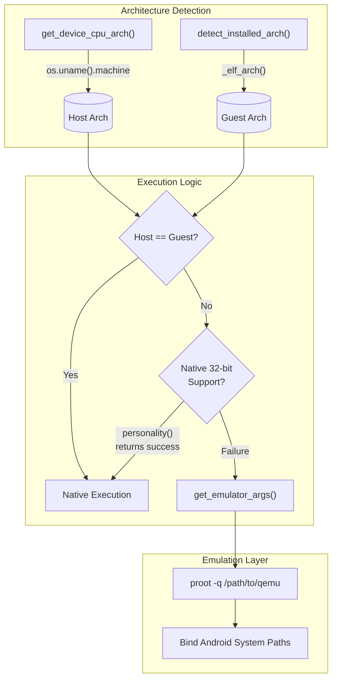
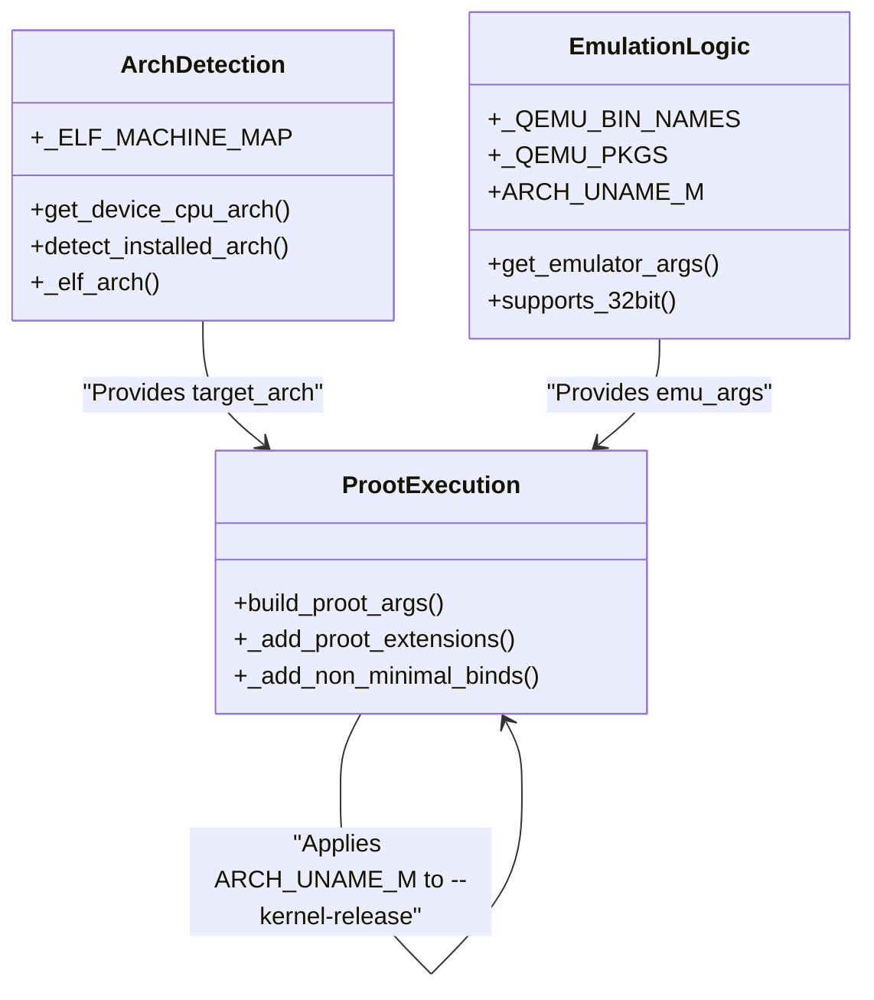

<!-- source: DeepWiki mcp.deepwiki.com · repo termux/proot-distro · page 3.3 Multi-architecture Support · fetched 2026-10-26 -->

# Multi-architecture Support

Relevant source files

The following files were used as context for generating this wiki page:

- [proot_distro/__init__.py](proot_distro/__init__.py)
- [proot_distro/arch.py](proot_distro/arch.py)
- [proot_distro/commands/__init__.py](proot_distro/commands/__init__.py)
- [proot_distro/commands/login/proot_cmd.py](proot_distro/commands/login/proot_cmd.py)
- [proot_distro/helpers/build_engine/run_step.py](proot_distro/helpers/build_engine/run_step.py)
- [proot_distro/sysdata.py](proot_distro/sysdata.py)

This page documents how `proot-distro` handles multiple CPU architectures, enabling users to run Linux distributions compiled for different instruction sets than the host Android device. It covers ELF-based architecture detection, QEMU user-mode emulation, and the technical constraints of cross-architecture containers.

## Architecture Overview

`proot-distro` supports a wide range of architectures by leveraging the host kernel's native capabilities or transparently invoking emulators. Supported architectures include:

- `aarch64` (ARM 64-bit)
- `arm` (ARM 32-bit)
- `i686` (x86 32-bit)
- `x86_64` (x86 64-bit)
- `riscv64` (RISC-V 64-bit)

### System Architecture Flow

The following diagram illustrates how the system determines the architecture of both the host and the container, and decides whether to use native execution or emulation.

Sources: [proot_distro/arch.py:38-47](), [proot_distro/arch.py:104-125](), [proot_distro/arch.py:189-215]()

## Architecture Detection System

`proot-distro` v5.1 detects architecture by inspecting the actual binaries within a container rather than relying on configuration files. This logic is encapsulated in `arch.py` to keep the rest of the codebase arch-agnostic [proot_distro/arch.py:21-25]().

### ELF-based Guest Detection
The function `detect_installed_arch()` scans a container's `rootfs` for common binaries (e.g., `/usr/bin/bash`, `/bin/sh`, `/bin/su`) [proot_distro/arch.py:115-120](). It passes these files to `_elf_arch()`, which parses the ELF header to extract the `e_machine` field [proot_distro/arch.py:90-101]().

The `_ELF_MACHINE_MAP` dictionary maps these machine codes to internal architecture names:

| ELF Machine Code | Architecture Name |
|------------------|-------------------|
| 3 (EM_386)       | `i686`            |
| 40 (EM_ARM)      | `arm`             |
| 62 (EM_X86_64)   | `x86_64`          |
| 183 (EM_AARCH64) | `aarch64`         |
| 243 (EM_RISCV)   | `riscv64`         |

Sources: [proot_distro/arch.py:81-87](), [proot_distro/arch.py:104-125]()

### Host Architecture & 32-bit Support
Host detection uses `os.uname().machine`, collapsing `armv7l` and `armv8l` into a generic `arm` name [proot_distro/arch.py:44-47](). To determine if a 64-bit host (like `aarch64`) can run 32-bit code (like `arm`) natively, the `supports_32bit()` function attempts a `personality(PER_LINUX32)` syscall via `ctypes` [proot_distro/arch.py:67-74](). If the kernel returns -1, the system assumes the CPU lacks AArch32 EL0 support and requires emulation [proot_distro/arch.py:71-72]().

## CPU Architecture Emulation

When architectures differ and native execution is impossible, `proot-distro` uses QEMU user-mode emulation via the `proot -q` flag.

### Emulator Selection and Configuration
The `get_emulator_args()` function constructs the necessary `proot` flags [proot_distro/arch.py:189-215]().

1. **Native Compatibility**: It checks if a 64-bit host can run a 32-bit guest natively (e.g., `arm` on `aarch64` or `i686` on `x86_64`) before resorting to emulation [proot_distro/arch.py:207-210]().
2. **Binary Mapping**: It looks up the emulator path in `_QEMU_BIN_NAMES` (e.g., `qemu-aarch64`, `qemu-arm`, `qemu-i386`) [proot_distro/arch.py:172-178]().
3. **Missing Binary Handling**: If the binary is not found in the PATH, it raises a critical error suggesting the specific Termux package to install from `_QEMU_PKGS` [proot_distro/arch.py:216-224]().

### Cross-Architecture Entity Map
This diagram maps internal code symbols to their roles in the emulation process.

Sources: [proot_distro/arch.py:21-25](), [proot_distro/commands/login/proot_cmd.py:52-64](), [proot_distro/commands/login/proot_cmd.py:125-129]()

## OCI and Docker Integration

When pulling images or building from Dockerfiles, `proot-distro` must map its internal architecture names to OCI/Docker platform strings.

### Architecture Mapping
The `normalize_arch()` function handles conversions from Docker platform strings (e.g., `linux/amd64`) to canonical `proot-distro` names [proot_distro/arch.py:145-157]().

| Internal Arch | Docker Name (`_DOCKER_TO_PROOT`) |
|---------------|----------------------------------|
| `aarch64`     | `arm64`                          |
| `arm`         | `arm/v7` or `arm`                |
| `i686`        | `386`                            |
| `x86_64`      | `amd64`                          |
| `riscv64`     | `riscv64`                        |

Sources: [proot_distro/arch.py:135-142](), [proot_distro/arch.py:145-157]()

## Restrictions and Constraints

### Termux-type Containers
Containers identified as `termux` type (those containing a Termux `PREFIX` layout) have a critical restriction: **Cross-architecture is not supported**. Because these containers are designed to interact closely with the Termux environment, running them under an emulator would lead to library mismatches and path conflicts.

### Emulator Overrides
Users can manually specify an emulator path using the `--emulator` flag. When `emulator_override` is provided to `get_emulator_args()`, it bypasses native-run checks and uses the provided binary directly [proot_distro/arch.py:197-201]().

### Fake Sysdata
To support tools like `htop` or `top` in cross-arch environments where the Android `/proc` might be restricted or return host-specific data, `proot-distro` generates synthetic entries in `containers/<name>/sysdata/` [proot_distro/sysdata.py:21-25](). These are bind-mounted over the container's `/proc` and `/sys` entries [proot_distro/commands/login/proot_cmd.py:178-178]().

Sources: [proot_distro/arch.py:197-201](), [proot_distro/sysdata.py:21-25](), [proot_distro/commands/login/proot_cmd.py:178-178]()

---

