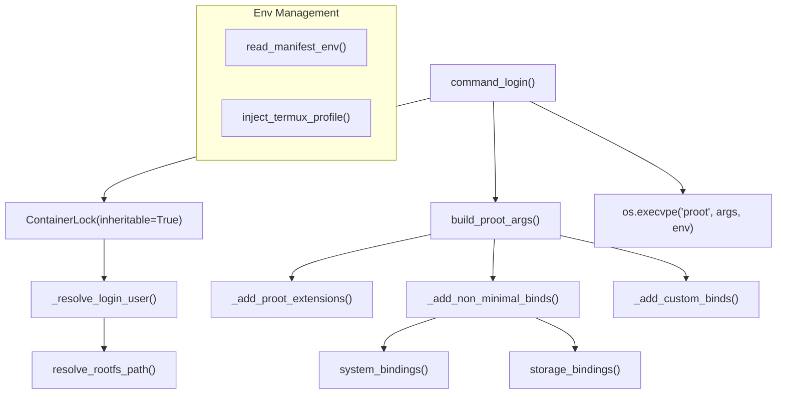
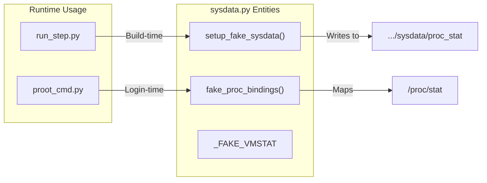

<!-- source: DeepWiki mcp.deepwiki.com · repo termux/proot-distro · page 3.4 Container Runtime & Fake Sysdata · fetched 2026-10-26 -->

# Container Runtime & Fake Sysdata

Relevant source files

The following files were used as context for generating this wiki page:

- [proot_distro/commands/login/__init__.py](proot_distro/commands/login/__init__.py)
- [proot_distro/commands/login/bindings.py](proot_distro/commands/login/bindings.py)
- [proot_distro/commands/login/env.py](proot_distro/commands/login/env.py)
- [proot_distro/commands/login/proot_cmd.py](proot_distro/commands/login/proot_cmd.py)
- [proot_distro/helpers/build_engine/run_step.py](proot_distro/helpers/build_engine/run_step.py)
- [proot_distro/sysdata.py](proot_distro/sysdata.py)

This page documents the execution pipeline of `proot-distro`, focusing on how containers are initialized, the construction of the `proot` command line, the synthetic system data subsystem used to bypass Android restrictions, and the environment variable precedence logic.

## The Execution Pipeline (`command_login`)

The `command_login()` function serves as the primary entry point for starting a container session. It handles environment setup, filesystem resolution, and process execution.

### 1. Initialization and Locking
Before execution, the runtime acquires a shared lock using the `ContainerLock` class [proot_distro/commands/login/__init__.py:82-84](). The lock is initialized with `inheritable=True`, which clears the `O_CLOEXEC` flag on the file descriptor. This ensures the lock persists after the process is replaced by `os.execvpe`, as `proot` will keep the file descriptor open [proot_distro/commands/login/__init__.py:76-81]().

### 2. Path Resolution (`_resolve_rootfs_path`)
The `resolve_rootfs_path()` function translates absolute guest paths (like `/etc/passwd`) into real host paths [proot_distro/commands/login/passwd.py:65](). It handles nested symlinks (up to 40 levels) and re-roots absolute symlink targets to stay within the container's rootfs [proot_distro/commands/login/passwd.py:114-142]().

### 3. Container Type Distinction
The runtime distinguishes between `normal` and `termux` container types by checking for the existence of the Termux `login` binary at the expected `TERMUX_PREFIX` path [proot_distro/commands/login/__init__.py:88-99]().

| Feature | `normal` Container | `termux` Container |
| :--- | :--- | :--- |
| **Link2Symlink** | Enabled by default | Disabled [proot_distro/commands/login/proot_cmd.py:118-119]() |
| **ID Change** | Enabled (`--change-id`) | Disabled [proot_distro/commands/login/proot_cmd.py:78-79]() |
| **Working Dir** | User home or `/` | `TERMUX_HOME` [proot_distro/commands/login/__init__.py:228]() |
| **SysV IPC** | Optional (default ON) | Optional (default ON) [proot_distro/commands/login/proot_cmd.py:121-122]() |

### 4. Bind Mount Construction
The `build_proot_args()` function assembles the complex set of `--bind` arguments [proot_distro/commands/login/proot_cmd.py:52-64]():
*   **System Bindings**: `system_bindings()` maps Android paths like `/system`, `/apex`, and `/vendor` if they are traversable (modes 1, 5, or 7) [proot_distro/commands/login/bindings.py:58-84]().
*   **Storage Bindings**: `storage_bindings()` maps `/sdcard` and `/storage` [proot_distro/commands/login/bindings.py:35-55]().
*   **Fake Sysdata**: Binds synthetic files created by `sysdata.py` over restricted `/proc` entries [proot_distro/commands/login/proot_cmd.py:178]().
*   **Termux Bridges**: For `normal` containers, `TERMUX_PREFIX` is bound to allow access to host binaries [proot_distro/commands/login/proot_cmd.py:151]().

### 5. Environment Variable Precedence
The environment is constructed with the following precedence (later overrides earlier):
1.  **Image Configuration**: `read_manifest_env()` harvests `Env` entries from the container's `manifest.json` [proot_distro/commands/login/env.py:68-77]().
2.  **Blocked Variables**: `IMAGE_ENV_BLOCKED` prevents images from overriding critical host vars like `ANDROID_DATA` or `TERM` [proot_distro/commands/login/env.py:46-52]().
3.  **Termux Profile Injection**: `inject_termux_profile()` writes a snippet to `/etc/profile.d/termux-profile.sh` [proot_distro/commands/login/env.py:80-98](). This ensures that when a login shell sources `/etc/profile`, variables like `PULSE_SERVER` or user-supplied `--env` flags are re-exported and not lost [proot_distro/commands/login/env.py:108-127]().

### Execution Flow Diagram
**Runtime Command Assembly Flow**

Sources: [proot_distro/commands/login/__init__.py:82-85](), [proot_distro/commands/login/__init__.py:102](), [proot_distro/commands/login/proot_cmd.py:52](), [proot_distro/commands/login/env.py:80]().

---

## Fake Sysdata Subsystem (`sysdata.py`)

Android restricts access to many files in `/proc` and `/sys`. The `sysdata.py` module generates synthetic versions of these files to support tools like `htop`.

### Key Functions
*   **`setup_fake_sysdata(rootfs)`**: Writes static content to a `sysdata/` directory sibling to the `rootfs` [proot_distro/sysdata.py:247-252](). It creates files like `stat`, `vmstat`, `uptime`, and `loadavg` [proot_distro/sysdata.py:260-267]().
*   **`fake_proc_bindings(rootfs)`**: Generates the `--bind` strings to map these fake files into the guest `/proc` [proot_distro/sysdata.py:280-297]().

### Synthetic Data Components
The following constants provide the raw text for the fake files:
*   `_FAKE_STAT`: Synthetic CPU statistics [proot_distro/sysdata.py:38-55]().
*   `_FAKE_VMSTAT`: Synthetic virtual memory statistics [proot_distro/sysdata.py:59-238]().
*   `_FAKE_LOADAVG`: Static load average string [proot_distro/sysdata.py:34]().

### Sysdata Mapping Diagram
**Sysdata Integration**

Sources: [proot_distro/sysdata.py:21-25](), [proot_distro/commands/login/proot_cmd.py:178](), [proot_distro/helpers/build_engine/run_step.py:184-187]().

---

## Link2Symlink Management

`proot` uses `link2symlink` to emulate hard links on Android's `/data` partition.

*   **Activation**: Enabled for non-termux containers unless `--no-link2symlink` is passed [proot_distro/commands/login/proot_cmd.py:118-119]().
*   **Environment**: The runtime sets the `PROOT_L2S_DIR` environment variable to point to a directory within the container's storage area [proot_distro/commands/login/__init__.py:313]().
*   **Migration**: When a rootfs is moved, `migrate_legacy_rootfs()` performs a recursive rewrite of the symlink targets inside the `.l2s` directory to ensure they point to the new absolute path [proot_distro/commands/login/migrate.py:65-78]().

Sources: [proot_distro/commands/login/proot_cmd.py:118-119](), [proot_distro/commands/login/migrate.py:21-29]().

---

