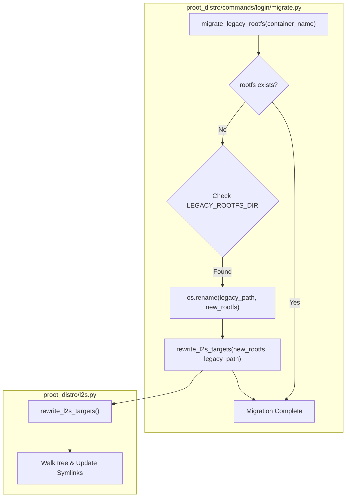
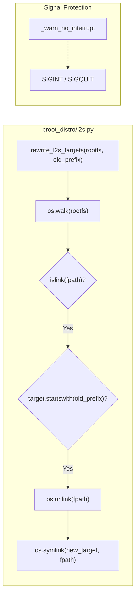

<!-- source: DeepWiki mcp.deepwiki.com · repo termux/proot-distro · page 3.5 Legacy Migration · fetched 2026-10-26 -->

# Legacy Migration

Relevant source files

The following files were used as context for generating this wiki page:

- [proot_distro/commands/login/migrate.py](proot_distro/commands/login/migrate.py)
- [proot_distro/constants.py](proot_distro/constants.py)
- [proot_distro/helpers/build_cache.py](proot_distro/helpers/build_cache.py)
- [proot_distro/helpers/layer_diff.py](proot_distro/helpers/layer_diff.py)
- [proot_distro/l2s.py](proot_distro/l2s.py)

Proot-distro v5.1 continues the architectural shift from the legacy 4.x shell-based releases to a structured layout that supports OCI-native metadata. To ensure a seamless transition for users, the system implements automated migration logic, absolute path rewriting for symlinks, and compatibility routing for legacy backup archives.

## Overview of Storage Layout Changes

The migration path addresses the transition from the legacy 4.x layout to the new v5.1 layout:

| Feature | Legacy Layout (4.x) | New Layout (5.1) |
| :--- | :--- | :--- |
| **Primary Directory** | `installed-rootfs/<name>` | `containers/<name>/rootfs/` |
| **Metadata** | None (Shell-based) | `containers/<name>/manifest.json` |
| **L2S Directory** | `installed-rootfs/<name>/.l2s` | `containers/<name>/rootfs/.l2s` |

The migration logic is primarily triggered during the first `login` or `run` command targeting a legacy container.

### Data Flow: Migration Trigger
The following diagram illustrates how the migration logic detects and moves legacy data before executing the container.

**Migration Execution Flow**

Sources: [proot_distro/commands/login/migrate.py:36-57](), [proot_distro/l2s.py:90-101]()

## Implementation Details

### The Migration Function
The `migrate_legacy_rootfs()` function handles the physical relocation of files on the host filesystem.

1.  **Path Resolution**: It checks `LEGACY_ROOTFS_DIR` (defined as `installed-rootfs` under the runtime directory) for the existence of the container [proot_distro/constants.py:92-92](), [proot_distro/commands/login/migrate.py:38-40]().
2.  **Relocation**: It creates the new container directory structure and uses `os.rename()` to move the entire rootfs directory to its new home under `containers/<name>/rootfs` [proot_distro/commands/login/migrate.py:49-50]().
3.  **Link2Symlink (L2S) Cleanup**: PRoot's `link2symlink` extension emulates hard links by replacing the original path with a symlink to an intermediate file. These symlinks often contain absolute host paths. Since the rootfs has moved, these paths become invalid. The migration calls `rewrite_l2s_targets()` to fix these pointers [proot_distro/commands/login/migrate.py:55-55]().

### Link2Symlink Path Rewriting
When a container is moved, the symlinks created by the `--link2symlink` extension must be updated because they point to the absolute path of the old rootfs location. The `proot_distro.l2s` module handles this by walking the entire rootfs tree [proot_distro/l2s.py:90-112]().

**Code Entity Space: L2S Symlink Resolution**

To prevent filesystem corruption during this walk, `rewrite_l2s_targets` intercepts `SIGINT` and `SIGQUIT`. If a user attempts to interrupt the process (e.g., via Ctrl-C), a warning is logged, and the operation continues to ensure no dangling symlinks are left behind [proot_distro/l2s.py:105-128]().

Sources: [proot_distro/l2s.py:21-32](), [proot_distro/l2s.py:90-128]()

## Snapshot and Build Integration

The migration architecture also influences how the build engine and snapshot systems handle legacy files. The `.l2s/` directory is treated as internal backing store and is excluded from OCI layer snapshots to ensure that host-specific hard-link emulations do not leak into portable images [proot_distro/helpers/layer_diff.py:101-103]().

When generating layers, the system uses `resolve_l2s_target()` to identify symlinks that are actually L2S intermediate files, allowing the build engine to capture the actual file content instead of a broken symlink [proot_distro/helpers/layer_diff.py:104-105](), [proot_distro/l2s.py:49-72]().

## Summary of Constants
The migration subsystem relies on specific path constants defined in `proot_distro/constants.py`.

*   `RUNTIME_DIR`: The base path for all proot-distro data, determined by whether the environment is Termux or a regular Linux host [proot_distro/constants.py:75-86]().
*   `CONTAINERS_DIR`: The new storage root for container directories [proot_distro/constants.py:89-89]().
*   `LEGACY_ROOTFS_DIR`: The old v4.x storage root (`installed-rootfs`), maintained only for migration [proot_distro/constants.py:92-92]().
*   `BASE_CACHE_DIR`: Location where build artifacts like `build_cache_index.json` are stored [proot_distro/helpers/build_cache.py:37-40]().

Sources: [proot_distro/constants.py:75-92](), [proot_distro/helpers/build_cache.py:37-40]()

---

