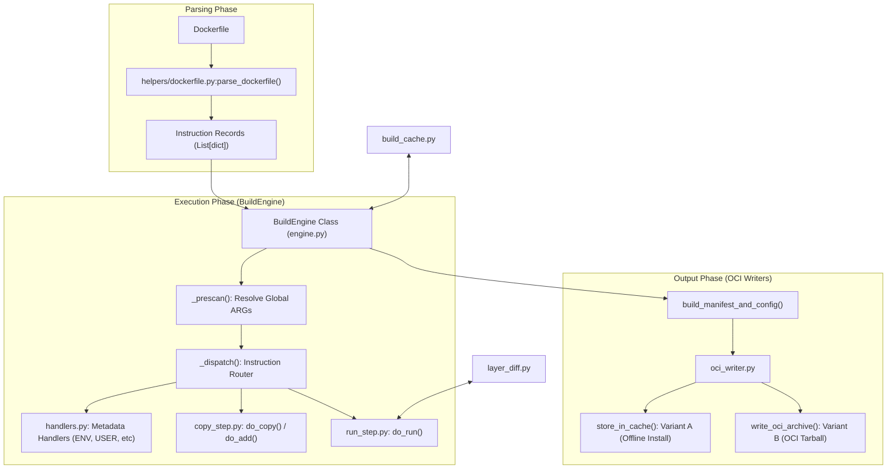

<!-- source: DeepWiki mcp.deepwiki.com · repo termux/proot-distro · page 3.6 Build Engine & Image Authoring · fetched 2026-10-26 -->

# Build Engine & Image Authoring

Relevant source files

The following files were used as context for generating this wiki page:

- [proot_distro/commands/build.py](proot_distro/commands/build.py)
- [proot_distro/constants.py](proot_distro/constants.py)
- [proot_distro/helpers/build_cache.py](proot_distro/helpers/build_cache.py)
- [proot_distro/helpers/build_engine/__init__.py](proot_distro/helpers/build_engine/__init__.py)
- [proot_distro/helpers/build_engine/copy_step.py](proot_distro/helpers/build_engine/copy_step.py)
- [proot_distro/helpers/build_engine/engine.py](proot_distro/helpers/build_engine/engine.py)
- [proot_distro/helpers/build_engine/handlers.py](proot_distro/helpers/build_engine/handlers.py)
- [proot_distro/helpers/build_engine/parsing.py](proot_distro/helpers/build_engine/parsing.py)
- [proot_distro/helpers/build_engine/stage.py](proot_distro/helpers/build_engine/stage.py)
- [proot_distro/helpers/dockerfile.py](proot_distro/helpers/dockerfile.py)
- [proot_distro/helpers/layer_diff.py](proot_distro/helpers/layer_diff.py)
- [proot_distro/helpers/oci_writer.py](proot_distro/helpers/oci_writer.py)
- [proot_distro/l2s.py](proot_distro/l2s.py)

The **Build Engine** is a pure-Python, stateful interpreter designed to execute Dockerfile instructions and produce OCI-compliant images. Unlike standard Docker which requires a daemon, `proot-distro build` orchestrates the entire pipeline—from parsing and variable expansion to PRoot-based execution and layer diffing—within a single process.

### Architecture Overview

The build process follows a linear pipeline where each instruction in a Dockerfile is translated into a mutation of the container's rootfs or its OCI configuration metadata.

#### Data Flow and Code Entities
The following diagram maps the high-level build stages to the specific code entities responsible for them.

**Build Pipeline Data Flow**

**Sources:** `proot_distro/commands/build.py:21-27`(), `proot_distro/helpers/build_engine/engine.py:21-27`(), `proot_distro/helpers/oci_writer.py:21-36`()

---

### 1. Dockerfile Parsing
The parser in `proot_distro/helpers/dockerfile.py` is a pure-Python implementation that handles the complexities of the Dockerfile format without external dependencies.

*   **Parser Directives:** It recognizes leading `# key=value` comments (e.g., `# escape=\``) to modify lexer behavior [proot_distro/helpers/dockerfile.py:104-134]().
*   **Continuations & Here-docs:** Handles backslash line continuations and multi-line Here-docs for `RUN`, `COPY`, and `ADD` instructions [proot_distro/helpers/dockerfile.py:152-193]().
*   **Instruction Records:** Produces a dictionary for each instruction containing the name, flags (e.g., `--from`), the raw value, and a boolean `exec_form` indicating if it was parsed as a JSON array [proot_distro/helpers/dockerfile.py:60-75]().

**Sources:** `proot_distro/helpers/dockerfile.py:21-27`(), `proot_distro/helpers/dockerfile.py:60-75`()

---

### 2. The Build Engine
The `BuildEngine` class in `proot_distro/helpers/build_engine/engine.py` manages the state of the build, including the global `ARG` scope, named stages for multi-stage builds, and the current `Stage` context [proot_distro/helpers/build_engine/engine.py:54-62]().

#### Instruction Dispatching
The engine iterates through instructions and routes them via a dispatch table [proot_distro/helpers/build_engine/handlers.py:24-26]():
*   **Metadata Handlers:** Instructions like `ENV`, `LABEL`, `USER`, and `WORKDIR` mutate the `image_config` dict within the current `Stage` [proot_distro/helpers/build_engine/handlers.py:21-22]().
*   **COPY / ADD:** Handled by `copy_step.py`. It resolves sources from the build context, other stages, or URLs (for `ADD`), materializes them into the rootfs, and generates a new layer [proot_distro/helpers/build_engine/copy_step.py:21-25]().
*   **RUN:** Handled by `run_step.py`. This is the only instruction that requires a PRoot environment to execute commands within the temporary rootfs [proot_distro/helpers/build_engine/__init__.py:31-32]().

**Sources:** `proot_distro/helpers/build_engine/engine.py:21-27`(), `proot_distro/helpers/build_engine/handlers.py:21-26`()

---

### 3. Snapshot and Layer Generation
To maintain OCI compatibility, every instruction that modifies the filesystem must produce a discrete layer. This is handled by `proot_distro/helpers/layer_diff.py`.

#### The Diffing Algorithm
1.  **Snapshot:** Before an instruction runs, the engine records the state of the rootfs. A fingerprint is generated for every file consisting of `(size, mtime_ns, mode, crc32)` [proot_distro/helpers/layer_diff.py:84-90]().
2.  **CRC32 Tie-breaker:** While `size` and `mtime` catch most changes, a streaming `zlib.crc32` is used to detect sub-second rewrites or `touch -r` modifications [proot_distro/helpers/layer_diff.py:97-100]().
3.  **Whiteouts:** Deletions are captured using OCI-standard `.wh.` prefix files [proot_distro/helpers/layer_diff.py:161-176]().
4.  **Streaming Writer:** The `LayerWriter` streams the tar payload through a 4-stage pipeline in a single pass to compute the `diff_id` (uncompressed SHA256) and the `digest` (compressed SHA256) simultaneously [proot_distro/helpers/layer_diff.py:28-37]().

**Sources:** `proot_distro/helpers/layer_diff.py:21-37`(), `proot_distro/helpers/layer_diff.py:84-106`()

---

### 4. Build Cache
The build cache prevents redundant execution by storing results of previous instructions.

*   **Recipe Hash:** For every instruction, a hash is computed based on the `parent_layer_digest`, the instruction name, flags, value, here-docs, and "extra inputs" (like file digests for `COPY`) [proot_distro/helpers/build_cache.py:141-148]().
*   **Index:** A JSON index (`build_cache_index.json`) maps these recipe hashes to layer digests and image configuration patches [proot_distro/helpers/build_cache.py:21-27]().
*   **Concurrency:** The engine uses `fcntl.flock` on a lock file to ensure atomic read-modify-write cycles when multiple builds share the same cache [proot_distro/helpers/build_cache.py:44-54]().

**Sources:** `proot_distro/helpers/build_cache.py:21-27`(), `proot_distro/helpers/build_cache.py:141-167`()

---

### 5. OCI Output Writers
Once the `BuildEngine` completes, `proot_distro/helpers/oci_writer.py` assembles the final artifacts.

| Output Variant | Function | Destination | Purpose |
| :--- | :--- | :--- | :--- |
| **Variant A** | `store_in_cache()` | `MANIFEST_CACHE_DIR` | Populates the local download cache so `proot-distro install <tag>` can run offline immediately after a build [proot_distro/helpers/oci_writer.py:24-29](). |
| **Variant B** | `write_oci_archive()` | User-defined path (`-o`) | Produces a standard OCI image-layout tarball compatible with `docker load` and `proot-distro install <path>` [proot_distro/helpers/oci_writer.py:31-36](). |

**Sources:** `proot_distro/helpers/oci_writer.py:21-36`(), `proot_distro/helpers/oci_writer.py:113-122](), `proot_distro/helpers/oci_writer.py:162-173]()

---

### 6. PRoot Integration & Link2Symlink
During `RUN` steps, the engine must handle PRoot's `link2symlink` extension, which emulates hard links by creating symlinks to a backing store in `<rootfs>/.l2s/`.

*   **Resolution:** The `layer_diff.py` module uses `proot_distro.l2s:resolve_l2s_target` to follow these internal symlinks and capture the actual file content in the OCI layer, ensuring the resulting image is portable to non-PRoot environments [proot_distro/l2s.py:49-72]().
*   **Exclusion:** The `.l2s/` directory itself is always excluded from snapshots and layers [proot_distro/helpers/layer_diff.py:101-106]().

**Sources:** `proot_distro/helpers/layer_diff.py:101-106`(), `proot_distro/l2s.py:21-32](), `proot_distro/l2s.py:49-72]()

---

