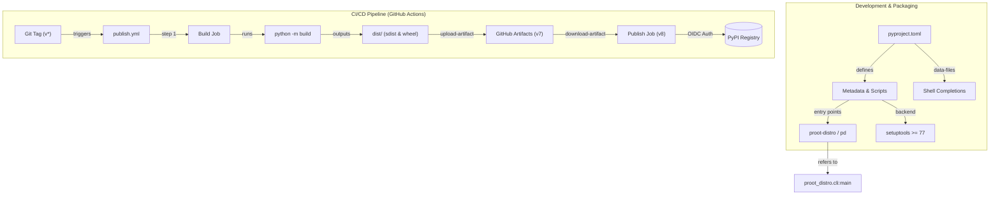
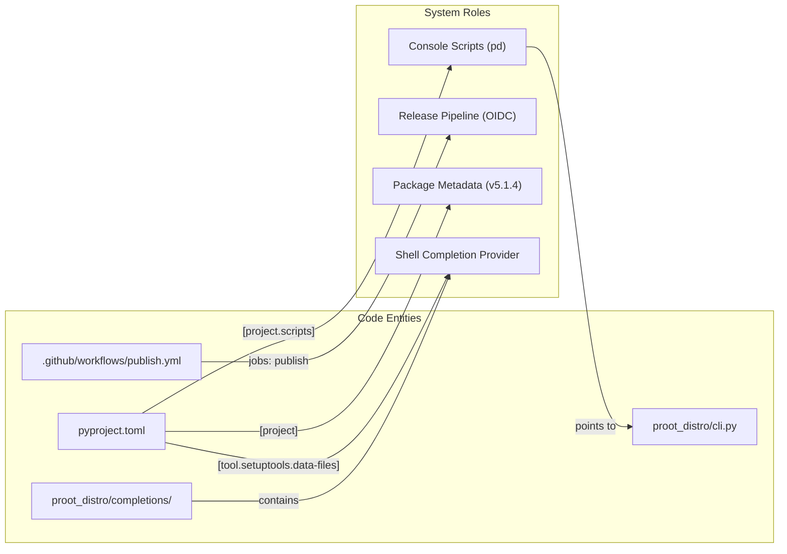

<!-- source: DeepWiki mcp.deepwiki.com · repo termux/proot-distro · page 4 Build & Release · fetched 2026-10-26 -->

# Build & Release

Relevant source files

The following files were used as context for generating this wiki page:

- [.github/workflows/publish.yml](.github/workflows/publish.yml)
- [pyproject.toml](pyproject.toml)
- [screenshot.png](screenshot.png)

With the transition to v5.1, `proot-distro` has solidified its move from a shell-based distribution system to a modern Python packaging and release pipeline. The build system focuses on producing a Python package (Wheel and Source Distribution) and publishing it to PyPI using secure, automated workflows, while also managing shell completion assets.

## Overview

The `proot-distro` build and release architecture is centered around standard Python tooling and GitHub Actions. v5.1 leverages `setuptools` for packaging and OIDC-based "Trusted Publishing" for secure delivery to the Python Package Index (PyPI).

Sources: [pyproject.toml:1-32](), [.github/workflows/publish.yml:1-52]()

## Python Packaging

The core of the build system is the `pyproject.toml` file. It defines the project as a pure Python package with zero third-party dependencies, ensuring maximum compatibility within the Termux environment.

*   **Build Backend**: Uses `setuptools.build_meta` with a requirement for `setuptools>=77` [pyproject.toml:1-3]().
*   **Requirements**: Requires Python >= 3.9 [pyproject.toml:10-10]().
*   **Entry Points**: Defines two console scripts, `proot-distro` and the shorthand `pd`, both mapping to `proot_distro.cli:main` [pyproject.toml:19-21]().
*   **Asset Management**: Includes logic for installing shell completions for Bash, Zsh, and Fish into standard system paths [pyproject.toml:29-32]().

For details on version management via `importlib.metadata` and local installation from source, see [Python Packaging](#4.1).

Sources: [pyproject.toml:1-32]()

## Automated Release Pipeline

Release automation is handled by the `Publish to PyPI` workflow. This pipeline ensures that every tagged version (e.g., `v5.1.4`) is built in a clean environment and delivered securely to users.

### Release Workflow Logic

| Stage | Action | Entity/Tool |
|:---|:---|:---|
| **Trigger** | Push of a tag starting with `v*` | GitHub Actions [publish.yml:3-6]() |
| **Build** | Generate `.tar.gz` (sdist) and `.whl` (wheel) | `python -m build` [publish.yml:21-25]() |
| **Handover** | Transfer build files between jobs | `actions/upload-artifact@v7` and `download-artifact@v8` [publish.yml:28, 45]() |
| **Publish** | Upload to PyPI via OIDC | `pypa/gh-action-pypi-publish` [publish.yml:50-51]() |

### Security via OIDC
The workflow uses **Trusted Publishing**. Instead of storing sensitive API tokens in GitHub Secrets, the `publish` job requests a short-lived identity token from GitHub's OIDC provider by setting `permissions: id-token: write` [publish.yml:40-41](). This identity is verified by PyPI based on the repository and environment [publish.yml:37-39]().

For details on the CI/CD configuration and artifact lifecycle, see [GitHub Actions & PyPI Release](#4.2).

Sources: [.github/workflows/publish.yml:1-52]()

## Code-to-System Mapping

The following diagram maps the high-level release concepts to the specific files and configurations that implement them in the `proot-distro` repository.

Sources: [pyproject.toml:5-32](), [.github/workflows/publish.yml:33-52]()

---

