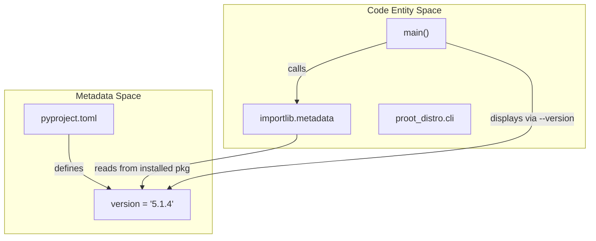
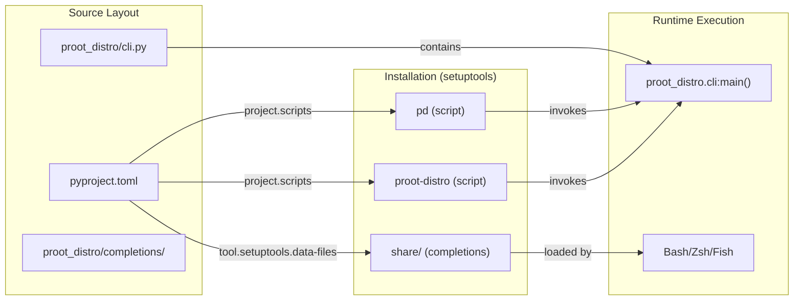

<!-- source: DeepWiki mcp.deepwiki.com · repo termux/proot-distro · page 4.1 Python Packaging · fetched 2026-10-26 -->

# Python Packaging

<details>
<summary>Relevant source files</summary>

The following files were used as context for generating this wiki page:

- [proot_distro/completions/_proot-distro](proot_distro/completions/_proot-distro)
- [proot_distro/completions/proot-distro.bash](proot_distro/completions/proot-distro.bash)
- [proot_distro/completions/proot-distro.fish](proot_distro/completions/proot-distro.fish)
- [pyproject.toml](pyproject.toml)
- [screenshot.png](screenshot.png)

</details>


## Purpose and Scope

This document details the Python packaging configuration for `proot-distro` v5.1. The project utilizes a modern Python packaging workflow centered around a `pyproject.toml` configuration. Key features include a strict zero third-party dependency policy, automated entry point generation for the CLI, and the inclusion of shell completion scripts for Bash, Zsh, and Fish.

## Packaging Configuration

The project uses `setuptools` as the build backend. The configuration is centralized in `pyproject.toml`, which defines metadata, entry points, and environment requirements.

### Metadata and Requirements
- **Build Backend**: Uses `setuptools.build_meta` [pyproject.toml:1-3]().
- **Python Version**: Requires `Python >= 3.9` [pyproject.toml:10-10]().
- **Dependencies**: The `dependencies` list is explicitly empty [pyproject.toml:12-12](). The project maintains a strict policy of using only the Python Standard Library to ensure maximum compatibility and zero overhead in the Termux environment.
- **License**: Licensed under `GPL-3.0-only` [pyproject.toml:11-11]().

### Entry Points
The packaging system automatically creates two executable wrappers in the user's path that point to the same internal function:
1. `proot-distro`: The canonical command name [pyproject.toml:20-20]().
2. `pd`: A shorthand alias for quicker terminal usage [pyproject.toml:21-21]().

Both scripts call the `main` function located in the `proot_distro.cli` module [pyproject.toml:20-21]().

Sources: [pyproject.toml:1-25]()

## Version Management

`proot-distro` manages its version string within `pyproject.toml` [pyproject.toml:7-7](). To avoid hardcoding the version in multiple places, the codebase is designed to retrieve this metadata at runtime.

### Implementation Logic



When a user executes `proot-distro --version`, the system dynamically resolves the version using `importlib.metadata`. This ensures that the version reported by the tool always matches the version defined in the package metadata.

Sources: [pyproject.toml:7-7]()

## Data Flow: From Source to Execution

The following diagram illustrates how the Python packaging configuration translates into executable commands and assets within the environment.

### Packaging to CLI Mapping



Sources: [pyproject.toml:19-21](), [pyproject.toml:29-32]()

## Shell Completion Installation

The package includes completion scripts for three major shells. These are defined as `data-files` in `pyproject.toml` to ensure they are placed in standard system locations during installation [pyproject.toml:29-32]().

| Shell | Source Path | Installation Target |
| :--- | :--- | :--- |
| **Bash** | `proot_distro/completions/proot-distro.bash` | `share/bash-completion/completions` |
| **Zsh** | `proot_distro/completions/_proot-distro` | `share/zsh/site-functions` |
| **Fish** | `proot_distro/completions/proot-distro.fish` | `share/fish/vendor_completions.d` |

The completion scripts mirror the logic used in the Python core, such as the `_proot_distro_is_termux` helper function which implements the same scoring logic as the internal `constants.py` [proot_distro/completions/proot-distro.bash:26-33](), [proot_distro/completions/_proot-distro:36-43](), [proot_distro/completions/proot-distro.fish:39-57]().

Sources: [pyproject.toml:29-32](), [proot_distro/completions/_proot-distro:1-10]()

## Building and Installing from Source

While `proot-distro` is typically distributed via `pkg install proot-distro` in Termux, it can be built and installed using standard Python tooling.

### Build Process
To create a distributable wheel or source distribution:
1. Ensure `setuptools >= 77` is installed [pyproject.toml:2-2]().
2. Run the build frontend:
   ```bash
   python3 -m build
   ```

### Installation
For local development, an editable install is recommended:
```bash
pip3 install -e .
```
This links the source directory to the Python site-packages, allowing changes in the `proot_distro/` directory to take effect immediately without re-installation.

### Manual Completion Installation
If not using a package manager that handles `data-files`, completions can be installed manually:
- **Bash**: `cp proot_distro/completions/proot-distro.bash ~/.local/share/bash-completion/completions/proot-distro` [proot_distro/completions/proot-distro.bash:6-7]().
- **Zsh**: `cp proot_distro/completions/_proot-distro ~/.local/share/zsh/site-functions/_proot-distro` [proot_distro/completions/_proot-distro:8-9]().
- **Fish**: `cp proot_distro/completions/proot-distro.fish ~/.config/fish/completions/proot-distro.fish` [proot_distro/completions/proot-distro.fish:4-5]().

Sources: [pyproject.toml:1-3](), [proot_distro/completions/proot-distro.bash:3-8]()

---

