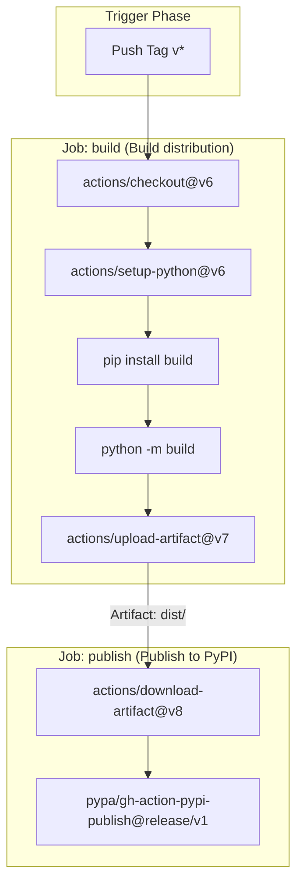
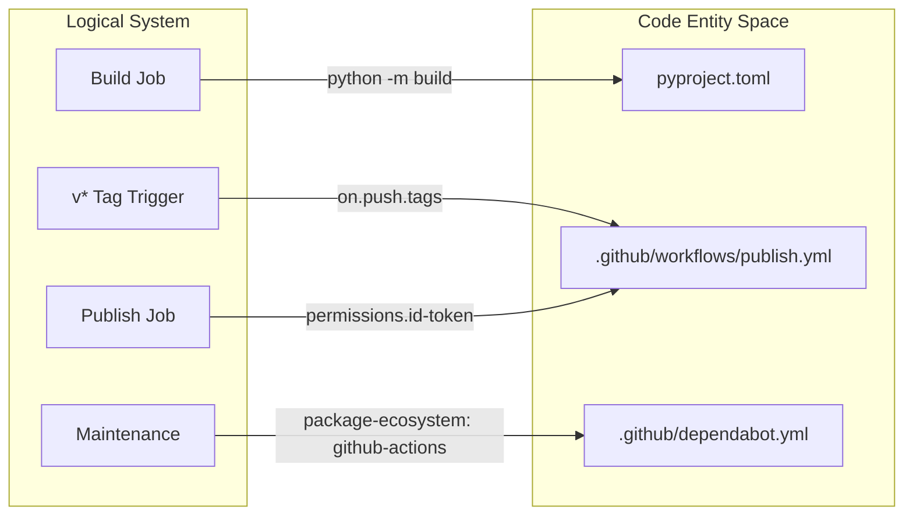
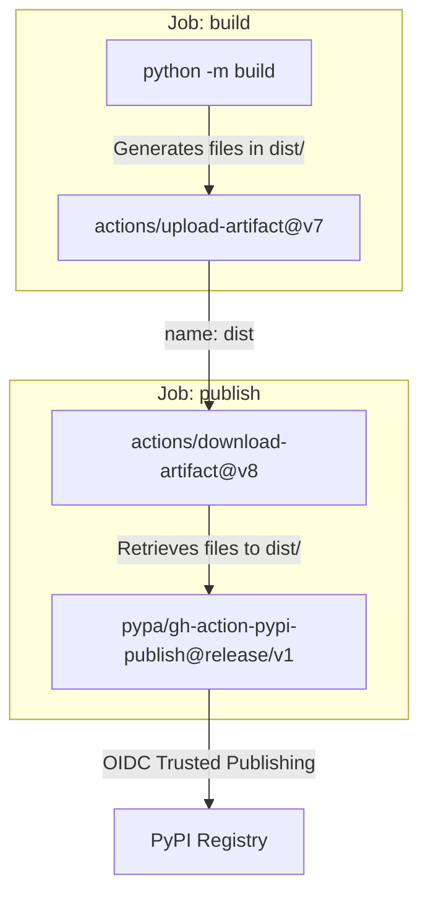

<!-- source: DeepWiki mcp.deepwiki.com · repo termux/proot-distro · page 4.2 GitHub Actions & PyPI Release · fetched 2026-10-26 -->

# GitHub Actions & PyPI Release

Relevant source files

The following files were used as context for generating this wiki page:

- [.github/ISSUE_TEMPLATE/03-question.yml](.github/ISSUE_TEMPLATE/03-question.yml)
- [.github/dependabot.yml](.github/dependabot.yml)
- [.github/workflows/publish.yml](.github/workflows/publish.yml)

This document describes the automated release pipeline for `proot-distro` v5.1. With the transition to a Python-based architecture, the project utilizes GitHub Actions to automate the building of Python distributions (sdist and wheels) and their publication to the Python Package Index (PyPI).

## Pipeline Overview

The release process is a two-stage Directed Acyclic Graph (DAG) consisting of a **Build** stage and a **Publish** stage. The pipeline is designed to be secure, utilizing OpenID Connect (OIDC) for Trusted Publishing, which eliminates the need for long-lived static API tokens.

### Release Workflow DAG

**Sources:** [.github/workflows/publish.yml:1-52]()

---

## Build Stage Implementation

The `build` job runs on `ubuntu-latest` and is responsible for generating the distribution archives.

### Build Steps
1.  **Environment Setup**: Uses `actions/setup-python@v6` to initialize a Python 3.x environment [[.github/workflows/publish.yml:16-19]]().
2.  **Tooling**: Installs the standard PEP 517 `build` frontend via `pip` [[.github/workflows/publish.yml:21-22]]().
3.  **Compilation**: Executes `python -m build` to generate the Source Distribution (`.tar.gz`) and the Built Distribution (`.whl`) based on the project's `pyproject.toml` configuration [[.github/workflows/publish.yml:24-25]]().
4.  **Artifact Handover**: Uses `actions/upload-artifact@v7` to store the contents of the `dist/` directory. This allows the subsequent `publish` job to access the binaries without re-running the build [[.github/workflows/publish.yml:27-31]]().

**Sources:** [.github/workflows/publish.yml:9-32]()

---

## Publish Stage & OIDC Security

The `publish` job is gated by the successful completion of the `build` job via the `needs: build` declaration [[.github/workflows/publish.yml:35]]().

### Trusted Publishing (OIDC)
Instead of storing a `PYPI_API_TOKEN` in GitHub Secrets, `proot-distro` uses **OIDC Trusted Publishing**. 
- The job requests a short-lived identity token from GitHub's identity provider by setting `permissions: id-token: write` [[.github/workflows/publish.yml:40-41]]().
- The job is associated with a specific GitHub Environment named `pypi` [[.github/workflows/publish.yml:37-38]]().
- PyPI verifies the token's claims (repository, workflow, and environment) before accepting the upload.

### Execution Flow
1.  **Download**: `actions/download-artifact@v8` retrieves the `dist/` folder uploaded in the previous stage [[.github/workflows/publish.yml:44-48]]().
2.  **Upload**: The `pypa/gh-action-pypi-publish` action transmits the artifacts to PyPI [[.github/workflows/publish.yml:50-51]]().

**Sources:** [.github/workflows/publish.yml:33-52]()

---

## Automation Maintenance (Dependabot)

To ensure the security and reliability of the CI/CD pipeline, `proot-distro` uses Dependabot to monitor and update GitHub Action versions.

### Configuration Details
Dependabot is configured to check for updates to the actions used in `.github/workflows/` on a weekly interval. This ensures that components like `actions/checkout` or `actions/setup-python` are kept at their latest stable versions (e.g., upgrading from `v5` to `v6`).

| Parameter | Value | Description |
|-----------|-------|-------------|
| `package-ecosystem` | `github-actions` | Monitors GitHub Action dependencies [[.github/dependabot.yml:3]]() |
| `directory` | `/` | Scans the root for `.github/workflows` [[.github/dependabot.yml:4]]() |
| `schedule.interval` | `weekly` | Frequency of update checks [[.github/dependabot.yml:5-6]]() |

**Sources:** [.github/dependabot.yml:1-7]()

---

## Trigger Mechanics

The pipeline is strictly controlled to prevent accidental or unauthorized releases.

### Tag-Based Triggering
The workflow only executes when a git tag following the `v*` pattern (e.g., `v5.1.0`) is pushed to the repository [[.github/workflows/publish.yml:3-6]]().

### Release Sequence
1.  Developer updates versioning in the codebase.
2.  Developer creates a signed tag: `git tag -s v5.x.x -m "Release v5.x.x"`.
3.  Developer pushes the tag: `git push origin v5.x.x`.
4.  GitHub Actions detects the tag and initiates the `Publish to PyPI` workflow.

**Sources:** [.github/workflows/publish.yml:3-6]()

---

## System to Code Entity Mapping

The following diagrams bridge the natural language concepts of the release pipeline to the specific code entities and GitHub Action references used in the implementation.

### Release Pipeline Entity Mapping
This diagram maps the logical release steps to the specific GitHub Actions and configuration keys.

**Sources:** [.github/workflows/publish.yml:3-41](), [.github/dependabot.yml:1-7]()

### Data Flow and Artifact Handover
This diagram tracks the movement of data (distribution artifacts) between the GitHub Action jobs.

**Sources:** [.github/workflows/publish.yml:24-51]()

---

