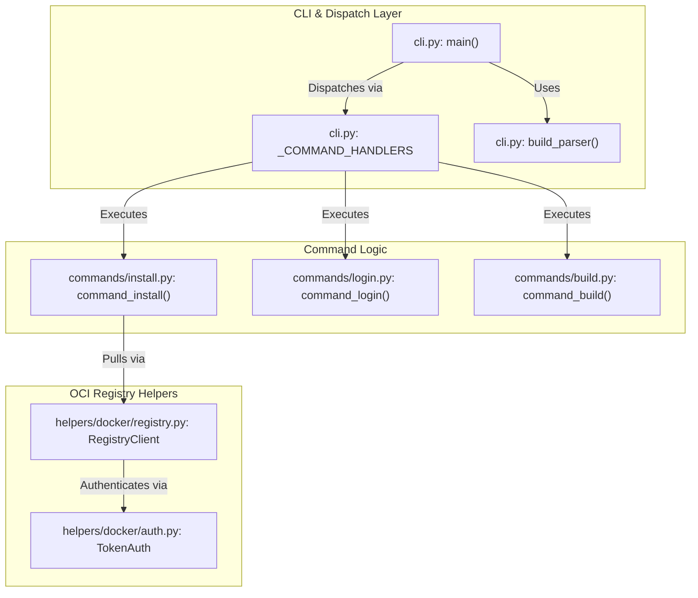
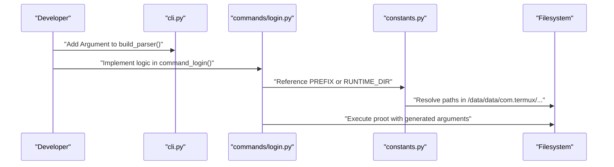

<!-- source: DeepWiki mcp.deepwiki.com · repo termux/proot-distro · page 5 Contributing Guide · fetched 2026-10-26 -->

# Contributing Guide

<details>
<summary>Relevant source files</summary>

The following files were used as context for generating this wiki page:

- [.github/ISSUE_TEMPLATE/01-bug-report.yml](.github/ISSUE_TEMPLATE/01-bug-report.yml)
- [.github/ISSUE_TEMPLATE/02-feature-request.yml](.github/ISSUE_TEMPLATE/02-feature-request.yml)
- [.github/ISSUE_TEMPLATE/config.yml](.github/ISSUE_TEMPLATE/config.yml)

</details>


This guide provides high-level information for developers who want to contribute to the `proot-distro` project. Since version 5.0, the project has transitioned from a Bash-based architecture to a pure Python 3 implementation. This change streamlines the management of OCI/Docker images and improves maintainability by removing complex shell logic.

## Development Workflow

Contributing to `proot-distro` involves working with a zero-dependency Python codebase. All logic resides within the `proot_distro/` package, with `proot-distro.py` serving as a thin shim for local execution.

### Local Setup
For development, it is recommended to use an editable install. This allows you to run the `proot-distro` command while the changes in your source tree take effect immediately:

```bash
git clone https://github.com/termux/proot-distro
cd proot-distro
pip install -e .
```

Alternatively, you can run the script directly from the repository root using `./proot-distro.py <command>`.

For a detailed walkthrough on setting up your environment, adding new CLI commands, and the pure-Python policy, see **[Development Setup & Adding Containers](#5.1)**.

## Codebase Architecture

The following diagram maps the logical components of the contribution workflow to their respective code entities. Developers should identify which subsystem their contribution affects before submitting a PR.

### Contribution Entity Map

Sources: [proot_distro/cli.py:46-95](), [proot_distro/commands/install.py:112-112](), [proot_distro/helpers/docker/registry.py:28-28]()

## Types of Contributions

### 1. Adding New Containers and Commands
The v5.1 architecture uses OCI registry pulls by default. Adding a distribution typically involves ensuring OCI manifest compatibility. Developers can also extend the CLI by registering new handlers.
*   **OCI Images:** Testing new images from Docker Hub or GHCR.
*   **CLI Extension:** Adding entries to `_COMMAND_HANDLERS` and `_HELP_PAGES` in the CLI module.

For details on the OCI pull flow, manifest schema, and adding new commands, see **[Development Setup & Adding Containers](#5.1)**.

### 2. Core Runtime Improvements
Changes to how containers are executed or how the build engine functions happen in the core subsystems:
*   **Build Engine:** The new Dockerfile parser and build pipeline in `proot_distro/helpers/dockerfile.py`.
*   **Architecture Detection:** Handling new CPU types in `proot_distro/arch.py`.
*   **Fake Sysdata:** Modifying synthetic `/proc` and `/sys` generation in `proot_distro/sysdata.py`.

### 3. Reporting and Feedback
If you are not writing code, you can contribute by providing high-quality bug reports or feature requests. We enforce a strict scope to separate distribution-specific bugs from `proot-distro` tool bugs.

For guidelines on templates and scope enforcement, see **[Reporting Issues](#5.2)**.

## System Interaction Flow

This diagram illustrates how a developer's contribution to a command (e.g., a new flag in `login`) interacts with the internal system constants and the user's filesystem.

### Developer Implementation Flow

Sources: [proot_distro/cli.py:116-116](), [proot_distro/commands/login.py:62-62](), [proot_distro/constants.py:73-87]()

## Summary of Child Pages

*   **[Development Setup & Adding Containers](#5.1):** Technical deep-dive into the OCI implementation, local testing, the `manifest.json` structure, and the process for adding new CLI commands and distributions.
*   **[Reporting Issues](#5.2):** Guidelines for using GitHub issue templates, providing debug logs via `--debug`, and understanding the project's scope regarding distribution-specific issues vs. tool bugs. 
    *   **Bug Reports:** Requires problem description and reproduction steps [.github/ISSUE_TEMPLATE/01-bug-report.yml:15-26]().
    *   **Feature Requests:** Evaluated based on complexity and project fit [.github/ISSUE_TEMPLATE/02-feature-request.yml:11-18]().

---

