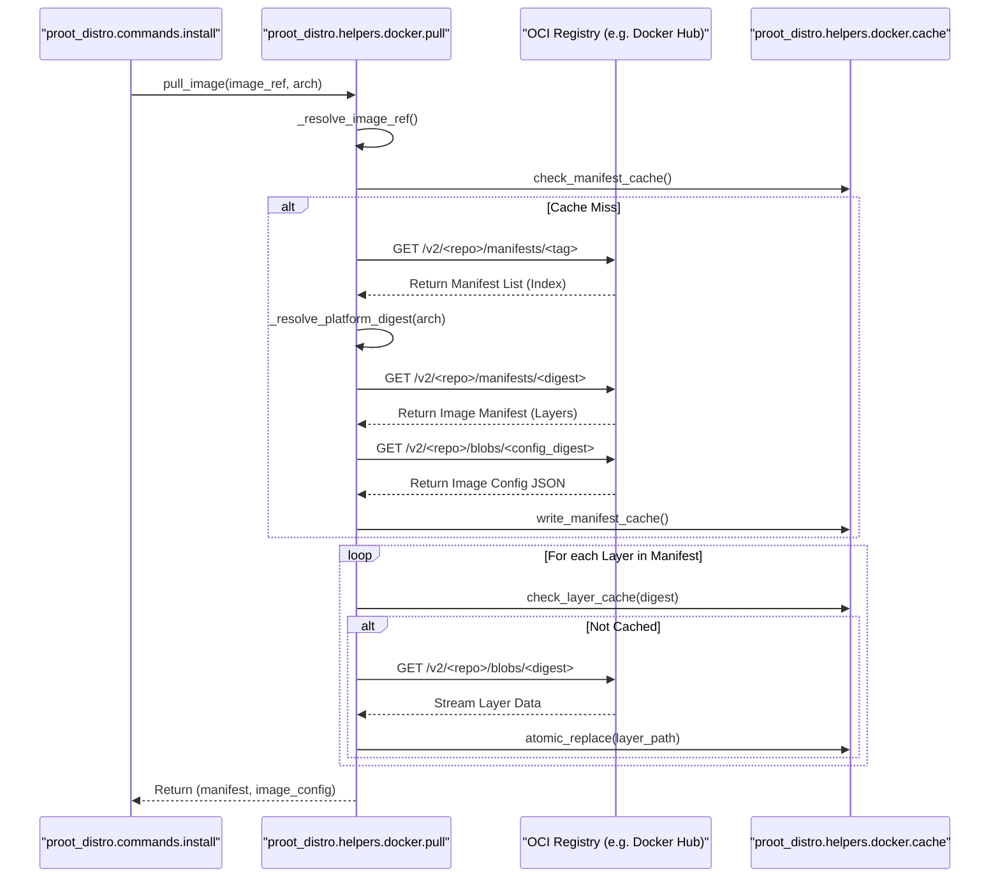
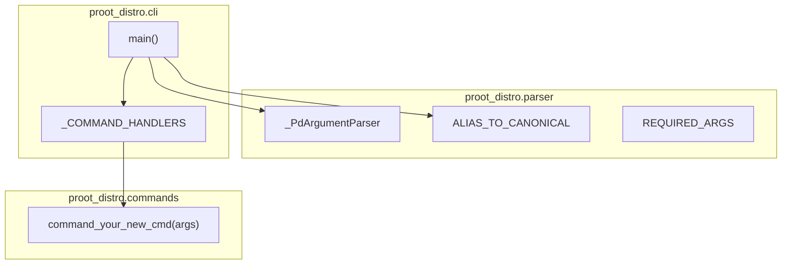

<!-- source: DeepWiki mcp.deepwiki.com · repo termux/proot-distro · page 5.1 Development Setup & Adding Containers · fetched 2026-10-26 -->

# Development Setup & Adding Containers

<details>
<summary>Relevant source files</summary>

The following files were used as context for generating this wiki page:

- [CLAUDE.md](CLAUDE.md)
- [README.md](README.md)
- [proot-distro.py](proot-distro.py)
- [proot_distro/commands/help/__init__.py](proot_distro/commands/help/__init__.py)
- [proot_distro/commands/help/pages.py](proot_distro/commands/help/pages.py)
- [pyproject.toml](pyproject.toml)
- [screenshot.png](screenshot.png)

</details>


This page provides technical guidance for setting up a development environment for `proot-distro` v5.1 and adding support for new container images or commands. The v5.1 release maintains the pure-Python architecture introduced in v5.0, focusing on a zero-dependency policy and OCI-native workflows.

## Development Environment Setup

`proot-distro` is designed as a zero-dependency Python package [CLAUDE.md:12-13](). The primary entry point for development is the `proot-distro.py` shim in the repository root, which allows running the tool directly from the source tree [CLAUDE.md:16-17]().

### Editable Installation

For developers who want to test changes globally while keeping the source code editable, an "editable" pip installation is recommended. This links the installed package to the local source directory [README.md:110-111]().

```bash
# Clone the repository
git clone https://github.com/termux/proot-distro
cd proot-distro

# Install in editable mode
pip install -e .
```

### Direct Execution

Alternatively, the tool can be run directly without installation. The `proot-distro.py` script serves as a thin wrapper that imports and calls the main entry point [proot-distro.py:21-23]().

```bash
./proot-distro.py --help
./proot-distro.py list
```

### Pure-Python Policy

The project strictly follows a **no third-party Python dependencies** policy [CLAUDE.md:20-21](). All logic is contained within the `proot_distro/` package using standard library modules like `urllib`, `tarfile`, and `ctypes` [CLAUDE.md:22-26]().

Sources: [CLAUDE.md:1-28](), [README.md:107-111](), [proot-distro.py:1-24]()

## Adding Support for New Containers

In v5.1, `proot-distro` pulls standard OCI/Docker images from registries. Support for a new container is achieved by ensuring its image is compatible with the OCI pull flow.

### OCI Pull Flow and Manifest Schema

When a user runs `proot-distro install <image>`, the `pull_image()` function initiates a multi-step process to fetch and verify image data.

#### Data Flow: OCI Image Pull
The following diagram illustrates the interaction between the registry client and the local storage during an installation.


Sources: [CLAUDE.md:59-63](), [README.md:184-204](), [CLAUDE.md:88-93]()

### Container Storage Layout

Once an image is pulled, it is extracted into a specific directory structure under `CONTAINERS_DIR`. The presence of a `manifest.json` file distinguishes OCI-based containers from plain tarball installs [CLAUDE.md:88-93]().

| Path | Purpose |
|---|---|
| `containers/<name>/rootfs/` | The extracted filesystem layers [CLAUDE.md:92-92]() |
| `containers/<name>/manifest.json` | Stores `image_ref`, `arch`, OCI `manifest`, and `image_config` [CLAUDE.md:91-91]() |

The `manifest.json` is critical for the `reset` command, as it allows the tool to re-pull the exact same image layers [README.md:33-33]().

Sources: [CLAUDE.md:65-75](), [CLAUDE.md:88-93]()

## Adding New Commands

To add a new command to the CLI, you must register it in the dispatcher and provide the necessary metadata.

### CLI Dispatcher Registry

The CLI logic is centralized in `proot_distro/cli.py` and `proot_distro/parser.py`.



1.  **Define the Handler**: Create a function in `proot_distro/commands/` (e.g., `command_my_cmd(args)`).
2.  **Register Handler**: Add the function to the `_COMMAND_HANDLERS` map in `proot_distro/cli.py`.
3.  **Define Aliases**: Add any short aliases to `ALIAS_TO_CANONICAL` in `proot_distro/parser.py`.
4.  **Argument Validation**: If the command requires specific positional arguments, add the count to `REQUIRED_ARGS` in `proot_distro/parser.py`.
5.  **Help Page**: Add a help entry to `HELP_PAGES` in `proot_distro/commands/help/pages.py` [proot_distro/commands/help/pages.py:31-31]().

Sources: [CLAUDE.md:45-52](), [proot_distro/commands/help/__init__.py:41-49](), [proot_distro/commands/help/pages.py:21-24]()

## Testing and Verification

1.  **Registry Compatibility**: Ensure the image is available on a public OCI registry [README.md:195-199]().
2.  **Custom Name**: Test installation with `--name` to ensure naming validation works [README.md:180-180]().
3.  **Architecture Override**: Use `-a` to test cross-architecture pulls [README.md:181-181]().
4.  **Login Verification**: Verify that the container can be entered and that the `image_config` (Env, Entrypoint) is respected [README.md:28-29]().

Sources: [README.md:159-183](), [CLAUDE.md:100-108]()

---

