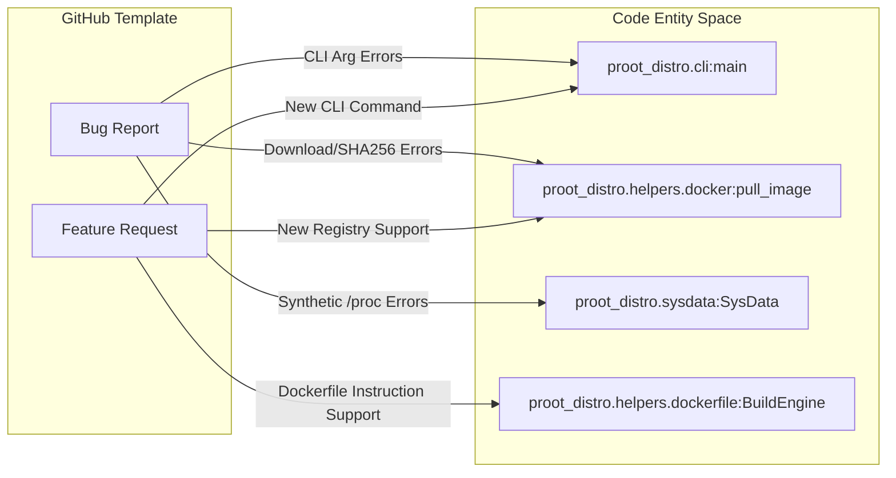

<!-- source: DeepWiki mcp.deepwiki.com · repo termux/proot-distro · page 5.2 Reporting Issues · fetched 2026-10-26 -->

# Reporting Issues

<details>
<summary>Relevant source files</summary>

The following files were used as context for generating this wiki page:

- [.github/ISSUE_TEMPLATE/01-bug-report.yml](.github/ISSUE_TEMPLATE/01-bug-report.yml)
- [.github/ISSUE_TEMPLATE/02-feature-request.yml](.github/ISSUE_TEMPLATE/02-feature-request.yml)
- [.github/ISSUE_TEMPLATE/03-question.yml](.github/ISSUE_TEMPLATE/03-question.yml)
- [.github/ISSUE_TEMPLATE/config.yml](.github/ISSUE_TEMPLATE/config.yml)
- [.github/dependabot.yml](.github/dependabot.yml)
- [SECURITY.md](SECURITY.md)

</details>


## Purpose and Scope

This document provides technical guidelines for reporting issues in the `proot-distro` project. Since the v5.1 transition to a Python-based architecture, the project enforces strict scope boundaries between the `proot-distro` utility and the Linux distributions it manages. These guidelines ensure that maintainers receive actionable data and that out-of-scope issues (such as distribution-specific bugs) are redirected appropriately.

Sources: [.github/ISSUE_TEMPLATE/01-bug-report.yml:1-14](), [.github/ISSUE_TEMPLATE/02-feature-request.yml:1-11]()

## Issue Categories and Labels

The project uses GitHub Issue Forms to standardize data collection. Blank issues are disabled to prevent unstructured reports [.github/ISSUE_TEMPLATE/config.yml:1-1]().

| Issue Type | GitHub Label | Template File | Purpose |
| :--- | :--- | :--- | :--- |
| **Bug Report** | `bug report` | `01-bug-report.yml` | Malfunctions in the Python utility (e.g., failed OCI pulls, extraction errors). |
| **Feature Request** | `enhancement` | `02-feature-request.yml` | Proposals for new functionality or CLI improvements. |
| **General Question** | `question` | `03-question.yml` | General inquiries about usage or behavior. |

Sources: [.github/ISSUE_TEMPLATE/01-bug-report.yml:4](), [.github/ISSUE_TEMPLATE/02-feature-request.yml:4](), [.github/ISSUE_TEMPLATE/03-question.yml:4]()

## Bug Reports

### Scope Enforcement
A critical distinction is made between the `proot-distro` manager and the guest environment. **DISTRIBUTION BUG REPORTS WILL BE DISMISSED** [.github/ISSUE_TEMPLATE/01-bug-report.yml:14-14](). If a package fails to install via `apt` or a service fails to start due to missing kernel features, these are generally not `proot-distro` bugs.

The following diagram maps common issues to their respective code entities or external projects to help determine where to report:

```mermaid
graph TD
    "User_Problem"["User Problem"] --> A{"Where is the failure?"}
    
    A -- "Extraction/Download/CLI Error" --> B["proot-distro (Python)"]
    A -- "Permission Denied/Syscall error" --> C["PRoot (C binary)"]
    A -- "apt/pacman/software crash" --> D["Distribution (Guest)"]
    A -- "Kernel/Android restriction" --> E["Android/Termux"]

    subgraph "proot-distro_Entities" ["proot-distro Entities"]
        B --> B1["proot_distro.helpers.docker (Pulling)"]
        B --> B2["proot_distro.cli (Arguments)"]
        B --> B3["proot_distro.sysdata (Synthetic FS)"]
    end

    subgraph "External_Projects" ["External Projects"]
        C --> C1["termux/proot"]
        D --> D1["Debian/Arch/Fedora"]
        E --> E1["termux/termux-app"]
    end
```
Sources: [.github/ISSUE_TEMPLATE/01-bug-report.yml:9-14]()

### Required Fields
To avoid immediate closure without resolution [.github/ISSUE_TEMPLATE/01-bug-report.yml:11-11](), bug reports must include:
1.  **Problem Description**: A clear and concise description of the malfunction. Logs, screenshots, and video recordings are encouraged [.github/ISSUE_TEMPLATE/01-bug-report.yml:17-19]().
2.  **Reproduction Steps**: Sequential commands to trigger the bug [.github/ISSUE_TEMPLATE/01-bug-report.yml:24-26]().
3.  **Expected Behavior**: What the utility should have done [.github/ISSUE_TEMPLATE/01-bug-report.yml:29-30]().

## Feature Requests

Feature requests are evaluated based on complexity and alignment with the project's architecture. Implementation is not guaranteed [.github/ISSUE_TEMPLATE/02-feature-request.yml:11-11]().

### Evaluation Criteria
*   **Complexity**: Does the feature require significant changes to the OCI logic or the build engine?
*   **Fit**: Does it belong in a lightweight manager, or should it be handled by the user inside the guest?
*   **Architecture**: Does it break the zero-dependency Python policy?

Sources: [.github/ISSUE_TEMPLATE/02-feature-request.yml:11-16]()

## General Questions

For inquiries that do not qualify as bugs or features, the `question` template is used [.github/ISSUE_TEMPLATE/03-question.yml:1-4](). This helps maintainers distinguish between actionable code issues and user support requests.

Sources: [.github/ISSUE_TEMPLATE/03-question.yml:1-11]()

## Reporting Security Vulnerabilities

Security-sensitive issues (e.g., sandbox escapes or vulnerabilities in the OCI manifest handling) should follow the standard Termux security policy. Do not use public GitHub issues for vulnerabilities.

Sources: [SECURITY.md:1-1]()

## Data Flow: Issue to Code Entity

When a report is filed, it typically targets one of the following subsystems in the v5.1 architecture:



Sources: [.github/ISSUE_TEMPLATE/01-bug-report.yml:1-30](), [.github/ISSUE_TEMPLATE/02-feature-request.yml:1-19]()

---

