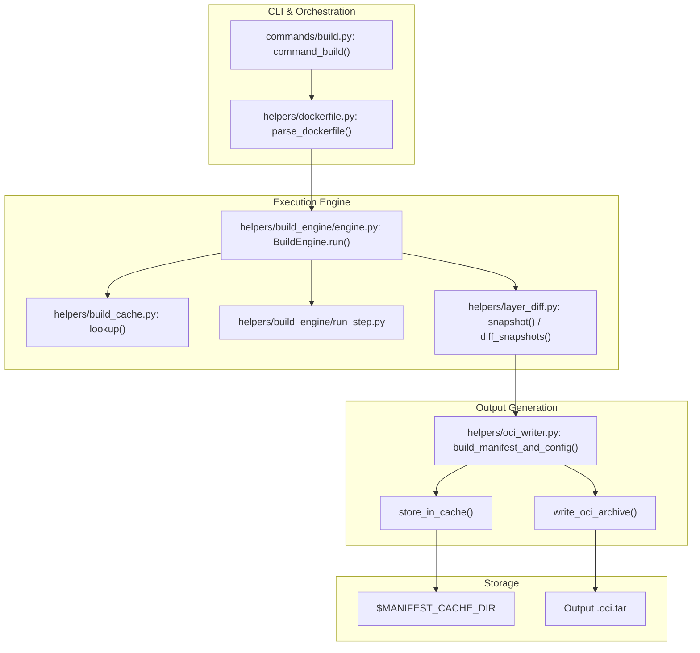
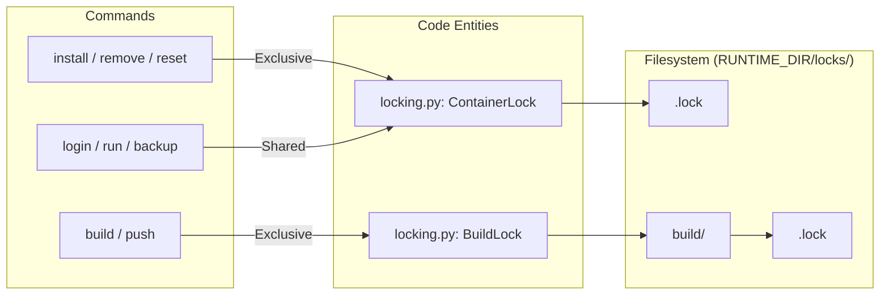

<!-- source: DeepWiki mcp.deepwiki.com · repo termux/proot-distro · page 6 Glossary · fetched 2026-10-26 -->

# Glossary

Relevant source files

The following files were used as context for generating this wiki page:

- [CLAUDE.md](CLAUDE.md)
- [README.md](README.md)
- [proot_distro/atomic.py](proot_distro/atomic.py)
- [proot_distro/commands/build.py](proot_distro/commands/build.py)
- [proot_distro/constants.py](proot_distro/constants.py)
- [proot_distro/helpers/build_cache.py](proot_distro/helpers/build_cache.py)
- [proot_distro/helpers/build_engine/engine.py](proot_distro/helpers/build_engine/engine.py)
- [proot_distro/helpers/dockerfile.py](proot_distro/helpers/dockerfile.py)
- [proot_distro/helpers/layer_diff.py](proot_distro/helpers/layer_diff.py)
- [proot_distro/helpers/oci_writer.py](proot_distro/helpers/oci_writer.py)
- [proot_distro/l2s.py](proot_distro/l2s.py)
- [proot_distro/locking.py](proot_distro/locking.py)
- [proot_distro/names.py](proot_distro/names.py)
- [proot_distro/paths.py](proot_distro/paths.py)

This page defines codebase-specific terms, jargon, abbreviations, and domain concepts used within `proot-distro` v5.1. It is intended to help onboarding engineers navigate the internal logic, the container runtime, and the new build/push pipeline.

## Core Concepts

### PRoot
A user-space implementation of `chroot`, `mount --bind`, and `binfmt_misc`. It uses `ptrace` to intercept and manipulate system calls, allowing for unprivileged container-like environments on Android/Termux.
*   **Code Pointers:**
    *   `proot-distro` checks for the binary in `cli.py` before execution [proot_distro/cli.py:138-140]().
    *   The execution pipeline is constructed in `command_login` [proot_distro/commands/login/proot_cmd.py:42-160]().

### Distribution Type (`normal` vs `termux`)
`proot-distro` distinguishes between standard Linux distributions and nested Termux environments.
*   **`normal`**: Standard Linux rootfs (e.g., Ubuntu, Alpine).
*   **`termux`**: A rootfs containing a Termux installation. Detected by the presence of `usr/bin/login` relative to the Termux prefix inside the rootfs [CLAUDE.md:100-108]().
*   **Behavioral Differences:** `termux` containers skip `link2symlink`, use specific environment variables, and do not support cross-architecture emulation [CLAUDE.md:103-107]().

### Link2Symlink (L2S)
A PRoot feature that emulates hard links and specific file attributes by using symbolic links and a separate database. This is required because Android's `/data` partition is typically formatted as `ext4` or `f2fs` but mounted with options that restrict standard Linux link behavior.
*   **Code Pointers:**
    *   Helpers for resolving and rewriting targets: `proot_distro/l2s.py` [proot_distro/l2s.py:21-129]().
    *   Rewriting targets during migration: `rewrite_l2s_targets` [proot_distro/l2s.py:90-129]().

## Build & Push Terminology (v5.1)

### Build Engine
The stateful interpreter that walks parsed Dockerfile instructions and produces an OCI image. It manages multi-stage builds and global/local ARG scopes.
*   **Key Class:** `BuildEngine` [proot_distro/helpers/build_engine/engine.py:54-180]().
*   **State Management:** Tracks stages in `self.stages` and the current active stage in `self.current` [proot_distro/helpers/build_engine/engine.py:90-92]().

### Build Cache
A tiny on-disk index keyed by a "recipe hash" (parent layer + instruction + inputs). It allows skipping instructions if a matching layer already exists in the local cache.
*   **Index Path:** `BASE_CACHE_DIR/build_cache_index.json` [proot_distro/helpers/build_cache.py:40]().
*   **Recipe Hashing:** `compute_recipe_hash` [proot_distro/helpers/build_cache.py:141-167]().

### Snapshot & Layer Diff
The mechanism used to generate OCI layers during a build. It captures the filesystem state before and after a `RUN` instruction and emits a gzipped tarball of the delta.
*   **Fingerprinting:** Uses (size, mtime_ns, mode, crc32) to detect changes [proot_distro/helpers/layer_diff.py:21-26]().
*   **Whiteouts:** Translates deletions into OCI-compliant `.wh.` files [proot_distro/helpers/layer_diff.py:161-176]().

### Manifest Cache
A local storage for OCI manifests and image configs, allowing `install` to work offline for images previously pulled or built.
*   **Path:** `MANIFEST_CACHE_DIR` [proot_distro/constants.py:96]().
*   **Writer:** `store_in_cache` [proot_distro/helpers/oci_writer.py:113-132]().

## System Architecture Diagrams

### Build Pipeline Flow
This diagram maps the high-level `build` command to the internal engine and OCI writer entities.

**Title: Build Command to OCI Output**

**Sources:** [proot_distro/commands/build.py:68-135](), [proot_distro/helpers/build_engine/engine.py:102-117](), [proot_distro/helpers/oci_writer.py:21-37]()

### Locking & Concurrency
`proot-distro` uses advisory file locking to prevent data corruption during concurrent operations.

**Title: Locking Subsystem Map**

**Sources:** [proot_distro/locking.py:21-42](), [proot_distro/locking.py:76-88](), [CLAUDE.md:111-125]()

## Key Paths and Constants

| Constant | Code Pointer | Purpose |
| :--- | :--- | :--- |
| `TERMUX_PREFIX` | [proot_distro/constants.py:51-53]() | The base Termux installation path (Android only). |
| `RUNTIME_DIR` | [proot_distro/constants.py:75-86]() | Root directory for all `proot-distro` data (XDG or Termux). |
| `CONTAINERS_DIR` | [proot_distro/constants.py:89]() | Where individual container directories (`rootfs/` + `manifest.json`) are stored. |
| `LAYER_CACHE_DIR` | [proot_distro/constants.py:95]() | Where downloaded and built OCI layer blobs are stored. |
| `LEGACY_ROOTFS_DIR` | [proot_distro/constants.py:92]() | The old `installed-rootfs/` path used for migration from v4.x. |

## Architecture Components

### Pure-Python Policy
The codebase strictly avoids third-party Python dependencies and minimizes subprocess calls.
*   **ELF Detection:** Uses `struct.unpack` on bytes instead of the `file` command [CLAUDE.md:20-24]().
*   **Networking:** Uses `urllib` instead of `requests` or `curl` [CLAUDE.md:23-24]().
*   **Locking:** Uses `fcntl.flock` for POSIX-compliant advisory locks [proot_distro/locking.py:44-46]().

### Atomic Operations
To prevent leaving the system in a broken state (e.g., partial files after Ctrl-C), the codebase uses atomic replacements.
*   **Key Function:** `atomic_replace` [proot_distro/atomic.py]() (mkstemp + `os.replace`).
*   **Usage:** Used for saving the build cache index [proot_distro/helpers/build_cache.py:95]() and writing manifests [proot_distro/helpers/oci_writer.py:128]().

**Sources:** [proot_distro/constants.py:1-121](), [proot_distro/locking.py:1-115](), [proot_distro/helpers/layer_diff.py:1-181](), [CLAUDE.md:1-150]()