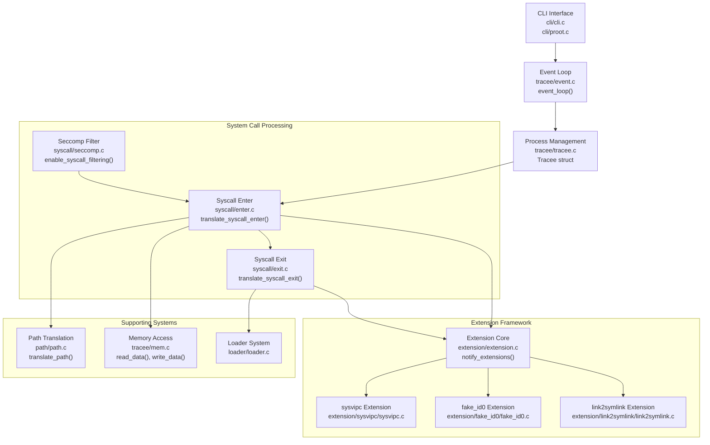
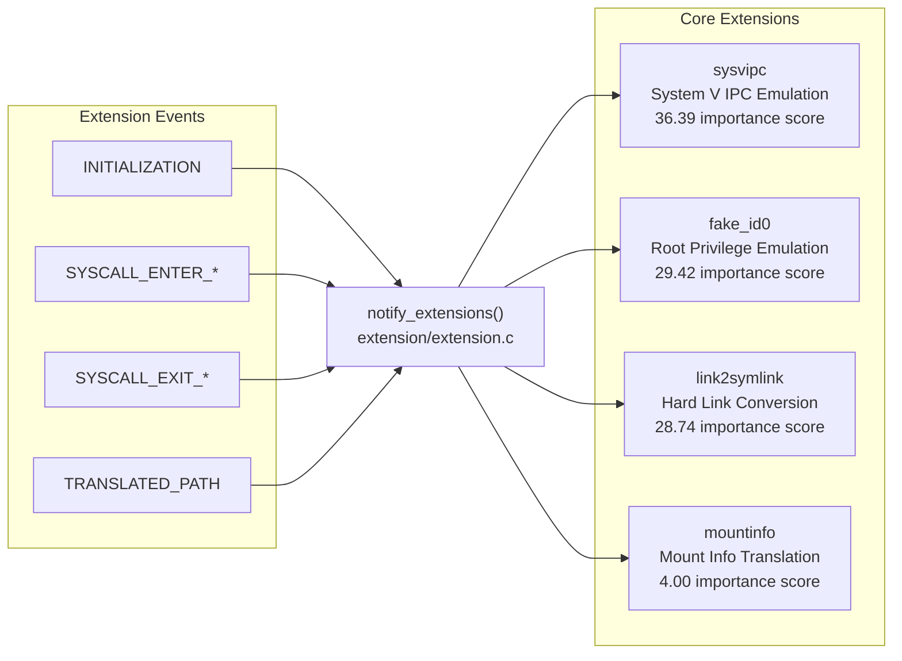
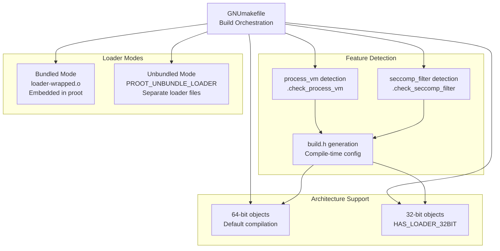

<!-- source: DeepWiki mcp.deepwiki.com · repo termux/proot · page 1 Overview · fetched 2026-10-26 -->

# Overview

<details>
<summary>Relevant source files</summary>

The following files were used as context for generating this wiki page:

- [src/GNUmakefile](src/GNUmakefile)
- [src/cli/cli.c](src/cli/cli.c)
- [src/extension/mountinfo/mountinfo.c](src/extension/mountinfo/mountinfo.c)
- [src/tracee/event.c](src/tracee/event.c)

</details>


This document provides a high-level overview of PRoot, a user-space implementation of `chroot`, `mount --bind`, and `binfmt_misc`. PRoot enables users to execute programs in a fake root environment without requiring administrator privileges, using Linux's `ptrace` system call to intercept and translate system calls from traced processes.

For detailed information about specific subsystems, see [Architecture](#2) for the overall system design, [Core Systems](#3) for fundamental components like process management and system call interception, and [Extension System](#4) for modular functionality.

## What is PRoot

PRoot is a ptrace-based process virtualization tool that creates an isolated execution environment by intercepting and translating system calls. It allows programs to run with a different view of the filesystem hierarchy, emulated root privileges, and modified system behavior without requiring kernel modifications or root access.

The core functionality includes:
- **Filesystem virtualization**: Redirecting file system paths through binding mechanisms
- **Process tracing**: Using `ptrace` to monitor and modify system call behavior  
- **Privilege emulation**: Simulating root user capabilities for compatibility
- **Binary execution**: Supporting cross-architecture execution through QEMU integration

Sources: [src/cli/cli.c:1-50](), [src/tracee/event.c:1-50]()

## System Architecture



The architecture follows a tracer-tracee model where PRoot acts as the tracer, monitoring one or more child processes (tracees). The `event_loop()` function in `tracee/event.c` serves as the central dispatcher, handling ptrace events and coordinating between system call interception, extension processing, and tracee management.

Sources: [src/tracee/event.c:260-363](), [src/cli/cli.c:448-506](), [src/GNUmakefile:21-86]()

## Core Components

### Process Launching and Tracing

```mermaid
sequenceDiagram
    participant Main as "main()<br/>cli/cli.c"
    participant Launch as "launch_process()<br/>tracee/event.c"
    participant Child as "Child Process"
    participant Loop as "event_loop()<br/>tracee/event.c"
    
    Main->>Launch: "launch_process(tracee, argv)"
    Launch->>Child: "fork() + ptrace(PTRACE_TRACEME)"
    Child->>Child: "enable_syscall_filtering()"
    Child->>Child: "execvp(tracee->exe, argv)"
    Launch->>Loop: "Start event loop"
    Loop->>Loop: "waitpid() + handle_tracee_event()"
```

The process begins with `main()` parsing command-line arguments and calling `launch_process()` to create the first traced process. The child process enables seccomp filtering for performance and executes the target program, while the parent enters the main event loop.

Sources: [src/cli/cli.c:488-495](), [src/tracee/event.c:59-115](), [src/tracee/event.c:260-363]()

### System Call Interception Flow

PRoot intercepts system calls through multiple mechanisms depending on the available kernel features:

| Method | Performance | Completeness | Code Location |
|--------|-------------|--------------|---------------|
| seccomp + ptrace | High | Complete | [syscall/seccomp.c]() |
| ptrace only | Medium | Complete | [tracee/event.c:465-541]() |

The `handle_tracee_event()` function processes different types of ptrace stops, including `SIGTRAP \| 0x80` for system calls and `SIGTRAP \| PTRACE_EVENT_SECCOMP` for seccomp-filtered calls.

Sources: [src/tracee/event.c:370-689](), [src/syscall/seccomp.c]()

## Extension System



The extension system allows modular functionality through the `notify_extensions()` mechanism. Extensions register callback functions that are invoked at specific points during system call processing, path translation, and process lifecycle events.

Sources: [src/extension/extension.c](), [src/extension/mountinfo/mountinfo.c:126-143](), [src/GNUmakefile:57-86]()

## Build System Architecture

The build system supports multiple architectures and deployment modes through feature detection and conditional compilation:



The build system automatically detects available kernel features like `process_vm_readv/writev` and seccomp filtering support, generating a `build.h` header with appropriate preprocessor definitions. It supports both bundled mode (loader embedded in the main executable) and unbundled mode (separate loader binaries).

Sources: [src/GNUmakefile:88-110](), [src/GNUmakefile:137-166](), [src/GNUmakefile:202-235]()

## Key Data Structures

| Structure | Purpose | Location | Key Fields |
|-----------|---------|----------|------------|
| `Tracee` | Process state management | [tracee/tracee.h]() | `pid`, `exe`, `fs`, `seccomp` |
| `Extension` | Extension instance | [extension/extension.h]() | `callback`, `config` |
| `Cli` | Command-line interface | [cli/cli.h]() | `options`, `handlers` |

The `Tracee` structure serves as the central data repository for each traced process, containing filesystem state, extension configurations, and execution context. Extensions maintain their state through the `Extension` structure and receive events through registered callback functions.

Sources: [src/tracee/event.c:342-344](), [src/cli/cli.c:300-444]()

---

